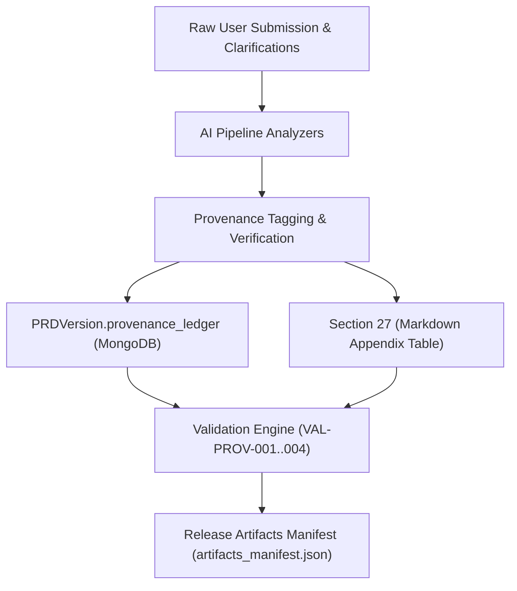

# Phase 2.4.5: Full-Document Provenance Audit and Classification Standard
## Architectural Specification and Semantic Verification Audit

**Document Status:** Authoritative Audit Specification  
**Author:** Principal Requirements Architect & Compliance Auditor  
**Timestamp:** 2026-11-06T05:15:40Z  
**Phase:** 2.4.5  
**Version:** v2.4.5  

---

## 1. Provenance Policy & Canonical Categories

Phase 2.4.5 enforces strict end-to-end traceability across every requirement, objective, business rule, and acceptance criterion. Every claim within a PRD must have an auditable origin.

The framework standardizes on **six canonical provenance categories**:

| Category | Definition | Source Evidence Requirement | Baseline Status | Confirmation Required |
| :--- | :--- | :--- | :--- | :--- |
| **`USER_CONFIRMED`** | Directly stated in user input, problem statement, or confirmed clarifications for THIS product. | Explicit quote or factual statement from user submission. | Approved Baseline | No |
| **`ASSIGNMENT_REQUIRED`** | Mandated by academic, RFP, or assignment specification instructions. | Specific citation from assignment instructions. | Approved Baseline | No |
| **`REFERENCE_SUPPORTED`** | Established based on external regulatory or industry standards. | Citation of external standard (ISO, W3C, IEEE). | Proposed / Review | Yes |
| **`INFERRED`** | Logically derived by AI from domain context or operational standards. | Documented engineering rationale. | Proposed / Review | Yes |
| **`PROPOSED`** | Advisory or architectural proposal recommended by the engineering team. | Architectural trade-off analysis. | Proposed / Review | Yes |
| **`UNRESOLVED`** | Missing, ambiguous, or contested requirement pending stakeholder decision. | Explicit open decision statement. | Unresolved | Yes |

---

## 2. Strict Numerical and Regulatory Provenance Constraints

To prevent requirement fabrication and false compliance claims:

1. **Numerical Invariants:**
   - A numerical threshold (e.g., `80.0% confidence threshold`, `75.0% attendance cutoff`, `20.0% battery charge limit`) is classified as `USER_CONFIRMED` **if and only if** the exact percentage or number was provided in the user submission or confirmed clarification.
   - Any ungrounded metric (e.g., 95% satisfaction, 10-minute hold time, 2-minute latency) must be classified as `INFERRED` or `PROPOSED`.
2. **Data Retention Limits:**
   - Active session memory TTL (e.g. 24 hours) is distinct from permanent conversation retention.
   - Mandatory 30-day, 90-day, or 1-year archival mandates are prohibited unless explicitly backed by user constraints. Missing retention durations must be marked as `[Unresolved: Pending stakeholder specification]`.
3. **Regulatory Frameworks:**
   - Mention of GDPR, HIPAA, FERPA, or PCI-DSS must NOT be asserted as confirmed commitments unless explicitly required by user inputs.
   - Unverified regulatory targets are tagged as `UNRESOLVED` or `PROPOSED` pending formal compliance review.

---

## 3. Provenance Ledger Architecture

The provenance ledger is persisted and presented across three layers:



### 3.1. Database Schema (`PRDVersion.provenance_ledger`)
Each entry records:
- `statement_id`: Stable identifier (e.g. `PL-001`, `PL-002`).
- `section_key`: Canonical section (e.g. `functional_requirements`, `business_rules`).
- `statement_text`: Exact statement or claim summary.
- `provenance`: Canonical classification enum.
- `source_reference`: Traceable citation to user input or standard.
- `related_requirement_id`: Mapped FR, NFR, or BR ID.
- `is_approved_baseline`: Boolean indicating whether the item forms part of the confirmed scope.

### 3.2. Markdown Document Rendering
Section 27 (Appendix and Glossary) renders the full ledger table:
```markdown
### Full Document Provenance Ledger

| Statement ID | Section | Statement / Claim Summary | Provenance Classification | Source Reference | Related ID | Baseline Status |
|---|---|---|---|---|---|---|
| **PL-001** | product_vision_and_objectives | Deliver automated KB answers | `USER_CONFIRMED` | User Submission: Customer Support Requirement | FR-001 | Approved Baseline |
| **PL-002** | business_rules | Escalation threshold below 80% | `USER_CONFIRMED` | User Input: 80% confidence threshold | BR-002 | Approved Baseline |
| **PL-003** | data_retention | Compliance archival duration | `UNRESOLVED` | Unresolved Decision | NFR-004 | Unresolved / Proposed |
```

---

## 4. Automated Quality Gate Rules

The validation service enforces the following rules:

- **`VAL-PROV-001`**: Strict validation that all provenance strings match the 6 canonical categories. Rejects obsolete or ungrounded values.
- **`VAL-PROV-002`**: Rejects requirements or business rules missing provenance attribution.
- **`VAL-PROV-003`**: Flags assertion of unconfirmed numeric metrics or regulatory claims under `USER_CONFIRMED`.
- **`VAL-PROV-004`**: Verifies 100% cross-consistency between the database `provenance_ledger` and Section 27 markdown table.
