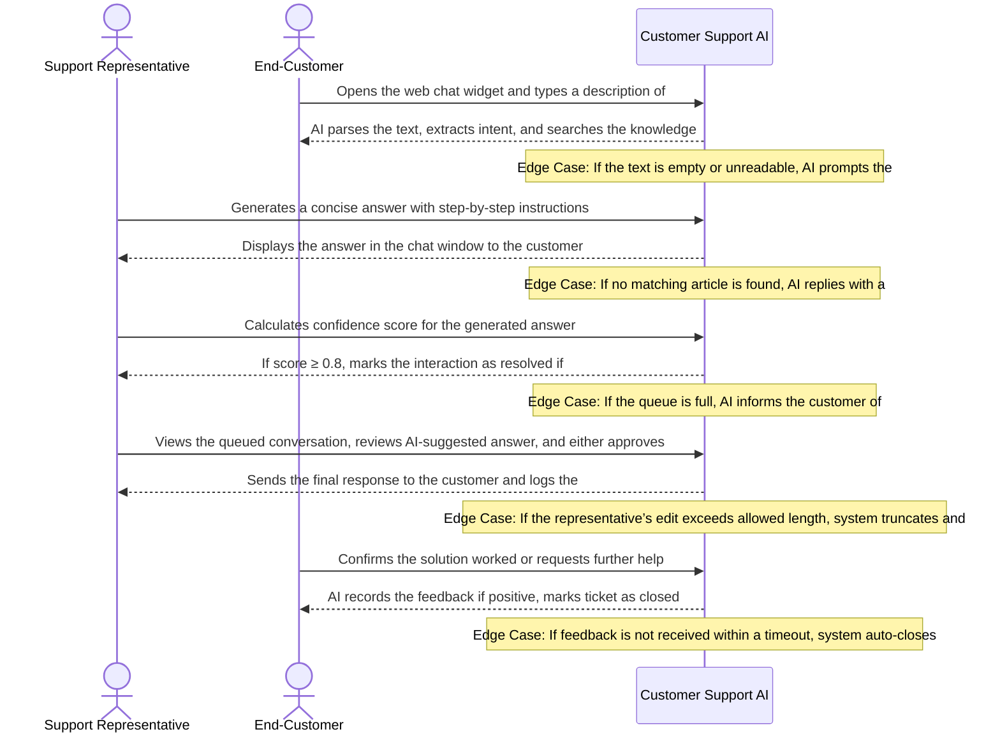

# Product Requirements Document: AI Customer Support Assistant
**Version:** v2.4.3 | **Status:** DRAFT | **Date:** 2026-11-06 | **Job ID:** dbc0f7b3-495d-4a7d-8794-e42a8df2d2d8 | **SHA-256:** `44b8c26213b42a292b3a8dd4babd95d3ed1b3faec16e4b58c425e40407df44e0`
**Generated by:** 6aed4723932083e0338de88e | **Changelog:** Full PRD generation v2.4.3

---

## 1. Document Information

**Document Title:** Product Requirements Document for AI Customer Support Assistant

**Document ID:** PRD-6AED4724

**Version:** v2.4.3

**Target Domain:** Customer Support / Contact Center

**Product Category:** Customer Support AI

**Job ID:** dbc0f7b3-495d-4a7d-8794-e42a8df2d2d8

**Content Hash (SHA-256):** `44b8c26213b42a292b3a8dd4babd95d3ed1b3faec16e4b58c425e40407df44e0`

**Status:** Under Active Review

## 2. Executive Summary

The AI Customer Support Assistant is an intelligent web‑chat agent designed for contact‑center environments where support representatives are overwhelmed by repetitive inquiries. By leveraging a curated, approved knowledge‑base, the assistant delivers consistent, accurate answers, maintains per‑user conversation context, and automatically escalates queries that fall below an 80% confidence threshold. The solution targets front‑line support teams and their customers, aiming to lower manual workload, shorten response times, and improve answer quality while preserving a seamless handoff to human agents when needed.

## 3. Product Overview

### Vision
To deliver an authoritative, high-integrity system solving core operational challenges in Customer Support / Contact Center.

### Key Capabilities
- Answer questions using approved knowledge‑base articles
- Maintain conversation history per user
- Compute confidence score and flag answers below 80%
- Automatically route complex queries to human agents with a summarized context

## 4. Problem Statement

Support teams face a chronic overload of low‑complexity, repeatable questions that consume valuable agent time and lead to long customer wait times. The root causes include: (1) fragmented knowledge access, forcing agents to search multiple sources; (2) lack of real‑time confidence assessment, resulting in agents providing uncertain answers; (3) manual routing of complex issues, which adds latency and often loses context. Existing tools—static FAQs, rule‑based bots, or generic AI chat services—either cannot guarantee use of approved content, lack confidence‑driven escalation, or fail to preserve conversation history, leaving agents to intervene frequently and inconsistently. Consequently, customers experience variable answer quality and prolonged resolution cycles.

## 5. Product Vision and Objectives

### Core Objectives
1. Reduce repetitive support workload
2. Provide consistent, accurate answers
3. Escalate low‑confidence queries to humans
4. Automated handling of low‑complexity queries with >80% confidence
5. Reduced wait times and agent workload
6. Consistent, knowledge‑base‑driven responses
7. Smart escalation with summarized context for human agents

## 6. Target Users and Stakeholders

**Primary Stakeholders and User Roles:**
- **Support Representatives:** Primary actor interacting with AI Customer Support Assistant capabilities.
- **End‑Customers:** Primary actor interacting with AI Customer Support Assistant capabilities.

## 7. User Personas

#### Persona 1: Support Representative
- **Responsibilities:** Handle inbound support requests, use AI suggestions to craft replies, close issues efficiently
- **Primary Goals:**
  - Resolve customer issues quickly
  - Maintain high satisfaction scores
- **Frustrations:**
  - Repeating same troubleshooting steps
  - Unclear AI suggestions
- **Technical Proficiency:** Intermediate

#### Persona 2: End‑Customer
- **Responsibilities:** Seek help for product issues via chat interface
- **Primary Goals:**
  - Get a solution without waiting
  - Understand next steps clearly
- **Frustrations:**
  - Long wait times
  - Generic responses
- **Technical Proficiency:** Novice

## 8. Existing Workflow and Pain Points

1. Customer initiates contact via phone or web chat. 2. Agent manually reviews the query and searches the internal knowledge‑base for a suitable article. 3. Agent copies or paraphrases the answer, often without a confidence check, leading to potential inaccuracies. 4. If the agent is unsure, they may place the customer on hold while consulting peers or supervisors, extending wait time. 5. Complex issues are transferred to a senior tier, but the handoff frequently lacks sufficient context, requiring the senior agent to repeat questions. 6. Throughout the interaction, no persistent conversation log is shared across tiers, causing duplicated effort. Pain points: high agent effort on trivial queries, inconsistent answer quality, long hold times, and loss of context during escalations.

## 9. Proposed Solution

The AI Customer Support Assistant sits in the web‑chat channel as the first point of contact. When a user submits a query, the system retrieves relevant approved knowledge‑base articles, generates a response, and computes a confidence score. If the score meets or exceeds the 80% threshold, the answer is delivered instantly, and the interaction is logged in a per‑user session store. If confidence is below 80%, the assistant automatically routes the conversation to an internal escalation queue, attaching a concise summary of the dialogue (under 200 words) and the top candidate articles. Human agents then pick up the session with full context, ensuring a smooth handoff. The architecture comprises: a web‑chat front‑end, a knowledge‑base retrieval layer, an LLM inference engine with confidence scoring, a session‑state manager, and an internal escalation service. All components operate within the organization’s security perimeter, and data handling will be subject to formal privacy and legal review.

## 10. Product Scope

- Web‑chat interface as the sole user channel for MVP
- Retrieval and presentation of answers strictly from approved knowledge‑base articles
- Real‑time confidence scoring with an 80% threshold for automatic escalation
- Automatic routing of low‑confidence queries to an internal escalation queue
- Generation of escalation handoff summaries limited to under 200 words
- Persistent per‑user conversation history during a session
- Administrative UI for knowledge‑base curators to approve and update content
- Monitoring dashboard for confidence distribution and escalation volume

## 11. Out of Scope

**Explicit Non-Goals (Out of Scope for Initial Release):**
- External third-party ticketing platforms (e.g. Zendesk, Freshdesk, Jira)
- External CRM customer relationship management data synchronization (e.g. Salesforce, HubSpot)
- Voice calls, telephony integration, and Interactive Voice Response (IVR) systems
- Outbound marketing campaigns, promotional email broadcasting, or bulk messaging
- Multilingual machine translation or localized dialect parsing
- Commercial payment processing, credit card billing, and subscription invoicing
- Customer sentiment profiling or predictive purchase analytics

## 12. Functional Requirements

| ID | Title | Description | Priority | Traceable AC |
|---|---|---|---|---|
| **FR-001** | Grounded Knowledge Retrieval and Answer Delivery | **Actor:** End‑Customer. **Trigger:** Customer submits a question via chat interface. **Preconditions:** Approved knowledge‑base articles are loaded and an active session exists. **Inputs:** Customer query text. **System Behavior:** The system the AI searches the approved KB, selects the most relevant article, generates an answer citing the source, and computes a confidence score. **Business Constraints:** Answer must be based solely on approved KB articles and may be delivered directly only if confidence ≥ 80.0%. **Alternate & Failure Paths:** If no relevant article is found or confidence < 80.0%, the system routes the query to internal escalation (FR‑003) and returns an escalation notice to the customer. **Expected Outcome:** Customer receives a knowledge‑base‑driven answer with citation when confidence ≥ 80.0%; otherwise the query is escalated. **Relevant Data Changes:** Session history entry created with query, answer, source article ID, and confidence score; escalation flag set if applicable. **Authorization Requirements:** Any authenticated end‑customer may submit queries. **Provenance:** `confirmed_user_input` (User Input: Core Objectives and Target Capabilities). | Must Have | AC-003, AC-004, AC-005, AC-006 |
| **FR-002** | Per‑Session Conversation History Management | **Actor:** AI System. **Trigger:** New message received in an active session. **Preconditions:** A session identifier exists and the session is younger than 24 hours. **Inputs:** Session ID, message payload (text, timestamp, sender). **System Behavior:** The system append the message to the session cache, maintain chronological order, and ensure the cache retains entries for a maximum of 24 hours before automatic purge. **Business Constraints:** Conversation history must not be retained beyond 24 hours. **Alternate & Failure Paths:** If the cache service is unavailable, store messages temporarily in volatile memory, log a warning, and attempt to persist once the cache recovers. **Expected Outcome:** Updated session history is available for context retrieval for the remainder of the 24‑hour window. **Relevant Data Changes:** Session cache entry updated; purge logs generated when entries expire. **Authorization Requirements:** Only the session owner or system components may modify the session cache. **Provenance:** `confirmed_user_input` (User Input: Target Capabilities – Maintain conversation history per user). | Must Have | AC-007, AC-008 |
| **FR-003** | Low‑Confidence Detection and Automatic Escalation | **Actor:** AI System. **Trigger:** Confidence score computed for a generated answer. **Preconditions:** Answer and confidence score are available. **Inputs:** Generated answer text, confidence score (percentage). **System Behavior:** The system if confidence < 80.0% the answer is not sent to the customer; instead the query, confidence score, and a concise context summary are placed into an internal escalation queue and the customer receives an escalation notice. **Business Constraints:** Answers with confidence below 80.0% must not be delivered directly to customers. **Alternate & Failure Paths:** If the escalation queue is unavailable, log the failure, send a generic apology to the customer, and flag the session for manual review. **Expected Outcome:** Low‑confidence queries are escalated with context; customer is informed of escalation. **Relevant Data Changes:** Escalation queue entry created with query, confidence, session ID, and summary; session marked as escalated. **Authorization Requirements:** System internal components only; no external actor required. **Provenance:** `confirmed_user_input` (User Input: Core Objectives – Escalate low‑confidence queries to humans). | Must Have | AC-001, AC-002 |
| **FR-004** | Concise Context Summarization for Human Handoff | **Actor:** AI System. **Trigger:** Escalation decision (low confidence or identified complexity). **Preconditions:** Session history exists and escalation entry is being created. **Inputs:** Full session transcript up to escalation point, last generated answer (if any). **System Behavior:** The system generate a summary of no more than three sentences that captures the last two customer messages, the attempted answer, and any key entities; attach the summary to the escalation entry. **Business Constraints:** Summary must be concise (≤ 3 sentences) to aid human agents. **Alternate & Failure Paths:** If summarization fails, attach the raw transcript instead and flag the entry for reviewer attention. **Expected Outcome:** Human agent receives a short, relevant summary alongside the escalated query. **Relevant Data Changes:** Summary text stored with escalation queue entry; audit log of summarization success/failure created. **Authorization Requirements:** System internal components only. **Provenance:** `confirmed_user_input` (User Input: Smart escalation with summarized context for human agents). | Must Have | AC-009, AC-010 |

### Detailed Functional Requirement Specifications

#### FR-001: Grounded Knowledge Retrieval and Answer Delivery
- **Actor:** End‑Customer
- **Trigger:** Customer submits a question via chat interface
- **Preconditions:** Approved knowledge‑base articles are loaded and an active session exists
- **Inputs:** Customer query text
- **System Behavior:** the AI searches the approved KB, selects the most relevant article, generates an answer citing the source, and computes a confidence score
- **Business Constraints:** Answer must be based solely on approved KB articles and may be delivered directly only if confidence ≥ 80.0%
- **Alternate & Failure Paths:** If no relevant article is found or confidence < 80.0%, the system routes the query to internal escalation (FR‑003) and returns an escalation notice to the customer
- **Expected Outcome:** Customer receives a knowledge‑base‑driven answer with citation when confidence ≥ 80.0%; otherwise the query is escalated
- **Relevant Data Changes:** Session history entry created with query, answer, source article ID, and confidence score; escalation flag set if applicable
- **Authorization Requirements:** Any authenticated end‑customer may submit queries
- **Priority:** Must Have
- **Linked Acceptance Criteria:** AC-003, AC-004, AC-005, AC-006
- **Provenance:** `confirmed_user_input` (User Input: Core Objectives and Target Capabilities)

#### FR-002: Per‑Session Conversation History Management
- **Actor:** AI System
- **Trigger:** New message received in an active session
- **Preconditions:** A session identifier exists and the session is younger than 24 hours
- **Inputs:** Session ID, message payload (text, timestamp, sender)
- **System Behavior:** append the message to the session cache, maintain chronological order, and ensure the cache retains entries for a maximum of 24 hours before automatic purge
- **Business Constraints:** Conversation history must not be retained beyond 24 hours
- **Alternate & Failure Paths:** If the cache service is unavailable, store messages temporarily in volatile memory, log a warning, and attempt to persist once the cache recovers
- **Expected Outcome:** Updated session history is available for context retrieval for the remainder of the 24‑hour window
- **Relevant Data Changes:** Session cache entry updated; purge logs generated when entries expire
- **Authorization Requirements:** Only the session owner or system components may modify the session cache
- **Priority:** Must Have
- **Linked Acceptance Criteria:** AC-007, AC-008
- **Provenance:** `confirmed_user_input` (User Input: Target Capabilities – Maintain conversation history per user)

#### FR-003: Low‑Confidence Detection and Automatic Escalation
- **Actor:** AI System
- **Trigger:** Confidence score computed for a generated answer
- **Preconditions:** Answer and confidence score are available
- **Inputs:** Generated answer text, confidence score (percentage)
- **System Behavior:** if confidence < 80.0% the answer is not sent to the customer; instead the query, confidence score, and a concise context summary are placed into an internal escalation queue and the customer receives an escalation notice
- **Business Constraints:** Answers with confidence below 80.0% must not be delivered directly to customers
- **Alternate & Failure Paths:** If the escalation queue is unavailable, log the failure, send a generic apology to the customer, and flag the session for manual review
- **Expected Outcome:** Low‑confidence queries are escalated with context; customer is informed of escalation
- **Relevant Data Changes:** Escalation queue entry created with query, confidence, session ID, and summary; session marked as escalated
- **Authorization Requirements:** System internal components only; no external actor required
- **Priority:** Must Have
- **Linked Acceptance Criteria:** AC-001, AC-002
- **Provenance:** `confirmed_user_input` (User Input: Core Objectives – Escalate low‑confidence queries to humans)

#### FR-004: Concise Context Summarization for Human Handoff
- **Actor:** AI System
- **Trigger:** Escalation decision (low confidence or identified complexity)
- **Preconditions:** Session history exists and escalation entry is being created
- **Inputs:** Full session transcript up to escalation point, last generated answer (if any)
- **System Behavior:** generate a summary of no more than three sentences that captures the last two customer messages, the attempted answer, and any key entities; attach the summary to the escalation entry
- **Business Constraints:** Summary must be concise (≤ 3 sentences) to aid human agents
- **Alternate & Failure Paths:** If summarization fails, attach the raw transcript instead and flag the entry for reviewer attention
- **Expected Outcome:** Human agent receives a short, relevant summary alongside the escalated query
- **Relevant Data Changes:** Summary text stored with escalation queue entry; audit log of summarization success/failure created
- **Authorization Requirements:** System internal components only
- **Priority:** Must Have
- **Linked Acceptance Criteria:** AC-009, AC-010
- **Provenance:** `confirmed_user_input` (User Input: Smart escalation with summarized context for human agents)

## 13. Non-Functional Requirements

| ID | Title | Description | Classification | Priority |
|---|---|---|---|---|
| **NFR-001** | Answer Generation Latency | The system shall aim to generate a response within a time frame that meets user expectations, with the exact target to be decided during implementation planning | Proposed target | Must Have |
| **NFR-002** | Data Protection and Encryption | All user queries, answers, and session history shall be protected in transit and at rest using industry‑standard encryption mechanisms; the specific algorithms and key management approach are pending decision | Proposed target | Must Have |
| **NFR-003** | System Availability | The service shall strive for high availability with minimal downtime; the precise availability percentage and failover architecture are open decisions at this stage | Open decision | Must Have |

## 14. User Stories

| Story ID | As a... | I want to... | So that... | Linked FR |
|---|---|---|---|---|
| **US-001** | Customer | receive answers derived from approved support articles | I can resolve common issues quickly without waiting for a human agent | FR-001 |
| **US-002** | Customer | have my ongoing conversation history remembered across dialogue turns | I do not have to repeat context when asking follow-up questions | FR-002 |
| **US-003** | Customer | have uncertain or low-confidence questions automatically escalated to human support | I never receive inaccurate or ungrounded advice from the AI | FR-003 |
| **US-004** | Customer Service Representative | receive escalated customer conversations accompanied by a concise context summary | I can resolve complex customer problems immediately without asking them to re-enter information | FR-004 |
| **US-005** | Customer Service Representative | view confidence assessment indicators and article references for escalated inquiries | I can quickly verify the context before providing customer assistance | FR-004 |

## 15. User Journeys

### Step-by-Step User Journey Progression
**Stage 1: 1. Customer Inquiry**
- **Actor (End‑Customer):** Opens the web chat widget and types a description of the problem
- **System Response:** AI parses the text, extracts intent, and searches the knowledge base
- **Edge Case / Error Handling:** If the text is empty or unreadable, AI prompts the user to re‑enter a clearer description

**Stage 2: 2. AI Response Generation**
- **Actor (Customer Support AI):** Generates a concise answer with step‑by‑step instructions
- **System Response:** Displays the answer in the chat window to the customer
- **Edge Case / Error Handling:** If no matching article is found, AI replies with a fallback message asking for more details

**Stage 3: 3. Confidence Evaluation & Escalation**
- **Actor (Customer Support AI):** Calculates confidence score for the generated answer
- **System Response:** If score ≥ 0.8, marks the interaction as resolved; if <0.8, places the conversation in the escalation queue for a representative
- **Edge Case / Error Handling:** If the queue is full, AI informs the customer of an expected wait time

**Stage 4: 4. Representative Resolution**
- **Actor (Support Representative):** Views the queued conversation, reviews AI‑suggested answer, and either approves or edits before sending
- **System Response:** Sends the final response to the customer and logs the interaction internally
- **Edge Case / Error Handling:** If the representative’s edit exceeds allowed length, system truncates and warns the rep

**Stage 5: 5. Closure Confirmation**
- **Actor (End‑Customer):** Confirms the solution worked or requests further help
- **System Response:** AI records the feedback; if positive, marks ticket as closed; if negative, re‑opens the escalation loop
- **Edge Case / Error Handling:** If feedback is not received within a timeout, system auto‑closes after prompting once more

## 16. Business Rules

| ID | Rule Title | Operational Statement | Provenance | Source Reference | Rationale | Confirmation Required |
|---|---|---|---|---|---|---|
| **BR-001** | Use Only Approved Knowledge‑Base Content | All AI‑generated responses must be sourced exclusively from approved knowledge‑base articles; no external or unsanctioned content may be used. | `confirmed_user_input` | User Input: "The assistant must answer using approved knowledge‑base articles." | Ensures consistency, accuracy, and compliance with organizational knowledge standards. | No (Confirmed) |
| **BR-002** | Maintain Full Conversation History | The system shall retain the complete conversation history for each session and include it in the context for every subsequent AI response. | `confirmed_user_input` | User Input: "It must maintain conversation history." | Provides context for accurate answers and enables seamless handoff to human agents. | No (Confirmed) |
| **BR-003** | Confidence‑Based Escalation Threshold | If the AI's confidence score for a response is below 80%, the query must be escalated to a human support representative with a summarized context. | `confirmed_user_input` | User Input: "It must identify low‑confidence answers below 80% and escalate them to human agents with a summarized context." | Prevents inaccurate automated answers and ensures complex issues receive human expertise. | No (Confirmed) |
| **BR-004** | Automated Handling of Low‑Complexity Queries | Queries classified as low‑complexity and receiving an AI confidence score of 80% or higher shall be answered automatically without human intervention. | `confirmed_user_input` | User Input: "Automated handling of low‑complexity queries with >80% confidence." | Reduces repetitive workload on agents and improves response speed for straightforward issues. | No (Confirmed) |
| **BR-005** | Escalation Context Summarization | When escalating a low‑confidence query, the system shall generate a concise summary of the conversation history and the AI's reasoning to present to the human agent. | `confirmed_user_input` | User Input: "Escalate low‑confidence queries to humans, ... with a summarized context." | Equips human agents with essential information to resolve the issue efficiently, minimizing repeat questioning. | No (Confirmed) |

## 17. System Workflows

1. User initiates a text‑based chat session via the web UI. 2. The AI Engine receives the user message, normalizes it, and queries the approved Knowledge‑Base for the top‑N relevant articles. 3. A response is generated, a confidence score (0‑100%) is computed, and the answer together with the score is stored in the active session transcript. 4. Decision branch: • If confidence ≥ 80.0%, the answer is sent to the user and the session is marked completed. • If confidence < 80.0%, the system creates an internal Escalation Ticket, attaches a concise context summary, and routes it to the human‑agent queue. 5. Human agent retrieves the ticket, reviews the context, composes a resolution, and marks the ticket resolved; the final interaction is appended to the session transcript. 6. After session closure, analytics are derived, the transcript is retained for up to 24 hours, metrics are stored for 90 days, and audit logs are archived for 1 year.

## 18. Data Requirements

Core entities: • User {user_id, external_id, role}. • Session {session_id, user_id, start_ts, end_ts, status}. • Message {message_id, session_id, sender (user|ai|agent), content, timestamp}. • KnowledgeBaseArticle {article_id, title, content, version, approved_flag}. • Answer {answer_id, session_id, article_refs[], generated_text, confidence_pct (0‑100), timestamp}. • EscalationTicket {ticket_id, session_id, summary, assigned_agent_id, created_ts, resolved_ts, status}. • AnalyticsMetric {metric_id, name, value, collected_ts}. • AuditLog {log_id, entity_type, entity_id, action, actor_role, timestamp}. Consistency rules: • Every Message must belong to an active Session; Session status transitions only from open→closed. • Answer.confidence_pct must be stored as a numeric value between 0 and 100. • EscalationTicket can only be created when Answer.confidence_pct < 80.0. Persistence: • Relational store (e.g., PostgreSQL) for User, Session, Message, Answer, EscalationTicket, KnowledgeBaseArticle. • Time‑series or columnar store (proposed target) for AnalyticsMetric. • Immutable log store (proposed target) for AuditLog. Retention: • Active Session transcripts (Message, Answer) retained for session duration or max 24 hours. • AnalyticsMetric retained for 90 days. • AuditLog retained for 1 year.

## 19. Integration Requirements

- **Core Interface:** Standard REST and WebSocket APIs for web chat communication and knowledge-base search.
- **Third-Party SaaS Connectors:** No external CRM (Salesforce/HubSpot) or external ticketing platforms (Zendesk/Jira) are required for MVP; the system operates self-contained.

## 20. Security and Privacy Requirements

Role‑Based Access Control (RBAC): • EndUser – can create Sessions and view own transcript within retention window. • AIEngine – service account with read‑only access to approved KnowledgeBaseArticle and write access to Message, Answer, and temporary Session data. • Agent – can read assigned EscalationTicket, view full transcript, and write resolution messages. • Admin – full read/write on configuration, RBAC policies, and audit logs. Encryption: • TLS 1.2+ for all in‑transit API calls. • AES‑256 at rest for all persisted data stores. Audit Logging: • Every read/write of KnowledgeBaseArticle, creation of EscalationTicket, and role‑elevated action is recorded in immutable AuditLog with actor_role and timestamp. Privacy Controls: • No personally identifiable information (PII) is stored in KnowledgeBaseArticle. • Transcripts are automatically purged after 24 hours; analytics are aggregated and do not retain raw user text beyond 90 days. • Retention periods are enforced by scheduled cleanup jobs. No certifications are claimed; compliance with institutional policies is subject to legal review.

## 21. Acceptance Criteria

| AC ID | Associated Requirement | Acceptance Criteria (Given-When-Then / Rule) |
|---|---|---|
| **AC-001** | FR-003 | Given a customer query that results in a confidence score of 79.9%, When the AI processes the answer, Then the system must not deliver the answer to the customer and must create an escalation queue entry containing the query, confidence score, and a concise context summary |
| **AC-002** | FR-003 | Given a customer query that results in a confidence score of 80.0%, When the AI processes the answer, Then the system must deliver the answer to the customer and must not create any escalation entry |
| **AC-003** | FR-001 | Given an AI-generated answer candidate with evaluated confidence of 80.1%, When evaluated against the threshold, Then automatic response is permitted with verified article citations. |
| **AC-004** | FR-001 | Given an AI-generated answer candidate where no approved knowledge-base article exists, When evaluated, Then automatic response is suppressed regardless of score and the query is routed to escalation. |
| **AC-005** | FR-001 | Given the confidence evaluation service encounters an internal calculation failure or timeout, When the exception occurs, Then the system safely halts automated response, logs the failure diagnostic, and routes to human escalation. |
| **AC-006** | FR-001 | Given a customer submits a multi-part query flagged as complex, When analyzed, Then the system routes the query to human escalation with context summary per confirmed policy. |
| **AC-007** | FR-002 | Given an ongoing customer conversation within an active 24-hour session, When the customer submits a follow-up query referencing prior turns, Then the system incorporates preceding dialogue context to resolve the query accurately. |
| **AC-008** | FR-002 | Given an inactive chat session exceeding the 24-hour active window, When a customer sends a new message, Then the system initializes a fresh session ID and treats prior transcript retention as an unresolved open architectural decision. |
| **AC-009** | FR-004 | Given an escalation triggered for a multi-turn conversation, When the summarization module executes, Then it generates a concise summary not exceeding 200 words capturing the query and attempted resolutions. |
| **AC-010** | FR-004 | Given an escalation for a single-turn query with no prior exchanges, When summarization is invoked, Then the system passes the original query and context metadata without hallucinating past dialogue turns. |

## 22. Dependencies and Constraints

• Hosting environment must support container orchestration (Docker/Kubernetes – proposed target). • Runtime language stack (e.g., Python 3.11) is a proposed target; any language meeting the AI model serving requirements is acceptable. • Failover strategy is an open architectural decision; initial deployment will use single‑zone instances with health‑check‑driven restart. • All data must reside within the organization’s approved data‑center region to satisfy data‑residency constraints. • Voice, telephony, SMS, and video channels are explicitly out of scope for this release.

## 23. Risks and Mitigation

| Risk ID | Category | Risk Description | Root Cause | Likelihood | Impact | Mitigation Strategy | Contingency Plan | Owner |
|---|---|---|---|---|---|---|---|---|
| **RSK-001** | Functional | The AI retrieves a deprecated KB article and provides a wrong solution to a customer, leading to resolution failure and potential churn. | Knowledge‑base synchronization job fails silently, leaving stale articles in the searchable index. | Medium | High | Implement automated checksum validation and version tagging for each article; reject any article that fails freshness check before indexing; schedule health‑check alerts on sync job failures. | Fail safe to manual operator review with diagnostic telemetry. | Knowledge‑Base Engineering Lead |
| **RSK-002** | Security | An attacker exploits a missing authorization check in the conversation‑history API and reads sensitive chat logs of multiple customers. | API endpoint does not validate the caller's tenant and user identifiers against the access token scopes. | Low | Critical | Enforce strict RBAC on all conversation‑history endpoints; add token‑scope verification middleware; conduct regular penetration tests targeting auth bypass. | Immediately revoke compromised tokens, rotate all active session keys, and trigger an incident response run‑book that includes notifying affected customers and regulatory bodies. | Security Engineering Manager |
| **RSK-003** | Data Privacy | Chat logs containing personal identifiers are stored for 90 days despite a 30‑day retention policy, risking GDPR/CCPA violations. | Retention scheduler reads a default configuration file that was never overridden for the production environment. | Medium | High | Externalize retention period to a centrally managed config service; add automated compliance audit that verifies deletion timestamps daily. | Run an emergency purge script to delete logs older than 30 days; document breach and report to privacy officer within 72 hours. | Data Governance Lead |
| **RSK-004** | Operational | During peak traffic, the confidence‑scoring microservice exceeds its SLA, delaying the flagging of sub‑80 % answers and preventing timely routing to human agents. | CPU‑bound model inference runs on a single instance without autoscaling; queue builds up under load. | High | Medium | Deploy the scoring service behind a horizontal autoscaler with CPU utilization thresholds; cache recent scores for identical queries. | If latency breaches 2 seconds, automatically route the query to a human agent with a generic “We’ll connect you shortly” message and log the event for post‑mortem. | Site Reliability Engineer (SRE) – AI Services |
| **RSK-005** | Integration | The KB API endpoint becomes unavailable, causing the AI to answer with non‑approved fallback text or no answer at all. | Network partition between the contact‑center service and the KB content service; no circuit‑breaker logic implemented. | Medium | High | Implement a resilient client with exponential backoff, circuit‑breaker, and a read‑through cache of the last known good version of approved articles. | Switch to cached approved articles; if cache miss occurs, automatically flag the interaction for human escalation and notify the operations on‑call. | Integration Platform Engineer |

## 24. Assumptions and Open Questions

### Documented Operational Assumptions
- [Assumed] A structured, searchable knowledge‑base already exists.
- [Assumed] The AI model can be fine‑tuned or prompted to respect the 80% confidence threshold.
- [Assumed] Conversation history will be stored temporarily per session and can be attached to escalation tickets.
- [Assumed] Human agents have a system to receive escalated queries with context.
- [Assumed] The organization is willing to integrate the assistant with existing support channels.

### Open Architectural Questions
- Target deployment environment (cloud, on‑premise, hybrid)
- Supported languages and localization requirements
- Integration points (CRM, ticketing system, chat platform)
- Performance and latency expectations
- Data privacy, security, and compliance requirements
- Scalability and concurrency targets
- Metrics for success (e.g., reduction in average handle time, CSAT improvement)
- Budget and timeline constraints

## 25. Success Metrics

1. AI‑only resolution rate ≥ 70 % of total user queries (measured over 30 days). 2. Average confidence score of AI‑delivered answers ≥ 85 % (scale 0‑100%). 3. Mean time to first response ≤ 2 seconds for AI answers. 4. Escalation rate (answers < 80 % confidence) ≤ 20 % of sessions. 5. Post‑interaction CSAT score ≥ 4.5 / 5. 6. Average handling time for escalated tickets ≤ 5 minutes. 7. Audit log completeness = 100 % (all privileged actions recorded).

## 26. Release Considerations

Phase 1 – Internal Alpha: limited employee user group, focus on end‑to‑end flow validation, confidence threshold tuning, and audit‑log verification. Phase 2 – Closed Beta: expand to selected external customers, introduce RBAC policies, and begin analytics retention enforcement. Phase 3 – General Availability: full production rollout, enable optional prospective integrations, and hand off operational monitoring to Site Reliability Engineering. Data migration: legacy chat logs (if any) will be ingested into the Session store with a one‑time ETL, respecting the 24‑hour transcript retention rule (older data moved to analytics store). Operational handoff includes runbooks for escalation queue monitoring, backup/restore procedures, and periodic security review cycles.

## 27. Appendix and Glossary

AI Engine – the inference service that consumes user messages, retrieves KnowledgeBaseArticle content, and generates answers with a confidence_pct. KnowledgeBaseArticle – approved, version‑controlled documentation that the AI may cite; only articles flagged approved_flag = true are searchable. Confidence_pct – numeric score from 0 to 100 representing the model’s estimated correctness; threshold for auto‑escalation is 80.0 %. Escalation Ticket – internal queue entry created when confidence_pct < 80.0, containing a concise context summary for human agents. Session – logical container for a user’s interaction from start to end; transcripts are retained ≤ 24 hours. Transcript – ordered collection of Message and Answer records belonging to a Session. AnalyticsMetric – aggregated, non‑PII data derived from Sessions (e.g., average confidence, response time). AuditLog – immutable record of privileged actions, retained 1 year. RBAC – Role‑Based Access Control model defining permissions for EndUser, AIEngine, Agent, and Admin roles.
