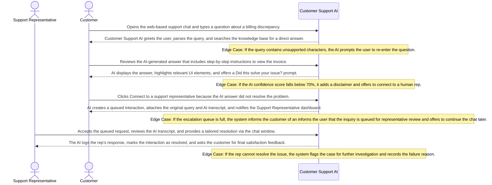

# Product Requirements Document: AI Customer Support Assistant
**Version:** v2.4.4 | **Status:** DRAFT | **Date:** 2026-11-06 | **Job ID:** d8b26147-f5ce-434c-a30c-6ebdef8651ae | **SHA-256:** `6942cbeee1dd38d9cefabf96125a33eb85465812780ac2228f71498233e39830`
**Generated by:** 6aed54a7fd0f6c0eb4d90243 | **Changelog:** Full PRD generation v2.4.4

---

## 1. Document Information

**Document Title:** Product Requirements Document for AI Customer Support Assistant

**Document ID:** PRD-6AED54A7

**Version:** v2.4.4

**Target Domain:** Customer Support / Contact Center

**Product Category:** Customer Support AI

**Job ID:** d8b26147-f5ce-434c-a30c-6ebdef8651ae

**Content Hash (SHA-256):** `9a45507d9f9894f08023404ae4502ca799ca11d4fea90e463005792d800eca81`

**Status:** Under Active Review

## 2. Executive Summary

The AI Customer Support Assistant is an intelligent web‑chat agent designed for contact‑center environments where support representatives are inundated with repetitive inquiries. By automatically answering high‑confidence questions directly from approved knowledge‑base articles and routing low‑confidence or complex queries to human agents with a concise context summary, the solution aims to lower support workload, improve answer consistency, and shorten customer wait times. Target users include front‑line support agents, support managers, and end‑customers seeking fast, accurate self‑service answers.

## 3. Product Overview

### Vision
To deliver an authoritative, high-integrity system solving core operational challenges in Customer Support / Contact Center.

### Key Capabilities
- Answer questions using approved knowledge‑base articles
- Maintain conversation history per user
- Detect answers with confidence below 80%
- Summarize conversation context and route to human agents

## 4. Problem Statement

Support teams face a chronic overload of repetitive, low‑complexity questions that must be answered manually despite the existence of a curated knowledge base. Root causes include: (1) lack of real‑time retrieval of approved articles during chat, (2) inconsistent use of knowledge‑base content across agents, (3) no automated confidence assessment to decide when to hand off to a human, and (4) fragmented conversation history that forces agents to re‑read prior messages. Existing solutions—static FAQ pages, rule‑based bots, or generic large‑language models without knowledge‑base constraints—either provide inaccurate information, require extensive manual tuning, or cannot guarantee that responses are sourced only from approved content. Consequently, customers experience long wait times and variable answer quality, while agents spend disproportionate effort on queries that could be automated.

## 5. Product Vision and Objectives

### Core Objectives
1. Reduce repetitive inquiry load on support staff
2. Provide accurate, knowledge‑base‑driven answers
3. Escalate low‑confidence or complex queries with context
4. Automated AI assistant handles high‑confidence queries using approved knowledge‑base articles
5. Maintain full conversation history for context-aware responses
6. Identify and flag low‑confidence (<80%) answers for escalation
7. Provide concise, contextual summaries to human agents for faster resolution
8. Reduce wait times, improve answer consistency, and lower support workload

## 6. Target Users and Stakeholders

**Primary Stakeholders and User Roles:**
- **Support Representatives:** Primary actor interacting with AI Customer Support Assistant capabilities.
- **Customers:** Primary actor interacting with AI Customer Support Assistant capabilities.

## 7. User Personas

#### Persona 1: Support Representative
- **Responsibilities:** Handle inbound customer queries, validate AI‑suggested resolutions, and close support interactions.
- **Primary Goals:**
  - Resolve customer issues quickly
  - Maintain high satisfaction scores
- **Frustrations:**
  - Receiving ambiguous AI suggestions
  - Long wait times for escalated tickets
- **Technical Proficiency:** Advanced

#### Persona 2: Customer
- **Responsibilities:** Seek help for product or service problems via the support portal.
- **Primary Goals:**
  - Get a correct answer fast
  - Avoid repeating the issue
- **Frustrations:**
  - Unclear AI answers
  - Being transferred without context
- **Technical Proficiency:** Intermediate

## 8. Existing Workflow and Pain Points

1. Customer initiates a web‑chat session and is placed in a queue. 2. A support rep picks up the chat and manually searches the internal knowledge base for relevant articles. 3. The rep copies/pastes or paraphrases the answer, often without a confidence check. 4. If the rep is unsure, they may ask the customer for clarification, extending the interaction. 5. Conversation history is stored in the chat UI but is not programmatically linked to future interactions, leading to repeated context gathering. 6. Repetitive queries consume the same agent time repeatedly, increasing average handling time and causing inconsistent phrasing across agents. 7. Escalations to senior staff occur without a structured summary, forcing senior agents to reconstruct the context from scratch.

## 9. Proposed Solution

The AI Customer Support Assistant sits between the web‑chat front‑end and the support team. Incoming messages are first processed by a retrieval‑augmented generation engine that indexes only approved knowledge‑base articles. The engine returns a confidence score; if the score meets or exceeds the 80% threshold, the answer is sent directly to the customer. If confidence falls below 80% or the query is flagged as complex, the system automatically creates an escalation entry in an internal queue and generates a concise, contextual summary of the conversation (under 200 words) for the next available human agent. All interactions are persisted per user to provide context‑aware follow‑up. The architecture includes: • Web‑chat UI plugin • Knowledge‑base indexer • LLM inference layer with confidence scoring • Conversation memory store • Escalation queue with summary generator • Admin console for article approval and monitoring.

## 10. Product Scope

- Web‑chat channel as the sole customer‑facing interface for MVP
- Retrieval‑augmented generation using only approved knowledge‑base articles
- Automatic answer delivery when confidence ≥ 80%
- Low‑confidence detection (<80%) and automatic routing to an internal escalation queue
- Generation of a concise escalation handoff summary (under 200 words) for human agents
- Persistent per‑user conversation history to enable context‑aware responses
- Admin dashboard for knowledge‑base article approval, confidence threshold tuning, and basic usage metrics
- Monitoring dashboard for real‑time volume, confidence distribution, and escalation rates

## 11. Out of Scope

**Explicit Non-Goals (Out of Scope for Initial Release):**
- External third-party ticketing platforms (e.g. Zendesk, Freshdesk, Jira)
- External CRM customer relationship management data synchronization (e.g. Salesforce, HubSpot)
- Voice calls, telephony integration, and Interactive Voice Response (IVR) systems
- Outbound marketing campaigns, promotional email broadcasting, or bulk messaging
- Multilingual machine translation or localized dialect parsing
- Commercial payment processing, credit card billing, and subscription invoicing
- Customer sentiment profiling or predictive purchase analytics

## 12. Functional Requirements

| ID | Title | Description | Priority | Traceable AC |
|---|---|---|---|---|
| **FR-001** | Grounded Knowledge Retrieval and Answer Delivery | **Actor:** Customer. **Trigger:** Customer submits a support question via chat interface. **Preconditions:** System has loaded approved knowledge‑base articles and session cache is initialized. **Inputs:** Question text string. **System Behavior:** The system searches the approved knowledge‑base for the most relevant article, computes a confidence score, and if confidence ≥ 80 % returns a concise answer derived from the article; otherwise routes to escalation flow. **Business Constraints:** Answers must be directly grounded in an approved article and only delivered automatically when confidence ≥ 80 %. **Alternate & Failure Paths:** If no relevant article is found, or confidence calculation fails, system automatically escalates to human agent with diagnostic log. **Expected Outcome:** Customer receives either an AI‑generated answer or a notification that the query is being escalated. **Relevant Data Changes:** Interaction record created with question, selected article ID, confidence score, and outcome flag; session history updated. **Authorization Requirements:** None for end‑user; internal AI service requires system‑level execution role. **Provenance:** `confirmed_user_input` (User Input: Core Objectives and Target Capabilities). | Must Have | AC-001, AC-002, AC-003, AC-009, AC-010, AC-011 |
| **FR-002** | Per‑Session Conversation History Management | **Actor:** AI Assistant. **Trigger:** Receipt of a new message within an existing user session. **Preconditions:** A session identifier exists and its creation timestamp is ≤ 24 hours old. **Inputs:** Message text, session identifier. **System Behavior:** The system retrieves prior messages from the session cache (max 24 h), appends the new message, and uses the aggregated context for subsequent processing. **Business Constraints:** Conversation history must be retained only for a maximum of 24 hours to comply with data‑retention policy. **Alternate & Failure Paths:** If session exceeds 24 h, system creates a new session and discards prior context. **Expected Outcome:** Subsequent AI processing has access to full conversation context within the 24‑hour window. **Relevant Data Changes:** Session cache entry updated with new message and timestamp; if new session created, old cache entry marked expired. **Authorization Requirements:** System‑level access to session store; no external user permissions required. **Provenance:** `confirmed_user_input` (User Input: Target Capabilities – Maintain conversation history per user). | Must Have | AC-004, AC-005 |
| **FR-003** | Low‑Confidence Detection and Automatic Escalation | **Actor:** AI Assistant. **Trigger:** Completion of answer generation with confidence score < 80 %. **Preconditions:** Answer generation step completed and confidence metric available. **Inputs:** Generated answer text, confidence score. **System Behavior:** The system evaluates confidence; if < 80 % it flags the interaction for internal queue escalation, attaches full conversation context, and does not send the answer to the customer. **Business Constraints:** Any answer with confidence below 80 % must not be presented to the customer without human review. **Alternate & Failure Paths:** If confidence calculation fails, system treats it as low confidence and escalates with error details logged. **Expected Outcome:** Interaction is placed in escalation queue with appropriate metadata; customer receives escalation acknowledgment. **Relevant Data Changes:** Escalation record created linking session ID, confidence score, and reason flag; original answer not stored as customer‑facing output. **Authorization Requirements:** System role with permission to write to internal escalation queue. **Provenance:** `confirmed_user_input` (User Input: Low‑confidence answer detection (<80%) and automatic internal queue escalation). | Must Have | AC-006, AC-007 |
| **FR-004** | Concise Context Summarization for Human Handoff | **Actor:** AI Assistant. **Trigger:** Escalation of a low‑confidence or complex query. **Preconditions:** Escalation flag set and full session history available (≤ 24 h). **Inputs:** Session transcript, identified knowledge‑base article references, confidence score. **System Behavior:** The system generates a summary ≤ 200 words that captures user intent, key details, attempted AI answer, and confidence level, then attaches it to the escalation payload. **Business Constraints:** Summary must not exceed 200 words to ensure quick agent comprehension. **Alternate & Failure Paths:** If summarization engine fails, system includes raw transcript excerpt up to 200 words as fallback and logs the failure. **Expected Outcome:** Human agent receives a concise, context‑rich summary facilitating rapid resolution. **Relevant Data Changes:** Escalation payload updated with summary text; audit log records summarization status. **Authorization Requirements:** System role with permission to write to escalation payload; agents require read access to payload. **Provenance:** `confirmed_user_input` (User Input: Provide concise, contextual summaries to human agents for faster resolution). | Must Have | AC-008 |

### Detailed Functional Requirement Specifications

#### FR-001: Grounded Knowledge Retrieval and Answer Delivery
- **Actor:** Customer
- **Trigger:** Customer submits a support question via chat interface
- **Preconditions:** System has loaded approved knowledge‑base articles and session cache is initialized
- **Inputs:** Question text string
- **System Behavior:** The system searches the approved knowledge‑base for the most relevant article, computes a confidence score, and if confidence ≥ 80 % returns a concise answer derived from the article; otherwise routes to escalation flow
- **Business Constraints:** Answers must be directly grounded in an approved article and only delivered automatically when confidence ≥ 80 %
- **Alternate & Failure Paths:** If no relevant article is found, or confidence calculation fails, system automatically escalates to human agent with diagnostic log
- **Expected Outcome:** Customer receives either an AI‑generated answer or a notification that the query is being escalated
- **Relevant Data Changes:** Interaction record created with question, selected article ID, confidence score, and outcome flag; session history updated
- **Authorization Requirements:** None for end‑user; internal AI service requires system‑level execution role
- **Priority:** Must Have
- **Linked Acceptance Criteria:** AC-001, AC-002, AC-003, AC-009, AC-010, AC-011
- **Provenance:** `confirmed_user_input` (User Input: Core Objectives and Target Capabilities)

#### FR-002: Per‑Session Conversation History Management
- **Actor:** AI Assistant
- **Trigger:** Receipt of a new message within an existing user session
- **Preconditions:** A session identifier exists and its creation timestamp is ≤ 24 hours old
- **Inputs:** Message text, session identifier
- **System Behavior:** The system retrieves prior messages from the session cache (max 24 h), appends the new message, and uses the aggregated context for subsequent processing
- **Business Constraints:** Conversation history must be retained only for a maximum of 24 hours to comply with data‑retention policy
- **Alternate & Failure Paths:** If session exceeds 24 h, system creates a new session and discards prior context
- **Expected Outcome:** Subsequent AI processing has access to full conversation context within the 24‑hour window
- **Relevant Data Changes:** Session cache entry updated with new message and timestamp; if new session created, old cache entry marked expired
- **Authorization Requirements:** System‑level access to session store; no external user permissions required
- **Priority:** Must Have
- **Linked Acceptance Criteria:** AC-004, AC-005
- **Provenance:** `confirmed_user_input` (User Input: Target Capabilities – Maintain conversation history per user)

#### FR-003: Low‑Confidence Detection and Automatic Escalation
- **Actor:** AI Assistant
- **Trigger:** Completion of answer generation with confidence score < 80 %
- **Preconditions:** Answer generation step completed and confidence metric available
- **Inputs:** Generated answer text, confidence score
- **System Behavior:** The system evaluates confidence; if < 80 % it flags the interaction for internal queue escalation, attaches full conversation context, and does not send the answer to the customer
- **Business Constraints:** Any answer with confidence below 80 % must not be presented to the customer without human review
- **Alternate & Failure Paths:** If confidence calculation fails, system treats it as low confidence and escalates with error details logged
- **Expected Outcome:** Interaction is placed in escalation queue with appropriate metadata; customer receives escalation acknowledgment
- **Relevant Data Changes:** Escalation record created linking session ID, confidence score, and reason flag; original answer not stored as customer‑facing output
- **Authorization Requirements:** System role with permission to write to internal escalation queue
- **Priority:** Must Have
- **Linked Acceptance Criteria:** AC-006, AC-007
- **Provenance:** `confirmed_user_input` (User Input: Low‑confidence answer detection (<80%) and automatic internal queue escalation)

#### FR-004: Concise Context Summarization for Human Handoff
- **Actor:** AI Assistant
- **Trigger:** Escalation of a low‑confidence or complex query
- **Preconditions:** Escalation flag set and full session history available (≤ 24 h)
- **Inputs:** Session transcript, identified knowledge‑base article references, confidence score
- **System Behavior:** The system generates a summary ≤ 200 words that captures user intent, key details, attempted AI answer, and confidence level, then attaches it to the escalation payload
- **Business Constraints:** Summary must not exceed 200 words to ensure quick agent comprehension
- **Alternate & Failure Paths:** If summarization engine fails, system includes raw transcript excerpt up to 200 words as fallback and logs the failure
- **Expected Outcome:** Human agent receives a concise, context‑rich summary facilitating rapid resolution
- **Relevant Data Changes:** Escalation payload updated with summary text; audit log records summarization status
- **Authorization Requirements:** System role with permission to write to escalation payload; agents require read access to payload
- **Priority:** Must Have
- **Linked Acceptance Criteria:** AC-008
- **Provenance:** `confirmed_user_input` (User Input: Provide concise, contextual summaries to human agents for faster resolution)

## 13. Non-Functional Requirements

| ID | Title | Description | Classification | Priority |
|---|---|---|---|---|
| **NFR-001** | Response Latency | The system shall aim to return an AI‑generated answer or escalation decision within a time frame that supports conversational flow, subject to operational constraints. | Proposed target | Should Have |
| **NFR-002** | Data Protection and Encryption | All data in transit between client, AI service, and storage components shall be protected using industry‑standard TLS; data at rest in session cache and logs shall be encrypted with AES‑256 or equivalent. | Proposed target | Should Have |
| **NFR-003** | System Availability | The AI service shall be designed to achieve high availability appropriate for a customer‑support environment, with failover mechanisms and monitoring to minimize downtime. | Proposed target | Should Have |

## 14. User Stories

| Story ID | As a... | I want to... | So that... | Linked FR |
|---|---|---|---|---|
| **US-001** | Customer | receive answers derived from approved support articles | I can resolve common issues quickly without waiting for a human agent | FR-001 |
| **US-002** | Customer | have my ongoing conversation history remembered across dialogue turns | I do not have to repeat context when asking follow-up questions | FR-002 |
| **US-003** | Customer | have uncertain or low-confidence questions automatically escalated to human support | I never receive inaccurate or ungrounded advice from the AI | FR-003 |
| **US-004** | Customer Service Representative | receive escalated customer conversations accompanied by a concise context summary | I can resolve complex customer problems immediately without asking them to re-enter information | FR-004 |
| **US-005** | Customer Service Representative | view confidence assessment indicators and article references for escalated inquiries | I can quickly verify the context before providing customer assistance | FR-004 |

## 15. User Journeys

### Step-by-Step User Journey Progression
**Stage 1: 1. Customer Inquiry**
- **Actor (Customer):** Opens the web‑based support chat and types a question about a billing discrepancy.
- **System Response:** Customer Support AI greets the user, parses the query, and searches the knowledge base for a direct answer.
- **Edge Case / Error Handling:** If the query contains unsupported characters, the AI prompts the user to re‑enter the question.

**Stage 2: 2. AI Response**
- **Actor (Customer):** Reviews the AI‑generated answer that includes step‑by‑step instructions to view the invoice.
- **System Response:** AI displays the answer, highlights relevant UI elements, and offers a "Did this solve your issue?" prompt.
- **Edge Case / Error Handling:** If the AI confidence score falls below 70%, it adds a disclaimer and offers to connect to a human rep.

**Stage 3: 3. AI Escalation**
- **Actor (Customer):** Clicks "Connect to a support representative" because the AI answer did not resolve the problem.
- **System Response:** AI creates a queued interaction, attaches the original query and AI transcript, and notifies the Support Representative dashboard.
- **Edge Case / Error Handling:** If the escalation queue is full, the system informs the customer of an informs the user that the inquiry is queued for representative review and offers to continue the chat later.

**Stage 4: 4. Rep Resolution**
- **Actor (Support Representative):** Accepts the queued request, reviews the AI transcript, and provides a tailored resolution via the chat window.
- **System Response:** The AI logs the rep’s response, marks the interaction as resolved, and asks the customer for final satisfaction feedback.
- **Edge Case / Error Handling:** If the rep cannot resolve the issue, the system flags the case for further investigation and records the failure reason.

## 16. Business Rules

| ID | Rule Title | Operational Statement | Provenance | Source Reference | Rationale | Confirmation Required |
|---|---|---|---|---|---|---|
| **BR-001** | Automated Response Confidence Threshold | The AI assistant may automatically answer a customer query only when its confidence score is 80% or higher and the answer is derived from an approved knowledge‑base article. | `confirmed_user_input` | User Input: "Confidence threshold for automatic answers is 80%" and "Responses must be sourced only from approved knowledge‑base articles" | Ensures high‑quality, reliable answers and compliance with knowledge‑base governance. | No (Confirmed) |
| **BR-002** | Source Attribution Requirement | Every AI‑generated answer must be linked to the specific approved knowledge‑base article that provided the content. | `ai_proposed_assumption` | AI Proposed Assumption: Linking answers to source articles improves traceability and auditability. | Facilitates verification, accountability, and future article updates. | Yes (Review needed) |
| **BR-003** | Conversation History Retention for Escalation | The system must retain the full conversation history for the duration of the session and attach it to any escalation sent to a human support representative. | `confirmed_user_input` | User Input: "Maintain full conversation history for context‑aware responses" | Provides agents with necessary context to resolve issues efficiently. | No (Confirmed) |
| **BR-004** | Low‑Confidence Flagging and Escalation | If the AI assistant's confidence score for an answer falls below 80%, the answer must be flagged and the query escalated to a human agent together with a concise contextual summary. | `confirmed_user_input` | User Input: "Identify and flag low‑confidence (<80%) answers for escalation" and "Provide concise, contextual summaries to human agents for faster resolution" | Prevents inaccurate automated responses and ensures complex or uncertain issues receive human attention. | No (Confirmed) |
| **BR-005** | Human Agent Summary Delivery | When a query is escalated, the system must generate and deliver a concise summary highlighting key points of the prior conversation to the human agent. | `confirmed_user_input` | User Input: "Provide concise, contextual summaries to human agents for faster resolution" | Reduces handling time and improves resolution speed by focusing agents on the most relevant information. | No (Confirmed) |
| **BR-006** | Knowledge‑Base Coverage Enforcement | If no approved knowledge‑base article matches the customer's query, the AI assistant must not provide an answer and must immediately route the request to a human support representative. | `confirmed_user_input` | User Input: "Responses must be sourced only from approved knowledge‑base articles" | Ensures that the system never supplies information outside vetted content, maintaining answer accuracy and compliance. | No (Confirmed) |

## 17. System Workflows

1. Session Initiation – User submits a text query via the web chat widget; a unique session identifier is generated and stored in the Session Store. 2. Knowledge Retrieval – The query is routed to the Retrieval Engine which performs a vector‑semantic search against the Approved Knowledge‑Base Articles and returns a ranked list of candidate passages. 3. Answer Generation & Confidence Scoring – The Generation Service composes a response using the top‑ranked passage(es), attaches source citations, and computes a confidence score on a 0%‑100% scale. 4. Confidence Gate – If confidence ≥ 80.0% the answer is returned to the user and the interaction is logged; if confidence < 80.0% the conversation context is summarized and placed onto the Internal Escalation Queue for human‑agent handling. 5. Human Agent Handoff – An agent retrieves the queued summary, reviews the context, and continues the dialogue through the same chat channel. 6. Session Termination – Upon user exit or inactivity timeout, the Session Store discards the in‑memory transcript; archival retention decisions are deferred to a later governance process.

## 18. Data Requirements

Core Entities:
- UserProfile { user_id (UUID), preferred_language, account_status }
- Session { session_id (UUID), user_id, start_timestamp, end_timestamp, status }
- KnowledgeArticle { article_id (UUID), title, content, version, approved_flag }
- RetrievalResult { query_id, article_id, relevance_score }
- GeneratedAnswer { answer_id, session_id, query_text, answer_text, source_article_ids[], confidence_percent (0‑100), timestamp }
- EscalationTicket { ticket_id, session_id, summary_text, created_timestamp, assigned_agent_id }
Data Consistency Rules:
* Every GeneratedAnswer must reference at least one KnowledgeArticle with approved_flag = true. 
* confidence_percent must be stored as a numeric value constrained to 0‑100. 
* Session status transitions follow: active → completed → archived. 
Persistence Requirements:
* Approved KnowledgeBase stored in a read‑optimized document store (access pattern: vector search). 
* Session and interaction logs require durable write‑ahead storage with ACID guarantees for auditability. 
* EscalationTicket persists until manually resolved; retention period is an Open Architectural Decision.

## 19. Integration Requirements

- **Core Interface:** Standard REST and WebSocket APIs for web chat communication and knowledge-base search.
- **Third-Party SaaS Connectors:** No external CRM (Salesforce/HubSpot) or external ticketing platforms (Zendesk/Jira) are required for MVP; the system operates self-contained.

## 20. Security and Privacy Requirements

Role‑Based Access Control (RBAC):
- SystemAdmin – full configuration and data purge rights.
- KnowledgeManager – create / update / approve KnowledgeArticle.
- Agent – read access to EscalationTicket and session transcript, write responses.
- EndUser – read only their own session transcript while active.
Encryption:
- All inbound/outbound API traffic must use TLS 1.2+ (encryption in transit).
- Data at rest for Session Store, GeneratedAnswer, and EscalationTicket must be encrypted using AES‑256 (encryption in rest) – [Proposed Option: Cloud‑managed key management].
Audit Logging:
- Immutable log entries for creation, update, and deletion of KnowledgeArticle, GeneratedAnswer, and EscalationTicket, including actor ID and timestamp.
Privacy Controls:
- Session transcripts are retained only for the active session duration; longer‑term archival is an Open Architectural Decision pending compliance policy.
- No personally identifiable information (PII) is stored beyond user_id (UUID) unless explicitly required by downstream systems, which must be approved by data‑governance.
- Access to any user‑linked data is logged and subject to periodic review.

## 21. Acceptance Criteria

| AC ID | Associated Requirement | Acceptance Criteria (Given-When-Then / Rule) |
|---|---|---|
| **AC-001** | FR-001 | Given a customer submits a question that yields a confidence score of 79.9 %, When the system evaluates the answer, Then the answer must not be sent to the customer and the interaction is placed in the escalation queue. |
| **AC-002** | FR-001 | Given a customer submits a question that yields a confidence score of 80.0 %, When the system evaluates the answer, Then the answer is delivered to the customer and no escalation occurs. |
| **AC-003** | FR-001 | Given a customer submits a question that yields a confidence score of 80.1 %, When the system evaluates the answer, Then the answer is delivered to the customer and no escalation occurs. |
| **AC-004** | FR-002 | Given a user has an active session created 5 hours ago, When the user sends a new message, Then the system retrieves the prior 5‑hour conversation history and includes it in the processing context. |
| **AC-005** | FR-002 | Given a user session was created 26 hours ago, When the user sends a new message, Then the system starts a new session and does not include any prior messages in the processing context. |
| **AC-006** | FR-003 | Given the AI generates an answer with a confidence score of 74.9 %, When the confidence check runs, Then the interaction is flagged for internal escalation and the customer receives an escalation acknowledgment. |
| **AC-007** | FR-003 | Given the confidence calculation service throws an exception, When the system attempts to evaluate confidence, Then the interaction is automatically escalated with a diagnostic log entry describing the failure. |
| **AC-008** | FR-004 | Given an escalation is triggered, When the summarization component creates the handoff summary, Then the summary contains no more than 200 words and includes user intent, key details, attempted AI answer, and the confidence percentage. |
| **AC-009** | FR-001 | Given an AI-generated answer candidate where no approved knowledge-base article exists, When evaluated, Then automatic response is suppressed regardless of score and the query is routed to escalation. |
| **AC-010** | FR-001 | Given the confidence evaluation service encounters an internal calculation failure or timeout, When the exception occurs, Then the system safely halts automated response, logs the failure diagnostic, and routes to human escalation. |
| **AC-011** | FR-001 | Given a customer submits a multi-part query flagged as complex, When analyzed, Then the system routes the query to human escalation with context summary per confirmed policy. |

## 22. Dependencies and Constraints

Platform: Must run on the organization’s approved cloud tenancy (AWS, Azure, or GCP) – [Open Architectural Decision].
Hosting: Container‑based deployment is preferred; orchestration choice is [Proposed Option: Kubernetes or alternative managed service].
Operating System: Linux‑based images compliant with internal hardening standards – [Open Architectural Decision].
Institutional Constraints: All code must pass internal security review before production release; deployment pipelines must integrate with the existing CI/CD framework.
No reliance on voice, telephony, SMS, or video channels in this release.

## 23. Risks and Mitigation

| Risk ID | Category | Risk Description | Root Cause | Likelihood | Impact | Mitigation Strategy | Contingency Plan | Owner |
|---|---|---|---|---|---|---|---|---|
| **RSK-001** | Functional | System generates inaccurate or ungrounded responses during answer questions using approved knowledge‑base articles | Out-of-date knowledge repository or threshold evaluation bypass | Medium | High | Enforce strict confidence threshold scoring and mandatory citation of approved sources before returning responses in Customer Support / Contact Center. | Suppress automated fulfillment and route directly to human specialist with session context. | Lead Domain Architect |
| **RSK-002** | Data Privacy | Unauthorized access or leakage of personal identifiers processed in Customer Support / Contact Center | Insufficient role authorization checks or insecure storage transmission | Low | Critical | Enforce TLS in transit, encryption at rest, field-level PII masking, and strict role-based access boundaries. | Revoke session tokens immediately, trigger security incident response runbook, and notify data protection officer. | Security & Compliance Officer |
| **RSK-003** | Integration | Integration endpoints fail or provide stale schema data to Customer Support / Contact Center | Network timeout, remote API breaking changes, or upstream database outage | Medium | High | Implement automated periodic health checks, versioned cache invalidation, and circuit breakers with graceful fallback. | Switch to local read-only cache and display degraded service advisory banner to active users. | DevOps / Infrastructure Engineer |
| **RSK-004** | Operational | Spike in concurrency exhausts server resources or human review capacity in Customer Support / Contact Center | Unpredictable surge in user demand without dynamic horizontal auto-scaling | Medium | High | Implement request queue rate-limiting, priority-based escalation queues, and real-time SLA breach alerting. | Activate secondary reserve capacity and notify supervisors to redistribute review workloads. | Operations Manager |

## 24. Assumptions and Open Questions

### Documented Operational Assumptions
- [Assumed] A searchable, structured knowledge base is available for integration
- [Assumed] The AI model can provide a confidence score for each answer
- [Assumed] Conversation will be text‑based (chat)
- [Assumed] Escalation to human agents will use existing support workflows
- [Assumed] The system will be hosted in an environment compatible with the organization’s security policies
- [Assumed] Metrics such as average handling time and answer accuracy will be tracked

### Open Architectural Questions
- Format, size and access method of the knowledge base
- Target deployment channels (web chat, mobile, etc.)
- Integration points with existing ticketing or CRM systems
- Performance SLAs (response time, accuracy targets)
- Security, privacy and compliance requirements
- Supported languages and localization needs
- Detailed escalation workflow and human‑agent interface

## 25. Success Metrics

- 100% adherence to the 80.0% confidence gating rule for automatic answers. 
- 100% citation grounding: every GeneratedAnswer must include at least one source_article_id from the Approved KnowledgeBase. 
- Mean Time to Route (MTTR) to human agent for confidence < 80.0% queries ≤ [Proposed Target: Pending formal benchmark] seconds. 
- Escalation Queue backlog size ≤ [Proposed Target: Pending formal benchmark] items at any given time. 
- Audit log completeness: 100% of create/update/delete actions recorded with actor and timestamp.

## 26. Release Considerations

Phase 1 – Alpha (internal QA): limited user pool, focus on knowledge retrieval accuracy and confidence gating; collect false‑negative cases for model tuning.
Phase 2 – Beta (selected external customers): enable full session lifecycle, monitor escalation queue latency, validate RBAC enforcement.
Data Migration: Existing approved knowledge articles will be bulk‑loaded into the new Document Store; migration scripts must preserve article_id and version.
Operational Handoff: After beta sign‑off, transition support ownership to the Customer Support Ops team; provide runbooks for session store scaling, escalation queue monitoring, and incident response.
Rollout Strategy: Gradual traffic increase (10% → 30% → 100%) with feature flags controlling the confidence gate to allow rapid rollback if regression detected.

## 27. Appendix and Glossary

AI: Artificial Intelligence – machine‑learning models used for answer generation.
Confidence Score: Numeric representation (0‑100%) of the model’s estimated correctness for a generated answer.
Approved Knowledge‑Base Article: Content vetted and marked approved_flag = true; only these sources may be cited.
Session: A discrete interaction window between an end‑user and the assistant, identified by session_id.
Escalation Ticket: Internal queue entry containing a summarized context for human‑agent takeover.
RBAC: Role‑Based Access Control – permission model governing system access.
MTTR: Mean Time to Route – average elapsed time from low‑confidence detection to ticket creation.
Open Architectural Decision: Design choice pending further stakeholder or infrastructure review.
Proposed Option: Suggested technology or configuration subject to approval by the infrastructure team.
