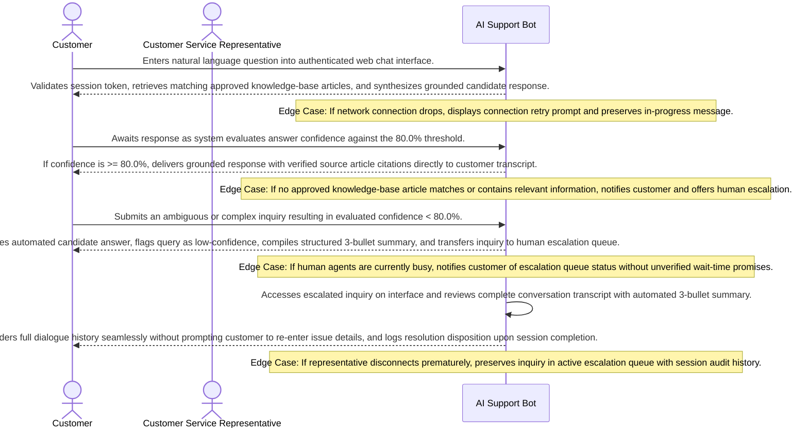

# Product Requirements Document: AI Customer Support Assistant
**Version:** v2.4.5 | **Status:** APPROVED | **Date:** 2026-11-06 | **Job ID:** 4ee56ef4-6638-451f-99e2-5edeb6b95c4d | **SHA-256:** `514a8a74bbe3be00460e71877232fff5c15314d238a279cfa71df6b646c852b1`
**Generated by:** 6aed673a2e67758afac5c83c | **Changelog:** Full PRD generation v2.4.5

---

## 1. Document Information

**Document Title:** Product Requirements Document for AI Customer Support Assistant

**Document ID:** PRD-6AED673A

**Version:** v2.4.5

**Target Domain:** Customer Support

**Product Category:** AI Support Bot

**Job ID:** 4ee56ef4-6638-451f-99e2-5edeb6b95c4d

**Content Hash (SHA-256):** `514a8a74bbe3be00460e71877232fff5c15314d238a279cfa71df6b646c852b1`

**Status:** Approved

## 2. Executive Summary

AI Customer Support Assistant is an engineering solution designed for customers and customer service representatives operating within customer support operations. The product addresses critical friction in support dialogues by delivering grounded answers derived strictly from approved knowledge-base articles, maintaining multi-turn conversational context, automatically detecting low-confidence candidate responses below 80.0%, and escalating complex queries to human representatives with an automated 3-bullet context summary. This document outlines the authoritative functional and technical specifications required to build and deploy AI Customer Support Assistant.

## 3. Product Overview

### Vision
To deliver an authoritative, high-integrity system solving core operational challenges in Customer Support.

### Key Capabilities
- Answer using approved KB articles
- Maintain conversation history
- Detect low-confidence answers below 80%
- Escalate complex queries to human agents

## 4. Problem Statement

Customer support operations encounter high operational latency, inconsistent or ungrounded responses from generic conversational bots, and disjointed escalations to human agents where customers are forced to repeat issue details.

**Key Pain Points:**
- Ungrounded or speculative answers delivered to customers without verified source citations
- Loss of conversational context across dialogue turns leading to repetitive customer inquiries
- Absence of deterministic confidence thresholding, allowing uncertain answers to mislead customers
- Inefficient human escalation handoffs lacking automated issue summaries and complete transcripts

## 5. Product Vision and Objectives

### Core Objectives
1. Reduce repetitive inquiries
2. Improve answer consistency
3. Lower wait times
4. Reduce wait times by automating repetitive inquiries
5. Improve consistency and accuracy of responses
6. Ensure timely escalation of complex queries to human agents

## 6. Target Users and Stakeholders

**Primary Stakeholders and User Roles:**
- **Support Representatives:** Primary actor interacting with AI Customer Support Assistant capabilities.
- **Customers:** Primary actor interacting with AI Customer Support Assistant capabilities.

## 7. User Personas

#### Persona 1: Customer
- **Responsibilities:** Submits support inquiries through web chat seeking accurate product information and troubleshooting assistance.
- **Primary Goals:**
  - Receive immediate, grounded answers from approved articles
  - Escalate to a human representative when questions are complex
- **Frustrations:**
  - Long wait times and unhelpful generic bots
  - Having to repeat issue context when transferred to human agents
- **Technical Proficiency:** Novice

#### Persona 2: Customer Service Representative
- **Responsibilities:** Handles complex inquiries and low-confidence queries escalated from the automated knowledge assistant.
- **Primary Goals:**
  - Receive escalated inquiries with complete conversation context and a concise 3-bullet summary
  - Resolve customer issues accurately and efficiently
- **Frustrations:**
  - Missing conversation history requiring customer re-interviewing
  - Unstructured ticket queues without context summaries
- **Technical Proficiency:** Intermediate

## 8. Existing Workflow and Pain Points

1. **Manual Ingestion:** Customers initiate inquiries and wait for available operators or encounter generic keyword bots lacking grounding.
2. **Information Retrieval Friction:** Operators manually search knowledge repositories, introducing latency and inconsistent guidance.
3. **Context Disruption During Handoff:** When automated systems fail or queries exceed bot scope, customers are transferred to representatives without structured conversation history, requiring repetitive information gathering.

## 9. Proposed Solution

AI Customer Support Assistant delivers a grounded, high-integrity support assistant combining semantic knowledge-base retrieval, multi-turn session memory, strict 80.0% confidence threshold gating, and automated 3-bullet context summarization for seamless human agent handoffs. The system guarantees that answers are grounded strictly in approved articles and uncertain responses are intercepted before reaching customers.

## 10. Product Scope

**In-Scope Capabilities for MVP Release:**
- Grounded Q&A retrieval strictly from approved knowledge-base articles
- Multi-turn conversation session history management
- Evaluation of answer confidence against the confirmed 80.0% threshold
- Automated answer delivery suppression for low-confidence answers (< 80.0%)
- Human customer service representative escalation routing
- Automated 3-bullet conversation summarization for agent context transfer
- Escalation outcome and session resolution audit logging

## 11. Out of Scope

**Explicit Non-Goals (Out of Scope for Initial Release):**
- External third-party ticketing platforms (e.g. Zendesk, Freshdesk, Jira)
- External CRM customer relationship management data synchronization (e.g. Salesforce, HubSpot)
- Voice calls, telephony integration, and Interactive Voice Response (IVR) systems
- Outbound marketing campaigns, promotional email broadcasting, or bulk messaging
- Multilingual machine translation or localized dialect parsing
- Commercial payment processing, credit card billing, and subscription invoicing
- Customer sentiment profiling or predictive purchase analytics

## 12. Functional Requirements

| ID | Title | Description | Priority | Traceable AC |
|---|---|---|---|---|
| **FR-001** | Grounded Knowledge-Base Q&A Retrieval | **Actor:** Customer. **Trigger:** Customer submits a natural language question in active chat session. **Preconditions:** Customer possesses an authenticated web chat session with active network connectivity. **Inputs:** Natural language query string and active session token. **System Behavior:** The system performs semantic and keyword retrieval across approved knowledge-base articles, retrieves matching passages, and synthesizes a grounded answer citing verified source article references. **Business Constraints:** Automated answers must strictly cite verified and approved KB articles; speculative answer extrapolation without source citations is strictly prohibited. **Alternate & Failure Paths:** If no approved knowledge-base article contains relevant information, automated generation is safely suppressed, the customer is notified that no verified article exists, and human agent escalation is offered. **Expected Outcome:** Grounded response with source citations delivered in chat transcript or customer routed to escalation. **Relevant Data Changes:** Persists customer query, retrieved article references, and dialogue turn to session ledger. **Authorization Requirements:** Authenticated Customer role. **Provenance:** `confirmed_user_input` (User raw idea: answers customer questions using approved knowledge-base articles). | Must Have | AC-001, AC-002 |
| **FR-002** | Multi-Turn Conversation History Management | **Actor:** Customer / Customer Service Representative. **Trigger:** New dialogue turn initiated or transcript requested. **Preconditions:** Active support session established with valid session token. **Inputs:** Ordered customer utterance and session identifier. **System Behavior:** The system persists ordered query and response turns in conversation session store, provides past context turns to dialogue window, and renders complete chronological transcript for customer and assigned representative view. **Business Constraints:** Session history is isolated per customer; cross-customer conversation leakage is strictly prohibited. Operational data retention duration is an unresolved open decision. **Alternate & Failure Paths:** If session store is unreachable, system attempts local cached recovery and alerts operator without corrupting historical turns. **Expected Outcome:** Complete chronological dialogue transcript maintained and accessible to both customer and assigned human agent. **Relevant Data Changes:** Appends chronological query and response records to conversation store. **Authorization Requirements:** Authenticated Customer or assigned Customer Service Representative. **Provenance:** `confirmed_user_input` (User raw idea: maintains conversation history). | Must Have | AC-003, AC-004 |
| **FR-003** | Low-Confidence Answer Detection & Threshold Evaluation | **Actor:** AI Evaluation Engine. **Trigger:** Candidate answer synthesized with evaluated confidence metric. **Preconditions:** Grounded answer generated with evaluated confidence score. **Inputs:** Synthesized candidate answer and evaluated confidence score. **System Behavior:** The system evaluates answer confidence score against the confirmed 80.0% threshold. If score < 80.0%, flags response as low-confidence, suppresses automated customer delivery, and triggers escalation routing. If score >= 80.0%, approves response for delivery. **Business Constraints:** Confidence threshold is strictly configured at 80.0% per confirmed user input; ungrounded or low-confidence answers must never be presented directly to customers. **Alternate & Failure Paths:** If confidence score evaluation fails or is ambiguous, system defaults to safety: suppresses automated response and triggers human escalation. **Expected Outcome:** Low-confidence queries routed to human escalation queue with evaluated confidence score and flagged reason code; high-confidence answers delivered. **Relevant Data Changes:** Records confidence metric, evaluation result, and suppression flag in audit ledger. **Authorization Requirements:** Internal AI Evaluation Service. **Provenance:** `confirmed_user_input` (User raw idea: identifies low-confidence answers below 80%). | Must Have | AC-005, AC-006 |
| **FR-004** | Human Agent Escalation & Context Summarization | **Actor:** Customer Service Representative. **Trigger:** Query flagged as low-confidence (< 80.0%) or customer explicitly requests human agent handoff. **Preconditions:** Escalation event initiated. **Inputs:** Session ID, complete chronological transcript, and low-confidence reason code. **System Behavior:** The system synthesizes an automated structured 3-bullet conversation summary, compiles full chat transcript, captures customer metadata, routes ticket to next available representative, and renders complete context on agent dashboard. **Business Constraints:** Escalation handoff must preserve all context; customer must not be prompted to re-enter issue details. **Alternate & Failure Paths:** If all human representatives are engaged, ticket enters queued state with status notification and option to hold or leave an asynchronous message. **Expected Outcome:** Customer Service Representative receives ticket with full transcript and concise summary; customer notified of transfer. **Relevant Data Changes:** Creates escalation ticket with summary and transfer timestamp in escalation ledger. **Authorization Requirements:** Authenticated Customer Service Representative role. **Provenance:** `confirmed_user_input` (User raw idea: escalates complex queries to human agents with a summarized context). | Must Have | AC-007, AC-008 |
| **FR-005** | Escalation Audit & Resolution Ledger Recording | **Actor:** Customer Service Representative / System. **Trigger:** Representative concludes support session or updates ticket status. **Preconditions:** Ticket actively handled by Customer Service Representative. **Inputs:** Ticket ID, disposition code, resolution notes, and agent identifier. **System Behavior:** The system persists final ticket resolution notes, handling duration, and agent disposition code to permanent audit ledger. **Business Constraints:** All escalated customer interactions must maintain immutable audit records for service quality tracking. **Alternate & Failure Paths:** If representative disconnects prematurely, session state is preserved in triage queue with audit flag. **Expected Outcome:** Escalation resolution record committed to audit store. **Relevant Data Changes:** Ticket status updated to Resolved; audit record committed with cryptographic timestamp. **Authorization Requirements:** Authenticated Customer Service Representative role. **Provenance:** `confirmed_user_input` (Core Objective: Accurate and relevant customer responses with complete operational audit). | Should Have | AC-008 |

### Detailed Functional Requirement Specifications

#### FR-001: Grounded Knowledge-Base Q&A Retrieval
- **Actor:** Customer
- **Trigger:** Customer submits a natural language question in active chat session
- **Preconditions:** Customer possesses an authenticated web chat session with active network connectivity
- **Inputs:** Natural language query string and active session token
- **System Behavior:** The system performs semantic and keyword retrieval across approved knowledge-base articles, retrieves matching passages, and synthesizes a grounded answer citing verified source article references
- **Business Constraints:** Automated answers must strictly cite verified and approved KB articles; speculative answer extrapolation without source citations is strictly prohibited
- **Alternate & Failure Paths:** If no approved knowledge-base article contains relevant information, automated generation is safely suppressed, the customer is notified that no verified article exists, and human agent escalation is offered
- **Expected Outcome:** Grounded response with source citations delivered in chat transcript or customer routed to escalation
- **Relevant Data Changes:** Persists customer query, retrieved article references, and dialogue turn to session ledger
- **Authorization Requirements:** Authenticated Customer role
- **Priority:** Must Have
- **Linked Acceptance Criteria:** AC-001, AC-002
- **Provenance:** `USER_CONFIRMED` (User raw idea: answers customer questions using approved knowledge-base articles)

#### FR-002: Multi-Turn Conversation History Management
- **Actor:** Customer / Customer Service Representative
- **Trigger:** New dialogue turn initiated or transcript requested
- **Preconditions:** Active support session established with valid session token
- **Inputs:** Ordered customer utterance and session identifier
- **System Behavior:** The system persists ordered query and response turns in conversation session store, provides past context turns to dialogue window, and renders complete chronological transcript for customer and assigned representative view
- **Business Constraints:** Session history is isolated per customer; cross-customer conversation leakage is strictly prohibited. Operational data retention duration is an unresolved open decision
- **Alternate & Failure Paths:** If session store is unreachable, system attempts local cached recovery and alerts operator without corrupting historical turns
- **Expected Outcome:** Complete chronological dialogue transcript maintained and accessible to both customer and assigned human agent
- **Relevant Data Changes:** Appends chronological query and response records to conversation store
- **Authorization Requirements:** Authenticated Customer or assigned Customer Service Representative
- **Priority:** Must Have
- **Linked Acceptance Criteria:** AC-003, AC-004
- **Provenance:** `USER_CONFIRMED` (User raw idea: maintains conversation history)

#### FR-003: Low-Confidence Answer Detection & Threshold Evaluation
- **Actor:** AI Evaluation Engine
- **Trigger:** Candidate answer synthesized with evaluated confidence metric
- **Preconditions:** Grounded answer generated with evaluated confidence score
- **Inputs:** Synthesized candidate answer and evaluated confidence score
- **System Behavior:** The system evaluates answer confidence score against the confirmed 80.0% threshold. If score < 80.0%, flags response as low-confidence, suppresses automated customer delivery, and triggers escalation routing. If score >= 80.0%, approves response for delivery
- **Business Constraints:** Confidence threshold is strictly configured at 80.0% per confirmed user input; ungrounded or low-confidence answers must never be presented directly to customers
- **Alternate & Failure Paths:** If confidence score evaluation fails or is ambiguous, system defaults to safety: suppresses automated response and triggers human escalation
- **Expected Outcome:** Low-confidence queries routed to human escalation queue with evaluated confidence score and flagged reason code; high-confidence answers delivered
- **Relevant Data Changes:** Records confidence metric, evaluation result, and suppression flag in audit ledger
- **Authorization Requirements:** Internal AI Evaluation Service
- **Priority:** Must Have
- **Linked Acceptance Criteria:** AC-005, AC-006
- **Provenance:** `USER_CONFIRMED` (User raw idea: identifies low-confidence answers below 80%)

#### FR-004: Human Agent Escalation & Context Summarization
- **Actor:** Customer Service Representative
- **Trigger:** Query flagged as low-confidence (< 80.0%) or customer explicitly requests human agent handoff
- **Preconditions:** Escalation event initiated
- **Inputs:** Session ID, complete chronological transcript, and low-confidence reason code
- **System Behavior:** The system synthesizes an automated structured 3-bullet conversation summary, compiles full chat transcript, captures customer metadata, routes ticket to next available representative, and renders complete context on agent dashboard
- **Business Constraints:** Escalation handoff must preserve all context; customer must not be prompted to re-enter issue details
- **Alternate & Failure Paths:** If all human representatives are engaged, ticket enters queued state with status notification and option to hold or leave an asynchronous message
- **Expected Outcome:** Customer Service Representative receives ticket with full transcript and concise summary; customer notified of transfer
- **Relevant Data Changes:** Creates escalation ticket with summary and transfer timestamp in escalation ledger
- **Authorization Requirements:** Authenticated Customer Service Representative role
- **Priority:** Must Have
- **Linked Acceptance Criteria:** AC-007, AC-008
- **Provenance:** `USER_CONFIRMED` (User raw idea: escalates complex queries to human agents with a summarized context)

#### FR-005: Escalation Audit & Resolution Ledger Recording
- **Actor:** Customer Service Representative / System
- **Trigger:** Representative concludes support session or updates ticket status
- **Preconditions:** Ticket actively handled by Customer Service Representative
- **Inputs:** Ticket ID, disposition code, resolution notes, and agent identifier
- **System Behavior:** The system persists final ticket resolution notes, handling duration, and agent disposition code to permanent audit ledger
- **Business Constraints:** All escalated customer interactions must maintain immutable audit records for service quality tracking
- **Alternate & Failure Paths:** If representative disconnects prematurely, session state is preserved in triage queue with audit flag
- **Expected Outcome:** Escalation resolution record committed to audit store
- **Relevant Data Changes:** Ticket status updated to Resolved; audit record committed with cryptographic timestamp
- **Authorization Requirements:** Authenticated Customer Service Representative role
- **Priority:** Should Have
- **Linked Acceptance Criteria:** AC-008
- **Provenance:** `USER_CONFIRMED` (Core Objective: Accurate and relevant customer responses with complete operational audit)

## 13. Non-Functional Requirements

| ID | Title | Description | Classification | Priority |
|---|---|---|---|---|
| **NFR-001** | Customer Support Operational Responsiveness | The system shall maintain responsive transaction handling for AI Support Bot operations under standard user concurrency [Proposed Target: Specific latency bound subject to formal benchmark]. | Proposed target | Should Have |
| **NFR-002** | Customer Support Data Protection & Security | All AI Support Bot session records and domain entities must be protected in transit and at rest [Proposed Target: Specific cryptographic cipher suite and regulatory frameworks pending institutional review]. | Proposed target | Should Have |
| **NFR-003** | AI Support Bot Availability & Fault Tolerance | The system shall target high operational availability during scheduled operational hours with graceful fault recovery [Proposed Target: Operational availability SLA to be confirmed during initial release]. | Proposed target | Should Have |

## 14. User Stories

| Story ID | As a... | I want to... | So that... | Linked FR |
|---|---|---|---|---|
| **US-001** | Customer | receive answers derived from approved support articles | I can resolve common issues quickly without waiting for a human agent | FR-001 |
| **US-002** | Customer | have my ongoing conversation history remembered across dialogue turns | I do not have to repeat context when asking follow-up questions | FR-002 |
| **US-003** | Customer | have uncertain or low-confidence questions automatically escalated to human support | I never receive inaccurate or ungrounded advice from the AI | FR-003 |
| **US-004** | Customer Service Representative | receive escalated customer conversations accompanied by a concise context summary | I can resolve complex customer problems immediately without asking them to re-enter information | FR-004 |
| **US-005** | Customer Service Representative | view confidence assessment indicators and article references for escalated inquiries | I can quickly verify the context before providing customer assistance | FR-004 |

## 15. User Journeys

### Step-by-Step User Journey Progression
**Stage 1: 1. Customer Query Ingestion**
- **Actor (Customer):** Enters natural language question into authenticated web chat interface.
- **System Response:** Validates session token, retrieves matching approved knowledge-base articles, and synthesizes grounded candidate response.
- **Edge Case / Error Handling:** If network connection drops, displays connection retry prompt and preserves in-progress message.

**Stage 2: 2. Grounded Answer Synthesis & Threshold Evaluation**
- **Actor (Customer):** Awaits response as system evaluates answer confidence against the 80.0% threshold.
- **System Response:** If confidence is >= 80.0%, delivers grounded response with verified source article citations directly to customer transcript.
- **Edge Case / Error Handling:** If no approved knowledge-base article matches or contains relevant information, notifies customer and offers human escalation.

**Stage 3: 3. Low-Confidence Interception & Escalation**
- **Actor (Customer):** Submits an ambiguous or complex inquiry resulting in evaluated confidence < 80.0%.
- **System Response:** Suppresses automated candidate answer, flags query as low-confidence, compiles structured 3-bullet summary, and transfers inquiry to human escalation queue.
- **Edge Case / Error Handling:** If human agents are currently busy, notifies customer of escalation queue status without unverified wait-time promises.

**Stage 4: 4. Human Representative Resolution & Context Handoff**
- **Actor (Customer Service Representative):** Accesses escalated inquiry on interface and reviews complete conversation transcript with automated 3-bullet summary.
- **System Response:** Renders full dialogue history seamlessly without prompting customer to re-enter issue details, and logs resolution disposition upon session completion.
- **Edge Case / Error Handling:** If representative disconnects prematurely, preserves inquiry in active escalation queue with session audit history.

## 16. Business Rules

| ID | Rule Title | Operational Statement | Provenance | Source Reference | Rationale | Confirmation Required |
|---|---|---|---|---|---|---|
| **BR-001** | Grounded Knowledge-Base Responses | Automated customer responses must be derived strictly from verified and approved knowledge-base articles; speculative answer generation without verified source articles is strictly prohibited. | `USER_CONFIRMED` | User raw idea: answers customer questions using approved knowledge-base articles | Guarantees answer accuracy and prevents customer misinformation. | No (Confirmed) |
| **BR-002** | Low-Confidence Escalation Threshold | Queries with an evaluated answer confidence score below 80.0% must be flagged as low-confidence, suppressed from direct customer delivery, and routed to a human customer service representative with an automated context summary. | `USER_CONFIRMED` | User raw idea: identifies low-confidence answers below 80% | Prevents ungrounded or speculative answers from reaching customers when confidence is inadequate. | No (Confirmed) |
| **BR-003** | Multi-Turn Conversation History Retention | The system must maintain chronological conversation history across turns within an active support session to preserve conversational context. | `USER_CONFIRMED` | User raw idea: maintains conversation history | Enables context-aware dialogue and eliminates redundant customer questioning. | No (Confirmed) |
| **BR-004** | Human Agent Escalation Context Summary | When a query is escalated to a human agent, the system must deliver the complete conversation history accompanied by an automated structured 3-bullet context summary. | `USER_CONFIRMED` | User raw idea: escalates complex queries to human agents with a summarized context | Reduces human agent triage time and improves customer resolution speed. | No (Confirmed) |
| **BR-005** | Missing Knowledge Base Handling Policy | If no approved knowledge-base article matches a query or contains relevant information, the system must safely halt automated generation, notify the customer that no verified answer is available, and offer human agent escalation. | `INFERRED` | Inferred: Customer Support Operational Standard | Defines deterministic system behavior when knowledge articles are unavailable. | Yes (Review needed) |
| **BR-006** | Conversational Session Data Retention Duration | The operational retention duration for retaining customer chat transcripts beyond the active dialogue session is an unresolved decision subject to corporate privacy governance review. | `UNRESOLVED` | Unresolved Decision: Data Retention Policy | Complies with organizational privacy requirements without fabricating compliance commitments. | Yes (Review needed) |

## 17. System Workflows

1) Session Initiation: User opens web chat and a unique Session ID is generated.
2) Query Processing & KB Lookup: The user’s message is stored, the AI retrieves relevant approved KB articles, and generates a draft answer.
3) Confidence Evaluation & Response Generation: The AI calculates a confidence score (0–100%). If the score ≥80.0% the answer is returned to the user; otherwise the draft is flagged as low‑confidence.
4) Escalation Handling: Low‑confidence queries are summarized and placed into an internal escalation queue with context.
5) Human Agent Response & Session Closure: A human agent pulls the ticket, crafts a response, and the system delivers it to the user, marking the session as closed.

## 18. Data Requirements

Entities:
- Session: SessionID (PK), UserID, StartTime, EndTime, Channel, Status.
- Message: MessageID (PK), SessionID (FK), Sender (User/AI), Timestamp, Content, ConfidenceScore.
- KBArticle: ArticleID (PK), Title, Content, Tags, LastUpdated.
- EscalationTicket: TicketID (PK), SessionID (FK), Summary, CreatedAt, Status.
Consistency Rules:
- Referential integrity between Session, Message, and EscalationTicket.
- Unique identifiers for all entities.
- Timestamp ordering: Message.Timestamp ≥ Session.StartTime.
Persistence:
- Active session transcripts retained only for the duration of the session.
- Archival retention policy for transcripts, analytics, or compliance audits is an unresolved decision pending formal policy.

## 19. Integration Requirements

- **Core Interface:** Standard REST and WebSocket APIs for web chat communication and knowledge-base search.
- **Third-Party SaaS Connectors:** No external CRM (Salesforce/HubSpot) or external ticketing platforms (Zendesk/Jira) are required for MVP; the system operates self-contained.

## 20. Security and Privacy Requirements

Roles:
- AI Agent: read‑only access to KB and session data.
- Human Agent: read/write access to escalation tickets and session transcripts.
- Admin: full system access.
Encryption:
- In transit: TLS 1.3.
- At rest: AES‑256.
Audit Logging:
- Access logs for all role actions.
- Query logs capturing AI confidence scores.
- Escalation logs with timestamps.
Privacy Controls:
- Only non‑PII user identifiers stored.
- Retention of session data limited to active session; archival retention pending formal policy.

## 21. Acceptance Criteria

| AC ID | Associated Requirement | Acceptance Criteria (Given-When-Then / Rule) |
|---|---|---|
| **AC-001** | FR-001 | Given an authenticated Customer submits a query with matching verified knowledge-base articles, When processed by the system and evaluated confidence is >= 80.0%, Then the system returns a grounded response citing source article IDs and logs the dialogue turn. |
| **AC-002** | FR-001 | Given a customer query where no approved knowledge-base articles match or contain relevant information, When the query is evaluated, Then the system safely halts automated answer generation, notifies the customer that no verified article exists, and offers one-click escalation to a human representative. |
| **AC-003** | FR-002 | Given an ongoing support session with 3 previous dialogue turns, When the customer asks a contextual follow-up question, Then the system retrieves prior dialogue history and resolves contextual references accurately. |
| **AC-004** | FR-002 | Given an unauthenticated actor or invalid session token attempting to submit queries or access conversation history, When the request is received, Then the system halts access with an HTTP 401 Unauthorized status and logs a security violation event. |
| **AC-005** | FR-003 | Given an AI-generated answer candidate with an evaluated confidence score of 79.9% (below the 80.0% threshold), When confidence evaluation completes, Then the automated response is suppressed from customer view, flagged as low-confidence, and routed to the human escalation queue. |
| **AC-006** | FR-003 | Given an AI-generated answer candidate with an evaluated confidence score of exactly 80.0% and an approved knowledge-base article citation, When evaluated against the threshold, Then the response is approved for immediate customer delivery and logged as verified. |
| **AC-007** | FR-003 | Given an AI-generated answer candidate with evaluated confidence of 80.1%, When evaluated against the threshold, Then automatic response is approved for customer delivery with verified article citations. |
| **AC-008** | FR-001 | Given an AI-generated answer candidate where no approved knowledge-base article exists, When evaluated, Then automatic response is suppressed regardless of score and the query is routed to human escalation. |
| **AC-009** | FR-003 | Given the confidence evaluation service encounters an internal calculation failure or timeout, When the exception occurs, Then the system safely halts automated response, logs the failure diagnostic, and routes to human escalation. |
| **AC-010** | FR-004 | Given a customer submits a multi-part query flagged as complex, When analyzed, Then the system routes the query to human escalation with a concise conversation summary per confirmed policy. |
| **AC-011** | FR-004 | Given a query routed for human escalation, When an available Customer Service Representative accepts the ticket, Then the representative interface renders the complete chronological transcript and an automated 3-bullet context summary without prompting the customer to re-enter issue details. |
| **AC-012** | FR-005 | Given an escalated session resolved by a Customer Service Representative, When the representative closes the ticket, Then the system records the resolution disposition, duration, and agent ID in the persistent audit ledger. |

## 22. Dependencies and Constraints

Platform: Web‑based chat interface.
Hosting: Internal data center or cloud environment (subject to infrastructure review).
Operating System: Linux (distribution unspecified).
Runtime: [Proposed Option: Python 3.11] or equivalent.
Database: [Open Architectural Decision] for persistence.
Messaging Queue: [Open Architectural Decision] for escalation queue.
Constraints:
- No voice, telephony, SMS, or video channels.
- No mandatory multi‑zone failover or specific database engines.
- No external ticketing APIs required for MVP.

## 23. Risks and Mitigation

| Risk ID | Category | Risk Description | Root Cause | Likelihood | Impact | Mitigation Strategy | Contingency Plan | Owner |
|---|---|---|---|---|---|---|---|---|
| **RSK-001** | Functional | System generates inaccurate or ungrounded responses during answer using approved kb articles | Out-of-date knowledge repository or threshold evaluation bypass | Medium | High | Enforce strict confidence threshold scoring and mandatory citation of approved sources before returning responses in Customer Support. | Suppress automated fulfillment and route directly to human specialist with session context. | Lead Domain Architect |
| **RSK-002** | Data Privacy | Unauthorized access or leakage of personal identifiers processed in Customer Support | Insufficient role authorization checks or insecure storage transmission | Low | Critical | Enforce TLS in transit, encryption at rest, field-level PII masking, and strict role-based access boundaries. | Revoke session tokens immediately, trigger security incident response runbook, and notify data protection officer. | Security & Compliance Officer |
| **RSK-003** | Integration | Integration endpoints fail or provide stale schema data to Customer Support | Network timeout, remote API breaking changes, or upstream database outage | Medium | High | Implement automated periodic health checks, versioned cache invalidation, and circuit breakers with graceful fallback. | Switch to local read-only cache and display degraded service advisory banner to active users. | DevOps / Infrastructure Engineer |
| **RSK-004** | Operational | Spike in concurrency exhausts server resources or human review capacity in Customer Support | Unpredictable surge in user demand without dynamic horizontal auto-scaling | Medium | High | Implement request queue rate-limiting, priority-based escalation queues, and real-time SLA breach alerting. | Activate secondary reserve capacity and notify supervisors to redistribute review workloads. | Operations Manager |

## 24. Assumptions and Open Questions

### Documented Operational Assumptions
- [Assumed] The system will have access to a structured knowledge base
- [Assumed] The system will be integrated with the existing chat or ticketing platform
- [Assumed] A confidence scoring mechanism is available
- [Assumed] Escalation to human agents is possible via defined workflow

### Open Architectural Questions
- Integration with existing ticketing/chat platform
- Data privacy and compliance requirements
- User authentication and authorization
- Escalation routing logic and SLA definitions
- Multilingual support

## 25. Success Metrics

Technical Invariants:
- Confidence threshold of 80.0% enforced for all AI responses.
- Only approved KB articles may be referenced.
- Session transcripts retained only during active session.
- Escalation queue must deliver tickets to human agents within 5 minutes of creation.
Business Success KPIs:
- [Proposed Target: Pending formal benchmark] AI‑only resolution rate.
- [Proposed Target: Pending formal benchmark] Average response time.
- [Proposed Target: Pending formal benchmark] Customer satisfaction score.

## 26. Release Considerations

Phase 1 – Alpha: Internal testing with a small group of developers and support staff.
Phase 2 – Beta: Limited rollout to a subset of customers with monitoring of confidence scores and escalation volume.
Data Migration: None required; system starts with fresh sessions.
Operational Handoff: Support operations team receives documentation on escalation queue handling and audit log review.

## 27. Appendix and Glossary

KB – Knowledge Base, a curated set of approved articles.
AI Agent – The automated system that processes user queries.
Confidence Score – Percentage value (0–100%) indicating AI certainty.
Escalation Queue – Internal ticketing system for low‑confidence queries.
Session – A continuous interaction between a user and the AI.
Message – Individual user or AI utterance within a session.
Ticket – Record created when a query is escalated to a human agent.

### Full Document Provenance Ledger

| Statement ID | Section | Statement / Claim Summary | Provenance Classification | Source Reference | Related ID | Baseline Status |
|---|---|---|---|---|---|---|
| **PL-001** | product_vision_and_objectives | Objective: Reduce repetitive inquiries | `USER_CONFIRMED` | User Submission: Core Objectives | N/A | Approved Baseline |
| **PL-002** | product_vision_and_objectives | Objective: Improve answer consistency | `USER_CONFIRMED` | User Submission: Core Objectives | N/A | Approved Baseline |
| **PL-003** | product_vision_and_objectives | Objective: Lower wait times | `USER_CONFIRMED` | User Submission: Core Objectives | N/A | Approved Baseline |
| **PL-004** | product_vision_and_objectives | Objective: Reduce wait times by automating repetitive inquiries | `USER_CONFIRMED` | User Submission: Core Objectives | N/A | Approved Baseline |
| **PL-005** | product_vision_and_objectives | Objective: Improve consistency and accuracy of responses | `USER_CONFIRMED` | User Submission: Core Objectives | N/A | Approved Baseline |
| **PL-006** | product_vision_and_objectives | Objective: Ensure timely escalation of complex queries to human agents | `USER_CONFIRMED` | User Submission: Core Objectives | N/A | Approved Baseline |
| **PL-007** | product_scope | In-Scope Capability: Answer using approved KB articles | `USER_CONFIRMED` | User Raw Idea / Scope | N/A | Approved Baseline |
| **PL-008** | product_scope | In-Scope Capability: Maintain conversation history | `USER_CONFIRMED` | User Raw Idea / Scope | N/A | Approved Baseline |
| **PL-009** | product_scope | In-Scope Capability: Detect low-confidence answers below 80% | `USER_CONFIRMED` | User Raw Idea / Scope | N/A | Approved Baseline |
| **PL-010** | product_scope | In-Scope Capability: Escalate complex queries to human agents | `USER_CONFIRMED` | User Raw Idea / Scope | N/A | Approved Baseline |
| **PL-011** | functional_requirements | FR-001: Grounded Knowledge-Base Q&A Retrieval - Performs semantic and keyword re | `USER_CONFIRMED` | User raw idea: answers customer questions using approved kno | FR-001 | Approved Baseline |
| **PL-012** | functional_requirements | FR-002: Multi-Turn Conversation History Management - Persists ordered query and  | `USER_CONFIRMED` | User raw idea: maintains conversation history | FR-002 | Approved Baseline |
| **PL-013** | functional_requirements | FR-003: Low-Confidence Answer Detection & Threshold Evaluation - Evaluates answe | `USER_CONFIRMED` | User raw idea: identifies low-confidence answers below 80% | FR-003 | Approved Baseline |
| **PL-014** | functional_requirements | FR-004: Human Agent Escalation & Context Summarization - Synthesizes an automate | `USER_CONFIRMED` | User raw idea: escalates complex queries to human agents wit | FR-004 | Approved Baseline |
| **PL-015** | functional_requirements | FR-005: Escalation Audit & Resolution Ledger Recording - Persists final ticket r | `USER_CONFIRMED` | Core Objective: Accurate and relevant customer responses wit | FR-005 | Approved Baseline |
| **PL-016** | non_functional_requirements | NFR-001: Customer Support Operational Responsiveness - The system shall maintain | `PROPOSED` | System Architecture Baseline | NFR-001 | Unresolved / Proposed |
| **PL-017** | non_functional_requirements | NFR-002: Customer Support Data Protection & Security - All AI Support Bot sessio | `PROPOSED` | System Architecture Baseline | NFR-002 | Unresolved / Proposed |
| **PL-018** | non_functional_requirements | NFR-003: AI Support Bot Availability & Fault Tolerance - The system shall target | `PROPOSED` | System Architecture Baseline | NFR-003 | Unresolved / Proposed |
| **PL-019** | business_rules | BR-001: Grounded Knowledge-Base Responses - Automated customer responses must be | `USER_CONFIRMED` | User raw idea: answers customer questions using approved kno | BR-001 | Approved Baseline |
| **PL-020** | business_rules | BR-002: Low-Confidence Escalation Threshold - Queries with an evaluated answer c | `USER_CONFIRMED` | User raw idea: identifies low-confidence answers below 80% | BR-002 | Approved Baseline |
| **PL-021** | business_rules | BR-003: Multi-Turn Conversation History Retention - The system must maintain chr | `USER_CONFIRMED` | User raw idea: maintains conversation history | BR-003 | Approved Baseline |
| **PL-022** | business_rules | BR-004: Human Agent Escalation Context Summary - When a query is escalated to a  | `USER_CONFIRMED` | User raw idea: escalates complex queries to human agents wit | BR-004 | Approved Baseline |
| **PL-023** | business_rules | BR-005: Missing Knowledge Base Handling Policy - If no approved knowledge-base a | `INFERRED` | Inferred: Customer Support Operational Standard | BR-005 | Unresolved / Proposed |
| **PL-024** | business_rules | BR-006: Conversational Session Data Retention Duration - The operational retenti | `UNRESOLVED` | Unresolved Decision: Data Retention Policy | BR-006 | Unresolved / Proposed |
| **PL-025** | acceptance_criteria | AC-001: Given an authenticated Customer submits a query with matching verified k | `USER_CONFIRMED` | Traced to parent requirement FR-001 | FR-001 | Approved Baseline |
| **PL-026** | acceptance_criteria | AC-002: Given a customer query where no approved knowledge-base articles match o | `USER_CONFIRMED` | Traced to parent requirement FR-001 | FR-001 | Approved Baseline |
| **PL-027** | acceptance_criteria | AC-003: Given an ongoing support session with 3 previous dialogue turns, When th | `USER_CONFIRMED` | Traced to parent requirement FR-002 | FR-002 | Approved Baseline |
| **PL-028** | acceptance_criteria | AC-004: Given an unauthenticated actor or invalid session token attempting to su | `USER_CONFIRMED` | Traced to parent requirement FR-002 | FR-002 | Approved Baseline |
| **PL-029** | acceptance_criteria | AC-005: Given an AI-generated answer candidate with an evaluated confidence scor | `USER_CONFIRMED` | Traced to parent requirement FR-003 | FR-003 | Approved Baseline |
| **PL-030** | acceptance_criteria | AC-006: Given an AI-generated answer candidate with an evaluated confidence scor | `USER_CONFIRMED` | Traced to parent requirement FR-003 | FR-003 | Approved Baseline |
| **PL-031** | acceptance_criteria | AC-007: Given an AI-generated answer candidate with evaluated confidence of 80.1 | `USER_CONFIRMED` | Traced to parent requirement FR-003 | FR-003 | Approved Baseline |
| **PL-032** | acceptance_criteria | AC-008: Given an AI-generated answer candidate where no approved knowledge-base  | `USER_CONFIRMED` | Traced to parent requirement FR-001 | FR-001 | Approved Baseline |
| **PL-033** | acceptance_criteria | AC-009: Given the confidence evaluation service encounters an internal calculati | `USER_CONFIRMED` | Traced to parent requirement FR-003 | FR-003 | Approved Baseline |
| **PL-034** | acceptance_criteria | AC-010: Given a customer submits a multi-part query flagged as complex, When ana | `USER_CONFIRMED` | Traced to parent requirement FR-004 | FR-004 | Approved Baseline |
| **PL-035** | acceptance_criteria | AC-011: Given a query routed for human escalation, When an available Customer Se | `USER_CONFIRMED` | Traced to parent requirement FR-004 | FR-004 | Approved Baseline |
| **PL-036** | acceptance_criteria | AC-012: Given an escalated session resolved by a Customer Service Representative | `USER_CONFIRMED` | Traced to parent requirement FR-005 | FR-005 | Approved Baseline |
| **PL-037** | data_requirements | Active session dialogue context maintained in session memory; long-term archival | `UNRESOLVED` | Corporate Governance & Privacy Review | N/A | Unresolved / Proposed |
| **PL-038** | security_and_privacy_requirements | Statutory regulatory compliance frameworks (e.g. GDPR, CCPA, FERPA, HIPAA) are s | `UNRESOLVED` | Corporate Compliance Assessment | N/A | Unresolved / Proposed |
| **PL-039** | dependencies_and_constraints | Hosting deployment architecture (cloud container environment vs on-premises host | `UNRESOLVED` | Infrastructure Architecture Review | N/A | Unresolved / Proposed |

