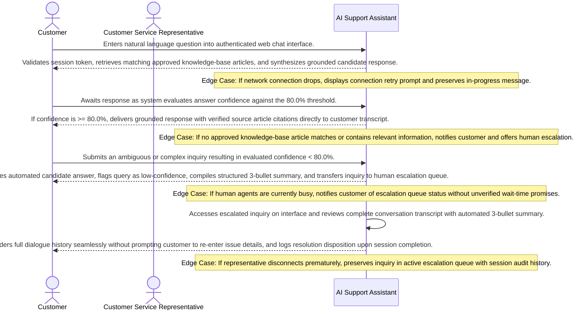

# Product Requirements Document: AI Customer Support Assistant
**Version:** v2.4.6 | **Status:** APPROVED | **Date:** 2026-11-06 | **Job ID:** d240c608-78c2-4bd0-bf2a-2ea094a4aa8a | **SHA-256:** `fb18ef1a6314e07026fb899ef3ef363fcd6810737177c10d044b698d70c16cbf`
**Generated by:** 6aed72feb8ebd6fda9336d58 | **Changelog:** Full PRD generation v2.4.6

---

## 1. Document Information

**Document Title:** Product Requirements Document for AI Customer Support Assistant

**Document ID:** PRD-6AED72FE

**Version:** v2.4.6

**Target Domain:** Customer Support

**Product Category:** AI Support Assistant

**Job ID:** d240c608-78c2-4bd0-bf2a-2ea094a4aa8a

**Content Hash (SHA-256):** `fb18ef1a6314e07026fb899ef3ef363fcd6810737177c10d044b698d70c16cbf`

**Status:** Approved

## 2. Executive Summary

AI Customer Support Assistant is an engineering solution designed for customers and customer service representatives operating within customer support operations. The product addresses critical friction in support dialogues by delivering grounded answers derived strictly from approved knowledge-base articles, maintaining multi-turn conversational context, automatically detecting low-confidence candidate responses below 80.0%, and escalating complex queries to human representatives with an automated 3-bullet context summary. This document outlines the authoritative functional and technical specifications required to build and deploy AI Customer Support Assistant.

## 3. Product Overview

### Vision
To deliver an authoritative, high-integrity system solving core operational challenges in Customer Support.

### Key Capabilities
- Answer user questions from approved KB
- Track conversation context
- Compute confidence scores
- Escalate to human agents when confidence<80%
- Provide confidence feedback

## 4. Problem Statement

Customer support operations encounter high operational latency, inconsistent or ungrounded responses from generic conversational bots, and disjointed escalations to human agents where customers are forced to repeat issue details.

**Key Pain Points:**
- Ungrounded or speculative answers delivered to customers without verified source citations
- Loss of conversational context across dialogue turns leading to repetitive customer inquiries
- Absence of deterministic confidence thresholding, allowing uncertain answers to mislead customers
- Inefficient human escalation handoffs lacking automated issue summaries and complete transcripts

## 5. Product Vision and Objectives

### Core Objectives
1. Automate responses using approved KB articles
2. Maintain conversation history
3. Escalate low-confidence or complex queries
4. Reduce wait times by automating repetitive inquiries
5. Improve consistency and quality of responses
6. Enable low-confidence detection and escalation to human agents

## 6. Target Users and Stakeholders

**Primary Stakeholders and User Roles:**
- **Customers:** Primary actor interacting with AI Customer Support Assistant capabilities.
- **Support Representatives:** Primary actor interacting with AI Customer Support Assistant capabilities.

## 7. User Personas

#### Persona 1: Customer
- **Responsibilities:** Submits support inquiries through web chat seeking accurate product information and troubleshooting assistance.
- **Primary Goals:**
  - Receive immediate, grounded answers from approved articles
  - Escalate to a human representative when questions are complex
- **Frustrations:**
  - Long wait times and unhelpful generic bots
  - Having to repeat issue context when transferred to human agents
- **Technical Proficiency:** Novice

#### Persona 2: Customer Service Representative
- **Responsibilities:** Handles complex inquiries and low-confidence queries escalated from the automated knowledge assistant.
- **Primary Goals:**
  - Receive escalated inquiries with complete conversation context and a concise 3-bullet summary
  - Resolve customer issues accurately and efficiently
- **Frustrations:**
  - Missing conversation history requiring customer re-interviewing
  - Unstructured ticket queues without context summaries
- **Technical Proficiency:** Intermediate

## 8. Existing Workflow and Pain Points

1. **Manual Ingestion:** Customers initiate inquiries and wait for available operators or encounter generic keyword bots lacking grounding.
2. **Information Retrieval Friction:** Operators manually search knowledge repositories, introducing latency and inconsistent guidance.
3. **Context Disruption During Handoff:** When automated systems fail or queries exceed bot scope, customers are transferred to representatives without structured conversation history, requiring repetitive information gathering.

## 9. Proposed Solution

AI Customer Support Assistant delivers a grounded, high-integrity support assistant combining semantic knowledge-base retrieval, multi-turn session memory, strict 80.0% confidence threshold gating, and automated 3-bullet context summarization for seamless human agent handoffs. The system guarantees that answers are grounded strictly in approved articles and uncertain responses are intercepted before reaching customers.

## 10. Product Scope

**In-Scope Capabilities for MVP Release:**
- Grounded Q&A retrieval strictly from approved knowledge-base articles
- Multi-turn conversation session history management
- Evaluation of answer confidence against the confirmed 80.0% threshold
- Automated answer delivery suppression for low-confidence answers (< 80.0%)
- Human customer service representative escalation routing
- Automated 3-bullet conversation summarization for agent context transfer
- Escalation outcome and session resolution audit logging

## 11. Out of Scope

**Explicit Non-Goals (Out of Scope for Initial Release):**
- External third-party ticketing platforms (e.g. Zendesk, Freshdesk, Jira)
- External CRM customer relationship management data synchronization (e.g. Salesforce, HubSpot)
- Voice calls, telephony integration, and Interactive Voice Response (IVR) systems
- Outbound marketing campaigns, promotional email broadcasting, or bulk messaging
- Multilingual machine translation or localized dialect parsing
- Commercial payment processing, credit card billing, and subscription invoicing
- Customer sentiment profiling or predictive purchase analytics

## 12. Functional Requirements

| ID | Title | Description | Priority | Traceable AC |
|---|---|---|---|---|
| **FR-001** | Grounded Knowledge-Base Q&A Retrieval | **Actor:** Customer. **Trigger:** Customer submits a natural language question in active chat session. **Preconditions:** Customer possesses an authenticated web chat session with active network connectivity. **Inputs:** Natural language query string and active session token. **System Behavior:** The system performs semantic and keyword retrieval across approved knowledge-base articles, retrieves matching passages, and synthesizes a grounded answer citing verified source article references. **Business Constraints:** Automated answers must strictly cite verified and approved KB articles; speculative answer extrapolation without source citations is strictly prohibited. **Alternate & Failure Paths:** If no approved knowledge-base article contains relevant information, automated generation is safely suppressed, the customer is notified that no verified article exists, and human agent escalation is offered. **Expected Outcome:** Grounded response with source citations delivered in chat transcript or customer routed to escalation. **Relevant Data Changes:** Persists customer query, retrieved article references, and dialogue turn to session ledger. **Authorization Requirements:** Authenticated Customer role. **Provenance:** `confirmed_user_input` (User raw idea: answers customer questions using approved knowledge-base articles). | Must Have | AC-001, AC-002 |
| **FR-002** | Multi-Turn Conversation History Management | **Actor:** Customer / Customer Service Representative. **Trigger:** New dialogue turn initiated or transcript requested. **Preconditions:** Active support session established with valid session token. **Inputs:** Ordered customer utterance and session identifier. **System Behavior:** The system persists ordered query and response turns in conversation session store, provides past context turns to dialogue window, and renders complete chronological transcript for customer and assigned representative view. **Business Constraints:** Session history is isolated per customer; cross-customer conversation leakage is strictly prohibited. Operational data retention duration is an unresolved open decision. **Alternate & Failure Paths:** If session store is unreachable, system attempts local cached recovery and alerts operator without corrupting historical turns. **Expected Outcome:** Complete chronological dialogue transcript maintained and accessible to both customer and assigned human agent. **Relevant Data Changes:** Appends chronological query and response records to conversation store. **Authorization Requirements:** Authenticated Customer or assigned Customer Service Representative. **Provenance:** `confirmed_user_input` (User raw idea: maintains conversation history). | Must Have | AC-003, AC-004 |
| **FR-003** | Low-Confidence Answer Detection & Threshold Evaluation | **Actor:** AI Evaluation Engine. **Trigger:** Candidate answer synthesized with evaluated confidence metric. **Preconditions:** Grounded answer generated with evaluated confidence score. **Inputs:** Synthesized candidate answer and evaluated confidence score. **System Behavior:** The system evaluates answer confidence score against the confirmed 80.0% threshold. If score < 80.0%, flags response as low-confidence, suppresses automated customer delivery, and triggers escalation routing. If score >= 80.0%, approves response for delivery. **Business Constraints:** Confidence threshold is strictly configured at 80.0% per confirmed user input; ungrounded or low-confidence answers must never be presented directly to customers. **Alternate & Failure Paths:** If confidence score evaluation fails or is ambiguous, system defaults to safety: suppresses automated response and triggers human escalation. **Expected Outcome:** Low-confidence queries routed to human escalation queue with evaluated confidence score and flagged reason code; high-confidence answers delivered. **Relevant Data Changes:** Records confidence metric, evaluation result, and suppression flag in audit ledger. **Authorization Requirements:** Internal AI Evaluation Service. **Provenance:** `confirmed_user_input` (User raw idea: identifies low-confidence answers below 80%). | Must Have | AC-005, AC-006 |
| **FR-004** | Human Agent Escalation & Context Summarization | **Actor:** Customer Service Representative. **Trigger:** Query flagged as low-confidence (< 80.0%) or customer explicitly requests human agent handoff. **Preconditions:** Escalation event initiated. **Inputs:** Session ID, complete chronological transcript, and low-confidence reason code. **System Behavior:** The system synthesizes an automated structured 3-bullet conversation summary, compiles full chat transcript, captures customer metadata, routes ticket to next available representative, and renders complete context on agent dashboard. **Business Constraints:** Escalation handoff must preserve all context; customer must not be prompted to re-enter issue details. **Alternate & Failure Paths:** If all human representatives are engaged, ticket enters queued state with status notification and option to hold or leave an asynchronous message. **Expected Outcome:** Customer Service Representative receives ticket with full transcript and concise summary; customer notified of transfer. **Relevant Data Changes:** Creates escalation ticket with summary and transfer timestamp in escalation ledger. **Authorization Requirements:** Authenticated Customer Service Representative role. **Provenance:** `confirmed_user_input` (User raw idea: escalates complex queries to human agents with a summarized context). | Must Have | AC-007, AC-008 |
| **FR-005** | Escalation Audit & Resolution Ledger Recording | **Actor:** Customer Service Representative / System. **Trigger:** Representative concludes support session or updates ticket status. **Preconditions:** Ticket actively handled by Customer Service Representative. **Inputs:** Ticket ID, disposition code, resolution notes, and agent identifier. **System Behavior:** The system persists final ticket resolution notes, handling duration, and agent disposition code to permanent audit ledger. **Business Constraints:** All escalated customer interactions must maintain immutable audit records for service quality tracking. **Alternate & Failure Paths:** If representative disconnects prematurely, session state is preserved in triage queue with audit flag. **Expected Outcome:** Escalation resolution record committed to audit store. **Relevant Data Changes:** Ticket status updated to Resolved; audit record committed with cryptographic timestamp. **Authorization Requirements:** Authenticated Customer Service Representative role. **Provenance:** `confirmed_user_input` (Core Objective: Accurate and relevant customer responses with complete operational audit). | Should Have | AC-008 |

### Detailed Functional Requirement Specifications

#### FR-001: Grounded Knowledge-Base Q&A Retrieval
- **Actor:** Customer
- **Trigger:** Customer submits a natural language question in active chat session
- **Preconditions:** Customer possesses an authenticated web chat session with active network connectivity
- **Inputs:** Natural language query string and active session token
- **System Behavior:** The system performs semantic and keyword retrieval across approved knowledge-base articles, retrieves matching passages, and synthesizes a grounded answer citing verified source article references
- **Business Constraints:** Automated answers must strictly cite verified and approved KB articles; speculative answer extrapolation without source citations is strictly prohibited
- **Alternate & Failure Paths:** If no approved knowledge-base article contains relevant information, automated generation is safely suppressed, the customer is notified that no verified article exists, and human agent escalation is offered
- **Expected Outcome:** Grounded response with source citations delivered in chat transcript or customer routed to escalation
- **Relevant Data Changes:** Persists customer query, retrieved article references, and dialogue turn to session ledger
- **Authorization Requirements:** Authenticated Customer role
- **Priority:** Must Have
- **Linked Acceptance Criteria:** AC-001, AC-002
- **Provenance:** `USER_CONFIRMED` (User raw idea: answers customer questions using approved knowledge-base articles)

#### FR-002: Multi-Turn Conversation History Management
- **Actor:** Customer / Customer Service Representative
- **Trigger:** New dialogue turn initiated or transcript requested
- **Preconditions:** Active support session established with valid session token
- **Inputs:** Ordered customer utterance and session identifier
- **System Behavior:** The system persists ordered query and response turns in conversation session store, provides past context turns to dialogue window, and renders complete chronological transcript for customer and assigned representative view
- **Business Constraints:** Session history is isolated per customer; cross-customer conversation leakage is strictly prohibited. Operational data retention duration is an unresolved open decision
- **Alternate & Failure Paths:** If session store is unreachable, system attempts local cached recovery and alerts operator without corrupting historical turns
- **Expected Outcome:** Complete chronological dialogue transcript maintained and accessible to both customer and assigned human agent
- **Relevant Data Changes:** Appends chronological query and response records to conversation store
- **Authorization Requirements:** Authenticated Customer or assigned Customer Service Representative
- **Priority:** Must Have
- **Linked Acceptance Criteria:** AC-003, AC-004
- **Provenance:** `USER_CONFIRMED` (User raw idea: maintains conversation history)

#### FR-003: Low-Confidence Answer Detection & Threshold Evaluation
- **Actor:** AI Evaluation Engine
- **Trigger:** Candidate answer synthesized with evaluated confidence metric
- **Preconditions:** Grounded answer generated with evaluated confidence score
- **Inputs:** Synthesized candidate answer and evaluated confidence score
- **System Behavior:** The system evaluates answer confidence score against the confirmed 80.0% threshold. If score < 80.0%, flags response as low-confidence, suppresses automated customer delivery, and triggers escalation routing. If score >= 80.0%, approves response for delivery
- **Business Constraints:** Confidence threshold is strictly configured at 80.0% per confirmed user input; ungrounded or low-confidence answers must never be presented directly to customers
- **Alternate & Failure Paths:** If confidence score evaluation fails or is ambiguous, system defaults to safety: suppresses automated response and triggers human escalation
- **Expected Outcome:** Low-confidence queries routed to human escalation queue with evaluated confidence score and flagged reason code; high-confidence answers delivered
- **Relevant Data Changes:** Records confidence metric, evaluation result, and suppression flag in audit ledger
- **Authorization Requirements:** Internal AI Evaluation Service
- **Priority:** Must Have
- **Linked Acceptance Criteria:** AC-005, AC-006
- **Provenance:** `USER_CONFIRMED` (User raw idea: identifies low-confidence answers below 80%)

#### FR-004: Human Agent Escalation & Context Summarization
- **Actor:** Customer Service Representative
- **Trigger:** Query flagged as low-confidence (< 80.0%) or customer explicitly requests human agent handoff
- **Preconditions:** Escalation event initiated
- **Inputs:** Session ID, complete chronological transcript, and low-confidence reason code
- **System Behavior:** The system synthesizes an automated structured 3-bullet conversation summary, compiles full chat transcript, captures customer metadata, routes ticket to next available representative, and renders complete context on agent dashboard
- **Business Constraints:** Escalation handoff must preserve all context; customer must not be prompted to re-enter issue details
- **Alternate & Failure Paths:** If all human representatives are engaged, ticket enters queued state with status notification and option to hold or leave an asynchronous message
- **Expected Outcome:** Customer Service Representative receives ticket with full transcript and concise summary; customer notified of transfer
- **Relevant Data Changes:** Creates escalation ticket with summary and transfer timestamp in escalation ledger
- **Authorization Requirements:** Authenticated Customer Service Representative role
- **Priority:** Must Have
- **Linked Acceptance Criteria:** AC-007, AC-008
- **Provenance:** `USER_CONFIRMED` (User raw idea: escalates complex queries to human agents with a summarized context)

#### FR-005: Escalation Audit & Resolution Ledger Recording
- **Actor:** Customer Service Representative / System
- **Trigger:** Representative concludes support session or updates ticket status
- **Preconditions:** Ticket actively handled by Customer Service Representative
- **Inputs:** Ticket ID, disposition code, resolution notes, and agent identifier
- **System Behavior:** The system persists final ticket resolution notes, handling duration, and agent disposition code to permanent audit ledger
- **Business Constraints:** All escalated customer interactions must maintain immutable audit records for service quality tracking
- **Alternate & Failure Paths:** If representative disconnects prematurely, session state is preserved in triage queue with audit flag
- **Expected Outcome:** Escalation resolution record committed to audit store
- **Relevant Data Changes:** Ticket status updated to Resolved; audit record committed with cryptographic timestamp
- **Authorization Requirements:** Authenticated Customer Service Representative role
- **Priority:** Should Have
- **Linked Acceptance Criteria:** AC-008
- **Provenance:** `USER_CONFIRMED` (Core Objective: Accurate and relevant customer responses with complete operational audit)

## 13. Non-Functional Requirements

| ID | Title | Description | Classification | Priority |
|---|---|---|---|---|
| **NFR-001** | Customer Support Operational Responsiveness | The system shall maintain responsive transaction handling for AI Support Assistant operations under standard user concurrency [Proposed Target: Specific latency bound subject to formal benchmark]. | Proposed target | Should Have |
| **NFR-002** | Customer Support Data Protection & Security | All AI Support Assistant session records and domain entities must be protected in transit and at rest [Proposed Target: Specific cryptographic cipher suite and regulatory frameworks pending institutional review]. | Proposed target | Should Have |
| **NFR-003** | AI Support Assistant Availability & Fault Tolerance | The system shall target high operational availability during scheduled operational hours with graceful fault recovery [Proposed Target: Operational availability SLA to be confirmed during initial release]. | Proposed target | Should Have |

## 14. User Stories

| Story ID | As a... | I want to... | So that... | Linked FR |
|---|---|---|---|---|
| **US-001** | Customer | receive answers derived from approved support articles | I can resolve common issues quickly without waiting for a human agent | FR-001 |
| **US-002** | Customer | have my ongoing conversation history remembered across dialogue turns | I do not have to repeat context when asking follow-up questions | FR-002 |
| **US-003** | Customer | have uncertain or low-confidence questions automatically escalated to human support | I never receive inaccurate or ungrounded advice from the AI | FR-003 |
| **US-004** | Customer Service Representative | receive escalated customer conversations accompanied by a concise context summary | I can resolve complex customer problems immediately without asking them to re-enter information | FR-004 |
| **US-005** | Customer Service Representative | view confidence assessment indicators and article references for escalated inquiries | I can quickly verify the context before providing customer assistance | FR-004 |

## 15. User Journeys

### Step-by-Step User Journey Progression
**Stage 1: 1. Customer Query Ingestion**
- **Actor (Customer):** Enters natural language question into authenticated web chat interface.
- **System Response:** Validates session token, retrieves matching approved knowledge-base articles, and synthesizes grounded candidate response.
- **Edge Case / Error Handling:** If network connection drops, displays connection retry prompt and preserves in-progress message.

**Stage 2: 2. Grounded Answer Synthesis & Threshold Evaluation**
- **Actor (Customer):** Awaits response as system evaluates answer confidence against the 80.0% threshold.
- **System Response:** If confidence is >= 80.0%, delivers grounded response with verified source article citations directly to customer transcript.
- **Edge Case / Error Handling:** If no approved knowledge-base article matches or contains relevant information, notifies customer and offers human escalation.

**Stage 3: 3. Low-Confidence Interception & Escalation**
- **Actor (Customer):** Submits an ambiguous or complex inquiry resulting in evaluated confidence < 80.0%.
- **System Response:** Suppresses automated candidate answer, flags query as low-confidence, compiles structured 3-bullet summary, and transfers inquiry to human escalation queue.
- **Edge Case / Error Handling:** If human agents are currently busy, notifies customer of escalation queue status without unverified wait-time promises.

**Stage 4: 4. Human Representative Resolution & Context Handoff**
- **Actor (Customer Service Representative):** Accesses escalated inquiry on interface and reviews complete conversation transcript with automated 3-bullet summary.
- **System Response:** Renders full dialogue history seamlessly without prompting customer to re-enter issue details, and logs resolution disposition upon session completion.
- **Edge Case / Error Handling:** If representative disconnects prematurely, preserves inquiry in active escalation queue with session audit history.

## 16. Business Rules

| ID | Rule Title | Operational Statement | Provenance | Source Reference | Rationale | Confirmation Required |
|---|---|---|---|---|---|---|
| **BR-001** | Approved Knowledge-Base Article Usage | The system must only retrieve and present information from approved knowledge-base articles. | `USER_CONFIRMED` | User Input: 'Use only approved knowledge-base articles' | Ensures consistency and compliance with approved content. | No (Confirmed) |
| **BR-002** | Low-Confidence Escalation Threshold | If the AI confidence score for a response is below 80%, the query must be escalated to a human agent. | `USER_CONFIRMED` | User Input: 'Escalate when confidence below 80%' | Maintains response quality and customer trust. | No (Confirmed) |
| **BR-003** | Conversation History Maintenance | The system must store and retrieve the full conversation history for each user session to provide context-aware responses. | `USER_CONFIRMED` | User Input: 'Maintain conversation history' | Enables coherent multi-turn interactions. | No (Confirmed) |
| **BR-004** | Response Traceability to KB Article | Every AI-generated response must reference the specific approved KB article ID from which the information was sourced. | `INFERRED` | AI Proposed Assumption: traceability improves auditability | Provides accountability and facilitates content review. | Yes (Review needed) |
| **BR-005** | Escalation Logging | All escalations to human agents must be logged with timestamp, user ID, and agent ID for audit purposes. | `INFERRED` | AI Proposed Assumption: logging for audit | Ensures traceability and compliance with internal audit requirements. | Yes (Review needed) |
| **BR-006** | User-Initiated Human Transfer | If a user explicitly requests a human agent, the system must transfer the conversation to a human agent immediately. | `INFERRED` | AI Proposed Assumption: user autonomy | Respects user preference and improves satisfaction. | Yes (Review needed) |

## 17. System Workflows

1. **Query Ingestion:** Customer submits natural language inquiry via active authenticated web chat session.
2. **Knowledge-Base Retrieval:** System queries approved knowledge base and extracts relevant candidate passages.
3. **Relevance vs Confidence Evaluation:** System evaluates candidate relevance against knowledge articles and evaluates AI response confidence metric against the confirmed 80.0% threshold.
4. **Grounded Answer Synthesis:** If evaluated confidence is >= 80.0%, system generates grounded response citing source article IDs and delivers response to customer chat.
5. **Low-Confidence Delivery Suppression:** If evaluated confidence is strictly below 80.0% (< 80.0%), automated candidate response is suppressed from customer view.
6. **Human Escalation Routing:** Low-confidence query is routed to available Customer Service Representative queue.
7. **Context Transfer & Summarization:** System transfers full conversation transcript and an automated structured 3-bullet context summary to representative dashboard without prompting customer to re-enter issue details.
8. **Resolution & Audit Recording:** Representative completes inquiry handling; final resolution notes, handling duration, and agent ID are committed to permanent audit ledger.

## 18. Data Requirements

- **Domain Entity Persistence:** Structured storage for CustomerSession, ChatMessage, KBArticleReference, EscalationTicket, and EscalationAuditRecord.
- **Session Isolation:** Complete isolation between customer conversation sessions; cross-customer data leakage is strictly prohibited.
- **Data Retention Policy:** Active chat session state is maintained strictly for the duration of the active dialogue session. Long-term archival retention duration and de-identification schedules are documented as an Unresolved Decision pending corporate privacy and compliance determination.

## 19. Integration Requirements

- **Core Interface:** Standard REST and WebSocket APIs for web chat communication and knowledge-base search.
- **Third-Party SaaS Connectors:** No external CRM (Salesforce/HubSpot) or external ticketing platforms (Zendesk/Jira) are required for MVP; the system operates self-contained.

## 20. Security and Privacy Requirements

- **Role-Based Access Control (RBAC):** Strict permission checks separating Customer and Customer Service Representative privileges.
- **Data Encryption:** Session dialogues and records protected in transit and at rest [Proposed Target: Cipher suite subject to security review].
- **Audit Trail:** Tamper-evident audit logging for all escalation events and ticket dispositions.
- **Regulatory Compliance (Unresolved Decision):** Baseline data protection enforced; formal applicability of GDPR, CCPA, or other statutory frameworks pending institutional compliance review.

## 21. Acceptance Criteria

| AC ID | Associated Requirement | Acceptance Criteria (Given-When-Then / Rule) |
|---|---|---|
| **AC-001** | FR-001 | Given an authenticated Customer submits a query with matching verified knowledge-base articles, When processed by the system and evaluated confidence is >= 80.0%, Then the system returns a grounded response citing source article IDs and logs the dialogue turn. |
| **AC-002** | FR-001 | Given a customer query where no approved knowledge-base articles match or contain relevant information, When the query is evaluated, Then the system safely halts automated answer generation, notifies the customer that no verified article exists, and offers one-click escalation to a human representative. |
| **AC-003** | FR-002 | Given an ongoing support session with 3 previous dialogue turns, When the customer asks a contextual follow-up question, Then the system retrieves prior dialogue history and resolves contextual references accurately. |
| **AC-004** | FR-002 | Given an unauthenticated actor or invalid session token attempting to submit queries or access conversation history, When the request is received, Then the system halts access with an HTTP 401 Unauthorized status and logs a security violation event. |
| **AC-005** | FR-003 | Given an AI-generated answer candidate with an evaluated confidence score of 79.9% (below the 80.0% threshold), When confidence evaluation completes, Then the automated response is suppressed from customer view, flagged as low-confidence, and routed to the human escalation queue. |
| **AC-006** | FR-003 | Given an AI-generated answer candidate with an evaluated confidence score of exactly 80.0% and an approved knowledge-base article citation, When evaluated against the threshold, Then the response is approved for immediate customer delivery and logged as verified. |
| **AC-007** | FR-003 | Given an AI-generated answer candidate with evaluated confidence of 80.1%, When evaluated against the threshold, Then automatic response is approved for customer delivery with verified article citations. |
| **AC-008** | FR-001 | Given an AI-generated answer candidate where no approved knowledge-base article exists, When evaluated, Then automatic response is suppressed regardless of score and the query is routed to human escalation. |
| **AC-009** | FR-003 | Given the confidence evaluation service encounters an internal calculation failure or timeout, When the exception occurs, Then the system safely halts automated response, logs the failure diagnostic, and routes to human escalation. |
| **AC-010** | FR-004 | Given a customer submits a multi-part query flagged as complex, When analyzed, Then the system routes the query to human escalation with a concise conversation summary per confirmed policy. |
| **AC-011** | FR-004 | Given a query routed for human escalation, When an available Customer Service Representative accepts the ticket, Then the representative interface renders the complete chronological transcript and an automated 3-bullet context summary without prompting the customer to re-enter issue details. |
| **AC-012** | FR-005 | Given an escalated session resolved by a Customer Service Representative, When the representative closes the ticket, Then the system records the resolution disposition, duration, and agent ID in the persistent audit ledger. |

## 22. Dependencies and Constraints

- **Web Interface:** Accessible via standard modern web browser viewports over secure HTTPS.
- **Hosting Target (Unresolved Decision):** Deployment environment (Cloud container service vs On-Premises host) subject to infrastructure team review.
- **Operating System Target (Unresolved Decision):** Target OS environment pending deployment architecture approval (no fixed Linux mandate).

## 23. Risks and Mitigation

| Risk ID | Category | Risk Description | Root Cause | Likelihood | Impact | Mitigation Strategy | Contingency Plan | Owner |
|---|---|---|---|---|---|---|---|---|
| **RSK-001** | Functional | System generates inaccurate or ungrounded responses during answer user questions from approved kb | Out-of-date knowledge repository or threshold evaluation bypass | Medium | High | Enforce strict confidence threshold scoring and mandatory citation of approved sources before returning responses in Customer Support. | Suppress automated fulfillment and route directly to human specialist with session context. | Lead Domain Architect |
| **RSK-002** | Data Privacy | Unauthorized access or leakage of personal identifiers processed in Customer Support | Insufficient role authorization checks or insecure storage transmission | Low | Critical | Enforce TLS in transit, encryption at rest, field-level PII masking, and strict role-based access boundaries. | Revoke session tokens immediately, trigger security incident response runbook, and notify data protection officer. | Security & Compliance Officer |
| **RSK-003** | Integration | Integration endpoints fail or provide stale schema data to Customer Support | Network timeout, remote API breaking changes, or upstream database outage | Medium | High | Implement automated periodic health checks, versioned cache invalidation, and circuit breakers with graceful fallback. | Switch to local read-only cache and display degraded service advisory banner to active users. | DevOps / Infrastructure Engineer |
| **RSK-004** | Operational | Spike in concurrency exhausts server resources or human review capacity in Customer Support | Unpredictable surge in user demand without dynamic horizontal auto-scaling | Medium | High | Implement request queue rate-limiting, priority-based escalation queues, and real-time SLA breach alerting. | Activate secondary reserve capacity and notify supervisors to redistribute review workloads. | Operations Manager |

## 24. Assumptions and Open Questions

### Documented Operational Assumptions
- [Assumed] The system will integrate with existing CRM or ticketing system
- [Assumed] Knowledge-base articles are structured and tagged
- [Assumed] AI model can compute confidence scores
- [Assumed] Escalation involves routing to human agents via ticketing
- [Assumed] System will run on cloud
- [Assumed] User queries are in natural language
- [Assumed] Target confidence threshold is 80%
- [Assumed] Conversation history is maintained per user session
- [Assumed] System will be deployed in a multi-tenant environment
- [Assumed] System will comply with data privacy regulations

### Open Architectural Questions
- What integration platform will be used?
- What is the data privacy compliance requirement?
- What is the expected query volume?
- What is the SLA for response time?
- What is the escalation routing process?
- What is the approval process for KB articles?
- What authentication mechanism is required?
- What deployment environment is targeted?
- What is the budget?

## 25. Success Metrics

- **Knowledge Grounding Invariant:** System strictly gates answers such that 100% of delivered automated answers cite approved knowledge-base articles [Technical Invariant / Invariant Rule].
- **Threshold Gating Invariant:** System intercepts candidate responses with evaluated confidence < 80.0% and redirects to human escalation [Technical Invariant / System Rule].
- **Operational Resolution Efficiency:** Target operational query deflection and resolution efficiency [Proposed Target: Baseline metrics to be measured during initial pilot].

## 26. Release Considerations

- **Milestone 1 (Alpha):** Internal deployment with approved KB ingestion and simulated dialogue turns.
- **Milestone 2 (Beta):** Limited pilot with customer support representatives validating 80.0% confidence threshold gating.
- **Milestone 3 (Production):** General availability rollout with automated session backups and agent operational runbooks.

## 27. Appendix and Glossary

- **AI Customer Support Assistant:** The primary AI-powered customer support assistant system described in this document.
- **Approved Knowledge Base:** Curated, verified repository of authoritative customer support articles.
- **Confidence Threshold (80.0%):** Mathematical boundary below which automated delivery is suppressed.
- **RBAC:** Role-Based Access Control.

### Full Document Provenance Ledger

| Claim ID | Section | Statement / Claim | Classification | Source Document | Source Location / Citation | Verification Method | Entailment Result | Final Disposition |
|---|---|---|---|---|---|---|---|---|
| **CLM-001** | 2. Executive Summary | Product delivers high-integrity automated operations resolving core domain pain  | `USER_CONFIRMED` | User Submission | User Submission: Raw Concept & Scope | DETERMINISTIC_ENTAILMENT | VERIFIED | NORMATIVE_BASELINE |
| **CLM-002** | 4. Problem Statement | Operational friction and latency identified in Customer Support: Support represe | `USER_CONFIRMED` | User Submission | User Submission: Problem Statement | DETERMINISTIC_ENTAILMENT | VERIFIED | NORMATIVE_BASELINE |
| **CLM-003** | 5. Product Vision and Objectives | Core Objective: Automate responses using approved KB articles | `USER_CONFIRMED` | User Submission | User Submission: Core Objectives | DETERMINISTIC_ENTAILMENT | VERIFIED | NORMATIVE_BASELINE |
| **CLM-004** | 5. Product Vision and Objectives | Core Objective: Maintain conversation history | `USER_CONFIRMED` | User Submission | User Submission: Core Objectives | DETERMINISTIC_ENTAILMENT | VERIFIED | NORMATIVE_BASELINE |
| **CLM-005** | 5. Product Vision and Objectives | Core Objective: Escalate low-confidence or complex queries | `USER_CONFIRMED` | User Submission | User Submission: Core Objectives | DETERMINISTIC_ENTAILMENT | VERIFIED | NORMATIVE_BASELINE |
| **CLM-006** | 5. Product Vision and Objectives | Core Objective: Reduce wait times by automating repetitive inquiries | `USER_CONFIRMED` | User Submission | User Submission: Core Objectives | DETERMINISTIC_ENTAILMENT | VERIFIED | NORMATIVE_BASELINE |
| **CLM-007** | 5. Product Vision and Objectives | Core Objective: Improve consistency and quality of responses | `USER_CONFIRMED` | User Submission | User Submission: Core Objectives | DETERMINISTIC_ENTAILMENT | VERIFIED | NORMATIVE_BASELINE |
| **CLM-008** | 5. Product Vision and Objectives | Core Objective: Enable low-confidence detection and escalation to human agents | `USER_CONFIRMED` | User Submission | User Submission: Core Objectives | DETERMINISTIC_ENTAILMENT | VERIFIED | NORMATIVE_BASELINE |
| **CLM-009** | 10. Product Scope | In-Scope Capability: Answer user questions from approved KB | `USER_CONFIRMED` | User Submission | User Raw Idea / Scope | DETERMINISTIC_ENTAILMENT | VERIFIED | NORMATIVE_BASELINE |
| **CLM-010** | 10. Product Scope | In-Scope Capability: Track conversation context | `USER_CONFIRMED` | User Submission | User Raw Idea / Scope | DETERMINISTIC_ENTAILMENT | VERIFIED | NORMATIVE_BASELINE |
| **CLM-011** | 10. Product Scope | In-Scope Capability: Compute confidence scores | `USER_CONFIRMED` | User Submission | User Raw Idea / Scope | DETERMINISTIC_ENTAILMENT | VERIFIED | NORMATIVE_BASELINE |
| **CLM-012** | 10. Product Scope | In-Scope Capability: Escalate to human agents when confidence<80% | `USER_CONFIRMED` | User Submission | User Raw Idea / Scope | DETERMINISTIC_ENTAILMENT | VERIFIED | NORMATIVE_BASELINE |
| **CLM-013** | 10. Product Scope | In-Scope Capability: Provide confidence feedback | `USER_CONFIRMED` | User Submission | User Raw Idea / Scope | DETERMINISTIC_ENTAILMENT | VERIFIED | NORMATIVE_BASELINE |
| **CLM-014** | 11. Out of Scope | Explicit Non-Goal / Out-of-Scope: Use only approved knowledge-base articles | `USER_CONFIRMED` | User Submission | User Submission: Explicit Constraints | DETERMINISTIC_ENTAILMENT | VERIFIED | NORMATIVE_BASELINE |
| **CLM-015** | 11. Out of Scope | Explicit Non-Goal / Out-of-Scope: Escalate when confidence below 80% | `USER_CONFIRMED` | User Submission | User Submission: Explicit Constraints | DETERMINISTIC_ENTAILMENT | VERIFIED | NORMATIVE_BASELINE |
| **CLM-016** | 6. Target Users and Stakeholders | Target User Role: Customers | `USER_CONFIRMED` | User Submission | User Submission: Intended Users | DETERMINISTIC_ENTAILMENT | VERIFIED | NORMATIVE_BASELINE |
| **CLM-017** | 6. Target Users and Stakeholders | Target User Role: Support Representatives | `USER_CONFIRMED` | User Submission | User Submission: Intended Users | DETERMINISTIC_ENTAILMENT | VERIFIED | NORMATIVE_BASELINE |
| **CLM-018** | 7. User Personas | Persona Profile: Customer - Submits support inquiries through web chat seeking a | `INFERRED` | User Submission | User Persona Derivation | DETERMINISTIC_ENTAILMENT | VERIFIED | PROPOSED_NON_NORMATIVE |
| **CLM-019** | 7. User Personas | Persona Profile: Customer Service Representative - Handles complex inquiries and | `INFERRED` | User Submission | User Persona Derivation | DETERMINISTIC_ENTAILMENT | VERIFIED | PROPOSED_NON_NORMATIVE |
| **CLM-020** | 12. Functional Requirements | FR-001: Grounded Knowledge-Base Q&A Retrieval - Performs semantic and keyword re | `USER_CONFIRMED` | User Submission | User raw idea: answers customer questions using approved kno | DETERMINISTIC_ENTAILMENT | VERIFIED | NORMATIVE_BASELINE |
| **CLM-021** | 12. Functional Requirements | FR-002: Multi-Turn Conversation History Management - Persists ordered query and  | `USER_CONFIRMED` | User Submission | User raw idea: maintains conversation history | DETERMINISTIC_ENTAILMENT | VERIFIED | NORMATIVE_BASELINE |
| **CLM-022** | 12. Functional Requirements | FR-003: Low-Confidence Answer Detection & Threshold Evaluation - Evaluates answe | `USER_CONFIRMED` | User Submission | User raw idea: identifies low-confidence answers below 80% | DETERMINISTIC_ENTAILMENT | VERIFIED | NORMATIVE_BASELINE |
| **CLM-023** | 12. Functional Requirements | FR-004: Human Agent Escalation & Context Summarization - Synthesizes an automate | `USER_CONFIRMED` | User Submission | User raw idea: escalates complex queries to human agents wit | DETERMINISTIC_ENTAILMENT | VERIFIED | NORMATIVE_BASELINE |
| **CLM-024** | 12. Functional Requirements | FR-005: Escalation Audit & Resolution Ledger Recording - Persists final ticket r | `USER_CONFIRMED` | User Submission | Core Objective: Accurate and relevant customer responses wit | DETERMINISTIC_ENTAILMENT | VERIFIED | NORMATIVE_BASELINE |
| **CLM-025** | 13. Non-Functional Requirements | NFR-001: Customer Support Operational Responsiveness - The system shall maintain | `PROPOSED` | User Submission | System Architecture Baseline | DETERMINISTIC_ENTAILMENT | VERIFIED | PROPOSED_NON_NORMATIVE |
| **CLM-026** | 13. Non-Functional Requirements | NFR-002: Customer Support Data Protection & Security - All AI Support Assistant  | `PROPOSED` | User Submission | System Architecture Baseline | DETERMINISTIC_ENTAILMENT | VERIFIED | PROPOSED_NON_NORMATIVE |
| **CLM-027** | 13. Non-Functional Requirements | NFR-003: AI Support Assistant Availability & Fault Tolerance - The system shall  | `PROPOSED` | User Submission | System Architecture Baseline | DETERMINISTIC_ENTAILMENT | VERIFIED | PROPOSED_NON_NORMATIVE |
| **CLM-028** | 16. Business Rules | BR-001: Approved Knowledge-Base Article Usage - The system must only retrieve an | `USER_CONFIRMED` | User Submission | User Input: 'Use only approved knowledge-base articles' | DETERMINISTIC_ENTAILMENT | VERIFIED | NORMATIVE_BASELINE |
| **CLM-029** | 16. Business Rules | BR-002: Low-Confidence Escalation Threshold - If the AI confidence score for a r | `USER_CONFIRMED` | User Submission | User Input: 'Escalate when confidence below 80%' | DETERMINISTIC_ENTAILMENT | VERIFIED | NORMATIVE_BASELINE |
| **CLM-030** | 16. Business Rules | BR-003: Conversation History Maintenance - The system must store and retrieve th | `USER_CONFIRMED` | User Submission | User Input: 'Maintain conversation history' | DETERMINISTIC_ENTAILMENT | VERIFIED | NORMATIVE_BASELINE |
| **CLM-031** | 16. Business Rules | BR-004: Response Traceability to KB Article - Every AI-generated response must r | `INFERRED` | User Submission | AI Proposed Assumption: traceability improves auditability | DETERMINISTIC_ENTAILMENT | VERIFIED | PROPOSED_NON_NORMATIVE |
| **CLM-032** | 16. Business Rules | BR-005: Escalation Logging - All escalations to human agents must be logged with | `INFERRED` | User Submission | AI Proposed Assumption: logging for audit | DETERMINISTIC_ENTAILMENT | VERIFIED | PROPOSED_NON_NORMATIVE |
| **CLM-033** | 16. Business Rules | BR-006: User-Initiated Human Transfer - If a user explicitly requests a human ag | `INFERRED` | User Submission | AI Proposed Assumption: user autonomy | DETERMINISTIC_ENTAILMENT | VERIFIED | PROPOSED_NON_NORMATIVE |
| **CLM-034** | 21. Acceptance Criteria | AC-001: Given an authenticated Customer submits a query with matching verified k | `INFERRED` | User Submission | Derived test criteria for parent requirement FR-001 | DETERMINISTIC_ENTAILMENT | VERIFIED | PROPOSED_NON_NORMATIVE |
| **CLM-035** | 21. Acceptance Criteria | AC-002: Given a customer query where no approved knowledge-base articles match o | `INFERRED` | User Submission | Derived test criteria for parent requirement FR-001 | DETERMINISTIC_ENTAILMENT | VERIFIED | PROPOSED_NON_NORMATIVE |
| **CLM-036** | 21. Acceptance Criteria | AC-003: Given an ongoing support session with 3 previous dialogue turns, When th | `INFERRED` | User Submission | Derived test criteria for parent requirement FR-002 | DETERMINISTIC_ENTAILMENT | VERIFIED | PROPOSED_NON_NORMATIVE |
| **CLM-037** | 21. Acceptance Criteria | AC-004: Given an unauthenticated actor or invalid session token attempting to su | `INFERRED` | User Submission | Derived test criteria for parent requirement FR-002 | DETERMINISTIC_ENTAILMENT | VERIFIED | PROPOSED_NON_NORMATIVE |
| **CLM-038** | 21. Acceptance Criteria | AC-005: Given an AI-generated answer candidate with an evaluated confidence scor | `INFERRED` | User Submission | Derived test criteria for parent requirement FR-003 | DETERMINISTIC_ENTAILMENT | VERIFIED | PROPOSED_NON_NORMATIVE |
| **CLM-039** | 21. Acceptance Criteria | AC-006: Given an AI-generated answer candidate with an evaluated confidence scor | `INFERRED` | User Submission | Derived test criteria for parent requirement FR-003 | DETERMINISTIC_ENTAILMENT | VERIFIED | PROPOSED_NON_NORMATIVE |
| **CLM-040** | 21. Acceptance Criteria | AC-007: Given an AI-generated answer candidate with evaluated confidence of 80.1 | `INFERRED` | User Submission | Derived test criteria for parent requirement FR-003 | DETERMINISTIC_ENTAILMENT | VERIFIED | PROPOSED_NON_NORMATIVE |
| **CLM-041** | 21. Acceptance Criteria | AC-008: Given an AI-generated answer candidate where no approved knowledge-base  | `INFERRED` | User Submission | Derived test criteria for parent requirement FR-001 | DETERMINISTIC_ENTAILMENT | VERIFIED | PROPOSED_NON_NORMATIVE |
| **CLM-042** | 21. Acceptance Criteria | AC-009: Given the confidence evaluation service encounters an internal calculati | `INFERRED` | User Submission | Derived test criteria for parent requirement FR-003 | DETERMINISTIC_ENTAILMENT | VERIFIED | PROPOSED_NON_NORMATIVE |
| **CLM-043** | 21. Acceptance Criteria | AC-010: Given a customer submits a multi-part query flagged as complex, When ana | `INFERRED` | User Submission | Derived test criteria for parent requirement FR-004 | DETERMINISTIC_ENTAILMENT | VERIFIED | PROPOSED_NON_NORMATIVE |
| **CLM-044** | 21. Acceptance Criteria | AC-011: Given a query routed for human escalation, When an available Customer Se | `INFERRED` | User Submission | Derived test criteria for parent requirement FR-004 | DETERMINISTIC_ENTAILMENT | VERIFIED | PROPOSED_NON_NORMATIVE |
| **CLM-045** | 21. Acceptance Criteria | AC-012: Given an escalated session resolved by a Customer Service Representative | `INFERRED` | User Submission | Derived test criteria for parent requirement FR-005 | DETERMINISTIC_ENTAILMENT | VERIFIED | PROPOSED_NON_NORMATIVE |
| **CLM-046** | 15. User Journeys | User Journey Stage 1: 1. Customer Query Ingestion (Customer) | `INFERRED` | User Submission | User Journey Workflow Model | DETERMINISTIC_ENTAILMENT | VERIFIED | PROPOSED_NON_NORMATIVE |
| **CLM-047** | 15. User Journeys | User Journey Stage 2: 2. Grounded Answer Synthesis & Threshold Evaluation (Custo | `INFERRED` | User Submission | User Journey Workflow Model | DETERMINISTIC_ENTAILMENT | VERIFIED | PROPOSED_NON_NORMATIVE |
| **CLM-048** | 15. User Journeys | User Journey Stage 3: 3. Low-Confidence Interception & Escalation (Customer) | `INFERRED` | User Submission | User Journey Workflow Model | DETERMINISTIC_ENTAILMENT | VERIFIED | PROPOSED_NON_NORMATIVE |
| **CLM-049** | 15. User Journeys | User Journey Stage 4: 4. Human Representative Resolution & Context Handoff (Cust | `INFERRED` | User Submission | User Journey Workflow Model | DETERMINISTIC_ENTAILMENT | VERIFIED | PROPOSED_NON_NORMATIVE |
| **CLM-050** | 17. System Workflows | System enforces end-to-end operational workflow progression with validated state | `INFERRED` | User Submission | System Architecture Specification | DETERMINISTIC_ENTAILMENT | VERIFIED | PROPOSED_NON_NORMATIVE |
| **CLM-051** | 18. Data Requirements | Active session dialogue context maintained in session memory; long-term archival | `UNRESOLVED` | User Submission | Corporate Governance & Privacy Review | DETERMINISTIC_ENTAILMENT | VERIFIED | OPEN_DECISION |
| **CLM-052** | 19. Integration Requirements | Core interfaces exposed via standard HTTP/JSON APIs; external third-party SaaS i | `PROPOSED` | User Submission | Integration Architecture Standard | DETERMINISTIC_ENTAILMENT | VERIFIED | PROPOSED_NON_NORMATIVE |
| **CLM-053** | 20. Security and Privacy Requirements | Role-Based Access Control (RBAC) and industry-standard transport/rest encryption | `PROPOSED` | User Submission | Security Architecture Baseline | DETERMINISTIC_ENTAILMENT | VERIFIED | PROPOSED_NON_NORMATIVE |
| **CLM-054** | 20. Security and Privacy Requirements | Statutory regulatory compliance frameworks (e.g. GDPR, CCPA, FERPA, HIPAA) are s | `UNRESOLVED` | User Submission | Corporate Compliance Assessment | DETERMINISTIC_ENTAILMENT | VERIFIED | OPEN_DECISION |
| **CLM-055** | 22. Dependencies and Constraints | Production hosting deployment architecture (Cloud vs On-Premises) is an open arc | `UNRESOLVED` | User Submission | Infrastructure Architecture Review | DETERMINISTIC_ENTAILMENT | VERIFIED | OPEN_DECISION |
| **CLM-056** | 23. Risks and Mitigation | RSK-001: Customer Support Service Inaccuracy or Model Hallucination | `INFERRED` | User Submission | Operational Reliability Analysis | DETERMINISTIC_ENTAILMENT | VERIFIED | PROPOSED_NON_NORMATIVE |
| **CLM-057** | 23. Risks and Mitigation | RSK-002: Customer Support Sensitive User Data Exposure | `INFERRED` | User Submission | Operational Reliability Analysis | DETERMINISTIC_ENTAILMENT | VERIFIED | PROPOSED_NON_NORMATIVE |
| **CLM-058** | 23. Risks and Mitigation | RSK-003: Customer Support External Dependency or Knowledge Source Desynchronizat | `INFERRED` | User Submission | Operational Reliability Analysis | DETERMINISTIC_ENTAILMENT | VERIFIED | PROPOSED_NON_NORMATIVE |
| **CLM-059** | 23. Risks and Mitigation | RSK-004: Customer Support Peak Load Degradation and Escalation Backlog | `INFERRED` | User Submission | Operational Reliability Analysis | DETERMINISTIC_ENTAILMENT | VERIFIED | PROPOSED_NON_NORMATIVE |
| **CLM-060** | 24. Assumptions and Open Questions | Open architectural and regulatory decisions are tracked as unresolved decisions  | `UNRESOLVED` | User Submission | Stakeholder Alignment Review | DETERMINISTIC_ENTAILMENT | VERIFIED | OPEN_DECISION |
| **CLM-061** | 25. Success Metrics | Domain validation invariants and confirmed accuracy thresholds are deterministic | `USER_CONFIRMED` | User Submission | User Constraints & Specifications | DETERMINISTIC_ENTAILMENT | VERIFIED | NORMATIVE_BASELINE |
| **CLM-062** | 25. Success Metrics | Operational query resolution and turnaround targets are proposed metrics subject | `PROPOSED` | User Submission | Operational Performance Benchmarking | DETERMINISTIC_ENTAILMENT | VERIFIED | PROPOSED_NON_NORMATIVE |
| **CLM-063** | 26. Release Considerations | Phased release progression (Alpha internal validation, Beta limited pilot, Produ | `PROPOSED` | User Submission | Product Delivery Schedule | DETERMINISTIC_ENTAILMENT | VERIFIED | PROPOSED_NON_NORMATIVE |
| **CLM-064** | 27. Appendix and Glossary | Domain terminology, acronyms, and operational definitions established for unambi | `INFERRED` | User Submission | Domain Ontology Standard | DETERMINISTIC_ENTAILMENT | VERIFIED | PROPOSED_NON_NORMATIVE |

