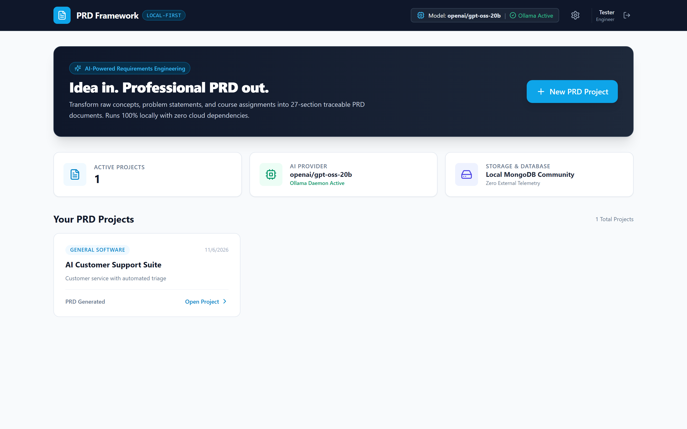
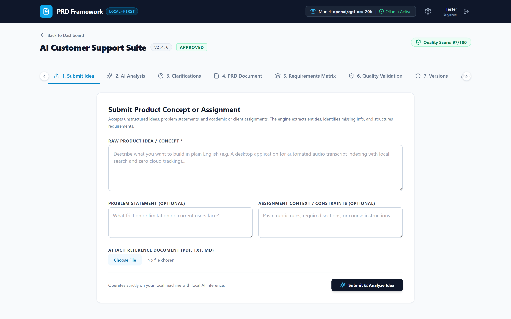
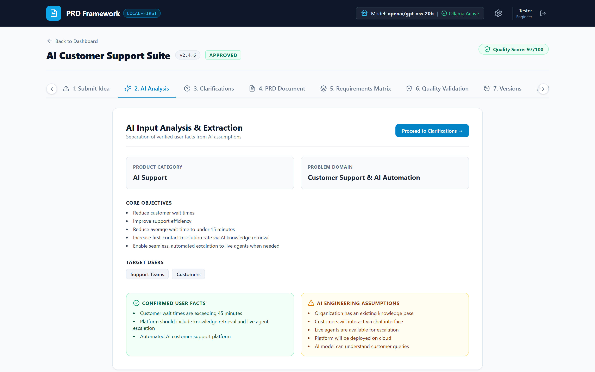
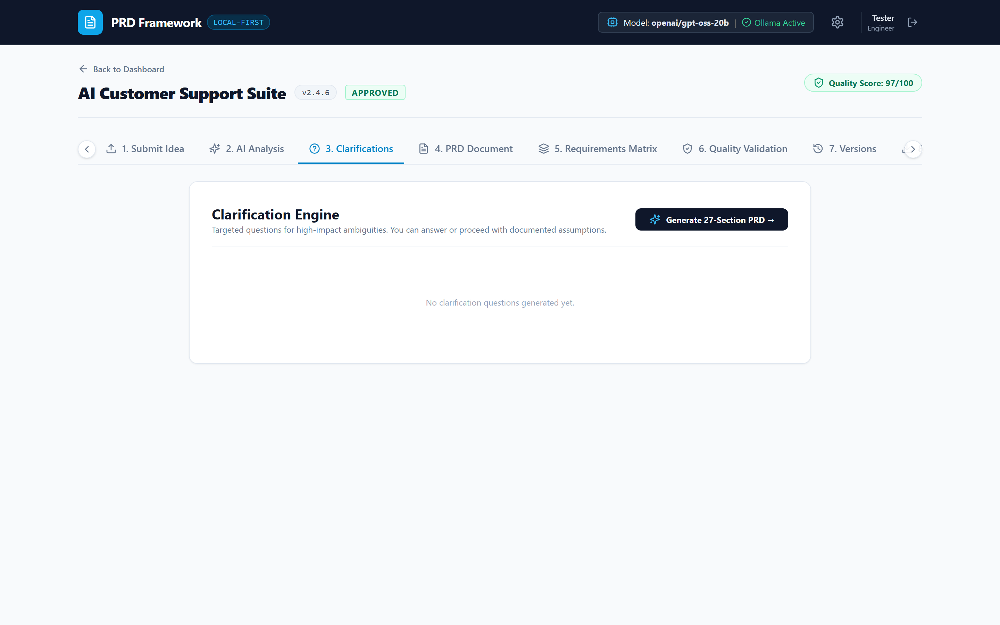
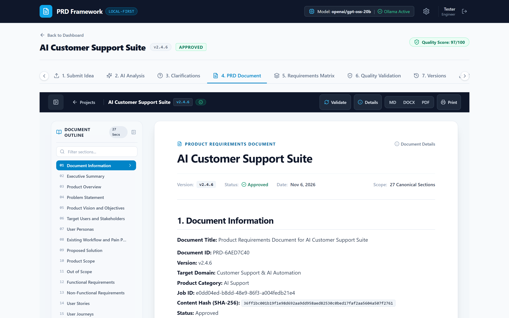
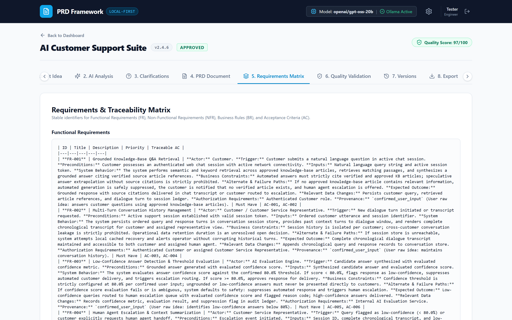
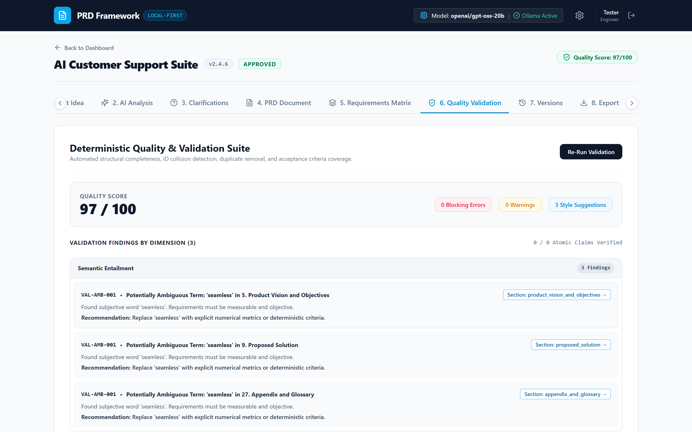
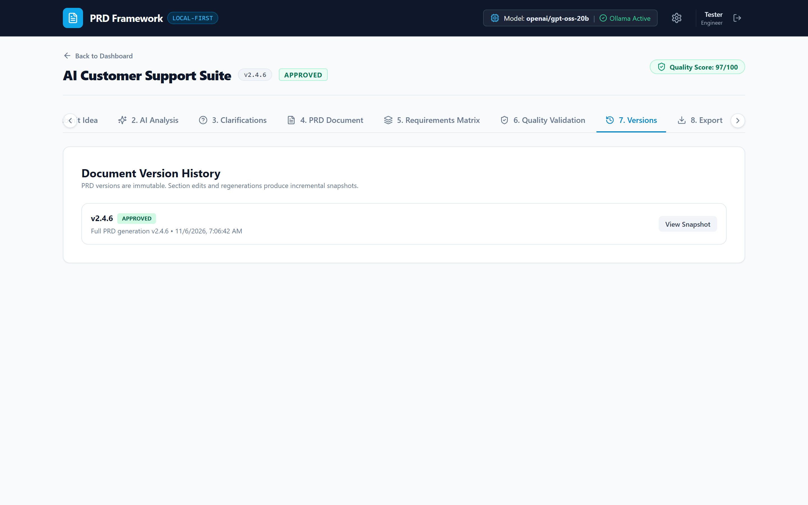
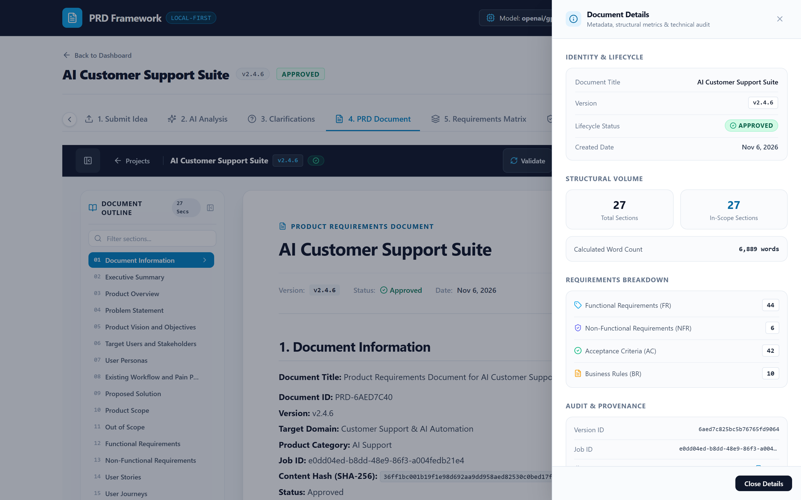

# Local-First Automated PRD Engineering Framework

**Idea in. Professionally engineered PRD out.**

A local-first AI-powered application that converts product ideas, problem statements, and assignment requirements into structured Product Requirements Documents (PRDs).

The framework guides users through idea submission, AI analysis, clarification, PRD generation, requirements traceability, quality validation, version management, and document export.

---

## 1. Project Overview

The PRD Framework helps product teams, developers, students, and engineers convert unstructured ideas into organized product documentation.

Instead of manually writing a PRD from scratch, users provide their product concept and supporting information. The framework analyzes the input, identifies missing details, asks clarification questions, and generates a structured PRD.

### Key Features

- Natural-language product idea submission.
- Problem statement and assignment context support.
- Reference document upload.
- AI-powered idea analysis.
- Interactive clarification engine.
- Documented assumptions and unresolved decisions.
- Structured 27-section PRD generation.
- Functional and non-functional requirements.
- Business rules and acceptance criteria.
- Requirements traceability matrix.
- Quality validation and actionable findings.
- PRD version management.
- Section-level editing and regeneration.
- Markdown, DOCX, and PDF export.
- Local-first architecture with configurable AI providers.

---

## 2. Technology Stack

| Component | Technology |
|---|---|
| Frontend | React 18, TypeScript, Vite |
| Styling | Tailwind CSS |
| Backend | Python, FastAPI |
| Data Validation | Pydantic v2 |
| Database | MongoDB Community Edition |
| MongoDB Driver | Motor |
| Local AI | Ollama |
| Cloud AI | Groq, when configured |
| Document Export | Markdown, DOCX, PDF |
| Containerization | Docker, Docker Compose |
| Backend Testing | Pytest |
| Frontend Testing | Vitest |
| Frontend Build | Vite |

**AI provider configuration:** The application supports local inference through Ollama and can use a configured cloud provider such as Groq. Cloud inference requires the appropriate credentials and configuration. Do not assume that every execution is fully offline.

---

## 3. Application Screenshots

The framework provides an end-to-end, visual workspace for transforming ideas into verified Product Requirements Documents. Each interface corresponds to a key stage of the requirements engineering lifecycle.

### 3.1 Project Dashboard

The dashboard serves as the primary entry point for managing PRD projects. It displays all active workspaces, target business domains, creation timestamps, active PRD identifiers, and quick navigation actions.



### 3.2 Product Idea & Context Ingestion

The idea submission interface accepts raw product concepts, optional problem statements, and academic or enterprise assignment briefs. Users can also attach reference documents (`.pdf`, `.docx`, `.txt`, `.md`, up to 15 MB) to ground downstream generation.



### 3.3 AI-Powered Problem & Domain Analysis

The AI analysis engine parses input materials to extract domain classifications, core objectives, target user personas, required capabilities, and explicit constraints. The system strictly separates user-confirmed facts from AI-inferred assumptions.



### 3.4 Interactive Clarification Engine

The clarification engine identifies ambiguities and information gaps in the product concept, generating prioritized questions (`critical`, `medium`, `low`). Users can choose suggested answers, provide custom answers, or explicitly accept documented assumptions.



### 3.5 Canonical 27-Section PRD Document Viewer

The document viewer presents the full 27-section PRD in a clean, document-first reading experience (850–950px width) with an interactive table of contents, synchronized Section 1 document metadata (version, status, SHA-256 hash), and inline section editing controls.



### 3.6 Requirements & Traceability Matrix

The requirements matrix enforces bidirectional traceability across all functional requirements (`FR-xxx`), non-functional requirements (`NFR-xxx`), and business rules (`BR-xxx`), linking each requirement directly to its acceptance criteria (`AC-xxx`) and provenance source.



### 3.7 Deterministic Quality Validation

The quality validation engine audits generated PRDs across 10 quality dimensions (structural completeness, provenance grounding, semantic entailment, numerical SLAs, and security governance). It reports a deterministic 0–100 quality score, blocking error warnings, and actionable recommendations.



### 3.8 Version History & Immutability

The version management drawer tracks document revisions without destructive overwrites. Approved versions are locked as immutable, with manual edits creating tracked minor revisions (`v1.1`, `v1.2`) and full regenerations allocating major revisions (`v2.0`).



### 3.9 Multi-Format Document Export

The export engine delivers publication-grade exports in Markdown (`.md`), Microsoft Word (`.docx`), and Adobe PDF (`.pdf`), preserving table structures, running headers, page geometry, and cryptographic metadata hashes across all formats.



---

## 4. End-to-End Application Workflow

Follow this 10-step engineering workflow to transform an initial product concept into an approved, exportable PRD.

### Step 1: Create or Open a PRD Project

* **UI Location:** Application Dashboard ([Screenshot 3.1](docs/screenshots/01-dashboard.png))
* **Action:**
  1. Open the application at `http://localhost:3000`.
  2. In the dashboard, enter a project title (e.g., `AI Customer Support Suite`) and an optional target domain.
  3. Click **Create Project** or click **Open Project** on an existing project card.
* **Verification Check:** Confirm that the project workspace opens with the project title displayed in the top navigation bar.

### Step 2: Submit the Product Idea or Assignment

* **UI Location:** Workspace Tab **1. Submit Idea** ([Screenshot 3.2](docs/screenshots/02-submit-idea.png))
* **Action:**
  1. Enter the raw product idea or concept in the **Product Idea / Concept** field.
  2. (Optional) Enter the specific problem definition in **Problem Statement**.
  3. (Optional) Provide assignment context, deliverables, or course constraints in **Assignment Context**.
  4. (Optional) Upload supporting reference files (`.pdf`, `.docx`, `.txt`, `.md`).
  5. Click **Submit & Analyze Idea**.
* **Verification Check:** Ensure the submission status indicator reports success and the application automatically transitions to Stage 2.

### Step 3: Run AI Analysis

* **UI Location:** Workspace Tab **2. AI Analysis** ([Screenshot 3.3](docs/screenshots/03-ai-analysis.png))
* **Action:**
  1. Review the extracted problem domain, primary objectives, target user personas, and core capabilities.
  2. Inspect the **Verified Facts vs. Assumptions** section.
* **Verification Check:** Verify that user-provided facts are correctly classified as `USER_CONFIRMED` and that AI suggestions are explicitly marked as `INFERRED` rather than accepted as facts.

### Step 4: Review Clarifications

* **UI Location:** Workspace Tab **3. Clarifications** ([Screenshot 3.4](docs/screenshots/04-clarifications.png))
* **Action:**
  1. Inspect the prioritized clarification questions generated by the clarification engine.
  2. Review the architectural and business impact note attached to each question.
* **Verification Check:** Identify any critical ambiguities regarding technology stacks, integration partners, authentication models, or SLA targets before providing answers.

### Step 5: Answer Questions or Explicitly Accept Assumptions

* **UI Location:** Workspace Tab **3. Clarifications** ([Screenshot 3.4](docs/screenshots/04-clarifications.png))
* **Action:**
  1. For each question, select one of the suggested answers or type a custom answer in the response field.
  2. Click **Save Answer**.
  3. If an architectural decision is intentionally deferred, click **Accept Assumption** to record the documented rationale.
* **Verification Check:** Confirm that all questions with `critical` impact have either a confirmed user answer or an explicit documented assumption. Do not leave unknown commitments ambiguous.

### Step 6: Generate the PRD

* **UI Location:** Workspace Tab **4. PRD Document**
* **Action:**
  1. Click **Generate 27-Section PRD**.
  2. The system queues a background synthesis job and begins allocating an immutable semantic version (e.g., `v1.0`).
  3. Monitor progress through the 6 pipeline stages: Input Analysis, Requirements Engineering, Stakeholder Analysis, Business Rules, Risk Analysis, and 27-Section Assembly.
* **Verification Check:** Confirm that generation completes successfully, progress reaches 100%, and the full document renders in the workspace.

### Step 7: Review the PRD Document

* **UI Location:** Workspace Tab **4. PRD Document** ([Screenshot 3.5](docs/screenshots/05-prd-document.png))
* **Action:**
  1. Review the document sequentially using the left-hand Table of Contents outline.
  2. Verify critical sections: Document Information, Executive Summary, Scope & Out of Scope, Functional Requirements, Non-Functional Requirements, Business Rules, System Workflows, Security & Privacy, Acceptance Criteria, and Risks & Mitigation.
  3. (Optional) Use **Edit Section** to modify content or **Regenerate** to refine a section with additional guidance.
* **Verification Check:** Ensure no placeholder strings (`[TBD]`, `TODO`, `N/A without rationale`) exist and that Section 1 displays a valid SHA-256 Content Hash.

### Step 8: Inspect the Requirements and Traceability Matrix

* **UI Location:** Workspace Tab **5. Requirements Matrix** ([Screenshot 3.6](docs/screenshots/06-requirements-matrix.png))
* **Action:**
  1. Review the list of functional requirements (`FR-001`+), non-functional requirements (`NFR-001`+), and business rules (`BR-001`+).
  2. Inspect the linked acceptance criteria (`AC-001`+) and priority classifications (`Must Have`, `Should Have`, `Could Have`).
  3. Check the provenance origin tag for every requirement.
* **Verification Check:** Confirm that every functional requirement has at least one mapped acceptance criterion and that no requirement is marked `USER_CONFIRMED` unless explicitly verified by user input.

### Step 9: Run Quality Validation

* **UI Location:** Workspace Tab **6. Quality Validation** ([Screenshot 3.7](docs/screenshots/07-quality-validation.png))
* **Action:**
  1. Inspect the overall validation score (0–100) and findings breakdown across all 10 quality dimensions.
  2. Review any blocking errors, warnings, or style suggestions.
  3. If blocking errors are detected, use the section editor to resolve them and re-run validation.
* **Verification Check:** Confirm that blocking errors equal zero and the verdict is `APPROVED` or `UNDER_REVIEW`. Never approve a document solely on a high numerical score if unresolved semantic contradictions remain.

### Step 10: Review Versions and Export the Document

* **UI Location:** Workspace Tab **7. Versions** & Document Toolbar ([Screenshots 3.8 & 3.9](docs/screenshots/09-document-export.png))
* **Action:**
  1. Click **Approve Version** to transition the verified PRD from `Under Review` to `Approved` (locking the version as immutable).
  2. Inspect the version history drawer to review prior revisions and changelogs.
  3. Use the export toolbar buttons to download the approved PRD in **Markdown (.md)**, **Microsoft Word (.docx)**, or **Adobe PDF (.pdf)** format.
* **Verification Check:** Open and inspect the exported file. Confirm table borders, column widths, running headers, footers, and page numbers render cleanly without text truncation.

---

## 5. Local Development Setup

### Prerequisites

Install the following:

- Python 3.11 or later.
- Node.js and npm.
- MongoDB Community Edition.
- Ollama, if using local inference.
- Git.
- Docker and Docker Compose, if using containerized deployment.

### Repository Structure

```text
PRD-Framework/
├── README.md
├── LICENSE
├── .gitignore
├── .env.example
├── docker-compose.yml
├── pytest.ini
│
├── backend/
│   ├── app/
│   ├── tests/
│   ├── requirements.txt
│   └── Dockerfile
│
├── frontend/
│   ├── src/
│   ├── public/
│   ├── package.json
│   ├── package-lock.json
│   └── Dockerfile
│
├── docs/
│   ├── architecture/
│   │   ├── ARCHITECTURE.md
│   │   ├── HLD.md
│   │   ├── LLD.md
│   │   ├── ASYNC_JOB_ARCHITECTURE.md
│   │   └── PRD_ENGINEERING_V2_DATA_FLOW.md
│   ├── user-guide/
│   │   └── PRD.md
│   ├── development/
│   │   ├── SECURITY.md
│   │   ├── TEST_STRATEGY.md
│   │   ├── PDF_FORMATTING_REPAIR_REPORT.md
│   │   └── UNIFIED_PRD_FORMATTING_REPORT.md
│   ├── screenshots/
│   │   └── 01-dashboard.png ... 09-document-export.png
│   ├── examples/
│   │   └── customer_support_prd_example.md
│   └── archive/phase-reports/
│       └── [historical phase reports & milestone validation artifacts]
│
├── scripts/
└── tests/
    └── fixtures/
        └── historical-prds/
```

The exact repository structure may contain additional directories and configuration files.

### Backend Setup

Open a terminal:

```bash
cd backend
```

Create a virtual environment:

```bash
python -m venv venv
```

Activate it on Windows PowerShell:

```powershell
.\venv\Scripts\Activate.ps1
```

Install dependencies:

```bash
pip install -r requirements.txt
```

Start the backend:

```bash
python -m uvicorn app.main:app --host 0.0.0.0 --port 8000 --reload
```

Backend API:

```text
http://localhost:8000
```

Swagger documentation:

```text
http://localhost:8000/docs
```

### Frontend Setup

Open another terminal:

```bash
cd frontend
```

Install dependencies:

```bash
npm install
```

Start the frontend:

```bash
npm run dev
```

Open:

```text
http://localhost:3000
```

Use the actual Vite development port configured in the project if it differs from 3000.

### Database Setup

Ensure MongoDB is running and that the backend connection string points to the correct database.

For a local MongoDB instance, a typical connection string is:

```text
mongodb://localhost:27017
```

Use the database and environment configuration defined by the backend. Never commit production credentials or API keys.

### Ollama Setup

Install and start Ollama if local inference is required.

Check available models:

```bash
ollama list
```

Pull a model only if it is not already installed:

```bash
ollama pull qwen3.5:4b
```

The actual model name must match the configured model in the application.

---

## 6. Docker Compose Setup

To start the containerized application:

```bash
docker compose up --build
```

To run in the background:

```bash
docker compose up --build -d
```

To inspect containers:

```bash
docker compose ps
```

To inspect logs:

```bash
docker compose logs -f
```

To stop services:

```bash
docker compose down
```

Verify the actual service names, ports, volumes, and environment variables in `docker-compose.yml`.

---

## 7. Testing

### Backend Tests

```bash
cd backend
pytest -v
```

### Frontend Tests

```bash
cd frontend
npm run test
```

### Frontend Lint

```bash
npm run lint
```

### Frontend Production Build

```bash
npm run build
```

### Full Test Runner

The existing README documents the following command:

```bash
python backend/tests/runner.py
```

Run it from the repository root.

Record the actual command output and exit code. A canceled or skipped test must not be reported as passed.

---

## 8. Troubleshooting

### MongoDB Duplicate Version Error

Example:

```text
E11000 duplicate key error collection:
prd_framework.prd_versions
index: uniq_prd_version

dup key:
{
  prd_id: "...",
  version_number: "v2.4.6"
}
```

**Cause:**

The database has a unique compound index on:

```text
prd_id + version_number
```

The application is trying to insert a version that already exists for the same PRD.

**Expected behavior:**

1. Check whether the version already exists.
2. If generation is a retry, handle it idempotently or return the existing generation result.
3. If this is a new revision, allocate the next available version number.
4. Use a database-safe version allocation strategy to handle concurrent requests.
5. Return a meaningful conflict or retry response instead of exposing a raw MongoDB exception.

Do not delete the existing version or drop the unique index as a workaround. The unique index protects version integrity.

### Backend Is Not Starting

Check:

- Python virtual environment is activated.
- Dependencies are installed.
- MongoDB is reachable.
- Environment variables are configured.
- The configured backend port is available.

### Frontend Cannot Connect to Backend

Check:

- Backend is running.
- API base URL is correct.
- CORS configuration permits the frontend origin.
- Browser network errors.
- Backend logs.

### AI Generation Fails

Check:

- The selected AI provider is available.
- Ollama is running when using local inference.
- The configured model is installed.
- Groq credentials are valid when using Groq.
- Provider timeout and rate-limit responses.
- Backend logs for the original exception.

Do not silently switch to a mock or fallback generator and present its output as genuine AI-generated content.

### PDF or DOCX Formatting Problems

Check:

- Markdown table rendering.
- Mermaid diagram rendering.
- Page breaks and content overflow.
- Font consistency.
- Table widths and wrapping.
- Exported document against the application preview.

A Markdown code block containing a table is not automatically a rendered table. Similarly, Mermaid source code is not automatically a rendered diagram. The export pipeline must explicitly convert these elements into the appropriate document structures or renderable images.

---

## 9. Important Engineering Principles

1. User-confirmed facts must remain distinguishable from AI assumptions.
2. Unresolved decisions must not become mandatory requirements.
3. Requirements must have stable identifiers.
4. Acceptance criteria must be traceable to their parent requirements.
5. Generated content must not invent business rules, integrations, metrics, or architecture decisions.
6. Version history must remain immutable.
7. Duplicate version creation must be handled safely.
8. Validation must inspect semantic correctness, not only document structure.
9. Exported documents must be checked independently.
10. A quality score must not replace human review.

---

## 10. Future Development Roadmap

The long-term direction is to extend the framework beyond PRD generation.

| Stage | Deliverable |
|---|---|
| 1 | Product Requirements Document (PRD) |
| 2 | High-Level Design (HLD) |
| 3 | Low-Level Design (LLD) |
| 4 | Implementation Plan |
| 5 | Development Workflow |
| 6 | Testing and Verification |

Each stage should maintain traceability to the approved upstream artifact.

Changes to an approved PRD should trigger impact analysis for downstream documents rather than silently changing them.

---

## 11. Contributing

1. Fork the repository.
2. Create a feature branch.
3. Implement the change.
4. Add or update tests.
5. Run the relevant quality checks.
6. Submit a pull request with implementation details and test evidence.

---

## 12. License

Add the applicable project license and ownership information before publishing or distributing the repository.
