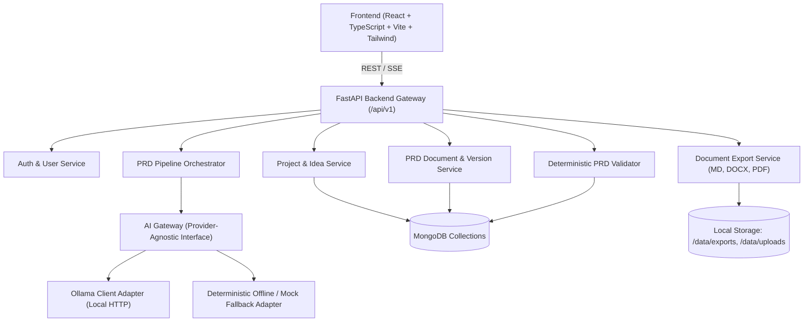

# Architecture and Specification: Local-First Automated PRD Engineering Framework

## 1. System Overview & PRD Requirement Breakdown

The framework is a local-first system designed to transform unstructured product ideas, problem statements, and assignments into validated, professional Product Requirements Documents (PRDs).

### Functional Requirement Matrix
- **Input Management (FR-001 - FR-005):** Multi-modal text submission (idea, problem statement, assignments, uploaded reference files), preservation of original input, multi-project workspace.
- **Input Understanding (FR-010 - FR-015):** Classification, problem extraction, target user identification, objective/constraint extraction, fact vs assumption boundary enforcement.
- **Clarification Engine (FR-020 - FR-024):** Impact-ranked clarification questions, documented assumption bypass, incremental requirement updates.
- **Requirement Engineering (FR-030 - FR-039):** Objectives, personas, user stories (Gherkin/standard), functional & non-functional requirements with stable IDs (FR-XXX, NFR-XXX), business rules (BR-XXX), workflows, acceptance criteria (AC-XXX), scope & out-of-scope.
- **Risk & Feasibility (FR-040 - FR-044):** Technical, operational, security risks with mitigations; explicit uncertainty markers for unverified assertions.
- **PRD Generation (FR-050 - FR-056):** 27-section canonical PRD document, section-level editing, section-level regeneration, semantic versioning (v1.0, v1.1), multi-format export (Markdown, PDF, DOCX).
- **PRD Validation (FR-060 - FR-065):** Deterministic structural and semantic validation (missing sections, ID gaps, orphan requirements without AC, duplicate or contradictory statements), actionable validation reports.
- **Local AI Management (FR-070 - FR-074):** Ollama connector with fallback mock/offline adapter, model profile registry, generation telemetry & prompt version tracking.

---

## 2. Technical Architecture & Component Boundaries

### Module Boundaries
1. `backend/app/core`: Configuration, security, logging, exceptions, database connection.
2. `backend/app/models`: Domain models and Pydantic validation schemas.
3. `backend/app/db`: MongoDB client, motor asynchronous driver, collection repositories.
4. `backend/app/ai`:
   - `gateway.py`: Provider-agnostic AI interface (`AIGatewayInterface`).
   - `ollama_adapter.py`: Ollama API adapter (`/api/generate`, `/api/chat`).
   - `offline_adapter.py`: Deterministic fallback adapter ensuring 100% offline testability.
   - `pipeline/`: Pipeline stages (InputAnalyzer, AssignmentParser, ProblemAnalyst, ClarificationEngine, RequirementEngineer, RiskAnalyst, PRDGenerator, PRDValidator).
5. `backend/app/services`:
   - `project_service.py`: Project lifecycle & idea submissions.
   - `clarification_service.py`: Q&A session orchestration.
   - `prd_service.py`: Document generation, section patching, regeneration, and versioning.
   - `validation_service.py`: Structural rule checking & semantic linting.
   - `export_service.py`: Markdown, DOCX, and PDF document compilers.
6. `backend/app/api`: FastAPI route controllers partitioned under `/api/v1`.
7. `frontend/src`:
   - `pages/`: Dashboard, Projects, IdeaInput, ClarificationQA, PRDEditor, ValidationReport, VersionHistory, Settings.
   - `components/`: UI layout, section cards, diff viewers, export modal, status badges.
   - `api/`: Typed client bindings for backend API.

---

## 3. Database Schema Design (MongoDB)

Collections and indexes:
1. `users`: Local user credentials, role, preferences.
2. `projects`: Project title, description, timestamps, active PRD ID.
3. `idea_submissions`: Raw input, type (`idea`, `problem_statement`, `assignment`, `hybrid`), uploaded reference file paths.
4. `analysis_records`: Stage outputs, parsed assignment requirements, domain classification, extracted entities.
5. `clarification_sessions`: Questions generated, priority (`critical`, `medium`, `low`), user answers, resolved assumptions.
6. `assumptions`: Documented AI-generated assumptions, status (`unverified`, `confirmed`, `rejected`), confidence.
7. `prd_documents`: Top-level document container, active version, project ID.
8. `prd_versions`: Immutable version snapshots (`version_number`, `sections` map, `metadata`, `changelog`, `created_by`, `status`).
9. `validation_reports`: Structural and semantic validation results, issues array (`severity`, `section`, `rule_id`, `description`, `recommendation`).
10. `generation_runs`: Execution telemetry (model used, prompt version, duration, token metrics, errors).

---

## 4. API Endpoint Specification

### Auth & System
- `POST /api/v1/auth/register`: Register local account.
- `POST /api/v1/auth/login`: Authenticate and receive JWT token.
- `GET  /api/v1/auth/me`: Get current user info.
- `GET  /api/v1/health`: System health and status of Ollama / MongoDB.
- `GET  /api/v1/models`: List available local Ollama models.
- `POST /api/v1/models/select`: Set default model for generation pipeline.

### Projects & Ideas
- `GET  /api/v1/projects`: List all user projects.
- `POST /api/v1/projects`: Create project.
- `GET  /api/v1/projects/{id}`: Get project details.
- `POST /api/v1/projects/{id}/submissions`: Submit idea/assignment with optional file upload.
- `POST /api/v1/projects/{id}/analyze`: Trigger AI input analysis & assignment parsing.
- `GET  /api/v1/projects/{id}/analysis`: Retrieve analysis record.

### Clarifications
- `GET  /api/v1/projects/{id}/clarifications`: List questions and status.
- `POST /api/v1/projects/{id}/clarifications/answer`: Submit answers or accept assumptions.

### PRD Generation & Editing
- `POST /api/v1/projects/{id}/prd/generate`: Trigger full PRD generation pipeline.
- `GET  /api/v1/projects/{id}/prd`: Get active PRD document and latest version.
- `GET  /api/v1/projects/{id}/prd/versions`: List all historical versions.
- `GET  /api/v1/projects/{id}/prd/versions/{v_id}`: Get specific version.
- `PATCH /api/v1/projects/{id}/prd/sections/{section_id}`: Edit a single section (creates new minor version).
- `POST /api/v1/projects/{id}/prd/sections/{section_id}/regenerate`: Regenerate a single section using AI.
- `POST /api/v1/projects/{id}/prd/approve`: Mark current version as Approved.

### Validation & Export
- `POST /api/v1/projects/{id}/prd/validate`: Run deterministic validation suite.
- `GET  /api/v1/projects/{id}/prd/validation`: Get latest validation report.
- `GET  /api/v1/projects/{id}/prd/export/{format}`: Export as `markdown`, `docx`, or `pdf`.

---

## 5. AI Processing Pipeline

The pipeline operates in explicit stages to prevent context overflows and hallucinations:

1. **Input Analyzer & Assignment Parser**:
   - Determines type: Freeform Idea, Problem Statement, or Academic/Corporate Assignment.
   - Extracts mandatory sections, expected length, explicit non-functional limits.
2. **Problem Analyst & Domain Classifier**:
   - Identifies problem domain, root pain points, current manual/inefficient workflows.
3. **Clarification Engine**:
   - Compares required information against supplied info.
   - Formulates targeted questions. Non-critical gaps turn into documented `Assumption` records with confidence indicators.
4. **Stakeholder & User Journey Engineer**:
   - Synthesizes user personas, user stories with Acceptance Criteria (`Given/When/Then`).
5. **Requirement Engineer**:
   - Generates numbered Functional Requirements (`FR-001`, etc.) and Non-Functional Requirements (`NFR-001`, etc.).
   - Generates Business Rules (`BR-001`, etc.) and System Workflows.
6. **Risk & Security Analyst**:
   - Technical, operational, privacy, and dependency risks with mitigations.
7. **PRD Generator**:
   - Assembles canonical 27 sections according to PRD document template.
8. **PRD Validator**:
   - Runs deterministic rules: check all required sections exist, ID uniqueness, AC completeness, traceability, assumption flagging.

---

## 6. Implementation Strategy & Test Plan

- **Step 1:** Backend foundational architecture (FastAPI, Motor DB connection, Auth, Models).
- **Step 2:** AI Gateway, Multi-stage Pipeline, and Prompt templates with resilient JSON parsing.
- **Step 3:** PRD Generation, Section Editor, Versioning, and Export engine (MD, DOCX, PDF).
- **Step 4:** Deterministic Validation Engine & Quality reporting.
- **Step 5:** React + Vite + Tailwind Frontend with full workflow UI.
- **Step 6:** Docker Compose, unit tests, integration tests, end-to-end verification.
