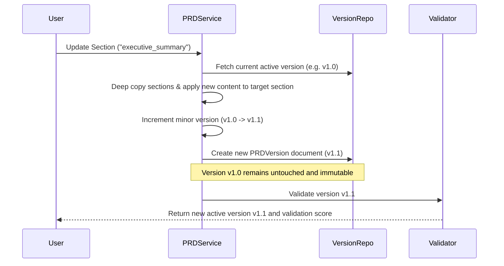

# Low-Level Design (LLD)
## Local-First Automated PRD Engineering Framework

**Status:** As-Built Implementation  
**Version:** 1.0.0

---

## 1. 10-Stage AI Pipeline Components

The pipeline is organized into 10 logically independent processing components in `backend/app/ai/pipeline/`:

| Component | Responsibility | Input Schema | Output Schema |
|---|---|---|---|
| **1. Input Analyzer** (`input_analyzer.py`) | Domain classification, core objectives, fact vs assumption extraction. | `IdeaSubmissionResponse` | `AnalysisRecord` |
| **2. Assignment Parser** (`assignment_parser.py`) | Extracts instructions, mandatory sections, deliverables, and constraints from assignments. | `AssignmentParserInput` | `AssignmentParserOutput` |
| **3. Problem Analyst** (`problem_analyst.py`) | Identifies root pain points, current limitations, and target business outcomes. | `ProblemAnalystInput` | `ProblemAnalystOutput` |
| **4. Clarification Engine** (`clarification_engine.py`) | Formulates ranked questions (`critical`, `medium`, `low`) with suggested options. | `AnalysisRecord` | `ClarificationSession` |
| **5. Stakeholder Analyst** (`stakeholder_analyst.py`) | Derives user personas, goals, frustrations, and end-to-end user journeys. | `StakeholderAnalystInput` | `StakeholderAnalystOutput` |
| **6. Requirement Engineer** (`requirement_engineer.py`) | Formulates numbered Functional Requirements (`FR-001`), NFRs (`NFR-001`), and Acceptance Criteria (`AC-001`). | `AnalysisRecord`, `ClarificationSession` | `Dict[str, Any]` |
| **7. Business Rules Analyst** (`business_rules_analyst.py`) | Derives operational invariants and domain constraints (`BR-001`). | `BusinessRulesInput` | `BusinessRulesOutput` |
| **8. Risk Analyst** (`risk_analyst.py`) | Categorizes technical, operational, quality, and dependency risks with mitigations. | `RiskAnalystInput` | `RiskAnalystOutput` |
| **9. PRD Generator** (`prd_generator.py`) | Synthesizes all outputs into 27 canonical sections with Markdown tables. | Project context, Analysis, Requirements | `Dict[str, PRDSectionContent]` |
| **10. PRD Validator** (`prd_validator.py`) | Runs structural completeness, ID collision, and Given-When-Then mapping checks. | `PRDValidatorInput` | `PRDValidatorOutput` |

---

## 2. MongoDB Collection Schema & Indexes

All indexes are initialized idempotently on startup by `backend/app/db/indexes.py`:

```
users:
  - _id (ObjectId, default)
  - username (String, Unique Index: uniq_username)
  - email (String, Unique Index: uniq_email)
  - created_at (DateTime, Index: idx_user_created)

projects:
  - _id (ObjectId)
  - owner_id + updated_at (Compound Index: idx_owner_updated)
  - title (String, Index: idx_project_title)

idea_submissions:
  - _id (ObjectId)
  - project_id + created_at (Compound Index: idx_proj_submissions)

analysis_records:
  - _id (ObjectId)
  - project_id + created_at (Compound Index: idx_proj_analysis)

clarification_sessions:
  - _id (ObjectId)
  - project_id + created_at (Compound Index: idx_proj_clarifications)

prd_documents:
  - _id (ObjectId)
  - project_id (Unique Index: uniq_proj_prd)

prd_versions:
  - _id (ObjectId)
  - prd_id + version_number (Compound Unique Index: uniq_prd_version)
  - project_id + created_at (Compound Index: idx_proj_versions)

validation_reports:
  - _id (ObjectId)
  - prd_version_id + created_at (Compound Index: idx_version_validation)

generation_runs:
  - _id (ObjectId)
  - project_id + created_at (Compound Index: idx_proj_generation_runs)
```

---

## 3. Version Immutability Model



---

## 4. Export Service Implementation

- **Markdown (`export_markdown`):** Compiles title, metadata header, changelog, and sequential Markdown sections with formatted tables and Mermaid blocks.
- **DOCX (`export_docx`):** Uses `python-docx` to construct styled headings, center-aligned title blocks, and OpenXML data tables (`Light Shading Accent 1` style).
- **PDF (`export_pdf`):** Uses `reportlab.platypus.SimpleDocTemplate` to render formatted paragraphs, metadata headers, running headers, and page margins.

