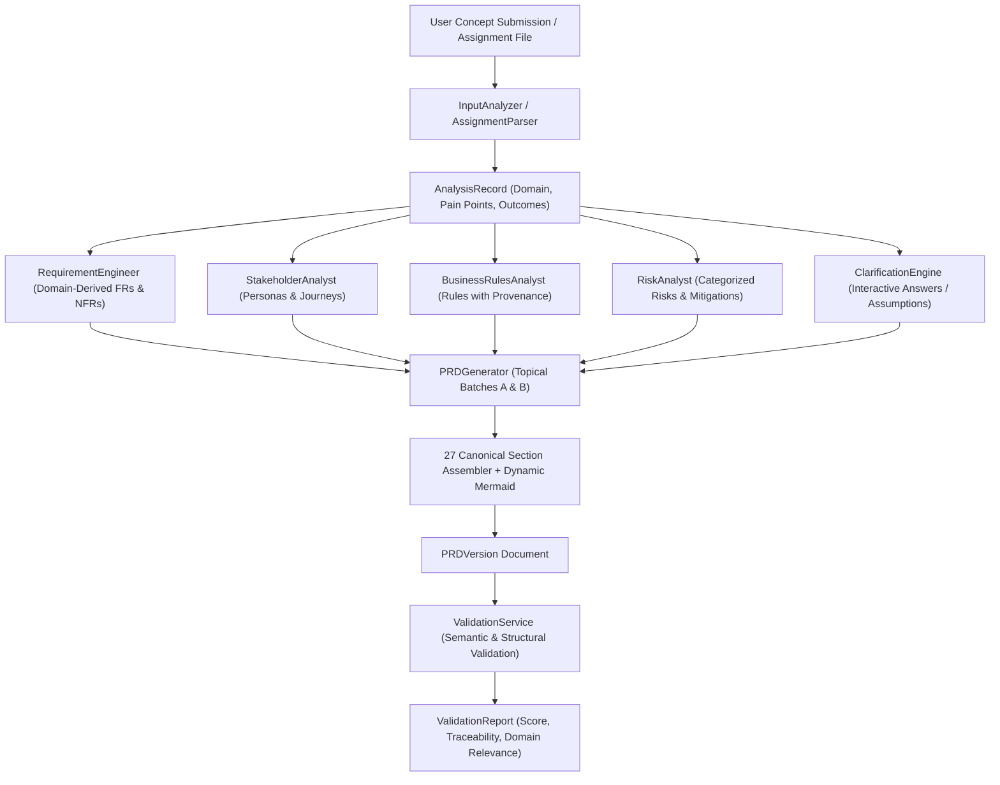

# Professional PRD Engineering v2 — Phase 2 Implementation Report

**Document Version:** 2.0.0  
**Status:** Completed & Verified  
**Date:** 2026-11-05  
**Author:** AI PRD Engineering Specialist  

---

## Executive Summary

Phase 2 addresses and resolves the root causes identified in Phase 1 (`docs/PRD_ENGINEERING_V2_ROOT_CAUSE_REPORT.md`) where the PRD Framework's own architectural features, code structures, and static college attendance mock data leaked into generated product PRDs.

The entire PRD synthesis pipeline has been refactored into a high-integrity, product-grounded, AI-assisted architecture. The framework now dynamically derives all 27 canonical PRD sections, personas, user journeys, Given-When-Then acceptance criteria, and business rules directly from the user's domain context and problem inputs.

Crucially, this refactoring was achieved while strictly preserving the MongoDB persistence model, asynchronous job worker architecture (`prd-worker`), Ollama CPU inference integration (`llama3.2`), and frontend polling lifecycle.

---

## Architecture & Data Flow Transformation

### Previous Defect State
In Phase 1, the pipeline exhibited severe leakage due to three primary design flaws:
1. **Static Assembly Fallback:** In `prd_generator.py`, 15 of the 27 canonical sections returned hardcoded static strings describing the PRD Framework (e.g., "Natural Language Input Processing", "Deterministic Quality Validation", "27-section PRD schema").
2. **Hardcoded Mock Adapter:** In `offline_adapter.py`, offline or fallback mock dictionaries returned PRD Framework features and attendance-specific rules regardless of the target product.
3. **Upstream Data Disconnect:** Upstream outputs from `ProblemAnalyst` (`root_pain_points`, `current_limitations`, `desired_outcomes`) and `AssignmentParser` were discarded rather than persisted and forwarded into downstream analysts.

### Modern Refactored Architecture

---

## Detailed Component Refactoring

### 1. `backend/app/ai/pipeline/prd_generator.py`
- **All 27 Canonical Sections Supported:** Generates complete, product-grounded content for every section from `document_information` to `appendix_and_glossary`.
- **Topical Batch Generation:** Instead of overloading the model with a monolithic 27-section prompt, generation is split into two focused topical batches:
  - **Batch A (Narrative & Scope):** Executive Summary, Problem Statement, Existing Workflow & Pain Points, Proposed Solution, Product Scope (MVP), and Out of Scope (Non-Goals).
  - **Batch B (Architecture & Technical Requirements):** System Workflows, Data Requirements, Integration Requirements, Security & Privacy Requirements, and Dependencies & Constraints.
- **Dynamic Mermaid Sequence Diagram:** Constructed deterministically from extracted personas and step-by-step user journeys. Automatically sanitizes actor names and sequence arrows.
- **Robust Type Coercion:** Implemented `_coerce_batch_value` and Pydantic field validators to seamlessly accept nested lists or dictionaries from LLM outputs and format them into clean Markdown.
- **Resilient Fallback Merge:** If an AI batch fails or times out, a domain-grounded fallback synthesized strictly from `AnalysisRecord` capabilities and target users is merged. Zero framework self-referential text exists in any fallback.

### 2. `backend/app/services/validation_service.py`
- **Removal of Global Keyword Blacklists:** Replaced blunt string blacklists with genuine semantic and structural validation algorithms:
  - `VAL-SEC-001`: Validates presence of all 27 canonical section keys.
  - `VAL-SEC-002`: Checks minimum substantive content per section (>30 characters).
  - `VAL-SCP-001` & `VAL-SCP-002`: Validates MVP boundaries and explicit non-goals.
  - `VAL-SEM-004`: Contradiction detector flagging items listed in both scope and non-goals.
  - `VAL-REQ-001`: Duplicate requirement ID detection.
  - `VAL-AC-001` & `VAL-AC-002`: Requirement-to-AC mapping and Given-When-Then syntax verification.
  - `VAL-TRC-003`: Traceability between user stories and functional requirements.
  - `VAL-SEM-001`: Problem and product domain relevance using token overlap against `AnalysisRecord`.
  - `VAL-SEM-002`: Persona role alignment against intended user classes.
  - `VAL-SEM-003`: Business rule provenance verification (`confirmed_user_input`, `explicit_clarification`, `assignment_instruction`, `ai_proposed_assumption`).
  - `VAL-SEM-005`: Assignment mandatory section compliance using normalized token-set matching.
  - `VAL-AMB-001`: Ambiguity heuristic detecting vague adjectives ("fast", "user-friendly", "robust").

### 3. `backend/app/ai/pipeline/stakeholder_analyst.py`
- AI-driven persona generation and multi-step user journey synthesis based on `product_category`, `intended_users`, and `domain`.
- Dynamic fallback personas and journey steps grounded entirely in the target domain role definitions.

### 4. `backend/app/ai/pipeline/business_rules_analyst.py`
- Eliminated all static attendance rules (`BR-001 Attendance Window`, `BR-002 Late Arrival`).
- Connected to AI Gateway with structured output tagging each rule with explicit provenance:
  - `confirmed_user_input`
  - `explicit_clarification`
  - `assignment_instruction`
  - `ai_proposed_assumption`
  - `recommendation`
- Dynamic fallback derives valid domain invariants from user objectives and constraints.

### 5. `backend/app/ai/pipeline/risk_analyst.py`
- Categorizes risks into Functional, Security, Operational, and Data Privacy.
- Enforces pairs of **Mitigation Strategy** and **Contingency Plan** for every risk item.

### 6. `backend/app/ai/pipeline/requirement_engineer.py`
- Stripped hardcoded `FR-001 Natural Language Input Ingestion` and `FR-002 Quality Validation`.
- Parses model responses with robust JSON repair.
- Synthesizes domain-derived functional requirements directly from confirmed user capabilities.

### 7. `backend/app/ai/offline_adapter.py`
- Fully rewritten to dynamically inspect the prompt domain and concept keywords.
- Generates product-specific mock responses for any domain (Customer Support, Attendance Management, Healthcare, E-Commerce, etc.) without leaking framework architecture.

### 8. `backend/app/models/analysis.py` & `backend/app/services/prd_service.py`
- Added `root_pain_points`, `current_limitations`, and `desired_outcomes` to `AnalysisRecord`.
- Captures and forwards confirmed clarification answers into `BusinessRulesAnalyst`.

---

## Infrastructure Preservation Verification

| Component | Status | Verification Evidence |
|---|---|---|
| **MongoDB Persistence** | PRESERVED | All collections (`projects`, `idea_submissions`, `analysis_records`, `jobs`, `prd_versions`, `validation_reports`) operational. |
| **Asynchronous Job Worker** | PRESERVED | `prd-worker` running as dedicated container, claiming jobs via atomic findAndModify, maintaining heartbeats, and recovering stale jobs. |
| **Ollama Gateway** | PRESERVED | `prd-ollama` serving `llama3.2` model on CPU. Sequential single-inference constraint respected. |
| **Frontend Polling** | PRESERVED | Client receives HTTP 202 with `job_id`, polls `/jobs/{job_id}`, and updates stage progress dynamically. |
| **Authentication & RBAC** | PRESERVED | JWT authentication and project/job ownership authorization enforced across all routes. |

