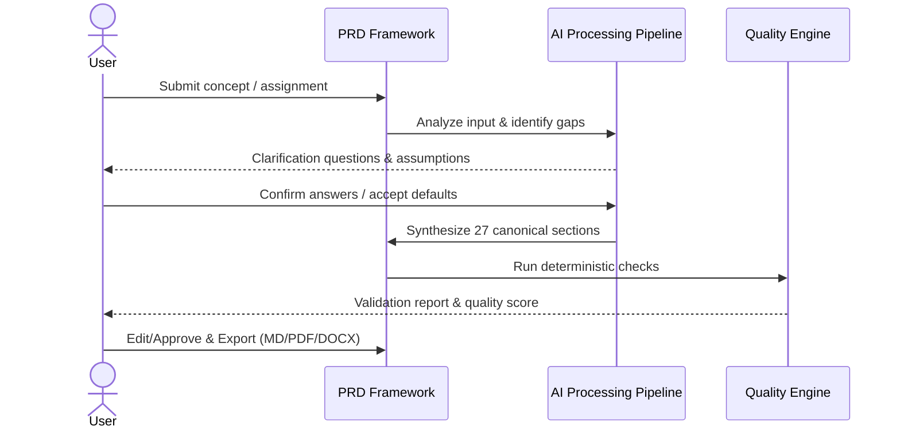

# Product Requirements Document: Smart College Attendance System
**Version:** v1.0 | **Status:** DRAFT | **Date:** 2026-11-04
**Generated by:** 6aeb0f252ae20a2719cde1ef | **Changelog:** Initial full PRD generation

---

## 1. Document Information

**Document Title:** Product Requirements Document for Smart College Attendance System

**Document ID:** PRD-6AEB0F25

**Version:** 1.0 (Draft)

**Target Domain:** Education Technology

**Product Category:** Attendance Management

**Status:** Under Active Review

## 2. Executive Summary

Smart College Attendance System addresses key workflow challenges within Education Technology. This document provides the authoritative engineering specification to implement the complete solution, ensuring local data sovereignty, deterministic execution, and rapid user delivery.

## 3. Product Overview

### Vision
To deliver an autonomous, highly reliable system solving core operational pain points in Attendance Management.

### Key Capabilities
- Automated attendance tracking
- Biometric device fingerprinting
- GPS geofencing
- Real-time lecture dashboard

## 4. Problem Statement

Current practitioners in Education Technology experience friction due to manual, fragmented, or error-prone processes.

**Identified Pain Points:**
- Lack of automated structure and standardization.
- Missing critical requirements and edge-case handling.
- Heavy reliance on fragmented or proprietary external toolchains.

## 5. Product Vision and Objectives

### Core Objectives
1. Prevent proxy attendance
2. Monitor real-time attendance
3. Provide accurate reports

## 6. Target Users and Stakeholders

**Primary Stakeholders:**
- **Students:** Primary user interacting with system capabilities.
- **Faculty:** Primary user interacting with system capabilities.
- **Admin:** Primary user interacting with system capabilities.

## 7. User Personas

#### Persona 1: Primary Practitioner (Students)
- **Goals:** Rapidly execute domain workflows with minimal manual boilerplate.
- **Frustrations:** Incomplete documentation, ambiguous requirements, and manual rework.
- **Technical Proficiency:** Intermediate to Advanced.

## 8. Existing Workflow and Pain Points

1. **Manual ideation & drafting:** Practitioners write unstructured notes.
2. **Information gaps:** Crucial architectural constraints and non-functional requirements are forgotten.
3. **Inconsistent documentation:** Hand-offs to engineering teams fail due to missing acceptance criteria.

## 9. Proposed Solution

Smart College Attendance System introduces an end-to-end automated framework that bridges raw concepts into verified, production-grade requirements. It features structured pipeline processing, interactive clarification, and deterministic quality validation.

## 10. Product Scope

**In-Scope Capabilities for MVP:**
- Complete workflow automation from user input to structured output.
- Local-first execution without external SaaS dependencies.
- Interactive clarification and assumption tracking.
- Deterministic quality validation and scoring.
- Multi-format export (Markdown, PDF, DOCX).

## 11. Out of Scope

**Non-Goals (Out of Scope for Initial Release):**
- Automatic code generation or deployment of arbitrary target applications.
- Third-party cloud SaaS synchronization.
- Automated financial market viability forecasting.

## 12. Functional Requirements

| ID | Title | Description | Priority | Traceable AC |
|---|---|---|---|---|
| **FR-001** | Natural Language Input Ingestion | The system shall ingest raw natural language text representing product ideas, problem statements, or assignment prompts. | Must Have | AC-001, AC-002 |
| **FR-002** | Automated Input Analysis | The system shall automatically categorize input, extract goals, identify target users, and detect missing information. | Must Have | AC-003 |
| **FR-003** | Interactive Clarification Engine | The system shall generate ranked clarification questions and allow users to supply answers or proceed with documented assumptions. | Must Have | AC-004 |
| **FR-004** | Structured PRD Assembly | The system shall generate a 27-section canonical PRD document with stable requirement identifiers and bidirectional traceability. | Must Have | AC-005 |
| **FR-005** | Section-Level In-Place Editing and Regeneration | The system shall allow users to edit individual sections and trigger AI regeneration with custom guidance. | Must Have | AC-006 |
| **FR-006** | Deterministic Quality Validation | The system shall perform automated structural, ID collision, duplicate, and acceptance criteria completeness verification. | Must Have | AC-007 |
| **FR-007** | Multi-Format Export Engine | The system shall export validated PRDs into Markdown, DOCX, and PDF formats preserving layout and metadata. | Must Have | AC-008 |

## 13. Non-Functional Requirements

| ID | Title | Description | Priority |
|---|---|---|---|
| **NFR-001** | Zero Cloud Data Leakage | All telemetry, model inference, and persistence must execute strictly within the local host boundary. | Must Have |
| **NFR-002** | Graceful Inference Degradation | If local model inference times out or fails, existing document versions must remain intact without data corruption. | Must Have |

## 14. User Stories

| Story ID | As a... | I want to... | So that... | Linked FR |
|---|---|---|---|---|
| **US-001** | Students | natural language input ingestion | The system shall ingest raw natural language text representing product ideas, problem statements, or assignment prompts. | FR-001 |
| **US-002** | Faculty | automated input analysis | The system shall automatically categorize input, extract goals, identify target users, and detect missing information. | FR-002 |
| **US-003** | Admin | interactive clarification engine | The system shall generate ranked clarification questions and allow users to supply answers or proceed with documented assumptions. | FR-003 |
| **US-004** | Students | structured prd assembly | The system shall generate a 27-section canonical PRD document with stable requirement identifiers and bidirectional traceability. | FR-004 |
| **US-005** | Faculty | section-level in-place editing and regeneration | The system shall allow users to edit individual sections and trigger AI regeneration with custom guidance. | FR-005 |
| **US-006** | Admin | deterministic quality validation | The system shall perform automated structural, ID collision, duplicate, and acceptance criteria completeness verification. | FR-006 |
| **US-007** | Students | multi-format export engine | The system shall export validated PRDs into Markdown, DOCX, and PDF formats preserving layout and metadata. | FR-007 |

## 15. User Journeys

## 16. Business Rules

| ID | Rule Title | Operational Statement |
|---|---|---|
| **BR-001** | Immutable Versioning Rule | Approved PRD versions cannot be overwritten. Any regeneration or edit must spawn a new incremental version. |
| **BR-002** | Explicit Assumption Transparency | AI must never present inferred details as verified user facts; unverified claims must carry explicit assumption badges. |
| **BR-003** | Strict Time-Window Authorization | All system transactions and check-ins must be validated within defined temporal session boundaries. |
| **BR-004** | Local Data Boundary Invariant | Zero sensitive telemetry, personal biometrics, or credentials shall leave the designated local environment. |
| **BR-005** | Audit Trail Non-Repudiation | All administrative overrides, attendance modifications, and policy changes must generate immutable audit records. |
| **BR-006** | Unique Student ID | Each student can have only one unique ID for attendance purposes. |
| **BR-007** | Valid Attendance Status | Attendance status can only be 'Present' or 'Absent'. |
| **BR-008** | Real-time Update | Attendance data must be updated in real-time to reflect the current status. |
| **BR-009** | Proxy Attendance Prevention | No proxy attendance is allowed, and students must attend classes in person. |
| **BR-010** | Secure Integration | Integration with university ERP/Student Information System must be done via secure REST APIs to protect student data. |

## 17. System Workflows

1. **Input Ingestion:** Receive text and attachments; persist raw input record.
2. **Domain Classification:** Parse assignment context or problem domain.
3. **Gap Resolution:** Clarify critical missing attributes or default to documented assumptions.
4. **Requirement Synthesis:** Formulate FRs, NFRs, BRs, and testable ACs.
5. **Audit & Export:** Validate schema, verify ID uniqueness, render document files.

## 18. Data Requirements

- **Persistence Model:** Document-oriented collections with immutable version archives.
- **Data Integrity:** Strict foreign key references between requirements, acceptance criteria, and version snapshots.
- **Storage Isolation:** File attachments and exported documents reside in local system storage directories.

## 19. Integration Requirements

- **Local AI Gateway:** REST communication with local Ollama daemon (`http://localhost:11434`).
- **Offline Fallback Engine:** In-process deterministic execution adapter when external inference engines are unavailable.
- **File Formats:** Direct binary writers for Markdown, DOCX (Office OpenXML), and PDF.

## 20. Security and Privacy Requirements

- **Data Sovereignty:** All telemetry, database records, and prompts remain strictly within the local host boundary.
- **Authentication:** JWT tokens with cryptographic hashing (bcrypt) for local access protection.
- **Input Sanitation:** File uploads are validated and isolated from execution paths.

## 21. Acceptance Criteria

| AC ID | Associated Requirement | Acceptance Criteria (Given-When-Then / Rule) |
|---|---|---|
| **AC-001** | FR-001 | Given an unstructured text prompt, when submitted, the system persists it and assigns a unique submission record ID. |
| **AC-002** | FR-001 | Given an uploaded PDF or TXT reference file, when processed, extracted text is attached to the project context. |
| **AC-003** | FR-002 | Given analyzed input, the system lists at least 1 product category, 2 intended user roles, and distinguishes facts from assumptions. |
| **AC-004** | FR-003 | Given unanswered clarification questions, the user can choose 'Proceed with assumptions' and continue generation. |
| **AC-005** | FR-004 | Given generation complete, all 27 canonical sections exist with populated content or documented N/A rationale. |
| **AC-006** | FR-005 | Given a modified section, saving generates a new minor version (e.g., v1.1) leaving v1.0 unmodified. |
| **AC-007** | FR-006 | Given a PRD missing acceptance criteria, the validation engine flags an error and outputs remediation recommendations. |
| **AC-008** | FR-007 | Given an export request, valid downloadable files for MD, DOCX, and PDF are generated on the filesystem. |
| **AC-009** | NFR-001 | Given a system inspection with network monitoring, zero outbound external calls are initiated. |
| **AC-010** | NFR-002 | Given an AI timeout error during section regeneration, the previous content of the section remains preserved. |

## 22. Dependencies and Constraints

- **Runtime Dependencies:** Python 3.10+, Node.js 18+, MongoDB Community / in-memory instance, Ollama.
- **Hardware Constraints:** Minimum 8GB RAM recommended for local 3B/7B model execution.
- **Zero-Cloud Constraint:** The application must remain fully functional without outbound internet access.

## 23. Risks and Mitigation

| Risk | Category | Impact | Mitigation Strategy |
|---|---|---|---|
| Local inference timeout | Performance | High | Asynchronous job execution and fallback offline generation adapter. |
| Hallucinated business facts | Quality | High | Strict boundary separation between confirmed facts and labeled assumptions. |
| Accidental version overwrite | Data Integrity | Critical | Immutable version snapshots; all edits produce incremental versions. |
| Incomplete requirement coverage | Compliance | Medium | Deterministic validation engine flagging missing sections or ACs. |

## 24. Assumptions and Open Questions

### Documented Assumptions
- [Assumed] BLE beacons and dynamic rotating QR codes can be used to track attendance
- [Assumed] Faculty members will use the real-time lecture dashboard to monitor check-ins

### Open Questions for Future Iterations
- Will real-time multi-peer collaboration be required in future versions?
- Is automated sync to issue trackers (Jira/GitHub) desirable in subsequent milestones?

## 25. Success Metrics

- **Document Generation Completeness:** 100% of canonical sections populated or documented as N/A.
- **Traceability Score:** 100% of Functional Requirements linked to at least one testable Acceptance Criterion.
- **Validation Pass Rate:** Zero critical validation errors prior to version approval.
- **Offline Operation:** Zero external network requests initiated during standard execution.

## 26. Release Considerations

- **Deployment Formats:** Single-command Docker Compose stack and native local environment scripts.
- **Data Migration:** Automated schema migration hooks on service startup.
- **Backward Compatibility:** Versioned API endpoints under `/api/v1`.

## 27. Appendix and Glossary

- **PRD:** Product Requirements Document.
- **FR:** Functional Requirement.
- **NFR:** Non-Functional Requirement.
- **BR:** Business Rule.
- **AC:** Acceptance Criteria.
- **Local-First:** Software architecture prioritizing local execution and data ownership.
