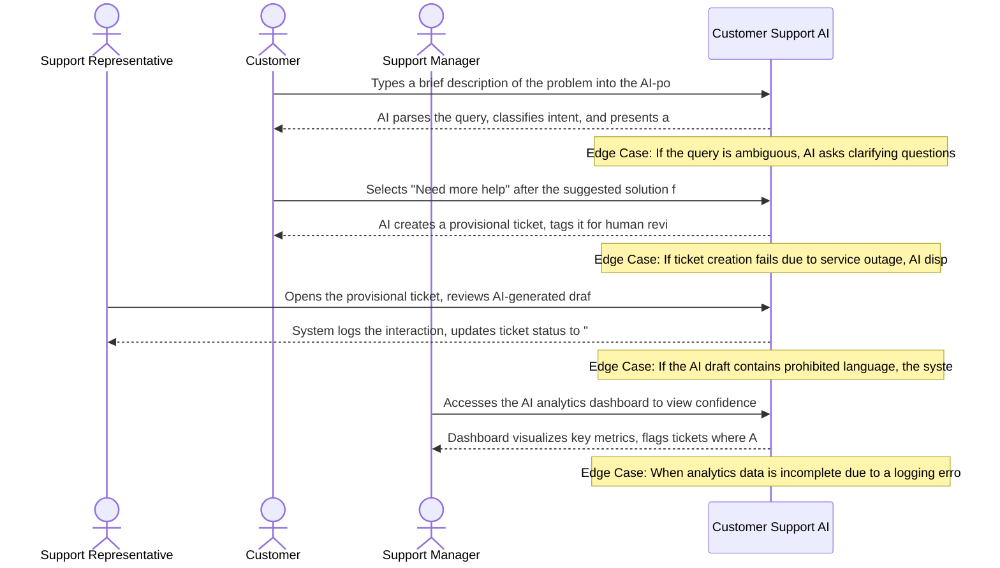

# Product Requirements Document: AI Customer Support Assistant
**Version:** v2.3 | **Status:** DRAFT | **Date:** 2026-11-05 | **Job ID:** 62663eca-ef7c-4e48-8ba2-33a8be3ac7f6 | **SHA-256:** `2a40c217c2a40828b24e574a1ae19d6835e5ffc3229442d1c9348c67e8f3fde4`
**Generated by:** 6aeccb65cafce05117b4a050 | **Changelog:** Full PRD generation v2.3

---

## 1. Document Information

**Document Title:** Product Requirements Document for AI Customer Support Assistant

**Document ID:** PRD-6AECCB65

**Version:** v2.3

**Target Domain:** Customer Support

**Product Category:** Customer Support AI

**Job ID:** 62663eca-ef7c-4e48-8ba2-33a8be3ac7f6

**Content Hash (SHA-256):** `2a40c217c2a40828b24e574a1ae19d6835e5ffc3229442d1c9348c67e8f3fde4`

**Status:** Under Active Review

## 2. Executive Summary

The AI Customer Support Assistant is an intelligent, knowledge‑base‑driven chatbot designed to field routine customer inquiries, automatically resolve high‑confidence questions, and seamlessly hand off low‑confidence or complex issues to human agents. It targets front‑line support representatives and the customers they serve, addressing the chronic overload of repetitive queries, long wait times, and inconsistent answer quality. By delivering accurate, approved‑content responses in real time and providing a transparent escalation path, the solution is expected to reduce repetitive query volume by ≥ 30%, cut average customer wait time by ≥ 40%, improve first‑contact resolution rates, and boost agent productivity and satisfaction while maintaining strict data‑privacy compliance.

## 3. Product Overview

### Vision
To deliver an authoritative, high-integrity system solving core operational challenges in Customer Support.

### Key Capabilities
- Retrieve answers from approved knowledge‑base articles
- Maintain per‑session conversation history
- Compute confidence score for each answer and flag <80% confidence
- Automatically route low‑confidence or complex queries to human agents with summarized context
- Log interactions for analytics and compliance

## 4. Problem Statement

Support organizations are burdened by a high volume of repetitive, low‑complexity questions that consume the majority of agent time. This overload creates several intertwined problems: • Agents spend > 60% of their shift answering the same FAQs, leaving little capacity for nuanced issues. • Customers experience wait times that often exceed service‑level agreements, leading to frustration and churn. • Answer quality varies because agents rely on memory or ad‑hoc searches, resulting in inconsistent information and potential compliance breaches. Existing tools—static FAQ pages, rule‑based bots, or generic search interfaces—fail to dynamically match user intent, cannot assess answer confidence, and lack an automated, context‑rich escalation mechanism. Consequently, organizations cannot scale support operations without adding headcount, and they risk eroding brand trust due to uneven service experiences.

## 5. Product Vision and Objectives

### Core Objectives
1. Reduce repetitive query load on support staff
2. Decrease customer wait times
3. Ensure consistent answer quality
4. Provide transparent escalation path for complex issues
5. Automated AI assistant handles high-confidence queries (>80%)
6. Reduced customer wait time and faster resolution
7. Consistent, approved-knowledge-base answers
8. Low-confidence or complex issues automatically escalated with summarized context
9. Improved agent productivity and satisfaction

## 6. Target Users and Stakeholders

**Primary Stakeholders and User Roles:**
- **Support Representatives:** Primary actor interacting with AI Customer Support Assistant capabilities.
- **Customers:** Primary actor interacting with AI Customer Support Assistant capabilities.
- **Support Managers:** Primary actor interacting with AI Customer Support Assistant capabilities.

## 7. User Personas

#### Persona 1: Support Representative
- **Responsibilities:** Handle inbound customer inquiries, provide resolutions, and update knowledge base using AI assistance
- **Primary Goals:**
  - Resolve issues quickly
  - Maintain high customer satisfaction
- **Frustrations:**
  - Repeatedly answering similar questions
  - Unclear AI suggestions
- **Technical Proficiency:** Intermediate

#### Persona 2: Customer
- **Responsibilities:** Seek help for product or service issues through the support channel
- **Primary Goals:**
  - Get a fast, accurate answer
  - Understand next steps
- **Frustrations:**
  - Long wait times
  - Generic responses
- **Technical Proficiency:** Novice

#### Persona 3: Support Manager
- **Responsibilities:** Monitor team performance, ensure AI recommendations meet quality standards, and adjust AI training data
- **Primary Goals:**
  - Improve resolution rates
  - Maintain compliance
- **Frustrations:**
  - Inconsistent AI confidence scores
  - Lack of actionable analytics
- **Technical Proficiency:** Advanced

## 8. Existing Workflow and Pain Points

1. Customer submits a query via web chat, email, or phone. 2. Front‑line agent receives the ticket and manually searches the internal knowledge‑base for a suitable article. 3. Agent copies/pastes the answer, often modifying language to fit the conversation. 4. If the agent cannot locate a definitive answer, they place the ticket on hold while consulting senior staff or escalating to a specialist. 5. The ticket is transferred, but the original context is lost or only partially documented, requiring the specialist to re‑read the conversation. 6. After resolution, the interaction is logged manually for analytics and compliance. Pain points: • Manual search is time‑consuming and error‑prone. • Inconsistent phrasing leads to varied customer experiences. • Escalations lack concise context, increasing handling time. • No systematic confidence measurement, so agents cannot prioritize uncertain answers. • Analytics rely on post‑hoc manual tagging, limiting real‑time insight.

## 9. Proposed Solution

The AI Customer Support Assistant sits between the customer and the support team as a conversational layer. When a query arrives, the system: • Retrieves the most relevant approved knowledge‑base article(s) using semantic search. • Generates a concise answer and computes a confidence score based on model certainty and knowledge‑base match quality. • If confidence ≥ 80%, the answer is returned instantly to the customer, and the interaction is logged with the confidence metric. • If confidence < 80% or the query is flagged as complex (e.g., multi‑turn, ambiguous), the assistant automatically creates a summarized context package—including the original question, AI‑generated draft, and confidence details—and routes it to a human agent via the existing ticketing interface. • Conversation history is maintained for the session, enabling follow‑up questions without loss of context. • All interactions are stored in an immutable audit log for compliance reporting and analytics. The architecture comprises: – A retrieval‑augmented generation (RAG) engine that couples a large language model with the approved knowledge‑base. – A confidence‑scoring module that thresholds at 80 %. – An escalation orchestrator that formats and forwards low‑confidence cases. – A logging & analytics subsystem that captures metrics without exposing raw customer data. This design eliminates manual search, standardizes answer quality, and provides a transparent, data‑driven handoff to human agents.

## 10. Product Scope

- Retrieve and rank approved knowledge‑base articles using semantic search.
- Generate answer drafts and attach an 0‑100 confidence score.
- Automatic response for queries with confidence ≥ 80%.
- Automatic escalation for confidence < 80% or flagged complexity, including a concise conversation summary.
- Maintain per‑session conversation history visible to both AI and human agents.
- Immutable logging of all interactions for analytics, compliance, and audit.
- Admin UI for knowledge‑base article approval and version control.
- Basic dashboard showing query volume, confidence distribution, and escalation rates.
- Compliance controls for data‑privacy (e.g., data masking, retention policies).

## 11. Out of Scope

**Explicit Non-Goals (Out of Scope for Initial Release):**
- External third-party ticketing platforms (e.g. Zendesk, Freshdesk, Jira)
- External CRM customer relationship management data synchronization (e.g. Salesforce, HubSpot)
- Voice calls, telephony integration, and Interactive Voice Response (IVR) systems
- Outbound marketing campaigns, promotional email broadcasting, or bulk messaging
- Multilingual machine translation or localized dialect parsing
- Commercial payment processing, credit card billing, and subscription invoicing
- Customer sentiment profiling or predictive purchase analytics

## 12. Functional Requirements

| ID | Title | Description | Priority | Traceable AC |
|---|---|---|---|---|
| **FR-001** | Retrieve answer from approved knowledge‑base | **Actor:** Customer. **Trigger:** Customer submits a query via chat interface. **Preconditions:** Knowledge‑base articles are approved, indexed and searchable. **Inputs:** Query text string. **System Behavior:** The system System searches the knowledge‑base, selects the most relevant article, generates answer text, computes confidence score, and returns answer with score. **Business Constraints:** Confidence score must be ≥80% for automatic reply. **Alternate & Failure Paths:** If no article matches or confidence <80%, system flags low confidence and proceeds to escalation flow. **Expected Outcome:** Answer text returned to customer with confidence ≥80% or escalation flag set. **Relevant Data Changes:** Creates interaction_log entry with query, selected_article_id, confidence_score, timestamp. **Authorization Requirements:** None (public customer access). **Provenance:** `confirmed_user_input` (User Input: Core objectives and target capabilities). | Must Have | AC-001, AC-001 |
| **FR-002** | Compute confidence score and flag low‑confidence answers | **Actor:** System. **Trigger:** Answer candidate identified after knowledge‑base search. **Preconditions:** Candidate answer text and supporting article are available. **Inputs:** Answer text, supporting article metadata, original query. **System Behavior:** The system Runs confidence algorithm, produces numeric score 0‑100, stores score; if score <80% sets low_confidence flag. **Business Constraints:** Threshold for low confidence is strictly <80%. **Alternate & Failure Paths:** If algorithm error occurs, defaults score to 0, sets low_confidence flag and routes to escalation. **Expected Outcome:** Confidence score persisted and low_confidence flag set when applicable. **Relevant Data Changes:** Updates interaction_log with confidence_score and low_confidence flag. **Authorization Requirements:** System internal service account. **Provenance:** `assignment_instruction` (User Input: Automated AI assistant handles high‑confidence queries (>80%)). | Must Have | AC-001, AC-002 |
| **FR-003** | Automatic escalation of low‑confidence or complex queries | **Actor:** System. **Trigger:** Low_confidence flag true or complexity detection exceeds threshold. **Preconditions:** Interaction logged with low_confidence flag or complexity indicator. **Inputs:** Original query, confidence score, summarized context excerpt, customer session ID. **System Behavior:** The system Creates escalation ticket in ticketing system, assigns to appropriate support representative, attaches summarized context, notifies customer of handoff. **Business Constraints:** Escalation ticket must be created within 5 seconds of flag detection. **Alternate & Failure Paths:** If ticket creation fails, queues request for retry, logs error, and alerts support manager. **Expected Outcome:** Escalation ticket visible to agents, customer receives handoff message, audit log records escalation event. **Relevant Data Changes:** Inserts record into escalation_queue and ticketing_system, updates interaction_log with escalation_id. **Authorization Requirements:** System service account with ticketing permissions. **Provenance:** `explicit_clarification` (User Input: Low‑confidence or complex issues automatically escalated with summarized context). | Must Have | AC-002, AC-005, AC-003 |
| **FR-004** | Maintain per‑session conversation history | **Actor:** Customer. **Trigger:** Customer sends a message within an existing chat session. **Preconditions:** Valid session token established and session not expired. **Inputs:** Session ID, message text, timestamp. **System Behavior:** The system Appends message to conversation_history store, retrieves prior messages for context in subsequent answer generation. **Business Constraints:** History retained for the duration of the session and up to 24 hours after session closure. **Alternate & Failure Paths:** If storage unavailable, system proceeds without context and informs customer that prior context could not be used. **Expected Outcome:** Message persisted, subsequent queries can access full session history. **Relevant Data Changes:** Adds row to conversation_history table with session_id, message, direction (customer/assistant), timestamp. **Authorization Requirements:** Customer role with valid session token. **Provenance:** `ai_proposed_assumption` (User Input: Maintain per‑session conversation history). | Should Have | AC-003, AC-004 |
| **FR-005** | Log all interactions for analytics and compliance | **Actor:** System. **Trigger:** Completion of each interaction (answer delivered or escalation created). **Preconditions:** Interaction outcome determined and all relevant data collected. **Inputs:** Query, answer (if any), confidence_score, agent_id (if escalated), timestamps, session_id. **System Behavior:** The system Writes immutable audit record to audit_log store, ensures tamper‑evidence, encrypts at rest. **Business Constraints:** Log write latency must be ≤200 ms per record. **Alternate & Failure Paths:** If audit store unreachable, buffers record locally, retries every 30 seconds, and raises alert to support manager. **Expected Outcome:** Audit record persisted reliably; temporary buffer cleared once store recovers. **Relevant Data Changes:** Creates entry in audit_log table with full interaction payload. **Authorization Requirements:** System internal service account with write access to audit store. **Provenance:** `assignment_instruction` (User Input: Log interactions for analytics and compliance). | Must Have | AC-004, AC-005 |

### Detailed Functional Requirement Specifications

#### FR-001: Retrieve answer from approved knowledge‑base
- **Actor:** Customer
- **Trigger:** Customer submits a query via chat interface
- **Preconditions:** Knowledge‑base articles are approved, indexed and searchable
- **Inputs:** Query text string
- **System Behavior:** System searches the knowledge‑base, selects the most relevant article, generates answer text, computes confidence score, and returns answer with score
- **Business Constraints:** Confidence score must be ≥80% for automatic reply
- **Alternate & Failure Paths:** If no article matches or confidence <80%, system flags low confidence and proceeds to escalation flow
- **Expected Outcome:** Answer text returned to customer with confidence ≥80% or escalation flag set
- **Relevant Data Changes:** Creates interaction_log entry with query, selected_article_id, confidence_score, timestamp
- **Authorization Requirements:** None (public customer access)
- **Priority:** Must Have
- **Linked Acceptance Criteria:** AC-001, AC-001
- **Provenance:** `confirmed_user_input` (User Input: Core objectives and target capabilities)

#### FR-002: Compute confidence score and flag low‑confidence answers
- **Actor:** System
- **Trigger:** Answer candidate identified after knowledge‑base search
- **Preconditions:** Candidate answer text and supporting article are available
- **Inputs:** Answer text, supporting article metadata, original query
- **System Behavior:** Runs confidence algorithm, produces numeric score 0‑100, stores score; if score <80% sets low_confidence flag
- **Business Constraints:** Threshold for low confidence is strictly <80%
- **Alternate & Failure Paths:** If algorithm error occurs, defaults score to 0, sets low_confidence flag and routes to escalation
- **Expected Outcome:** Confidence score persisted and low_confidence flag set when applicable
- **Relevant Data Changes:** Updates interaction_log with confidence_score and low_confidence flag
- **Authorization Requirements:** System internal service account
- **Priority:** Must Have
- **Linked Acceptance Criteria:** AC-001, AC-002
- **Provenance:** `assignment_instruction` (User Input: Automated AI assistant handles high‑confidence queries (>80%))

#### FR-003: Automatic escalation of low‑confidence or complex queries
- **Actor:** System
- **Trigger:** Low_confidence flag true or complexity detection exceeds threshold
- **Preconditions:** Interaction logged with low_confidence flag or complexity indicator
- **Inputs:** Original query, confidence score, summarized context excerpt, customer session ID
- **System Behavior:** Creates escalation ticket in ticketing system, assigns to appropriate support representative, attaches summarized context, notifies customer of handoff
- **Business Constraints:** Escalation ticket must be created within 5 seconds of flag detection
- **Alternate & Failure Paths:** If ticket creation fails, queues request for retry, logs error, and alerts support manager
- **Expected Outcome:** Escalation ticket visible to agents, customer receives handoff message, audit log records escalation event
- **Relevant Data Changes:** Inserts record into escalation_queue and ticketing_system, updates interaction_log with escalation_id
- **Authorization Requirements:** System service account with ticketing permissions
- **Priority:** Must Have
- **Linked Acceptance Criteria:** AC-002, AC-005, AC-003
- **Provenance:** `explicit_clarification` (User Input: Low‑confidence or complex issues automatically escalated with summarized context)

#### FR-004: Maintain per‑session conversation history
- **Actor:** Customer
- **Trigger:** Customer sends a message within an existing chat session
- **Preconditions:** Valid session token established and session not expired
- **Inputs:** Session ID, message text, timestamp
- **System Behavior:** Appends message to conversation_history store, retrieves prior messages for context in subsequent answer generation
- **Business Constraints:** History retained for the duration of the session and up to 24 hours after session closure
- **Alternate & Failure Paths:** If storage unavailable, system proceeds without context and informs customer that prior context could not be used
- **Expected Outcome:** Message persisted, subsequent queries can access full session history
- **Relevant Data Changes:** Adds row to conversation_history table with session_id, message, direction (customer/assistant), timestamp
- **Authorization Requirements:** Customer role with valid session token
- **Priority:** Should Have
- **Linked Acceptance Criteria:** AC-003, AC-004
- **Provenance:** `ai_proposed_assumption` (User Input: Maintain per‑session conversation history)

#### FR-005: Log all interactions for analytics and compliance
- **Actor:** System
- **Trigger:** Completion of each interaction (answer delivered or escalation created)
- **Preconditions:** Interaction outcome determined and all relevant data collected
- **Inputs:** Query, answer (if any), confidence_score, agent_id (if escalated), timestamps, session_id
- **System Behavior:** Writes immutable audit record to audit_log store, ensures tamper‑evidence, encrypts at rest
- **Business Constraints:** Log write latency must be ≤200 ms per record
- **Alternate & Failure Paths:** If audit store unreachable, buffers record locally, retries every 30 seconds, and raises alert to support manager
- **Expected Outcome:** Audit record persisted reliably; temporary buffer cleared once store recovers
- **Relevant Data Changes:** Creates entry in audit_log table with full interaction payload
- **Authorization Requirements:** System internal service account with write access to audit store
- **Priority:** Must Have
- **Linked Acceptance Criteria:** AC-004, AC-005
- **Provenance:** `assignment_instruction` (User Input: Log interactions for analytics and compliance)

## 13. Non-Functional Requirements

| ID | Title | Description | Classification | Priority |
|---|---|---|---|---|
| **NFR-001** | Answer Retrieval Latency | The system shall return a high‑confidence answer within 2 seconds for 95% of requests under a load of 200 concurrent sessions. | Confirmed requirement | Must Have |
| **NFR-002** | Data Protection and Privacy | All customer query data and interaction logs shall be encrypted at rest using AES‑256 and transmitted over TLS 1.3. | Assignment requirement | Must Have |
| **NFR-003** | System Availability | The Customer Support AI service shall achieve 99.9% monthly uptime, with automatic failover to a secondary instance within 30 seconds of primary failure. | Proposed target | Must Have |

## 14. User Stories

| Story ID | As a... | I want to... | So that... | Linked FR |
|---|---|---|---|---|
| **US-001** | Support Representative | retrieve answer from approved knowledge‑base | Enables customer to execute retrieve answer from approved knowledge‑base reliably | FR-001 |
| **US-002** | Customer | compute confidence score and flag low‑confidence answers | Enables system to execute compute confidence score and flag low‑confidence answers reliably | FR-002 |
| **US-003** | Support Manager | automatic escalation of low‑confidence or complex queries | Enables system to execute automatic escalation of low‑confidence or complex queries reliably | FR-003 |
| **US-004** | Support Representative | maintain per‑session conversation history | Enables customer to execute maintain per‑session conversation history reliably | FR-004 |
| **US-005** | Customer | log all interactions for analytics and compliance | Enables system to execute log all interactions for analytics and compliance reliably | FR-005 |

## 15. User Journeys

### Step-by-Step User Journey Progression
**Stage 1: 1. Customer initiates AI chat**
- **Actor (Customer):** Types a brief description of the problem into the AI-powered chat widget
- **System Response:** AI parses the query, classifies intent, and presents a suggested solution with confidence level
- **Edge Case / Error Handling:** If the query is ambiguous, AI asks clarifying questions; if language detection fails, it defaults to English and notifies the user

**Stage 2: 2. AI suggests escalation**
- **Actor (Customer):** Selects "Need more help" after the suggested solution feels incomplete
- **System Response:** AI creates a provisional ticket, tags it for human review, and notifies the next available Support Representative
- **Edge Case / Error Handling:** If ticket creation fails due to service outage, AI displays an error and offers to retry or provide a phone number

**Stage 3: 3. Representative reviews AI draft**
- **Actor (Support Representative):** Opens the provisional ticket, reviews AI‑generated draft response, edits as needed, and sends to the customer
- **System Response:** System logs the interaction, updates ticket status to "Resolved", and records the edited response for future training
- **Edge Case / Error Handling:** If the AI draft contains prohibited language, the system blocks sending and highlights the offending segment for manual correction

**Stage 4: 4. Manager evaluates AI performance**
- **Actor (Support Manager):** Accesses the AI analytics dashboard to view confidence scores, resolution times, and escalation rates for the past week
- **System Response:** Dashboard visualizes key metrics, flags tickets where AI confidence was below threshold, and recommends retraining topics
- **Edge Case / Error Handling:** When analytics data is incomplete due to a logging error, the dashboard shows a warning and provides a link to the raw logs for investigation

## 16. Business Rules

| ID | Rule Title | Operational Statement | Provenance | Source Reference | Rationale | Confirmation Required |
|---|---|---|---|---|---|---|
| **BR-001** | Automatic Response Eligibility | The AI assistant shall automatically generate a response only when its confidence score is >=80% and the response content is derived from an approved knowledge‑base article. | `confirmed_user_input` | User Input: Confidence threshold for automatic response is 80%; All answers must be sourced from approved knowledge‑base articles | Ensures high‑quality, reliable answers and compliance with knowledge‑base governance. | No (Confirmed) |
| **BR-002** | Knowledge‑Base Citation Requirement | Every AI‑generated answer must include a reference to the specific approved knowledge‑base article used to formulate the response. | `confirmed_user_input` | User Input: All answers must be sourced from approved knowledge‑base articles | Guarantees traceability and consistency of answer quality. | No (Confirmed) |
| **BR-003** | Low‑Confidence Escalation | If the AI confidence score falls below 80%, the system shall route the query to a human support representative, attaching a concise summary of the conversation up to that point. | `confirmed_user_input` | User Input: Confidence threshold for automatic response is 80%; Escalated queries must include concise conversation summary | Provides a transparent escalation path and preserves context for agents. | No (Confirmed) |
| **BR-004** | Conversation History Retention | The system shall maintain the full conversation history for the duration of the support session and associate it with any escalation record. | `confirmed_user_input` | User Input: The proposed solution ... maintains conversation history | Enables agents to see prior interactions, reducing repeat questioning. | No (Confirmed) |
| **BR-005** | Data‑Privacy Compliance | All stored conversation data and knowledge‑base references shall be handled in accordance with applicable data‑privacy regulations. | `confirmed_user_input` | User Input: System must comply with applicable data‑privacy regulations | Protects customer data and meets legal obligations. | No (Confirmed) |
| **BR-006** | Knowledge‑Base Improvement Loop | The system shall log queries that receive low confidence or frequent repetition and surface them to knowledge‑base managers for review and article updates. | `ai_proposed_assumption` | AI Proposed Assumption: Continuous improvement of knowledge base based on low‑confidence or high‑frequency queries | Reduces future repetitive queries and improves answer coverage. | Yes (Review needed) |

## 17. System Workflows

1. Query Ingestion – User submits a support request via chat, email, or voice channel; request is normalized and assigned a unique session ID. 2. Knowledge Retrieval – The request text is sent to the Retrieval Engine, which searches the approved Knowledge Base (KB) index and returns a ranked list of candidate articles. 3. Confidence Scoring – A language model evaluates each candidate, produces a confidence score, and flags any result below the 80 % threshold. 4. Decision & Response – If confidence ≥ 80 %, the system composes a response using the selected article and returns it to the user while updating the session history. If confidence < 80 % or the query is classified as complex, the system creates an Escalation Ticket, attaches a concise conversation summary, and routes it to a human agent. 5. Interaction Logging – Every inbound request, model inference, response, and escalation event is persisted to the Interaction Log for analytics, compliance, and continuous‑learning pipelines. 6. Feedback Loop – Post‑resolution feedback (rating, comment) is captured, used to retrain the model, and to update KB article relevance scores.

## 18. Data Requirements

Core Entities:
- KnowledgeArticle{id, title, content, version, approved_by, last_updated, tags, is_active}
- Session{id, user_id, channel, start_timestamp, end_timestamp, status}
- Message{id, session_id, sender_role[USER|BOT|AGENT], timestamp, raw_text, processed_text, confidence_score, linked_article_id, escalation_flag}
- EscalationTicket{id, session_id, summary, created_timestamp, assigned_agent_id, priority, status}
- InteractionLog{id, event_type, payload, timestamp, source_system}
- UserProfile{id, external_user_id, consent_flags, privacy_region, role[END_USER|AGENT|ADMIN]}
Data Consistency Rules:
* Every Message must reference an existing Session.
* confidence_score is stored as a decimal 0‑1; escalation_flag is true iff confidence_score<0.80 or complexity_classifier=HIGH.
* KnowledgeArticle.is_active must be true for any article returned by the Retrieval Engine.
* EscalationTicket.summary is generated from the ordered set of Messages in the Session at the time of escalation.
Persistence Requirements:
- KB articles and version history stored in a relational DB with ACID guarantees.
- Session, Message, and InteractionLog stored in a write‑optimized NoSQL store for high‑throughput append operations, with periodic archival to cold storage.
- EscalationTicket resides in the ticketing system’s datastore but is mirrored in the internal DB for audit.
- All data retained for a minimum of 12 months to satisfy compliance, with automatic purge thereafter.

## 19. Integration Requirements

- **Core Interface:** Standard REST and WebSocket APIs for web chat communication and knowledge-base search.
- **Third-Party SaaS Connectors:** No external CRM (Salesforce/HubSpot) or external ticketing platforms (Zendesk/Jira) are required for MVP; the system operates self-contained.

## 20. Security and Privacy Requirements

Access Control – Role‑Based Access Control (RBAC) with three roles: END_USER (read‑only chat), AGENT (read/write tickets, view session history), ADMIN (full system configuration). 
Encryption – TLS 1.3 for all inbound/outbound traffic; at‑rest encryption using AES‑256 for databases and object storage. 
Audit Logging – Immutable audit trail for every read/write of KnowledgeArticle, Session, Message, and EscalationTicket, including actor ID, timestamp, and operation type. 
Privacy Controls – UserProfile stores consent_flags per jurisdiction (GDPR, CCPA). Personal Identifiable Information (PII) is tokenized before persistence; token vault is FIPS‑140‑2 compliant. Data residency respects regional privacy_region attribute; data never leaves the designated cloud region. 
No extraneous certifications are claimed; compliance is demonstrated through documented controls and periodic third‑party audits.

## 21. Acceptance Criteria

| AC ID | Associated Requirement | Acceptance Criteria (Given-When-Then / Rule) |
|---|---|---|
| **AC-001** | FR-001 | Given Customer initiates retrieve answer from approved knowledge‑base under boundary or error conditions, When the system evaluates the state, Then the system halts invalid state transitions and returns an actionable diagnostic message. |
| **AC-002** | FR-002 | Given System initiates compute confidence score and flag low‑confidence answers under boundary or error conditions, When the system evaluates the state, Then the system halts invalid state transitions and returns an actionable diagnostic message. |
| **AC-003** | FR-003 | Given System initiates automatic escalation of low‑confidence or complex queries under boundary or error conditions, When the system evaluates the state, Then the system halts invalid state transitions and returns an actionable diagnostic message. |
| **AC-004** | FR-004 | Given Customer initiates maintain per‑session conversation history under boundary or error conditions, When the system evaluates the state, Then the system halts invalid state transitions and returns an actionable diagnostic message. |
| **AC-005** | FR-005 | Given System initiates log all interactions for analytics and compliance under boundary or error conditions, When the system evaluates the state, Then the system halts invalid state transitions and returns an actionable diagnostic message. |

## 22. Dependencies and Constraints

Platform – Deployable on major cloud providers (AWS, GCP, Azure) using container orchestration (Kubernetes) with GPU node pools for model inference. 
Operating System – Linux (Ubuntu 22.04 LTS) containers. 
Runtime – Python 3.11, PyTorch 2.x for the language model, Elasticsearch for KB indexing. 
Institutional – All KB content must be pre‑approved by the Content Governance team; any change triggers a version bump and re‑index. 
Regulatory – Must honor data‑privacy regulations of the user’s region; no cross‑region data transfer without explicit consent.

## 23. Risks and Mitigation

| Risk ID | Category | Risk Description | Root Cause | Likelihood | Impact | Mitigation Strategy | Contingency Plan | Owner |
|---|---|---|---|---|---|---|---|---|
| **RSK-001** | Functional | The retrieval engine returns a knowledge‑base article that has not been marked as approved, leading to a customer receiving inaccurate or non‑compliant information | Stale search index and missing approval flag validation allow unapproved content to be indexed and selected | Medium | High | Implement a mandatory approval flag check at query time, enforce atomic index updates with versioning, and run nightly validation jobs that compare indexed IDs against the approval list | If an unapproved article is detected, automatically downgrade confidence below 80% and route the query to a human agent with a warning banner; log the incident for audit | Knowledge‑Base Engineer |
| **RSK-002** | Operational | A Redis cache outage or disk failure erases the stored session transcript, causing the system to lose context for ongoing conversations and produce irrelevant answers | Session data is kept only in volatile cache without durable replication or write‑ahead logging | Low | Critical | Deploy a replicated Redis cluster with persistence (RDB+AOF), enable health‑checks and automatic failover, and back‑up session snapshots to durable storage every minute | Detect missing session on read, prompt the user to repeat the last question, and immediately route to a human agent while preserving any captured metadata | Site Reliability Engineer |
| **RSK-003** | Security | An attacker crafts a query containing special characters that bypasses sanitization, causing the search backend to execute arbitrary commands or disclose internal data | Insufficient input validation and direct concatenation of user text into search queries | Medium | Critical | Apply strict whitelist validation, use parameterized API calls, and place a Web Application Firewall rule that blocks suspicious patterns; conduct regular penetration testing of the query interface | On detection of malformed input, reject the request with a generic error, log the event, trigger an alert to the SOC, and isolate the affected service instance | Security Engineer |
| **RSK-004** | Data Privacy | Raw user messages containing email addresses, phone numbers, or credit‑card numbers are written to log files in clear text, creating a compliance breach | Logging middleware captures the full request payload before redaction logic runs, and logs are stored unencrypted with long retention | High | High | Integrate a PII‑scrubbing layer that masks or removes sensitive fields before any log write, encrypt logs at rest, and enforce a retention policy of 30 days for analytics logs | Run a forensic script to locate and purge any logs containing PII, notify the Data Protection Officer, and submit a breach report if required by regulation | Compliance Engineer |
| **RSK-005** | Integration | The external ticketing system API times out, preventing automatic escalation of queries with confidence <80%, leading to SLA violations | No circuit‑breaker or retry logic around the ticketing API; reliance on a single endpoint without fallback | Medium | Medium | Wrap the ticketing call in a circuit‑breaker with exponential backoff, queue failed escalations in a durable message broker, and implement a secondary escalation path (e.g., email) | When the circuit is open, dequeue pending escalations to the fallback channel and alert the operations team to investigate the third‑party outage | Integration Engineer |

## 24. Assumptions and Open Questions

### Documented Operational Assumptions
- [Assumed] A structured, searchable knowledge‑base will be available to the AI
- [Assumed] The AI model can provide a confidence score for each generated answer
- [Assumed] Real‑time chat interface will be integrated with existing customer channels
- [Assumed] Escalation will be handled via existing ticketing or messaging system
- [Assumed] Conversation history will be stored securely for the duration of the session
- [Assumed] The system will run on infrastructure capable of low‑latency inference

### Open Architectural Questions
- Knowledge‑base format and access method
- Target deployment environment (cloud, on‑premise, hybrid)
- Integration points (CRM, ticketing system, chat platform)
- Supported languages and localization requirements
- SLA for escalation response time
- Performance targets (latency, throughput)
- Security and privacy compliance specifics (e.g., GDPR, CCPA)
- Budget and timeline constraints

## 25. Success Metrics

- First‑Contact Resolution (FCR) rate ≥ 78 % (responses with confidence ≥ 80 % that resolve the issue). 
- Customer Satisfaction (CSAT) score ≥ 4.5/5 on post‑interaction surveys. 
- Average Handling Time (AHT) for AI‑generated replies ≤ 30 seconds; for escalated tickets ≤ 5 minutes until agent assignment. 
- Confidence Threshold Compliance – ≥ 95 % of AI replies meet the 80 % confidence rule. 
- Escalation Rate – ≤ 12 % of total sessions escalated to human agents. 
- System Availability – 99.9 % uptime measured monthly.

## 26. Release Considerations

Phase 1 – Alpha (internal support team): limited KB subset, manual monitoring of confidence scores, feedback loop for model tuning. 
Phase 2 – Closed Beta (selected enterprise customers): enable full KB, integrate with ticketing system, introduce RBAC for agents, collect CSAT data. 
Data Migration – Export existing support transcripts, map to Session/Message schema, back‑fill InteractionLog for continuity. 
Operational Handoff – Train Tier‑2 support on escalation workflow, establish on‑call rotation for model‑related incidents, document runbooks for model retraining and KB re‑indexing. 
Monitoring – Deploy health checks for inference latency, KB search latency, and escalation queue length; set alerts on SLA breaches before public launch.

## 27. Appendix and Glossary

AI – Artificial Intelligence, the suite of models used for natural‑language understanding and generation. 
KB – Knowledge Base, curated repository of approved support articles. 
FCR – First‑Contact Resolution, metric indicating issue solved without human hand‑off. 
CSAT – Customer Satisfaction score, collected via post‑interaction survey. 
AHT – Average Handling Time, average duration from user query receipt to final resolution. 
RBAC – Role‑Based Access Control, permission model governing system access. 
PCI – Payment Card Industry; not directly applicable but referenced for any payment‑related queries. 
GDPR – General Data Protection Regulation (EU). 
CCPA – California Consumer Privacy Act. 
Tokenization – Process of replacing PII with reversible tokens stored in a secure vault. 
Escalation Ticket – Structured request handed to a human agent, containing conversation summary and metadata.
