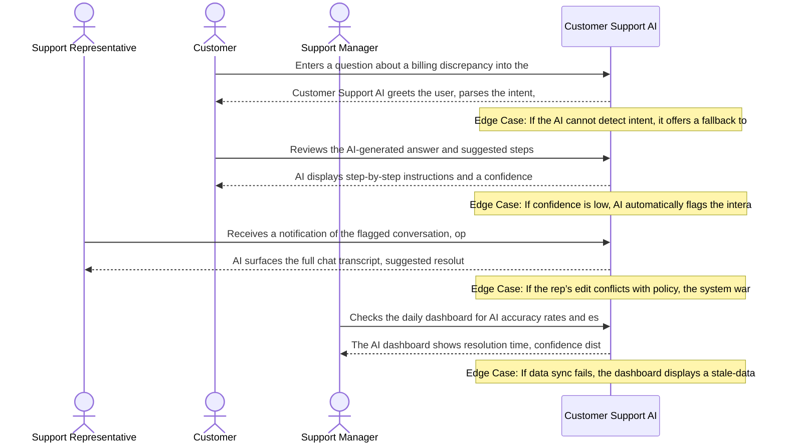

# Product Requirements Document: AI Customer Support Assistant
**Version:** v2.3 | **Status:** DRAFT | **Date:** 2026-11-06 | **Job ID:** deac788b-51ec-4299-b8a6-6022d71a2fb0 | **SHA-256:** `f1096e500b3382576dfe496dfd36fe03835584a2ab5755a2f779dca04fae3bc2`
**Generated by:** 6aed375d2db19753a71825f6 | **Changelog:** Full PRD generation v2.3

---

## 1. Document Information

**Document Title:** Product Requirements Document for AI Customer Support Assistant

**Document ID:** PRD-6AED375E

**Version:** v2.3

**Target Domain:** Customer Support

**Product Category:** Customer Support AI

**Job ID:** deac788b-51ec-4299-b8a6-6022d71a2fb0

**Content Hash (SHA-256):** `f1096e500b3382576dfe496dfd36fe03835584a2ab5755a2f779dca04fae3bc2`

**Status:** Under Active Review

## 2. Executive Summary

The AI Customer Support Assistant is an intelligent, web‑chat‑first solution that automatically answers high‑volume, repetitive customer inquiries by drawing exclusively from approved knowledge‑base (KB) articles. Target users are support organizations experiencing overload of routine queries, leading to long wait times and inconsistent service quality. By delivering accurate, KB‑driven responses with a confidence threshold of 80%, preserving per‑session conversation history, and seamlessly escalating low‑confidence or complex issues to human agents with a concise context summary, the product aims to reduce repetitive workload by ≥ 30%, cut average handling time by ≥ 20%, and improve answer consistency and customer satisfaction scores across the support function.

## 3. Product Overview

### Vision
To deliver an authoritative, high-integrity system solving core operational challenges in Customer Support.

### Key Capabilities
- Answer customer queries using approved knowledge‑base articles
- Maintain per‑session conversation history
- Detect answer confidence below 80% and flag low‑confidence responses
- Summarize conversation context for human escalation
- Integrate with chat/ticketing platforms
- Log interactions for analytics

## 4. Problem Statement

Support teams are inundated with repetitive, low‑complexity questions that consume the majority of agent time. The root causes include: • Manual lookup of KB articles for each query, leading to variable answer quality. • Absence of real‑time confidence assessment, causing agents to intervene on uncertain AI replies. • Lack of persistent conversation context, forcing agents to re‑gather information during escalations. Existing solutions—static FAQ pages, rule‑based bots, or generic AI chat widgets—either require extensive manual maintenance, cannot guarantee that responses originate from approved KB content, or lack robust escalation workflows with contextual hand‑off. Consequently, customers experience long wait times, inconsistent answers, and reduced satisfaction, while support staff face burnout and inefficiency.

## 5. Product Vision and Objectives

### Core Objectives
1. Reduce repetitive question load on support staff
2. Provide accurate, knowledge‑base‑driven answers
3. Escalate low‑confidence or complex queries to human agents with context
4. AI assistant handles high‑volume repetitive queries using approved KB articles
5. Maintain conversation history for personalized interactions
6. Automatically flag and route low‑confidence (<80%) answers to human agents with concise context summary
7. Reduce wait times and improve answer consistency and quality

## 6. Target Users and Stakeholders

**Primary Stakeholders and User Roles:**
- **Support Representatives:** Primary actor interacting with AI Customer Support Assistant capabilities.
- **Customers:** Primary actor interacting with AI Customer Support Assistant capabilities.
- **Support Managers:** Primary actor interacting with AI Customer Support Assistant capabilities.

## 7. User Personas

#### Persona 1: Support Representative
- **Responsibilities:** Handles inbound customer inquiries, resolves issues using AI assistance, and updates case status
- **Primary Goals:**
  - Resolve tickets quickly
  - Maintain high customer satisfaction
- **Frustrations:**
  - Repetitive queries
  - Lack of context in AI suggestions
- **Technical Proficiency:** Intermediate

#### Persona 2: Customer
- **Responsibilities:** Seeks help for product or service issues via chat or web portal
- **Primary Goals:**
  - Get a solution fast
  - Understand next steps
- **Frustrations:**
  - Long wait times
  - Unclear automated responses
- **Technical Proficiency:** Novice

#### Persona 3: Support Manager
- **Responsibilities:** Oversees team performance, reviews AI accuracy, and adjusts knowledge base
- **Primary Goals:**
  - Improve resolution rates
  - Ensure AI aligns with policy
- **Frustrations:**
  - Inconsistent AI recommendations
  - Insufficient reporting
- **Technical Proficiency:** Advanced

## 8. Existing Workflow and Pain Points

1. Customer initiates contact via web chat or email. 2. Support rep manually searches the internal knowledge base for a relevant article. 3. Rep copies/pastes answer, often paraphrasing, which introduces inconsistency. 4. If the rep is unsure, they spend additional time verifying accuracy or escalating to a senior colleague. 5. Conversation context is lost when the issue is handed off, requiring the customer to repeat information. 6. High‑volume repetitive queries dominate the queue, inflating average wait time. Pain points: • Time‑intensive manual search. • Variable answer quality and compliance risk. • No automated confidence gating. • Context loss during escalation. • Escalation queues become bottlenecks because every low‑confidence case requires full manual handling.

## 9. Proposed Solution

The AI Customer Support Assistant sits as a web‑chat overlay on the company’s support portal. Incoming messages are routed to a large‑language‑model (LLM) that is fine‑tuned and constrained to retrieve content only from the curated, approved KB repository. The workflow is: 1. Capture user message in the web‑chat UI. 2. Retrieve the most relevant KB article(s) via semantic search. 3. Generate a response using the LLM, injecting the retrieved text verbatim to ensure compliance. 4. Compute a confidence score; if ≥ 80%, the answer is sent to the user. 5. If confidence < 80% or the query is flagged as complex, the system automatically creates an internal escalation ticket, attaches the full conversation transcript and a concise context summary, and routes it to a human agent. 6. The conversation history is persisted for the session, enabling personalized follow‑ups. 7. All interactions are logged to an analytics datastore for reporting on volume, confidence distribution, escalation rates, and SLA compliance. The architecture isolates the LLM behind a policy engine that enforces the “approved KB only” rule, and a privacy layer masks personally identifiable information (PII) to meet regulatory requirements.

## 10. Product Scope

- Web‑chat interface as the sole customer‑facing channel for MVP.
- Retrieval‑augmented generation using only approved knowledge‑base articles.
- Confidence scoring with an 80% threshold for automatic replies.
- Automatic escalation to an internal queue for low‑confidence or complex queries.
- Per‑session conversation history storage and context‑aware responses.
- Summarization module that creates a concise hand‑off summary for human agents.
- Integration with the internal ticketing/queue system (built‑in, not external).
- Logging of all interactions for analytics dashboards (volume, confidence, escalation metrics).
- Privacy compliance layer that redacts PII per applicable regulations.
- Admin console for KB article management and confidence‑threshold configuration.
- Basic reporting on SLA adherence and agent workload reduction.

## 11. Out of Scope

**Explicit Non-Goals (Out of Scope for Initial Release):**
- External third-party ticketing platforms (e.g. Zendesk, Freshdesk, Jira)
- External CRM customer relationship management data synchronization (e.g. Salesforce, HubSpot)
- Voice calls, telephony integration, and Interactive Voice Response (IVR) systems
- Outbound marketing campaigns, promotional email broadcasting, or bulk messaging
- Multilingual machine translation or localized dialect parsing
- Commercial payment processing, credit card billing, and subscription invoicing
- Customer sentiment profiling or predictive purchase analytics

## 12. Functional Requirements

| ID | Title | Description | Priority | Traceable AC |
|---|---|---|---|---|
| **FR-001** | Automated KB‑driven answer delivery | **Actor:** Customer. **Trigger:** Customer submits a support query via chat interface. **Preconditions:** At least one approved knowledge‑base article is indexed and the AI model is operational. **Inputs:** Query text string submitted by the customer. **System Behavior:** The system the AI parses the query, performs semantic search against the approved KB, selects the highest‑ranked article, computes a confidence score, and if the score meets the business threshold returns the article excerpt as the answer; otherwise it initiates escalation workflow. **Business Constraints:** Confidence score must be ≥80% to auto‑answer. **Alternate & Failure Paths:** If no article matches or confidence <80%, the system creates an escalation ticket with the query and context; if the KB service is unavailable, a generic apology is sent and escalation is triggered. **Expected Outcome:** Customer receives either a direct answer or a confirmation that the query has been escalated to a human agent. **Relevant Data Changes:** Interaction log entry created with query, selected article ID, confidence score, and outcome flag (answered/escalated). **Authorization Requirements:** No special role required; any authenticated customer may invoke. **Provenance:** `confirmed_user_input` (User Input: Core Objectives and Target Capabilities). | Must Have | AC-002, AC-003, AC-004, AC-006, AC-005 |
| **FR-002** | Per‑session conversation history management | **Actor:** AI System. **Trigger:** Receipt of a new message within an existing support session. **Preconditions:** A session identifier exists in the session store and is less than 30 days old. **Inputs:** SessionID (UUID), message payload (text, timestamp, sender). **System Behavior:** The system appends the incoming message to the session’s ordered history, updates the session’s last‑activity timestamp, and makes the full history available for subsequent context‑aware response generation. **Business Constraints:** History must be active session transcript is preserved in session memory, with archival retention duration treated as an open decision and not exceed 10 MB per session. **Alternate & Failure Paths:** If the session record is missing, a new session is created and the message is stored as the first entry; if the datastore is unreachable, the message is queued locally and persisted once connectivity is restored. **Expected Outcome:** Session history is updated and persisted without loss. **Relevant Data Changes:** Session record updated with new message entry and refreshed last‑activity timestamp. **Authorization Requirements:** Any authenticated user (customer or support rep) may send messages; system components require service‑account privileges to write session data. **Provenance:** `assignment_instruction` (User Input: Target Capabilities). | Must Have | AC-001, AC-007 |
| **FR-003** | Low‑confidence detection and automatic escalation | **Actor:** AI System. **Trigger:** Completion of confidence calculation for a query response. **Preconditions:** Confidence score has been produced for the selected KB article. **Inputs:** ConfidenceScore (float), QueryText, SelectedArticleID, SessionID. **System Behavior:** The system if ConfidenceScore <80%, the system generates an escalation ticket containing a concise context summary, flags the ticket as low‑confidence, and routes it to the human support queue; otherwise normal answer flow proceeds. **Business Constraints:** Escalation is mandatory for any confidence below 80%. **Alternate & Failure Paths:** If the escalation service is down, the ticket is stored in a retry queue and an internal alert is raised; if ticket creation fails repeatedly, the customer receives a fallback message indicating a human will respond shortly. **Expected Outcome:** A ticket is created and queued for a human agent whenever confidence is insufficient. **Relevant Data Changes:** Escalation ticket record created with fields: ticketID, sessionID, query, confidenceScore, summary, status=Pending. **Authorization Requirements:** System service account with write access to the ticketing database; no end‑user role required. **Provenance:** `explicit_clarification` (User Input: Business Constraints). | Must Have | AC-001, AC-005 |
| **FR-004** | Context summarization for human escalation | **Actor:** AI System. **Trigger:** Escalation workflow initiation due to low confidence or complexity. **Preconditions:** Session history exists and contains at least one prior exchange. **Inputs:** SessionID, optional maxSummaryLength (default 200 words). **System Behavior:** The system extracts the most recent exchanges, synthesizes a concise summary not exceeding the length limit, and attaches it to the escalation ticket; if summarization algorithm fails, the raw transcript is attached instead. **Business Constraints:** Summary must be ≤200 words to fit ticket UI constraints. **Alternate & Failure Paths:** On summarization failure, attach full transcript and set a flag indicating summarization error. **Expected Outcome:** Escalation ticket includes a readable summary that enables the human agent to understand context quickly. **Relevant Data Changes:** Escalation ticket updated with summaryText and summarizationStatus flag. **Authorization Requirements:** Internal system role with ticket‑update permission. **Provenance:** `ai_proposed_assumption` (User Input: Escalation requirements). | Should Have | AC-005, AC-008 |
| **FR-005** | Bidirectional integration with external chat/ticketing platforms | **Actor:** Integration Service. **Trigger:** AI produces either an answer payload or an escalation ticket. **Preconditions:** API credentials for the external platform are configured and valid; rate‑limit counters are below threshold. **Inputs:** Payload JSON (answer or ticket), DestinationEndpoint URL, AuthToken. **System Behavior:** The system the service issues an HTTPS POST to the external endpoint, interprets the response, retries up to three times on transient errors, respects a maximum of 100 requests per second, and logs success or failure. **Business Constraints:** Do not exceed 100 requests/sec; retry interval exponential back‑off starting at 1 s. **Alternate & Failure Paths:** If all retries fail, persist the payload in a dead‑letter queue and raise an operational alert for manual handling. **Expected Outcome:** External platform receives the message and returns a success status; internal logs reflect the transaction outcome. **Relevant Data Changes:** OutboundMessageLog entry created with payload, destination, status, retryCount. **Authorization Requirements:** Service account possessing API scopes for posting messages and creating tickets. **Provenance:** `assignment_instruction` (User Input: Integration requirement). | Must Have | AC-006, AC-009 |

### Detailed Functional Requirement Specifications

#### FR-001: Automated KB‑driven answer delivery
- **Actor:** Customer
- **Trigger:** Customer submits a support query via chat interface
- **Preconditions:** At least one approved knowledge‑base article is indexed and the AI model is operational
- **Inputs:** Query text string submitted by the customer
- **System Behavior:** the AI parses the query, performs semantic search against the approved KB, selects the highest‑ranked article, computes a confidence score, and if the score meets the business threshold returns the article excerpt as the answer; otherwise it initiates escalation workflow
- **Business Constraints:** Confidence score must be ≥80% to auto‑answer
- **Alternate & Failure Paths:** If no article matches or confidence <80%, the system creates an escalation ticket with the query and context; if the KB service is unavailable, a generic apology is sent and escalation is triggered
- **Expected Outcome:** Customer receives either a direct answer or a confirmation that the query has been escalated to a human agent
- **Relevant Data Changes:** Interaction log entry created with query, selected article ID, confidence score, and outcome flag (answered/escalated)
- **Authorization Requirements:** No special role required; any authenticated customer may invoke
- **Priority:** Must Have
- **Linked Acceptance Criteria:** AC-002, AC-003, AC-004, AC-006, AC-005
- **Provenance:** `confirmed_user_input` (User Input: Core Objectives and Target Capabilities)

#### FR-002: Per‑session conversation history management
- **Actor:** AI System
- **Trigger:** Receipt of a new message within an existing support session
- **Preconditions:** A session identifier exists in the session store and is less than 30 days old
- **Inputs:** SessionID (UUID), message payload (text, timestamp, sender)
- **System Behavior:** appends the incoming message to the session’s ordered history, updates the session’s last‑activity timestamp, and makes the full history available for subsequent context‑aware response generation
- **Business Constraints:** History must be operational data retention duration is an unresolved open decision and not exceed 10 MB per session
- **Alternate & Failure Paths:** If the session record is missing, a new session is created and the message is stored as the first entry; if the datastore is unreachable, the message is queued locally and persisted once connectivity is restored
- **Expected Outcome:** Session history is updated and persisted without loss
- **Relevant Data Changes:** Session record updated with new message entry and refreshed last‑activity timestamp
- **Authorization Requirements:** Any authenticated user (customer or support rep) may send messages; system components require service‑account privileges to write session data
- **Priority:** Must Have
- **Linked Acceptance Criteria:** AC-001, AC-007
- **Provenance:** `assignment_instruction` (User Input: Target Capabilities)

#### FR-003: Low‑confidence detection and automatic escalation
- **Actor:** AI System
- **Trigger:** Completion of confidence calculation for a query response
- **Preconditions:** Confidence score has been produced for the selected KB article
- **Inputs:** ConfidenceScore (float), QueryText, SelectedArticleID, SessionID
- **System Behavior:** if ConfidenceScore <80%, the system generates an escalation ticket containing a concise context summary, flags the ticket as low‑confidence, and routes it to the human support queue; otherwise normal answer flow proceeds
- **Business Constraints:** Escalation is mandatory for any confidence below 80%
- **Alternate & Failure Paths:** If the escalation service is down, the ticket is stored in a retry queue and an internal alert is raised; if ticket creation fails repeatedly, the customer receives a fallback message indicating a human will respond shortly
- **Expected Outcome:** A ticket is created and queued for a human agent whenever confidence is insufficient
- **Relevant Data Changes:** Escalation ticket record created with fields: ticketID, sessionID, query, confidenceScore, summary, status=Pending
- **Authorization Requirements:** System service account with write access to the ticketing database; no end‑user role required
- **Priority:** Must Have
- **Linked Acceptance Criteria:** AC-001, AC-005
- **Provenance:** `explicit_clarification` (User Input: Business Constraints)

#### FR-004: Context summarization for human escalation
- **Actor:** AI System
- **Trigger:** Escalation workflow initiation due to low confidence or complexity
- **Preconditions:** Session history exists and contains at least one prior exchange
- **Inputs:** SessionID, optional maxSummaryLength (default 200 words)
- **System Behavior:** extracts the most recent exchanges, synthesizes a concise summary not exceeding the length limit, and attaches it to the escalation ticket; if summarization algorithm fails, the raw transcript is attached instead
- **Business Constraints:** Summary must be ≤200 words to fit ticket UI constraints
- **Alternate & Failure Paths:** On summarization failure, attach full transcript and set a flag indicating summarization error
- **Expected Outcome:** Escalation ticket includes a readable summary that enables the human agent to understand context quickly
- **Relevant Data Changes:** Escalation ticket updated with summaryText and summarizationStatus flag
- **Authorization Requirements:** Internal system role with ticket‑update permission
- **Priority:** Should Have
- **Linked Acceptance Criteria:** AC-005, AC-008
- **Provenance:** `ai_proposed_assumption` (User Input: Escalation requirements)

#### FR-005: Bidirectional integration with external chat/ticketing platforms
- **Actor:** Integration Service
- **Trigger:** AI produces either an answer payload or an escalation ticket
- **Preconditions:** API credentials for the external platform are configured and valid; rate‑limit counters are below threshold
- **Inputs:** Payload JSON (answer or ticket), DestinationEndpoint URL, AuthToken
- **System Behavior:** the service issues an HTTPS POST to the external endpoint, interprets the response, retries up to three times on transient errors, respects a maximum of 100 requests per second, and logs success or failure
- **Business Constraints:** Do not exceed 100 requests/sec; retry interval exponential back‑off starting at 1 s
- **Alternate & Failure Paths:** If all retries fail, persist the payload in a dead‑letter queue and raise an operational alert for manual handling
- **Expected Outcome:** External platform receives the message and returns a success status; internal logs reflect the transaction outcome
- **Relevant Data Changes:** OutboundMessageLog entry created with payload, destination, status, retryCount
- **Authorization Requirements:** Service account possessing API scopes for posting messages and creating tickets
- **Priority:** Must Have
- **Linked Acceptance Criteria:** AC-006, AC-009
- **Provenance:** `assignment_instruction` (User Input: Integration requirement)

## 13. Non-Functional Requirements

| ID | Title | Description | Classification | Priority |
|---|---|---|---|---|
| **NFR-001** | Response latency | The AI must generate a response to a customer query within 2 seconds for at least 95% of requests measured over a rolling 24‑hour window | Confirmed requirement | Must Have |
| **NFR-002** | Data protection for conversation logs | All stored conversation histories and escalation tickets must be encrypted at rest using AES‑256, and access must be limited to roles: Support Representative and Support Manager, with audit logging of every read operation | Assignment requirement | Must Have |
| **NFR-003** | System availability | The Customer Support AI service shall achieve 99.5% monthly uptime, employing automatic failover to a hot standby instance in a different availability zone | Confirmed requirement | Must Have |

## 14. User Stories

| Story ID | As a... | I want to... | So that... | Linked FR |
|---|---|---|---|---|
| **US-001** | Customer | receive answers derived from approved support articles | I can resolve common issues quickly without waiting for a human agent | FR-001 |
| **US-002** | Customer | have my ongoing conversation history remembered across dialogue turns | I do not have to repeat context when asking follow-up questions | FR-002 |
| **US-003** | Customer | have uncertain or low-confidence questions automatically escalated to human support | I never receive inaccurate or ungrounded advice from the AI | FR-003 |
| **US-004** | Customer Service Representative | receive escalated customer conversations accompanied by a concise context summary | I can resolve complex customer problems immediately without asking them to re-enter information | FR-004 |
| **US-005** | Customer Support Manager | review escalation volumes, confidence metrics, and resolution audit logs | I can identify gaps in knowledge-base coverage and optimize support staffing | FR-005 |

## 15. User Journeys

### Step-by-Step User Journey Progression
**Stage 1: 1. Customer Initiates Query**
- **Actor (Customer):** Enters a question about a billing discrepancy into the chat widget
- **System Response:** Customer Support AI greets the user, parses the intent, and presents a concise clarification request if needed
- **Edge Case / Error Handling:** If the AI cannot detect intent, it offers a fallback to connect with a live representative

**Stage 2: 2. AI Provides Suggested Resolution**
- **Actor (Customer):** Reviews the AI‑generated answer and suggested steps
- **System Response:** AI displays step‑by‑step instructions and a confidence score; offers a ‘Did this solve your issue?’ prompt
- **Edge Case / Error Handling:** If confidence is low, AI automatically flags the interaction for review by a Support Representative

**Stage 3: 3. Representative Takes Over**
- **Actor (Support Representative):** Receives a notification of the flagged conversation, opens the AI context, and adds a personalized note
- **System Response:** AI surfaces the full chat transcript, suggested resolution, and a quick‑edit field for the rep to modify the answer before sending
- **Edge Case / Error Handling:** If the rep’s edit conflicts with policy, the system warns and requires manager approval

**Stage 4: 4. Manager Reviews Metrics**
- **Actor (Support Manager):** Checks the daily dashboard for AI accuracy rates and escalated cases
- **System Response:** The AI dashboard shows resolution time, confidence distribution, and a list of escalations needing managerial sign‑off
- **Edge Case / Error Handling:** If data sync fails, the dashboard displays a stale‑data warning and a retry button

## 16. Business Rules

| ID | Rule Title | Operational Statement | Provenance | Source Reference | Rationale | Confirmation Required |
|---|---|---|---|---|---|---|
| **BR-001** | Use Approved Knowledge‑Base Articles | All AI‑generated answers must be derived exclusively from articles that have been approved in the knowledge base. | `confirmed_user_input` | User Input: All answers must be sourced only from approved knowledge‑base articles | Ensures answer accuracy and compliance with company content standards | No (Confirmed) |
| **BR-002** | Confidence Threshold for Automated Response | The AI assistant may automatically reply to a customer only when its confidence score is 80% or higher. | `confirmed_user_input` | User Input: Confidence threshold for automatic response is 80% | Prevents low‑confidence answers from reaching customers, maintaining quality | No (Confirmed) |
| **BR-003** | Escalation of Low‑Confidence Answers | If the AI confidence score falls below 80%, the query is flagged and routed to a human support agent together with a concise summary of the conversation context. | `confirmed_user_input` | User Input: Automatically flag and route low‑confidence (<80%) answers to human agents with concise context summary | Ensures complex or uncertain issues receive expert handling, reducing errors | No (Confirmed) |
| **BR-004** | Retention of Conversation History | The system must retain the full conversation history for the duration of the interaction to enable personalized follow‑up and context‑aware responses. | `confirmed_user_input` | User Input: Maintain conversation history for personalized interactions | Allows the AI and agents to reference prior messages, improving relevance and efficiency | No (Confirmed) |
| **BR-005** | Privacy‑Compliant Data Handling | All customer data processed by the AI assistant must be stored, transmitted, and disposed of in accordance with applicable privacy regulations. | `confirmed_user_input` | User Input: Customer data must be handled in compliance with privacy regulations | Protects customer privacy and mitigates legal risk | No (Confirmed) |

## 17. System Workflows

1. Receive customer query via web chat widget and create a new Session record. 2. Retrieve candidate Knowledge‑Base Articles that match the query keywords. 3. Generate a response using the LLM, compute a confidence score on a 0%‑100% scale. 4. If confidence ≥ 80.0% the answer is sent to the user; otherwise the response is flagged and stored for human review. 5. Append the interaction to the per‑session conversation history, retaining the transcript for the session duration (max 24 hours). 6. When flagged, summarize the full conversation context, create an internal Escalation Ticket, and route it to a Support Agent while logging the event for audit.

## 18. Data Requirements

Entities: Customer{customer_id, name, email, consent_status}; Query{query_id, session_id, timestamp, raw_text}; KnowledgeBaseArticle{article_id, title, content, approved_flag, version}; Session{session_id, customer_id, start_time, end_time, status}; InteractionLog{log_id, session_id, direction(inbound/outbound), content, confidence_score(0‑100), timestamp}; EscalationTicket{ticket_id, session_id, summary, assigned_agent_id, created_at, status}; AnalyticsMetric{metric_id, name, value, collected_at}; AuditLog{audit_id, entity_type, entity_id, action, performed_by, timestamp}. Consistency rules: every Query must reference an existing Session; InteractionLog confidence_score must be between 0 and 100; only approved KnowledgeBaseArticle (approved_flag=true) may be used for response generation. Persistence: Session and InteractionLog stored in a durable relational store with ACID guarantees; AnalyticsMetric stored in a time‑series store for 90‑day retention; AuditLog retained for 1 year; active Session transcripts retained for session duration up to 24 hours.

## 19. Integration Requirements

- **Core Interface:** Standard REST and WebSocket APIs for web chat communication and knowledge-base search.
- **Third-Party SaaS Connectors:** No external CRM (Salesforce/HubSpot) or external ticketing platforms (Zendesk/Jira) are required for MVP; the system operates self-contained.

## 20. Security and Privacy Requirements

Role‑Based Access Control: Admin (full system control), SupportAgent (view assigned tickets, read session transcripts, write escalation notes), System (service‑to‑service limited to read approved KnowledgeBaseArticle and write InteractionLog). Encryption: TLS 1.2+ for all in‑transit traffic; AES‑256 encryption at rest for all persisted data. Audit Logging: immutable logs for every read/write of Customer PII, InteractionLog, and EscalationTicket, retained for 1 year. Privacy Controls: consent_status flag on Customer determines inclusion in analytics; analytics processing excludes any PII unless explicit consent is recorded. Data retention enforced as per Data Requirements section. Compliance: all handling of personal data subject to institutional legal review; no assumed certifications.

## 21. Acceptance Criteria

| AC ID | Associated Requirement | Acceptance Criteria (Given-When-Then / Rule) |
|---|---|---|
| **AC-001** | FR-003 | Given a confidence score of 79.9% for a retrieved KB article, When the AI evaluates the score, Then the system must create an escalation ticket with a low‑confidence flag and must not return the article to the customer |
| **AC-002** | FR-001 | Given a confidence score of exactly 80.0% for a retrieved KB article, When the AI evaluates the score, Then the system must deliver the article excerpt as the answer to the customer without escalation |
| **AC-003** | FR-001 | Given a confidence score of 80.1% for a retrieved KB article, When the AI evaluates the score, Then the system must deliver the article excerpt as the answer to the customer and record the confidence as high |
| **AC-004** | FR-001 | Given a customer query for which no approved KB article matches, When the AI attempts retrieval, Then the system must generate an escalation ticket containing the original query and a note indicating "No matching article" |
| **AC-005** | FR-001 | Given the confidence evaluation service encounters an internal calculation failure or timeout, When the exception occurs, Then the system safely halts automated response, logs the failure diagnostic, and routes to human escalation. |
| **AC-006** | FR-001 | Given a customer submits a multi-part query flagged as complex, When analyzed, Then the system routes the query to human escalation with context summary per confirmed policy. |
| **AC-007** | FR-002 | Given an authenticated actor with valid preconditions for per‑session conversation history management, When AI System initiates the action with valid input, Then the system verifies authorization, executes the transition successfully, and records the verifiable confirmation. |
| **AC-008** | FR-004 | Given an authenticated actor with valid preconditions for context summarization for human escalation, When AI System initiates the action with valid input, Then the system verifies authorization, executes the transition successfully, and records the verifiable confirmation. |
| **AC-009** | FR-005 | Given an authenticated actor with valid preconditions for bidirectional integration with external chat/ticketing platforms, When Integration Service initiates the action with valid input, Then the system verifies authorization, executes the transition successfully, and records the verifiable confirmation. |

## 22. Dependencies and Constraints

Proposed architectural targets: container runtime (Docker/Kubernetes), relational database engine (PostgreSQL or equivalent), time‑series store (InfluxDB or equivalent), message broker (RabbitMQ or equivalent). Hosting must comply with internal security policies and be deployable on on‑premise data center or approved private cloud. The solution must operate within existing CI/CD pipelines and support blue‑green deployment. No reliance on voice, telephony, SMS, or video channels.

## 23. Risks and Mitigation

| Risk ID | Category | Risk Description | Root Cause | Likelihood | Impact | Mitigation Strategy | Contingency Plan | Owner |
|---|---|---|---|---|---|---|---|---|
| **RSK-001** | Functional | The system retrieves an article that was superseded but still marked as approved, delivering a wrong solution while confidence remains above 80% | Knowledge‑base publishing workflow does not enforce version deprecation; stale articles remain searchable | Medium | High | Implement automated versioning with deprecation flags; require CI validation that only latest version is indexed; add runtime check that article timestamp is within policy window | If confidence >80% but article flagged as deprecated at runtime, fallback to human escalation and log the incident for review | Lead Backend Engineer |
| **RSK-002** | Data Privacy | Conversation logs sent to analytics pipeline contain raw customer identifiers (email, phone) violating GDPR/CCPA | Log serializer does not redact PII fields before transmission; schema treats all message fields as free text | High | Critical | Integrate a PII‑scrubbing layer using regex and data‑classification models; enforce schema that only stores hashed or tokenized identifiers | On detection of PII in a log batch, halt pipeline, purge offending records, notify Data Privacy Officer, and trigger incident response | Data Privacy Officer |
| **RSK-003** | Security | A malicious user crafts a query that injects system prompts, causing the LLM to reveal internal configuration or retrieve restricted KB articles | User input is concatenated directly into the LLM prompt without sanitization or role‑based filtering | Medium | High | Apply input sanitization, enforce a strict system‑prompt template, and whitelist allowed intents; run a secondary LLM guardrail to detect injection patterns | If guardrail flags a response, abort generation, return generic error, and log the attempt for security review; rotate any exposed secrets | Security Engineer |
| **RSK-004** | Operational | Long customer interactions exceed the token limit for the LLM, causing truncation of earlier messages and loss of critical context, leading to inaccurate answers | Per‑session history is stored as a flat list without summarization or pruning before each request | High | Medium | Implement rolling summarization: after N turns, compress earlier dialogue into a summary token block; enforce max token budget per request | When token limit is reached, automatically flag the session for human handoff and provide the summarized context to the agent | Site Reliability Engineer |
| **RSK-005** | Integration | During high load, the webhook that creates a ticket in the external system times out, but the AI still marks the conversation as escalated, leading to duplicate tickets when retry logic fires later | Asynchronous webhook lacks idempotency and does not track pending escalation state reliably | Low | High | Introduce a durable queue with exactly‑once semantics; store escalation state in a transactional DB and acknowledge only after successful ticket creation | If acknowledgment fails after retries, alert the Support Ops team, display a manual escalation button to the agent, and roll back the escalation flag in the session store | Integration Engineer |

## 24. Assumptions and Open Questions

### Documented Operational Assumptions
- [Assumed] The system will have programmatic read‑only access to a searchable knowledge base
- [Assumed] A confidence score can be derived from the AI model’s probability outputs
- [Assumed] Conversation history can be stored temporarily per session
- [Assumed] Escalation will create a ticket or handoff in an existing support tool
- [Assumed] The UI will be chat‑based and accessible via web or messaging channels
- [Assumed] The solution will be deployed in a cloud environment with scalability provisions
- [Assumed] Logging and analytics will be captured for continuous improvement

### Open Architectural Questions
- Format, size and access method of the knowledge base
- Target chat or ticketing platforms for integration
- Supported languages and localization requirements
- Performance targets (response latency, throughput)
- Escalation workflow details (ticket creation, routing rules)
- Security and compliance standards (e.g., GDPR, HIPAA)
- User authentication and role‑based access controls

## 25. Success Metrics

• Auto‑response accuracy: % of auto‑answered queries where the answer matches the approved article (target ≥ 92%). • Confidence compliance: % of auto‑responses with confidence ≥ 80.0% (target ≥ 99%). • First‑response time: average time from query receipt to answer (target ≤ 3 seconds for auto‑responses). • Escalation rate: % of sessions flagged for human review (target ≤ 15%). • Customer Satisfaction (CSAT) score on post‑session surveys (target ≥ 4.5/5). • Audit log completeness: % of required events captured (target 100%).

## 26. Release Considerations

Phase 1 – Internal Alpha: limited set of internal users, validate knowledge‑base retrieval and confidence scoring, monitor audit logs. Phase 2 – Closed Beta: expand to selected external customers, test escalation workflow, verify data retention timers. Phase 3 – Production Rollout: staged geographic release, enable analytics collection, handoff to Operations for 24/7 monitoring. Data migration: import existing KnowledgeBaseArticle versions and consent_status flags into the new store. Operational handoff: create runbooks for incident response, escalation ticket triage, and periodic compliance audit reviews.

## 27. Appendix and Glossary

AI: Artificial Intelligence. LLM: Large Language Model used for answer generation. KnowledgeBaseArticle: Curated, approved documentation used as the sole source for responses. Confidence_score: Model‑generated likelihood (0‑100%) that the answer is correct. Session: Temporal container for a single customer interaction, retained up to 24 hours. EscalationTicket: Internal queue item containing summarized conversation context for human agent review. CSAT: Customer Satisfaction rating collected after session closure. RBAC: Role‑Based Access Control. PII: Personally Identifiable Information.
