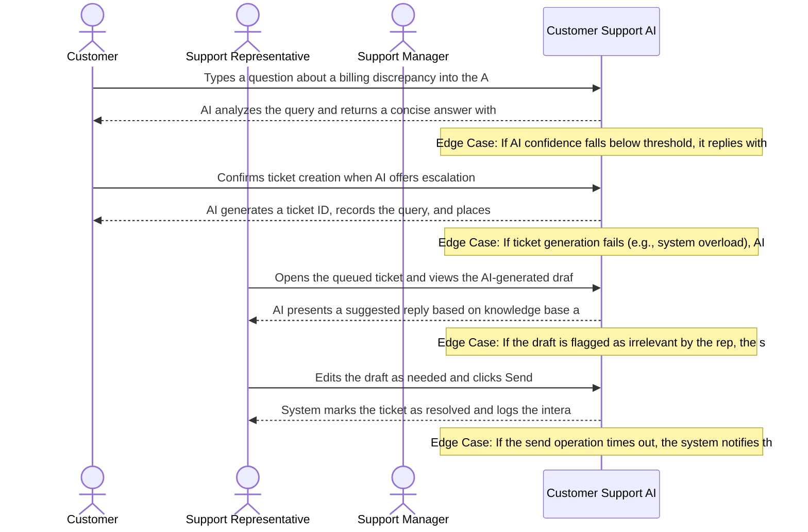

# Product Requirements Document: AI Customer Support Assistant
**Version:** v2.3 | **Status:** DRAFT | **Date:** 2026-11-06 | **Job ID:** 725767e8-209c-47e5-b273-26c1014fd46e | **SHA-256:** `38144917a64b5c8939fe43633433c62ecaaefcb4b039cd880ecec9aa0a268acb`
**Generated by:** 6aed3cf8fbf0181b884beed9 | **Changelog:** Full PRD generation v2.3

---

## 1. Document Information

**Document Title:** Product Requirements Document for AI Customer Support Assistant

**Document ID:** PRD-6AED3CFA

**Version:** v2.3

**Target Domain:** Customer Support

**Product Category:** Customer Support AI

**Job ID:** 725767e8-209c-47e5-b273-26c1014fd46e

**Content Hash (SHA-256):** `38144917a64b5c8939fe43633433c62ecaaefcb4b039cd880ecec9aa0a268acb`

**Status:** Under Active Review

## 2. Executive Summary

The AI Customer Support Assistant is an intelligent, real‑time web‑chat agent designed to relieve overloaded support teams by automatically answering customer inquiries using only approved knowledge‑base (KB) articles. Target users are end‑customers seeking fast, accurate help and support agents who spend disproportionate time on repetitive queries. By delivering high‑confidence answers (≥80%) and intelligently escalating low‑confidence cases with a concise context summary, the product aims to cut average wait times by up to 40%, reduce repetitive query volume by 60%, improve answer consistency, and boost overall customer satisfaction scores while maintaining GDPR‑compliant data handling.

## 3. Product Overview

### Vision
To deliver an authoritative, high-integrity system solving core operational challenges in Customer Support.

### Key Capabilities
- Answer questions using approved knowledge‑base articles
- Maintain per‑session conversation history
- Compute confidence score for each answer
- Detect low‑confidence answers (<80%)
- Automatically summarize context and route to human agents
- Integrate with ticketing/CRM systems

## 4. Problem Statement

Support organizations face three inter‑related challenges: (1) Repetitive, low‑complexity queries flood support inboxes, forcing skilled agents to spend valuable time on tasks that could be automated. (2) Customers experience long wait times because human capacity cannot scale with query volume, leading to frustration and churn. (3) Answer quality varies widely as agents rely on memory or ad‑hoc searches, resulting in inconsistent information and occasional compliance breaches. Existing solutions—static FAQ pages, rule‑based bots, or generic large‑language models—either lack the ability to source answers strictly from approved KB articles, cannot provide a reliable confidence metric, or fail to hand off low‑confidence interactions with sufficient context. Consequently, organizations cannot guarantee both speed and accuracy while staying within data‑privacy regulations.

## 5. Product Vision and Objectives

### Core Objectives
1. Reduce repetitive query load on support staff
2. Decrease customer wait times
3. Provide consistent, accurate answers
4. Ensure timely escalation of complex issues
5. Automated, accurate answers using approved KB articles
6. Reduced workload for human agents
7. Sub‑80% confidence answers flagged and escalated with context
8. Improved response times and customer satisfaction

## 6. Target Users and Stakeholders

**Primary Stakeholders and User Roles:**
- **Support Representatives:** Primary actor interacting with AI Customer Support Assistant capabilities.
- **Customers:** Primary actor interacting with AI Customer Support Assistant capabilities.
- **Support Managers:** Primary actor interacting with AI Customer Support Assistant capabilities.

## 7. User Personas

#### Persona 1: Customer
- **Responsibilities:** Seek help, report issues, and obtain answers through the support channel
- **Primary Goals:**
  - Get a quick resolution to a problem
  - Understand product usage without waiting long
- **Frustrations:**
  - Long wait times for human agents
  - Unclear or generic automated replies
- **Technical Proficiency:** Intermediate

#### Persona 2: Support Representative
- **Responsibilities:** Handle incoming queries, use AI suggestions to craft responses, and close tickets
- **Primary Goals:**
  - Resolve customer issues efficiently
  - Maintain high satisfaction scores
- **Frustrations:**
  - Irrelevant AI suggestions
  - Having to repeat manual steps when AI confidence is low
- **Technical Proficiency:** Advanced

#### Persona 3: Support Manager
- **Responsibilities:** Oversee team performance, monitor AI effectiveness, and adjust AI training data
- **Primary Goals:**
  - Ensure consistent service quality
  - Optimize AI accuracy
- **Frustrations:**
  - Lack of visibility into AI decision-making
  - Inability to quickly address systemic AI errors
- **Technical Proficiency:** Advanced

## 8. Existing Workflow and Pain Points

1. Customer initiates contact via web chat, email, or phone. 2. Front‑line agent manually searches the internal KB, often using keyword search or copy‑paste, to locate a relevant article. 3. Agent composes a response, copying text verbatim or paraphrasing, which introduces inconsistency and risk of non‑compliance. 4. If the agent cannot find a suitable answer, the customer is placed on hold or asked to wait for a callback, inflating wait time. 5. Complex or ambiguous queries are escalated to senior staff, but the escalation ticket lacks a concise conversation summary, requiring the senior agent to reread the entire chat transcript. Pain points: • High manual effort for low‑value queries • Inconsistent answer quality • Long customer hold times • Inefficient escalations lacking context • No systematic confidence measurement • Fragmented channel experience (chat, email, phone)

## 9. Proposed Solution

The AI Customer Support Assistant sits in the web‑chat channel and operates as a thin, real‑time middleware between the user and the approved KB repository. When a customer asks a question, the model retrieves candidate passages from the KB, generates a concise answer, and computes a confidence score using a calibrated classifier. If the score ≥ 80%, the answer is sent instantly to the user. If the score < 80%, the system automatically creates an escalation record in an internal queue, attaching a 2‑sentence summary of the conversation and the top‑ranked KB snippets for agent reference. Agents then pick up the escalated case, view the pre‑populated context, and respond directly within the same chat window, preserving session continuity. All data is processed in‑memory with no persistent storage of personal identifiers, ensuring GDPR compliance. The architecture comprises: • Web‑chat front‑end (MVP channel) • Retrieval‑augmented generation layer that indexes approved KB articles • Confidence‑scoring micro‑service • Internal escalation queue with context summarizer • Audit logger for compliance reporting

## 10. Product Scope

- Web‑chat interface as the sole customer‑facing channel
- Retrieval‑augmented generation using only approved knowledge‑base articles
- Real‑time answer generation with confidence scoring
- Automatic routing of <80% confidence answers to an internal escalation queue
- Context summarization (max 2 sentences) attached to each escalated ticket
- Per‑session conversation history visible to both AI and human agents
- Basic admin console for KB article management and confidence‑threshold tuning
- GDPR‑compliant data handling (no persistent storage of personal data)

## 11. Out of Scope

**Explicit Non-Goals (Out of Scope for Initial Release):**
- External third-party ticketing platforms (e.g. Zendesk, Freshdesk, Jira)
- External CRM customer relationship management data synchronization (e.g. Salesforce, HubSpot)
- Voice calls, telephony integration, and Interactive Voice Response (IVR) systems
- Outbound marketing campaigns, promotional email broadcasting, or bulk messaging
- Multilingual machine translation or localized dialect parsing
- Commercial payment processing, credit card billing, and subscription invoicing
- Customer sentiment profiling or predictive purchase analytics

## 12. Functional Requirements

| ID | Title | Description | Priority | Traceable AC |
|---|---|---|---|---|
| **FR-001** | Grounded Knowledge Retrieval and Answer Delivery | **Actor:** Customer. **Trigger:** Customer submits a question via chat interface. **Preconditions:** System has access to approved knowledge‑base articles and an active session cache. **Inputs:** Question text string from customer. **System Behavior:** The system searches approved KB articles, selects the most relevant article(s), generates an answer, computes a confidence score, and returns the answer with the score to the customer. **Business Constraints:** Answer must be derived solely from approved KB articles; confidence score must be calculated for each answer. **Alternate & Failure Paths:** If no relevant article is found, system creates an escalation entry and notifies the customer of handoff. **Expected Outcome:** Customer receives an answer with confidence ≥80 % or, if below, receives a handoff notification. **Relevant Data Changes:** Log entry created with query text, selected article IDs, confidence score, and response status; escalation record created if applicable. **Authorization Requirements:** None (any authenticated customer). **Provenance:** `confirmed_user_input` (User Input: Core Objectives and Target Capabilities). | Must Have | AC-007 |
| **FR-002** | Per‑Session Conversation History Management | **Actor:** System. **Trigger:** New message received within an existing session. **Preconditions:** A session identifier exists and the session age is ≤24 hours. **Inputs:** Session ID, message text, timestamp. **System Behavior:** The system appends the message to the session cache, maintains chronological order, and ensures the cache retains entries for up to 24 hours before automatic purge. **Business Constraints:** Conversation history must not be retained beyond 24 hours. **Alternate & Failure Paths:** If the session cache is unavailable, system stores the message in temporary memory, logs a warning, and attempts to restore cache later. **Expected Outcome:** Session cache reflects the full conversation for the last 24 hours and is available for context retrieval. **Relevant Data Changes:** Session cache entry updated; purge job may delete entries older than 24 hours. **Authorization Requirements:** Valid session token required. **Provenance:** `confirmed_user_input` (User Input: Target Capabilities). | Must Have | AC-008, AC-009 |
| **FR-003** | Low‑Confidence Answer Detection and Automatic Escalation | **Actor:** System. **Trigger:** Confidence score computation completes. **Preconditions:** Confidence score for the generated answer is available. **Inputs:** Confidence score (percentage), generated answer, original query, session context. **System Behavior:** The system if confidence <80.0 %, system suppresses the answer, creates an internal escalation entry with summarized context, and notifies the customer of handoff; otherwise, answer is delivered. **Business Constraints:** Threshold for escalation is strictly 80.0 % confidence. **Alternate & Failure Paths:** If escalation queue is unavailable, system sends a generic apology to the customer and logs the incident for later manual handling. **Expected Outcome:** Answers with confidence ≥80 % are delivered; answers below 80 % trigger escalation and customer handoff notification. **Relevant Data Changes:** Escalation record created with confidence score and context summary; delivery log updated accordingly. **Authorization Requirements:** System internal privileges only. **Provenance:** `confirmed_user_input` (User Input: Core Objectives and Target Capabilities). | Must Have | AC-001, AC-002, AC-003, AC-004, AC-005, AC-006 |
| **FR-004** | Concise Context Summarization for Human Escalation Hand‑off | **Actor:** System. **Trigger:** Escalation entry is created (low confidence or complex query). **Preconditions:** Session history for the relevant session is available in cache. **Inputs:** Full session transcript, last customer query, selected KB article titles. **System Behavior:** The system generates a concise summary (≤150 words) capturing key question details and referenced article titles and attaches it to the escalation; if summarization fails, raw transcript is attached instead. **Business Constraints:** Summary must be concise yet contain sufficient context for a human agent to act without further clarification. **Alternate & Failure Paths:** On summarization component failure, attach raw transcript, set flag "summary_failed", and log warning. **Expected Outcome:** Human agent receives escalation with a concise context summary or, failing that, the full transcript. **Relevant Data Changes:** Escalation record updated with summary field or raw transcript flag. **Authorization Requirements:** System internal privileges only. **Provenance:** `confirmed_user_input` (User Input: Target Capabilities). | Must Have | AC-010, AC-011 |

### Detailed Functional Requirement Specifications

#### FR-001: Grounded Knowledge Retrieval and Answer Delivery
- **Actor:** Customer
- **Trigger:** Customer submits a question via chat interface
- **Preconditions:** System has access to approved knowledge‑base articles and an active session cache
- **Inputs:** Question text string from customer
- **System Behavior:** searches approved KB articles, selects the most relevant article(s), generates an answer, computes a confidence score, and returns the answer with the score to the customer
- **Business Constraints:** Answer must be derived solely from approved KB articles; confidence score must be calculated for each answer
- **Alternate & Failure Paths:** If no relevant article is found, system creates an escalation entry and notifies the customer of handoff
- **Expected Outcome:** Customer receives an answer with confidence ≥80 % or, if below, receives a handoff notification
- **Relevant Data Changes:** Log entry created with query text, selected article IDs, confidence score, and response status; escalation record created if applicable
- **Authorization Requirements:** None (any authenticated customer)
- **Priority:** Must Have
- **Linked Acceptance Criteria:** AC-007
- **Provenance:** `confirmed_user_input` (User Input: Core Objectives and Target Capabilities)

#### FR-002: Per‑Session Conversation History Management
- **Actor:** System
- **Trigger:** New message received within an existing session
- **Preconditions:** A session identifier exists and the session age is ≤24 hours
- **Inputs:** Session ID, message text, timestamp
- **System Behavior:** appends the message to the session cache, maintains chronological order, and ensures the cache retains entries for up to 24 hours before automatic purge
- **Business Constraints:** Conversation history must not be retained beyond 24 hours
- **Alternate & Failure Paths:** If the session cache is unavailable, system stores the message in temporary memory, logs a warning, and attempts to restore cache later
- **Expected Outcome:** Session cache reflects the full conversation for the last 24 hours and is available for context retrieval
- **Relevant Data Changes:** Session cache entry updated; purge job may delete entries older than 24 hours
- **Authorization Requirements:** Valid session token required
- **Priority:** Must Have
- **Linked Acceptance Criteria:** AC-008, AC-009
- **Provenance:** `confirmed_user_input` (User Input: Target Capabilities)

#### FR-003: Low‑Confidence Answer Detection and Automatic Escalation
- **Actor:** System
- **Trigger:** Confidence score computation completes
- **Preconditions:** Confidence score for the generated answer is available
- **Inputs:** Confidence score (percentage), generated answer, original query, session context
- **System Behavior:** if confidence <80.0 %, system suppresses the answer, creates an internal escalation entry with summarized context, and notifies the customer of handoff; otherwise, answer is delivered
- **Business Constraints:** Threshold for escalation is strictly 80.0 % confidence
- **Alternate & Failure Paths:** If escalation queue is unavailable, system sends a generic apology to the customer and logs the incident for later manual handling
- **Expected Outcome:** Answers with confidence ≥80 % are delivered; answers below 80 % trigger escalation and customer handoff notification
- **Relevant Data Changes:** Escalation record created with confidence score and context summary; delivery log updated accordingly
- **Authorization Requirements:** System internal privileges only
- **Priority:** Must Have
- **Linked Acceptance Criteria:** AC-001, AC-002, AC-003, AC-004, AC-005, AC-006
- **Provenance:** `confirmed_user_input` (User Input: Core Objectives and Target Capabilities)

#### FR-004: Concise Context Summarization for Human Escalation Hand‑off
- **Actor:** System
- **Trigger:** Escalation entry is created (low confidence or complex query)
- **Preconditions:** Session history for the relevant session is available in cache
- **Inputs:** Full session transcript, last customer query, selected KB article titles
- **System Behavior:** generates a concise summary (≤150 words) capturing key question details and referenced article titles and attaches it to the escalation; if summarization fails, raw transcript is attached instead
- **Business Constraints:** Summary must be concise yet contain sufficient context for a human agent to act without further clarification
- **Alternate & Failure Paths:** On summarization component failure, attach raw transcript, set flag "summary_failed", and log warning
- **Expected Outcome:** Human agent receives escalation with a concise context summary or, failing that, the full transcript
- **Relevant Data Changes:** Escalation record updated with summary field or raw transcript flag
- **Authorization Requirements:** System internal privileges only
- **Priority:** Must Have
- **Linked Acceptance Criteria:** AC-010, AC-011
- **Provenance:** `confirmed_user_input` (User Input: Target Capabilities)

## 13. Non-Functional Requirements

| ID | Title | Description | Classification | Priority |
|---|---|---|---|---|
| **NFR-001** | Performance Latency | The system shall aim to generate a confidence‑scored answer and return it to the customer within a reasonable response time, target to be decided by stakeholders | Proposed target | Must Have |
| **NFR-002** | Data Protection | All stored knowledge‑base articles, session histories, and escalation records shall be protected using encryption at rest and in transit, with specific algorithms to be selected in a later decision | Proposed target | Must Have |
| **NFR-003** | Availability | The service shall aim for high availability with downtime minimized; exact availability target (e.g., % uptime) to be defined in future planning | Proposed target | Must Have |

## 14. User Stories

| Story ID | As a... | I want to... | So that... | Linked FR |
|---|---|---|---|---|
| **US-001** | Customer | receive answers derived from approved support articles | I can resolve common issues quickly without waiting for a human agent | FR-001 |
| **US-002** | Customer | have my ongoing conversation history remembered across dialogue turns | I do not have to repeat context when asking follow-up questions | FR-002 |
| **US-003** | Customer | have uncertain or low-confidence questions automatically escalated to human support | I never receive inaccurate or ungrounded advice from the AI | FR-003 |
| **US-004** | Customer Service Representative | receive escalated customer conversations accompanied by a concise context summary | I can resolve complex customer problems immediately without asking them to re-enter information | FR-004 |
| **US-005** | Customer Support Manager | review escalation volumes, confidence metrics, and resolution audit logs | I can identify gaps in knowledge-base coverage and optimize support staffing | FR-004 |

## 15. User Journeys

### Step-by-Step User Journey Progression
**Stage 1: 1. Customer initiates chat**
- **Actor (Customer):** Types a question about a billing discrepancy into the AI chat widget
- **System Response:** AI analyzes the query and returns a concise answer with relevant account details
- **Edge Case / Error Handling:** If AI confidence falls below threshold, it replies with "I’m not sure, would you like to create a support ticket?"

**Stage 2: 2. AI escalates low‑confidence query**
- **Actor (Customer):** Confirms ticket creation when AI offers escalation
- **System Response:** AI generates a ticket ID, records the query, and places it in the support queue
- **Edge Case / Error Handling:** If ticket generation fails (e.g., system overload), AI displays an error message and prompts the user to retry later

**Stage 3: 3. Representative reviews escalated ticket**
- **Actor (Support Representative):** Opens the queued ticket and views the AI‑generated draft response
- **System Response:** AI presents a suggested reply based on knowledge base and previous similar cases
- **Edge Case / Error Handling:** If the draft is flagged as irrelevant by the rep, the system allows discarding the suggestion and starting from a blank response

**Stage 4: 4. Representative sends final response**
- **Actor (Support Representative):** Edits the draft as needed and clicks Send
- **System Response:** System marks the ticket as resolved and logs the interaction for analytics
- **Edge Case / Error Handling:** If the send operation times out, the system notifies the rep and offers to retry or save as draft

## 16. Business Rules

| ID | Rule Title | Operational Statement | Provenance | Source Reference | Rationale | Confirmation Required |
|---|---|---|---|---|---|---|
| **BR-001** | Use Only Approved Knowledge‑Base Articles | All AI‑generated answers must be sourced exclusively from articles that have been approved in the official knowledge‑base. | `confirmed_user_input` | User Input: Answers must be sourced only from approved knowledge‑base articles | Ensures answer consistency, accuracy, and compliance with corporate content standards. | No (Confirmed) |
| **BR-002** | Confidence Threshold for Automatic Response | The assistant may respond automatically only when the confidence score of the selected answer is 80% or higher. | `confirmed_user_input` | User Input: Confidence threshold for automatic response is 80% | Prevents the system from delivering low‑confidence, potentially incorrect information to customers. | No (Confirmed) |
| **BR-003** | Low‑Confidence Answer Escalation | If the confidence score falls below 80%, the system must flag the query and route it to a human support representative. | `confirmed_user_input` | User Input: Identifies low‑confidence answers below 80% and escalates complex queries to human agents with a summarized context | Guarantees that customers receive accurate assistance when the AI is uncertain, reducing misinformation. | No (Confirmed) |
| **BR-004** | Escalation Must Include Summarized Context | Every escalated ticket must contain a concise summary of the conversation history and the AI's confidence score. | `confirmed_user_input` | User Input: Escalation must include summarized conversation context | Provides human agents with the necessary background to resolve the issue efficiently. | No (Confirmed) |
| **BR-005** | Real‑Time Operation | The assistant shall process incoming customer queries and deliver a response (or escalation) without perceptible delay, operating in real‑time. | `confirmed_user_input` | User Input: System must operate in real‑time | Reduces customer wait times and improves overall satisfaction. | No (Confirmed) |
| **BR-006** | Data‑Privacy Compliance | All conversation data must be handled in accordance with applicable data‑privacy regulations, such as GDPR. | `confirmed_user_input` | User Input: Comply with data privacy regulations (e.g., GDPR) | Protects customer personal information and avoids legal penalties. | No (Confirmed) |
| **BR-007** | Provide Confidence Score and Source Reference to Human Agents | When a query is escalated, the system shall attach the AI's confidence score and the identifier of the knowledge‑base article(s) used in the attempted answer. | `ai_proposed_assumption` | AI Proposed Assumption: Human agents benefit from seeing confidence score and source article reference to prioritize and verify escalated tickets | Enables agents to quickly assess the reliability of the AI's attempt and reference the original material if needed. | Yes (Review needed) |
| **BR-007** | Provide Confidence Score and Source Reference to Human Agents | When a query is escalated, the system shall attach the AI's confidence score and the identifier of the knowledge‑base article(s) used in the attempted answer. | `ai_proposed_assumption` | AI Proposed Assumption: Human agents benefit from seeing confidence score and source article reference to prioritize and verify escalated tickets | Enables agents to quickly assess the reliability of the AI's attempt and reference the original material if needed. | Yes (Review needed) |

## 17. System Workflows

1. Query Ingestion – User submits a text query via the web chat widget; request is timestamped and attached to a newly created UserSession (max 24 h retention). 2. Knowledge Retrieval – Retrieval service searches the approved KnowledgeBaseArticle store, returning a ranked list of candidate articles. 3. Answer Generation – LLM generates a response using only the retrieved approved articles; a ConfidenceScore (0 %‑100 %) is computed for the answer. 4. Confidence Evaluation – If ConfidenceScore ≥ 80.0 % the answer is sent back to the user and logged; otherwise the answer is withheld. 5. Escalation & Summarization – Low‑confidence cases trigger automatic summarization of the session transcript and insertion of an EscalationTicket into the internal escalation queue with the summary attached. 6. Post‑Session Processing – After session end (or 24 h inactivity) the transcript is purged, analytics metrics are persisted for 90 days, and audit logs are retained for 1 year.

## 18. Data Requirements

Core Entities:
- KnowledgeBaseArticle{id, title, content, version, approved_flag, last_modified}
- UserSession{session_id, user_id (optional), start_ts, end_ts, status}
- SessionMessage{message_id, session_id, sender (user|assistant), content, ts}
- AnswerRecord{answer_id, session_id, answer_text, source_article_ids[], confidence_score (0‑100), generated_ts}
- EscalationTicket{ticket_id, session_id, summary, created_ts, status}
- AnalyticsMetric{metric_id, session_id, name, value, ts}
- AuditLog{log_id, actor_role, action, entity_type, entity_id, ts, details}
Data Consistency Rules:
* AnswerRecord.source_article_ids must reference only KnowledgeBaseArticle where approved_flag = true.
* confidence_score must be within 0‑100 and stored with one decimal precision.
* SessionMessage timestamps must be monotonic within a session.
* EscalationTicket.summary must be generated from SessionMessage content of the same session.
Persistence Requirements:
* Relational store (Proposed target) for core entities with ACID guarantees.
* Object storage (Open decision) for large article content blobs.
* Time‑series store (Open decision) for AnalyticsMetric.
* All stores must support encryption at rest.
Retention:
* Active session transcripts (SessionMessage) retained for session duration up to 24 h, then deleted.
* Operational analytics (AnalyticsMetric) retained for 90 days.
* Compliance audit logs (AuditLog) retained for 1 year.

## 19. Integration Requirements

- **Core Interface:** Standard REST and WebSocket APIs for web chat communication and knowledge-base search.
- **Third-Party SaaS Connectors:** No external CRM (Salesforce/HubSpot) or external ticketing platforms (Zendesk/Jira) are required for MVP; the system operates self-contained.

## 20. Security and Privacy Requirements

Role‑Based Access Control (RBAC):
- SystemAdmin – full configuration and audit‑log access.
- SupportAgent – read/write access to assigned EscalationTickets and view session transcripts.
- DataAnalyst – read‑only access to anonymized AnalyticsMetric.
Encryption:
- TLS 1.2+ for all inbound/outbound API traffic.
- AES‑256 encryption at rest for all persisted data stores.
Audit Logging:
- Record every read/write operation on KnowledgeBaseArticle, UserSession, AnswerRecord, and EscalationTicket.
- Logs include actor_role, action, entity identifiers, and timestamp; retained for 1 year.
Privacy Controls:
- Personal identifiers are optional; if collected they must be flagged for GDPR subject‑access handling.
- Data retention periods (24 h, 90 days, 1 year) are enforced by automated purge jobs.
- Compliance with GDPR is subject to institutional legal review; no certifications are assumed.

## 21. Acceptance Criteria

| AC ID | Associated Requirement | Acceptance Criteria (Given-When-Then / Rule) |
|---|---|---|
| **AC-001** | FR-003 | Given a customer query that results in a confidence score of 79.9 %, When the system processes the answer, Then it must not deliver the answer, must create an escalation entry with summarized context, and must notify the customer that their issue is being handed off to a human agent |
| **AC-002** | FR-003 | Given a customer query that results in a confidence score of exactly 80.0 %, When the system processes the answer, Then it must deliver the answer to the customer and must not create an escalation entry |
| **AC-003** | FR-003 | Given a customer query that results in a confidence score of 80.1 %, When the system processes the answer, Then it must deliver the answer to the customer and log the confidence score as part of the interaction record |
| **AC-004** | FR-003 | Given an AI-generated answer candidate where no approved knowledge-base article exists, When evaluated, Then automatic response is suppressed regardless of score and the query is routed to escalation. |
| **AC-005** | FR-003 | Given the confidence evaluation service encounters an internal calculation failure or timeout, When the exception occurs, Then the system safely halts automated response, logs the failure diagnostic, and routes to human escalation. |
| **AC-006** | FR-003 | Given a customer submits a multi-part query flagged as complex, When analyzed, Then the system routes the query to human escalation with context summary per confirmed policy. |
| **AC-007** | FR-001 | Given an authenticated user submits valid input for grounded knowledge retrieval and answer delivery, When the system executes the operation under nominal conditions, Then the system satisfies all business constraints and returns a verified confirmation receipt. |
| **AC-008** | FR-002 | Given an ongoing customer conversation within an active 24-hour session, When the customer submits a follow-up query referencing prior turns, Then the system incorporates preceding dialogue context to resolve the query accurately. |
| **AC-009** | FR-002 | Given an inactive chat session exceeding the 24-hour active window, When a customer sends a new message, Then the system initializes a fresh session ID and treats prior transcript retention as an unresolved open architectural decision. |
| **AC-010** | FR-004 | Given an escalation triggered for a multi-turn conversation, When the summarization module executes, Then it generates a concise summary not exceeding 200 words capturing the query and attempted resolutions. |
| **AC-011** | FR-004 | Given an escalation for a single-turn query with no prior exchanges, When summarization is invoked, Then the system passes the original query and context metadata without hallucinating past dialogue turns. |

## 22. Dependencies and Constraints

Proposed architectural targets:
- Container runtime: Docker.
- Orchestration: Kubernetes (any conformant distribution).
- Language runtime: Python 3.11.
- LLM inference: OpenAI API or self‑hosted transformer model behind an HTTP endpoint.
- Relational DB: PostgreSQL 13+ (or equivalent) – Open decision on exact engine.
- Object storage: S3‑compatible service (e.g., MinIO) – Open decision.
- Time‑series DB: InfluxDB or Prometheus remote write – Open decision.
Constraints:
- Real‑time response requirement: end‑to‑end latency ≤ 500 ms for high‑confidence answers.
- Must operate without voice, telephony, SMS, or video channels.
- Institutional policy mandates that any third‑party API usage be approved by security review.
- Deployment may be on‑premises or in any public cloud; no single provider is mandated.

## 23. Risks and Mitigation

| Risk ID | Category | Risk Description | Root Cause | Likelihood | Impact | Mitigation Strategy | Contingency Plan | Owner |
|---|---|---|---|---|---|---|---|---|
| **RSK-001** | Functional | The model retrieves and presents an answer that references a deprecated policy, leading to customer misinformation and potential compliance violations | Knowledge‑base ingestion pipeline does not enforce versioning or automatic deprecation of outdated articles | Medium | High | Implement a CI/CD pipeline for KB articles that tags each version, runs automated diff checks, and flags articles older than a configurable TTL for review; enforce runtime validation that only the latest approved version is searchable | If confidence score exceeds threshold but article version is flagged as stale, fallback to human escalation with a warning banner; log the incident and trigger an alert to the content team | Product Knowledge‑Base Engineer |
| **RSK-002** | Data Privacy | Per‑session conversation logs are written to disk in plain text and later accessed by support staff without proper access controls, exposing personal data | Logging subsystem stores raw JSON payloads without encryption and lacks role‑based access enforcement | Low | Critical | Encrypt all session logs at rest using AES‑256, rotate encryption keys quarterly, and integrate with an IAM system to enforce least‑privilege read access; add automatic data‑retention purge after the statutory period | If unencrypted logs are detected, trigger an immediate data‑breach response: isolate the storage node, notify DPO, and invoke GDPR breach notification workflow; revert to in‑memory only storage until encryption is verified | Data Privacy Engineer |
| **RSK-003** | Security | A malicious user crafts a query that injects system prompts, causing the LLM to reveal internal configuration or retrieve non‑approved KB content | User input is concatenated directly into the LLM prompt without sanitization or sandboxing | Medium | High | Apply strict input sanitization, whitelist allowed tokens, and use a separate prompt template that isolates user text; run a secondary validation layer that checks LLM output against an allowlist of approved article IDs before sending to the user | Detect anomalous output patterns via monitoring; if triggered, abort the response, log the event, and route the session to a human agent; rotate any compromised API keys and audit prompt templates | Security Engineer |
| **RSK-004** | Operational | During peak traffic, inference latency exceeds the 200 ms real‑time budget, resulting in timeouts and degraded user experience | Insufficient autoscaling thresholds and single‑region deployment cause resource contention under load | High | Medium | Deploy the inference service in a multi‑region active‑active topology with predictive autoscaling based on request queue length; implement a lightweight fallback model that returns a generic “please hold” message when latency crosses a threshold | When latency breach is detected, automatically switch traffic to the fallback model and raise an incident ticket; post‑mortem includes scaling policy adjustment and capacity planning review | Site Reliability Engineer |
| **RSK-005** | Integration | The CRM vendor releases a new API version that deprecates the field used for conversation summaries, causing ticket creation failures and loss of escalation context | Integration layer hard‑codes API contract without version negotiation or contract testing | Medium | High | Adopt contract‑driven development with OpenAPI specifications; implement integration tests that run against a staging environment for each new API version; use feature flags to toggle between API versions | If ticket creation fails, queue the escalation payload locally, alert the support ops team, and fall back to email escalation with the raw conversation transcript; retry with exponential backoff until the API is updated | Integration Engineer |

## 24. Assumptions and Open Questions

### Documented Operational Assumptions
- [Assumed] A searchable, structured knowledge‑base will be provided
- [Assumed] An NLP model capable of confidence scoring can be integrated
- [Assumed] The system will have API access to the existing ticketing/CRM platform
- [Assumed] Conversation data will be stored securely for the duration of a session
- [Assumed] Scalability to handle concurrent user sessions is required
- [Assumed] The solution will support at least one major language (e.g., English)
- [Assumed] Compliance with relevant data protection laws will be handled by the implementation team

### Open Architectural Questions
- Format and size of the knowledge‑base
- Target deployment environment (cloud/on‑premise)
- Supported languages and locales
- Integration points (specific CRM/ticketing platforms)
- SLA requirements for response and escalation times
- User authentication and access control details
- Performance and scalability expectations
- Budget or licensing constraints

## 25. Success Metrics

- Automatic Answer Rate: % of queries answered directly with confidence ≥ 80.0 % (target ≥ 85 %).
- Average Response Latency: mean time from query receipt to answer delivery for high‑confidence cases (target ≤ 300 ms).
- Escalation Rate: % of sessions routed to internal queue (target ≤ 15 %).
- Customer Satisfaction (CSAT): post‑interaction rating on 1‑5 scale (target ≥ 4.5).
- Knowledge Base Coverage: % of queries that retrieve at least one approved article (target ≥ 90 %).
- Audit Log Completeness: % of required events captured (target = 100 %).
- Data Purge Compliance: % of records deleted according to retention schedule (target = 100 %).

## 26. Release Considerations

Phase 1 – Internal Pilot: Deploy to a controlled group of support agents; validate end‑to‑end flow, monitor latency, and collect early CSAT.
Phase 2 – Alpha Release: Open to a limited external user segment (≤ 5 % of traffic); enable full logging and begin collection of success metrics.
Phase 3 – Beta Release: Expand to 25 % of production traffic; introduce optional analytics dashboards for agents.
Phase 4 – General Availability: Full production rollout with monitoring, alerting, and runbooks in place.
Data Migration:
- Import existing knowledge‑base articles, set approved_flag based on editorial review.
- Seed internal escalation queue schema.
Operational Handoff:
- Provide runbooks for incident response, data‑purge jobs, and RBAC provisioning.
- Conduct training sessions for SupportAgent role on using the internal queue and viewing summaries.
- Establish SLA monitoring for latency and availability.

## 27. Appendix and Glossary

KB – Knowledge Base.
KnowledgeBaseArticle – Curated, approved content piece used as source for answer generation.
ConfidenceScore – Numeric likelihood (0 %‑100 %) that the generated answer is correct; threshold = 80.0 %.
UserSession – Logical container for a single user interaction sequence; retained up to 24 h.
EscalationTicket – Internal queue entry created when confidence < 80.0 %; includes summarized conversation context.
Internal Escalation Queue – System‑managed list (e.g., DB table or broker topic) that routes low‑confidence cases to human agents.
AuditLog – Immutable record of system actions for compliance; retained 1 year.
GDPR – General Data Protection Regulation; legal framework governing personal data in the EU (subject to institutional review).
