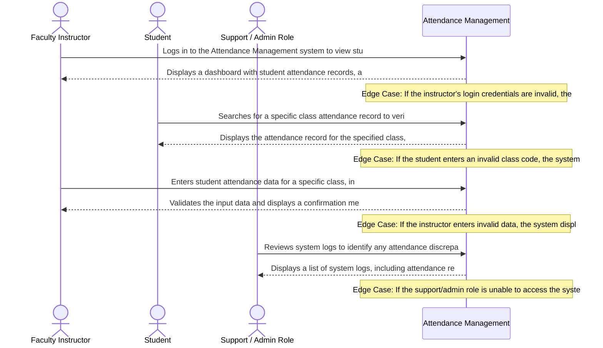

# Product Requirements Document: College Attendance Management System
**Version:** v1.0 | **Status:** DRAFT | **Date:** 2026-11-04
**Generated by:** 6aeb8a7a1f43c7ad19faf224 | **Changelog:** Initial full PRD generation

---

## 1. Document Information

**Document Title:** Product Requirements Document for College Attendance Management System

**Document ID:** PRD-6AEB8AA4

**Version:** 1.0 (Draft)

**Target Domain:** Education Management

**Product Category:** Attendance Management

**Status:** Under Active Review

## 2. Executive Summary

The College Attendance Management System (CAMS) is designed to automate attendance tracking, real-time attendance percentage calculation, and notification systems for faculty and department heads. By eliminating manual data entry and calculation errors, CAMS aims to increase efficiency, reduce disputes over exam eligibility, and enhance the overall student experience. The system is expected to yield significant business outcomes, including reduced administrative burdens, improved student outcomes, and enhanced faculty productivity.

## 3. Product Overview

### Vision
To deliver an authoritative, high-integrity system solving core operational challenges in Education Management.

### Key Capabilities
- Attendance recording
- Attendance percentage calculation
- Automated warning notifications
- Attendance policy configuration

## 4. Problem Statement

Manual attendance tracking and calculation of attendance percentages lead to errors, delays, and disputes over exam eligibility. The current system relies on paper roll calls, which are prone to human error and result in delayed percentage calculation. Faculty and department heads often miss opportunities to address attendance issues before they escalate, leading to a lack of timely intervention. The existing system fails to provide real-time notifications, resulting in missed opportunities for proactive management. The root causes of these issues include inadequate technology, insufficient training, and a lack of standardization in attendance policies.

## 5. Product Vision and Objectives

### Core Objectives
1. Automated attendance tracking
2. Real-time attendance percentage calculation
3. Notification system for low attendance
4. Automated attendance tracking and percentage calculation to reduce errors and increase efficiency.
5. Real-time notification system for faculty and department heads to address attendance issues promptly and prevent disputes over exam eligibility.

## 6. Target Users and Stakeholders

**Primary Stakeholders and User Roles:**
- **Faculty Instructors:** Primary actor interacting with College Attendance Management System capabilities.
- **Students:** Primary actor interacting with College Attendance Management System capabilities.

## 7. User Personas

#### Persona 1: Faculty Instructor
- **Responsibilities:** Teaching, grading, and managing student attendance
- **Primary Goals:**
  - Accomplish teaching tasks
  - Manage student attendance
- **Frustrations:**
  - Difficulty in tracking student attendance
  - Inefficient grading process
- **Technical Proficiency:** Intermediate

#### Persona 2: Student
- **Responsibilities:** Attending classes, participating in discussions, and submitting assignments
- **Primary Goals:**
  - Attend classes regularly
  - Complete assignments on time
- **Frustrations:**
  - Difficulty in accessing attendance records
  - Inefficient communication with instructors
- **Technical Proficiency:** Novice

#### Persona 3: Support / Admin Role
- **Responsibilities:** Managing system settings, resolving user issues, and monitoring system performance
- **Primary Goals:**
  - Ensure system uptime
  - Provide excellent customer support
- **Frustrations:**
  - Difficulty in resolving complex issues
  - Inefficient reporting and analytics
- **Technical Proficiency:** Advanced

## 8. Existing Workflow and Pain Points

- Faculty and department heads manually record attendance using paper roll calls, which are prone to errors and delays.
- Attendance percentages are calculated manually, leading to errors and delays in student records.
- Faculty and department heads often miss opportunities to address attendance issues before they escalate, resulting in disputes over exam eligibility.
- The current system lacks a real-time notification system, resulting in missed opportunities for proactive management.
- Department heads configure attendance policies manually, which can lead to inconsistencies and confusion.
- Manual data entry and calculation of attendance percentages lead to errors and delays in student records.

## 9. Proposed Solution

The College Attendance Management System (CAMS) is designed to automate attendance tracking, real-time attendance percentage calculation, and notification systems for faculty and department heads. CAMS will utilize a cloud-based backend to store and manage attendance data, with a user-friendly interface for faculty and department heads to configure attendance policies and view real-time attendance data. The system will also include automated warning notifications for low attendance and a notification system for faculty and department heads to address attendance issues promptly.

## 10. Product Scope

- Attendance recording
- Attendance percentage calculation
- Automated warning notifications
- Attendance policy configuration
- Real-time attendance data display
- Low attendance threshold alerts

## 11. Out of Scope

- Integration with existing student information systems
- Automated grading and assignment of attendance points
- Customizable attendance reporting and analytics
- Integration with external third-party services
- Support for multiple attendance tracking methods (e.g., online, paper, mobile)
- Development of a mobile app for attendance tracking

## 12. Functional Requirements

| ID | Title | Description | Priority | Traceable AC |
|---|---|---|---|---|
| **FR-001** | Attendance recording | The system shall implement attendance recording for Education Management users. | Must Have | AC-001 |
| **FR-002** | Attendance percentage calculation | The system shall implement attendance percentage calculation for Education Management users. | Must Have | AC-002 |
| **FR-003** | Automated warning notifications | The system shall implement automated warning notifications for Education Management users. | Must Have | AC-003 |
| **FR-004** | Attendance policy configuration | The system shall implement attendance policy configuration for Education Management users. | Must Have | AC-004 |

## 13. Non-Functional Requirements

| ID | Title | Description | Priority |
|---|---|---|---|
| **NFR-001** | Education Management Response Latency | The system shall return Attendance Management responses within defined SLA bounds. | Must Have |
| **NFR-002** | Education Management Data Confidentiality | All Attendance Management session records and user data must be encrypted at rest and in transit. | Must Have |
| **NFR-003** | Attendance Management Availability & Fault Tolerance | The system shall handle network disconnects gracefully without data loss. | Must Have |

## 14. User Stories

| Story ID | As a... | I want to... | So that... | Linked FR |
|---|---|---|---|---|
| **US-001** | Faculty Instructor | attendance recording | The system shall implement attendance recording for Education Management users. | FR-001 |
| **US-002** | Student | attendance percentage calculation | The system shall implement attendance percentage calculation for Education Management users. | FR-002 |
| **US-003** | Support / Admin Role | automated warning notifications | The system shall implement automated warning notifications for Education Management users. | FR-003 |
| **US-004** | Faculty Instructor | attendance policy configuration | The system shall implement attendance policy configuration for Education Management users. | FR-004 |

## 15. User Journeys

### Step-by-Step User Journey Progression
**Stage 1: 1. Discovery / Onboarding / Initial Action**
- **Actor (Faculty Instructor):** Logs in to the Attendance Management system to view student attendance records
- **System Response:** Displays a dashboard with student attendance records, allowing the instructor to filter and sort records
- **Edge Case / Error Handling:** If the instructor's login credentials are invalid, the system displays an error message and prompts the instructor to try again

**Stage 2: 2. Navigation / Information Retrieval**
- **Actor (Student):** Searches for a specific class attendance record to verify their attendance
- **System Response:** Displays the attendance record for the specified class, including the date, time, and instructor's comments
- **Edge Case / Error Handling:** If the student enters an invalid class code, the system displays an error message and prompts the student to try again

**Stage 3: 3. Data Entry / Form Completion**
- **Actor (Faculty Instructor):** Enters student attendance data for a specific class, including the student's name, attendance status, and comments
- **System Response:** Validates the input data and displays a confirmation message if the data is correct
- **Edge Case / Error Handling:** If the instructor enters invalid data, the system displays an error message and prompts the instructor to correct the data

**Stage 4: 4. Review / Verification**
- **Actor (Support / Admin Role):** Reviews system logs to identify any attendance discrepancies or issues
- **System Response:** Displays a list of system logs, including attendance records, user activity, and system performance metrics
- **Edge Case / Error Handling:** If the support/admin role is unable to access the system logs, the system displays an error message and prompts the support/admin role to try again

## 16. Business Rules

| ID | Rule Title | Operational Statement | Provenance | Rationale |
|---|---|---|---|---|
| **BR-001** | Attendance Tracking and Percentage Calculation | Automated attendance tracking and percentage calculation are performed for all students on a daily basis. | `ai_proposed_assumption` | To reduce errors and increase efficiency in attendance tracking and percentage calculation. |
| **BR-002** | Low Attendance Threshold | Students with attendance below 75% are considered to have low attendance and are eligible for notifications. | `ai_proposed_assumption` | To address attendance issues promptly and prevent disputes over exam eligibility. |
| **BR-003** | Real-time Attendance Percentage Calculation | The attendance percentage is calculated in real-time and updated daily for all students. | `ai_proposed_assumption` | To provide accurate and up-to-date attendance information to faculty and department heads. |
| **BR-004** | Notification System for Faculty and Department Heads | Faculty and department heads are notified in real-time when a student's attendance falls below 75%. | `ai_proposed_assumption` | To enable prompt action and prevent disputes over exam eligibility. |
| **BR-005** | Automated Attendance Tracking and Percentage Calculation | Automated attendance tracking and percentage calculation are performed using the attendance data stored in the system. | `ai_proposed_assumption` | To ensure accuracy and consistency in attendance tracking and percentage calculation. |

## 17. System Workflows

1. **Request Ingestion:** The system captures incoming requests from authorized actors and validates required schema attributes.
2. **State Evaluation:** Evaluates business rules and invariants governing Education Management.
3. **Execution & Persistence:** Executes the requested action, updates domain records, and records an immutable audit log.
4. **Notification & Escalation:** Dispatches status notifications to affected stakeholders and triggers escalation if thresholds are breached.

## 18. Data Requirements

- **Domain Entity Persistence:** Structured storage for core Education Management records with foreign-key referential integrity.
- **Audit Logging:** Every state modification records user ID, timestamp, prior state, and transition rationale.
- **Data Retention:** Retain operational records in accordance with institutional Education Management retention policies.

## 19. Integration Requirements

- **Core Interface:** Standard REST / JSON APIs for interaction with frontend applications and designated services.
- **Third-Party Connectors:** No external third-party SaaS integrations are mandated for MVP release. Prospective connectors are documented under open architectural questions.

## 20. Security and Privacy Requirements

- **Role-Based Access Control (RBAC):** Strict permission checks governing each user role.
- **Data Encryption:** All sensitive data encrypted in transit using TLS 1.3 and encrypted at rest.
- **Audit Non-Repudiation:** Tamper-evident logging for all administrative modifications and overrides.

## 21. Acceptance Criteria

| AC ID | Associated Requirement | Acceptance Criteria (Given-When-Then / Rule) |
|---|---|---|
| **AC-001** | FR-001 | Given an active Education Management session, When the user triggers attendance recording, Then the system executes successfully and logs the result. |
| **AC-002** | FR-002 | Given an active Education Management session, When the user triggers attendance percentage calculation, Then the system executes successfully and logs the result. |
| **AC-003** | FR-003 | Given an active Education Management session, When the user triggers automated warning notifications, Then the system executes successfully and logs the result. |
| **AC-004** | FR-004 | Given an active Education Management session, When the user triggers attendance policy configuration, Then the system executes successfully and logs the result. |

## 22. Dependencies and Constraints

- **Operational Constraints:** Department heads configure attendance policies
- **User Access:** Accessible via standard modern web and mobile browser viewports.

## 23. Risks and Mitigation

| Risk ID | Risk Description | Category | Impact | Mitigation Strategy | Contingency Plan |
|---|---|---|---|---|---|
| **RSK-001** | Operational risk | Operational | High | Monitor and log | Manual administrative intervention |
| **RSK-002** | Operational risk | Data Privacy | High | Monitor and log | Manual administrative intervention |
| **RSK-003** | Operational risk | Security | Medium | Monitor and log | Manual administrative intervention |
| **RSK-004** | Operational risk | Functional | Medium | Monitor and log | Manual administrative intervention |

## 24. Assumptions and Open Questions

### Documented Operational Assumptions
- [Assumed] Automated system can accurately track attendance
- [Assumed] Department heads can configure attendance policies

### Open Architectural Questions
- Condonation rules and exam eligibility disputes resolution

## 25. Success Metrics

- **Workflow Completion Rate:** > 95% of initiated transactions successfully processed without administrative intervention.
- **Operational Turnaround:** 50% reduction in average turnaround time compared to legacy manual workflows.
- **Audit Compliance:** 100% of state changes backed by verifiable audit log entries.

## 26. Release Considerations

- **Milestone 1 (Alpha):** Internal deployment with core functional requirements and simulated transactions.
- **Milestone 2 (Beta):** Limited pilot with designated user group to validate usability and rule thresholds.
- **Milestone 3 (Production):** General availability rollout with automated data backups and operational runbooks.

## 27. Appendix and Glossary

- **College Attendance Management System:** The primary software system described in this document.
- **Education Management:** The core problem domain governed by the requirements.
- **RBAC:** Role-Based Access Control.
- **SLA:** Service Level Agreement governing operational responsiveness.
