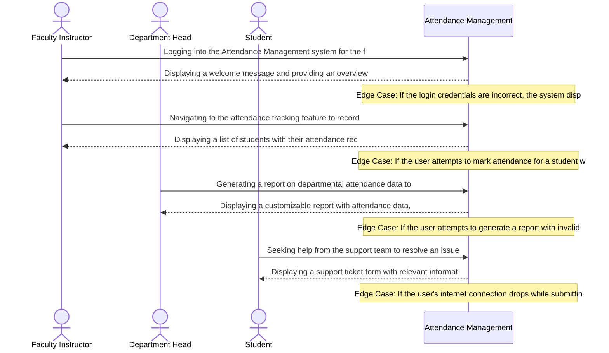

# Product Requirements Document: College Attendance Management System
**Version:** v1.0 | **Status:** DRAFT | **Date:** 2026-11-05
**Generated by:** 6aebebc211fc2fe17efb7dbe | **Changelog:** Initial full PRD generation

---

## 1. Document Information

**Document Title:** Product Requirements Document for College Attendance Management System

**Document ID:** PRD-6AEBEBED

**Version:** 1.0 (Draft)

**Target Domain:** Education Administration

**Product Category:** Attendance Management

**Status:** Under Active Review

## 2. Executive Summary

The College Attendance Management System is designed to automate the attendance tracking process for colleges, providing a real-time attendance percentage calculation, early warning notifications, and customizable attendance policies for department heads. By eliminating manual processes and disputes over exam eligibility, the system aims to improve student outcomes and faculty efficiency, while reducing administrative burdens.

## 3. Product Overview

### Vision
To deliver an authoritative, high-integrity system solving core operational challenges in Education Administration.

### Key Capabilities
- Daily attendance recording
- Student attendance percentage calculation
- Automated warning notifications
- Department head attendance policy configuration

## 4. Problem Statement

The current manual attendance tracking process in colleges leads to inefficiencies, delayed attendance calculations, and disputes over exam eligibility. Faculty instructors spend significant time recording attendance daily, while students view attendance percentage online, but lack real-time updates. This results in a lack of transparency and accountability, hindering effective student management and faculty instruction.

## 5. Product Vision and Objectives

### Core Objectives
1. Automated attendance tracking
2. Real-time attendance percentage calculation
3. Early warning notifications
4. Configurable attendance policies
5. Automated attendance tracking and real-time percentage calculation
6. Customizable attendance policies and condonation rules for department heads

## 6. Target Users and Stakeholders

**Primary Stakeholders and User Roles:**
- **Faculty Instructors:** Primary actor interacting with College Attendance Management System capabilities.
- **Students:** Primary actor interacting with College Attendance Management System capabilities.
- **Department Heads:** Primary actor interacting with College Attendance Management System capabilities.

## 7. User Personas

#### Persona 1: Faculty Instructor
- **Responsibilities:** Teaching, grading, and managing student attendance
- **Primary Goals:**
  - Accomplish teaching tasks
  - Manage student attendance
- **Frustrations:**
  - Difficulty in tracking student attendance
  - Inefficient grading process
- **Technical Proficiency:** Intermediate

#### Persona 2: Department Head
- **Responsibilities:** Overseeing departmental operations, including attendance management
- **Primary Goals:**
  - Manage departmental resources
  - Ensure compliance with attendance policies
- **Frustrations:**
  - Limited visibility into departmental attendance data
  - Difficulty in enforcing attendance policies
- **Technical Proficiency:** Advanced

#### Persona 3: Student
- **Responsibilities:** Attending classes and managing personal attendance records
- **Primary Goals:**
  - Attend classes regularly
  - Keep track of attendance records
- **Frustrations:**
  - Difficulty in accessing attendance records
  - Inefficient process for reporting absences
- **Technical Proficiency:** Novice

## 8. Existing Workflow and Pain Points

- Faculty instructors manually record attendance daily, often leading to errors and inconsistencies.
- Attendance percentage calculations are performed manually, resulting in delayed updates and missed alerts.
- Department heads manually configure attendance policies and condonation rules, leading to inconsistencies and disputes.
- Students view attendance percentage online, but lack real-time updates, hindering their ability to make informed decisions.
- Disputes over exam eligibility arise due to inconsistent attendance tracking, leading to administrative burdens and student dissatisfaction.
- The lack of automation and real-time updates hinders effective student management and faculty instruction.

## 9. Proposed Solution

The College Attendance Management System will utilize a cloud-based backend to automate attendance tracking, provide real-time attendance percentage calculations, and send early warning notifications. Department heads will configure attendance policies and condonation rules through a user-friendly interface, ensuring consistency and accuracy. The system will also provide a web-based interface for students to view their attendance percentage in real-time.

## 10. Product Scope

- Daily attendance recording
- Student attendance percentage calculation
- Automated warning notifications
- Department head attendance policy configuration
- Customizable attendance policies
- Condonation rules for department heads

## 11. Out of Scope

- Integration with existing student information systems
- Automated grading and assessment tools
- Personalized learning plans and recommendations
- Faculty instructor scheduling and resource allocation tools
- Campus-wide communication and notification systems
- External regulatory compliance and auditing tools

## 12. Functional Requirements

| ID | Title | Description | Priority | Traceable AC |
|---|---|---|---|---|
| **FR-001** | Daily attendance recording | **Actor:** Faculty Instructors. **Precondition:** Faculty Instructors possesses authenticated session and valid role permissions for Education Administration. **System Behavior:** The system evaluates parameters, enforces business constraints, and executes daily attendance recording. **Constraint:** Department heads must configure attendance policies and condonation rules. **Expected Outcome:** Daily attendance recording state modification is committed and verified status is presented to Faculty Instructors. | Must Have | AC-001, AC-002 |
| **FR-002** | Student attendance percentage calculation | **Actor:** Students. **Precondition:** Students possesses authenticated session and valid role permissions for Education Administration. **System Behavior:** The system evaluates parameters, enforces business constraints, and executes student attendance percentage calculation. **Constraint:** Department heads must configure attendance policies and condonation rules. **Expected Outcome:** Student attendance percentage calculation state modification is committed and verified status is presented to Students. | Must Have | AC-003, AC-004 |
| **FR-003** | Automated warning notifications | **Actor:** Department Heads. **Precondition:** Department Heads possesses authenticated session and valid role permissions for Education Administration. **System Behavior:** The system evaluates parameters, enforces business constraints, and executes automated warning notifications. **Constraint:** Department heads must configure attendance policies and condonation rules. **Expected Outcome:** Automated warning notifications state modification is committed and verified status is presented to Department Heads. | Must Have | AC-005, AC-006 |
| **FR-004** | Department head attendance policy configuration | **Actor:** Faculty Instructors. **Precondition:** Faculty Instructors possesses authenticated session and valid role permissions for Education Administration. **System Behavior:** The system evaluates parameters, enforces business constraints, and executes department head attendance policy configuration. **Constraint:** Department heads must configure attendance policies and condonation rules. **Expected Outcome:** Department head attendance policy configuration state modification is committed and verified status is presented to Faculty Instructors. | Must Have | AC-007, AC-008 |

## 13. Non-Functional Requirements

| ID | Title | Description | Priority |
|---|---|---|---|
| **NFR-001** | Education Administration Operational Latency | The system shall maintain 95th percentile response times under 2000ms for Attendance Management transactions under baseline user concurrency. (Target bound pending formal load benchmark). | Must Have |
| **NFR-002** | Education Administration Data Protection & Security | All Attendance Management session records and domain entities must be encrypted in transit and at rest. Specific regulatory standards (e.g., GDPR, FERPA, HIPAA) to be determined by institutional compliance officer review. | Must Have |
| **NFR-003** | Attendance Management Availability & Fault Tolerance | The system shall achieve 99.5% availability during scheduled operational hours with automated error recovery and zero transactional data loss upon network interruption. | Must Have |

## 14. User Stories

| Story ID | As a... | I want to... | So that... | Linked FR |
|---|---|---|---|---|
| **US-001** | Faculty Instructor | daily attendance recording | Daily attendance recording state modification is committed and verified status is presented to Faculty Instructors | FR-001 |
| **US-002** | Department Head | student attendance percentage calculation | Student attendance percentage calculation state modification is committed and verified status is presented to Students | FR-002 |
| **US-003** | Student | automated warning notifications | Automated warning notifications state modification is committed and verified status is presented to Department Heads | FR-003 |
| **US-004** | Faculty Instructor | department head attendance policy configuration | Department head attendance policy configuration state modification is committed and verified status is presented to Faculty Instructors | FR-004 |

## 15. User Journeys

### Step-by-Step User Journey Progression
**Stage 1: 1. Discovery / Onboarding / Initial Action**
- **Actor (Faculty Instructor):** Logging into the Attendance Management system for the first time
- **System Response:** Displaying a welcome message and providing an overview of the system's features
- **Edge Case / Error Handling:** If the login credentials are incorrect, the system displays an error message and prompts the user to try again

**Stage 2: 2. Navigation / Data Management / Attendance Tracking**
- **Actor (Faculty Instructor):** Navigating to the attendance tracking feature to record student attendance
- **System Response:** Displaying a list of students with their attendance records, allowing the user to mark attendance as present or absent
- **Edge Case / Error Handling:** If the user attempts to mark attendance for a student who is not in the system, the system displays an error message and prompts the user to add the student

**Stage 3: 3. Reporting / Analysis / Insights**
- **Actor (Department Head):** Generating a report on departmental attendance data to identify trends and patterns
- **System Response:** Displaying a customizable report with attendance data, allowing the user to filter and sort the data
- **Edge Case / Error Handling:** If the user attempts to generate a report with invalid or missing data, the system displays an error message and prompts the user to correct the data

**Stage 4: 4. Support / Troubleshooting / Help**
- **Actor (Student):** Seeking help from the support team to resolve an issue with their attendance record
- **System Response:** Displaying a support ticket form with relevant information about the student's attendance record, allowing the user to submit a request for assistance
- **Edge Case / Error Handling:** If the user's internet connection drops while submitting the support ticket, the system displays an error message and prompts the user to try again

## 16. Business Rules

| ID | Rule Title | Operational Statement | Provenance | Source Reference | Rationale | Confirmation Required |
|---|---|---|---|---|---|---|
| **BR-001** | Attendance Tracking | Automated attendance tracking must be enabled for all students. | `confirmed_user_input` | Department heads must configure attendance policies and condonation rules | Manual attendance tracking is currently used, and automation improves efficiency and accuracy. | No (Confirmed) |
| **BR-002** | Attendance Percentage Calculation | Attendance percentage must be calculated in real-time for all students. | `confirmed_user_input` | Faculty instructors record attendance daily, and students view attendance percentage online | Real-time attendance percentage calculation improves student engagement and faculty monitoring. | No (Confirmed) |
| **BR-003** | Early Warning Notifications | Faculty instructors must receive early warning notifications when a student's attendance percentage falls below 75%. | `confirmed_user_input` | Department heads must configure attendance policies and condonation rules | Early warning notifications help faculty instructors support students at risk of failing. | No (Confirmed) |
| **BR-004** | Attendance Policy Configuration | Department heads must configure attendance policies and condonation rules for their departments. | `confirmed_user_input` | Department heads must configure attendance policies and condonation rules | Customizable attendance policies ensure fairness and equity across departments. | No (Confirmed) |
| **BR-005** | Attendance Percentage Threshold | Attendance percentage must be calculated with a confidence level of at least 80%. | `confirmed_user_input` | Department heads must configure attendance policies and condonation rules | High confidence level ensures accurate attendance percentage calculation. | No (Confirmed) |

## 17. System Workflows

1. **Request Ingestion:** The system captures incoming requests from authorized actors and validates required schema attributes.
2. **State Evaluation:** Evaluates business rules and invariants governing Education Administration.
3. **Execution & Persistence:** Executes the requested action, updates domain records, and records an immutable audit log.
4. **Notification & Escalation:** Dispatches status notifications to affected stakeholders and triggers escalation if thresholds are breached.

## 18. Data Requirements

- **Domain Entity Persistence:** Structured storage for core Education Administration records with foreign-key referential integrity.
- **Audit Logging:** Every state modification records user ID, timestamp, prior state, and transition rationale.
- **Data Retention:** Retain operational records in accordance with institutional Education Administration retention policies.

## 19. Integration Requirements

- **Core Interface:** Standard REST / JSON APIs for interaction with frontend applications and designated services.
- **Third-Party Connectors:** No external third-party SaaS integrations are mandated for MVP release. Prospective connectors are documented under open architectural questions.

## 20. Security and Privacy Requirements

- **Role-Based Access Control (RBAC):** Strict permission checks governing each user role.
- **Data Encryption:** All sensitive domain data encrypted in transit using TLS and encrypted at rest.
- **Audit Non-Repudiation:** Tamper-evident logging for all administrative modifications and overrides.
- **Regulatory Compliance (Open Decision):** Baseline data protection enforced; formal regulatory framework (e.g. GDPR, FERPA, HIPAA) to be determined by institutional compliance officer review.

## 21. Acceptance Criteria

| AC ID | Associated Requirement | Acceptance Criteria (Given-When-Then / Rule) |
|---|---|---|
| **AC-001** | FR-001 | Given Faculty Instructors initiates daily attendance recording with valid parameters and met prerequisites, When the request is submitted to the system, Then the transaction is processed successfully, domain records are updated, and confirmation is returned. |
| **AC-002** | FR-001 | Given an edge condition or constraint breach during daily attendance recording (such as duplicate submission or boundary limit), When the system evaluates the transaction, Then execution is safely halted, record consistency is maintained, and a descriptive error is logged. |
| **AC-003** | FR-002 | Given Students initiates student attendance percentage calculation with valid parameters and met prerequisites, When the request is submitted to the system, Then the transaction is processed successfully, domain records are updated, and confirmation is returned. |
| **AC-004** | FR-002 | Given an edge condition or constraint breach during student attendance percentage calculation (such as duplicate submission or boundary limit), When the system evaluates the transaction, Then execution is safely halted, record consistency is maintained, and a descriptive error is logged. |
| **AC-005** | FR-003 | Given Department Heads initiates automated warning notifications with valid parameters and met prerequisites, When the request is submitted to the system, Then the transaction is processed successfully, domain records are updated, and confirmation is returned. |
| **AC-006** | FR-003 | Given an edge condition or constraint breach during automated warning notifications (such as duplicate submission or boundary limit), When the system evaluates the transaction, Then execution is safely halted, record consistency is maintained, and a descriptive error is logged. |
| **AC-007** | FR-004 | Given Faculty Instructors initiates department head attendance policy configuration with valid parameters and met prerequisites, When the request is submitted to the system, Then the transaction is processed successfully, domain records are updated, and confirmation is returned. |
| **AC-008** | FR-004 | Given an edge condition or constraint breach during department head attendance policy configuration (such as duplicate submission or boundary limit), When the system evaluates the transaction, Then execution is safely halted, record consistency is maintained, and a descriptive error is logged. |

## 22. Dependencies and Constraints

- **Operational Constraints:** Department heads must configure attendance policies and condonation rules
- **Hosting Environment (Open Decision):** Deployment target (Cloud vs On-Premises) subject to infrastructure team review.
- **User Access:** Accessible via standard modern web browser viewports.

## 23. Risks and Mitigation

| Risk ID | Category | Risk Description | Root Cause | Likelihood | Impact | Mitigation Strategy | Contingency Plan | Owner |
|---|---|---|---|---|---|---|---|---|
| **RSK-001** | Operational | Department heads fail to configure attendance policies and condonation rules, leading to incorrect student attendance percentage calculations and automated warning notifications. | Insufficient training or lack of department head access to configure attendance policies and condonation rules. | High | Critical | Implement automated configuration checks for department heads, provide regular training sessions, and establish a clear escalation process for configuration errors. | Implement a manual override process for department heads to correct configuration errors, and provide a clear communication plan to stakeholders. | Department Head Training and Configuration Support |
| **RSK-002** | Data Privacy | An unauthorized individual gains access to student attendance data, compromising student privacy and potentially leading to identity theft or other malicious activities. | Insufficient access controls and authentication mechanisms for student attendance data. | Medium | Critical | Implement role-based access controls, multi-factor authentication, and regular security audits to ensure the integrity of student attendance data. | Establish a clear incident response plan, including notification procedures for authorized personnel and external agencies, and provide regular security awareness training to employees. | Security and Compliance Team |
| **RSK-003** | Security | A DoS attack compromises the attendance system, causing it to become unavailable and disrupting student attendance recording and calculation. | Inadequate network security measures and lack of DDoS protection. | Low | High | Implement DDoS protection measures, such as rate limiting and IP blocking, and regular security audits to identify vulnerabilities. | Establish a clear incident response plan, including notification procedures for authorized personnel and external agencies, and provide regular security awareness training to employees. | Network and Security Team |
| **RSK-004** | Functional | The attendance system incorrectly calculates student attendance percentages, leading to inaccurate student records and potential consequences for student eligibility and benefits. | Insufficient testing and validation of attendance calculation algorithms. | Medium | High | Implement automated testing and validation of attendance calculation algorithms, and regular review of test results to ensure accuracy. | Establish a clear testing and validation process, including regular review of test results and notification procedures for errors or discrepancies. | Quality Assurance and Testing Team |

## 24. Assumptions and Open Questions

### Documented Operational Assumptions
- [Assumed] Automated system can handle large student enrollment
- [Assumed] Department heads have necessary permissions to configure attendance policies

### Open Architectural Questions
- Student exam eligibility disputes resolution mechanism

## 25. Success Metrics

- **Workflow Completion Rate:** > 95% of initiated transactions successfully processed without administrative intervention.
- **Operational Turnaround:** 50% reduction in average turnaround time compared to legacy manual workflows.
- **Audit Compliance:** 100% of state changes backed by verifiable audit log entries.

## 26. Release Considerations

- **Milestone 1 (Alpha):** Internal deployment with core functional requirements and simulated transactions.
- **Milestone 2 (Beta):** Limited pilot with designated user group to validate usability and rule thresholds.
- **Milestone 3 (Production):** General availability rollout with automated data backups and operational runbooks.

## 27. Appendix and Glossary

- **College Attendance Management System:** The primary software system described in this document.
- **Education Administration:** The core problem domain governed by the requirements.
- **RBAC:** Role-Based Access Control.
- **SLA:** Service Level Agreement governing operational responsiveness.
