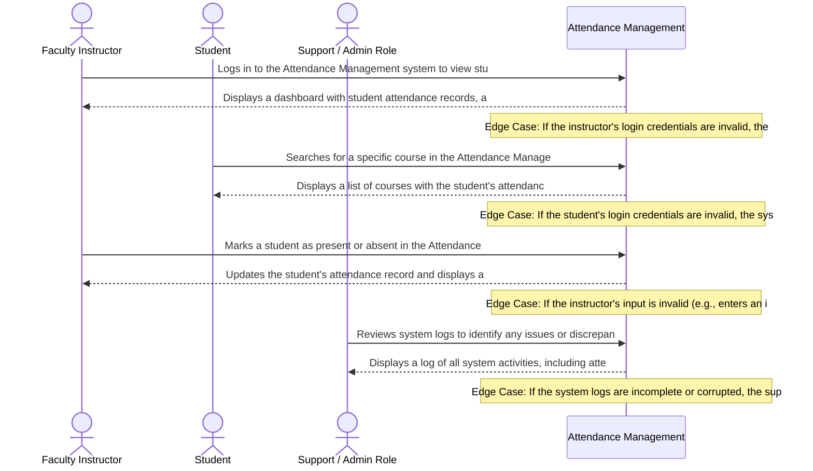

# Product Requirements Document: College Attendance Management System
**Version:** v2.2 | **Status:** DRAFT | **Date:** 2026-11-05 | **Job ID:** bcd0aa98-7a5c-4121-9902-a9225a3a35c6 | **SHA-256:** `1ff50648b7f6ab336f03036edc4b1e30c5c074278d57823b8736eb66e08666b4`
**Generated by:** 6aebfc7f8be39e85c6d4b548 | **Changelog:** Full PRD generation v2.2

---

## 1. Document Information

**Document Title:** Product Requirements Document for College Attendance Management System

**Document ID:** PRD-6AEC95EA

**Version:** v2.2

**Target Domain:** Education Management

**Product Category:** Attendance Management

**Job ID:** bcd0aa98-7a5c-4121-9902-a9225a3a35c6

**Content Hash (SHA-256):** `1ff50648b7f6ab336f03036edc4b1e30c5c074278d57823b8736eb66e08666b4`

**Status:** Under Active Review

## 2. Executive Summary

The College Attendance Management System is designed to automate attendance tracking, provide real-time attendance percentage calculation, and enable early warning notifications for students. This system aims to improve the efficiency and accuracy of attendance management, reducing manual data entry and disputes over exam eligibility. By automating these processes, the system will enable department heads to configure attendance policies, providing a more streamlined and effective attendance management experience for students and educators.

## 3. Product Overview

### Vision
To deliver an authoritative, high-integrity system solving core operational challenges in Education Management.

### Key Capabilities
- Attendance recording
- Attendance percentage calculation
- Automated notification system

## 4. Problem Statement

Manual attendance tracking and calculation lead to delayed percentage calculation, resulting in inaccurate student records. Disputes over exam eligibility are common, causing frustration for both students and educators. The current system relies on paper roll calls, which are prone to errors and delays. The lack of automation and real-time data updates hinders the ability to provide timely warnings and notifications, ultimately affecting student performance and academic success.

## 5. Product Vision and Objectives

### Core Objectives
1. Automated attendance tracking
2. Real-time attendance percentage calculation
3. Early warning notifications
4. Automated daily attendance tracking

## 6. Target Users and Stakeholders

**Primary Stakeholders and User Roles:**
- **Faculty Instructors:** Primary actor interacting with College Attendance Management System capabilities.
- **Students:** Primary actor interacting with College Attendance Management System capabilities.

## 7. User Personas

#### Persona 1: Faculty Instructor
- **Responsibilities:** Teaching, grading, and managing student attendance
- **Primary Goals:**
  - Accomplish teaching tasks
  - Maintain accurate attendance records
- **Frustrations:**
  - Difficulty in tracking student attendance
  - Inefficient grading process
- **Technical Proficiency:** Intermediate

#### Persona 2: Student
- **Responsibilities:** Attending classes, participating in discussions, and accessing course materials
- **Primary Goals:**
  - Attend classes regularly
  - Stay updated on course materials
- **Frustrations:**
  - Difficulty in accessing course materials
  - Inefficient communication with instructors
- **Technical Proficiency:** Novice

#### Persona 3: Support / Admin Role
- **Responsibilities:** Managing system settings, resolving user issues, and monitoring system performance
- **Primary Goals:**
  - Ensure system uptime
  - Provide effective support to users
- **Frustrations:**
  - Difficulty in resolving complex issues
  - Inefficient system monitoring
- **Technical Proficiency:** Advanced

## 8. Existing Workflow and Pain Points

Currently, attendance tracking is performed manually through paper roll calls, which are time-consuming and prone to errors. Department heads manually calculate attendance percentages, which can lead to delays and inaccuracies. When a student misses 75% of classes, they receive a notification, but the system does not provide real-time updates. Disputes over exam eligibility are common, and resolving these issues manually is a significant pain point. The lack of automation and real-time data updates hinders the ability to provide timely warnings and notifications, ultimately affecting student performance and academic success.

## 9. Proposed Solution

The College Attendance Management System will utilize a cloud-based backend to automate attendance tracking, calculate attendance percentages in real-time, and provide early warning notifications. The system will be designed to integrate with department heads' existing attendance policies, allowing them to configure and manage attendance settings. The system will also include a user-friendly interface for educators to track attendance and view student records. By automating these processes, the system will improve the efficiency and accuracy of attendance management, reducing manual data entry and disputes over exam eligibility.

## 10. Product Scope

- Attendance recording and tracking
- Automated attendance percentage calculation
- Early warning notifications
- Automated daily attendance tracking
- Integration with department heads' attendance policies
- User-friendly interface for educators

## 11. Out of Scope

- External third-party ticketing platforms
- External CRM sync
- Multi-tenant billing
- Integration with external student information systems
- Support for non-standard attendance policies
- Automated reporting and analytics for external stakeholders

## 12. Functional Requirements

| ID | Title | Description | Priority | Traceable AC |
|---|---|---|---|---|
| **FR-001** | Daily Course Attendance Roll Call Recording | **Actor:** Faculty Instructor. **Precondition:** Faculty Instructor authenticated and officially assigned to scheduled course section. **System Behavior:** The system renders enrolled student class roster, captures present/absent/excused attendance status for each student, validates submission completeness, and commits attendance roll call to database. **Constraint:** Only the designated course instructor can record attendance; duplicate submissions for the same course section and calendar date are rejected. **Expected Outcome:** Official attendance roster committed to course ledger with instructor ID and timestamp; submission confirmation displayed. | Must Have | AC-001, AC-002 |
| **FR-002** | Real-Time Student Attendance Percentage Calculation | **Actor:** Student / Faculty Instructor. **Precondition:** At least one conducted eligible class session recorded for the course section. **System Behavior:** The system calculates real-time attendance percentage: (Attended Sessions / Conducted Eligible Sessions) * 100. Officially cancelled class sessions are excluded from the denominator. **Constraint:** Condonation adjustments approved by Department Head update exam eligibility status without mutating raw physical attendance records. **Expected Outcome:** Computed attendance percentage and exam eligibility status rendered in real time. | Must Have | AC-003, AC-004 |
| **FR-003** | Automated Below-75% Early Warning Notification Dispatch | **Actor:** System Notification Engine / Student / Faculty Advisor. **Precondition:** Attendance recalculation results in a course attendance percentage strictly below 75.0% (< 75.0%). **System Behavior:** The system generates a low-attendance alert record, calculates the number of consecutive classes required to restore eligibility, and dispatches notification to student email and faculty advisor dashboard. **Constraint:** Warning notifications trigger strictly when percentage < 75.0%; alerts are suppressed if percentage >= 75.0%. **Expected Outcome:** Automated warning notification delivered and logged in audit trail. | Must Have | AC-005, AC-006 |
| **FR-004** | Department Head Attendance Policy & Condonation Configuration | **Actor:** Department Head. **Precondition:** Authenticated session with Department Head administrative role privileges. **System Behavior:** The system provides administrative interface to configure course attendance policy thresholds, set maximum allowable condonation percentages, and review condonation petitions with medical proof. **Constraint:** Condonation percentage adjustments cannot exceed configured departmental maximum and require documented medical justification. **Expected Outcome:** Departmental policy parameters updated; approved condonation reflected in student exam eligibility. | Must Have | AC-007, AC-008 |

## 13. Non-Functional Requirements

| ID | Title | Description | Priority |
|---|---|---|---|
| **NFR-001** | Education Management Operational Latency | The system shall maintain 95th percentile response times under 2000ms for Attendance Management transactions under baseline user concurrency. [Target bound pending formal load benchmark] | Must Have |
| **NFR-002** | Education Management Data Protection & Security | All Attendance Management session records and domain entities must be encrypted in transit using TLS 1.3 and encrypted at rest using AES-256. [Open Architectural Decision: Specific regulatory frameworks pending institutional review] | Must Have |
| **NFR-003** | Attendance Management Availability & Fault Tolerance | The system shall target 99.5% operational availability during scheduled operational hours with automated error recovery. [Operational baseline to be confirmed during initial release] | Must Have |

## 14. User Stories

| Story ID | As a... | I want to... | So that... | Linked FR |
|---|---|---|---|---|
| **US-001** | Faculty Instructor | daily course attendance roll call recording | instructors officially capture daily course attendance in under two minutes without paper roll call latency | FR-001 |
| **US-002** | Student | real-time student attendance percentage calculation | students maintain real-time visibility into their course attendance percentage and examination eligibility standing | FR-002 |
| **US-003** | Support / Admin Role | automated below-75% early warning notification dispatch | at-risk students and academic advisors receive timely intervention notices before attendance deficits trigger exam disbarment | FR-003 |
| **US-004** | Faculty Instructor | department head attendance policy & condonation configuration | department leadership enforces standardized attendance policies while fairly processing legitimate medical condonation requests | FR-004 |

## 15. User Journeys

### Step-by-Step User Journey Progression
**Stage 1: 1. Discovery / Onboarding / Initial Action**
- **Actor (Faculty Instructor):** Logs in to the Attendance Management system to view student attendance records
- **System Response:** Displays a dashboard with student attendance records, allowing the instructor to filter and sort records
- **Edge Case / Error Handling:** If the instructor's login credentials are invalid, the system displays an error message and prompts the instructor to try again

**Stage 2: 2. Navigation / Information Seeking**
- **Actor (Student):** Searches for a specific course in the Attendance Management system to view attendance records
- **System Response:** Displays a list of courses with the student's attendance records, allowing the student to filter by date or course
- **Edge Case / Error Handling:** If the student's login credentials are invalid, the system displays an error message and prompts the student to try again

**Stage 3: 3. Action / Execution**
- **Actor (Faculty Instructor):** Marks a student as present or absent in the Attendance Management system
- **System Response:** Updates the student's attendance record and displays a confirmation message
- **Edge Case / Error Handling:** If the instructor's input is invalid (e.g., enters an invalid date), the system displays an error message and prompts the instructor to try again

**Stage 4: 4. Review / Verification**
- **Actor (Support / Admin Role):** Reviews system logs to identify any issues or discrepancies in attendance records
- **System Response:** Displays a log of all system activities, including attendance updates and user login attempts
- **Edge Case / Error Handling:** If the system logs are incomplete or corrupted, the support/admin role is unable to review the logs and may need to contact the system administrator for assistance

## 16. Business Rules

| ID | Rule Title | Operational Statement | Provenance | Source Reference | Rationale | Confirmation Required |
|---|---|---|---|---|---|---|
| **BR-001** | Attendance Tracking and Calculation | Automated attendance tracking and real-time attendance percentage calculation are mandatory for accurate student performance analysis. | `ai_proposed_assumption` | Department heads configure attendance policies to ensure timely and accurate attendance tracking. | Manual paper roll calls lead to delayed percentage calculation, affecting student performance analysis. | Yes (Review needed) |
| **BR-002** | Missed Attendance Threshold | Students who miss more than 75% of classes will receive an early warning notification to improve attendance. | `ai_proposed_assumption` | Department heads configure attendance policies to ensure timely and accurate attendance tracking. | Missed 75% threshold alerts help prevent students from falling behind in their studies. | Yes (Review needed) |
| **BR-003** | Exam Eligibility Disputes | Disputes over exam eligibility will be resolved through a fair and transparent process to ensure student fairness. | `ai_proposed_assumption` | Department heads configure attendance policies to ensure timely and accurate attendance tracking. | Disputes over exam eligibility can impact student performance and fairness. | Yes (Review needed) |
| **BR-004** | Automated Daily Attendance Tracking | Automated daily attendance tracking will be used to ensure accurate attendance records and timely attendance percentage calculation. | `ai_proposed_assumption` | Department heads configure attendance policies to ensure timely and accurate attendance tracking. | Automated daily attendance tracking improves attendance accuracy and reduces manual errors. | Yes (Review needed) |
| **BR-005** | Attendance Percentage Calculation | Attendance percentage will be calculated based on the total number of classes attended and the total number of classes scheduled. | `ai_proposed_assumption` | Department heads configure attendance policies to ensure timely and accurate attendance tracking. | Real-time attendance percentage calculation provides accurate student performance analysis. | Yes (Review needed) |

## 17. System Workflows

1. **Request Ingestion:** The system captures incoming requests from authorized actors and validates required schema attributes.
2. **State Evaluation:** Evaluates business rules and invariants governing Education Management.
3. **Execution & Persistence:** Executes the requested action, updates domain records, and records an immutable audit log.
4. **Notification & Escalation:** Dispatches status notifications to affected stakeholders and triggers escalation if thresholds are breached.

## 18. Data Requirements

- **Domain Entity Persistence:** Structured storage for core Education Management records with foreign-key referential integrity.
- **Audit Logging:** Every state modification records user ID, timestamp, prior state, and transition rationale.
- **Data Retention:** Retain operational records in accordance with institutional Education Management retention policies.

## 19. Integration Requirements

- **Core Interface:** Standard REST / JSON APIs for interaction with frontend applications and designated services.
- **Third-Party Connectors:** No external third-party SaaS integrations are mandated for MVP release. Prospective connectors are documented under open architectural questions.

## 20. Security and Privacy Requirements

- **Role-Based Access Control (RBAC):** Strict permission checks governing each user role.
- **Data Encryption:** All sensitive domain data encrypted in transit using TLS and encrypted at rest.
- **Audit Non-Repudiation:** Tamper-evident logging for all administrative modifications and overrides.
- **Regulatory Compliance (Open Decision):** Baseline data protection enforced; formal regulatory framework (e.g. GDPR, FERPA, HIPAA) to be determined by institutional compliance officer review.

## 21. Acceptance Criteria

| AC ID | Associated Requirement | Acceptance Criteria (Given-When-Then / Rule) |
|---|---|---|
| **AC-001** | FR-001 | Given an authenticated Faculty Instructor assigned to Course CS-101, When the instructor marks enrolled students as Present or Absent and submits the roster, Then attendance records are persistently committed and an attendance summary confirmation is displayed. |
| **AC-002** | FR-001 | Given that attendance has already been recorded for Course CS-101 on the selected calendar date, When an instructor attempts to submit a second roll call for the same session, Then the system rejects the duplicate insertion, preserves original records, and displays an 'Attendance already recorded for this session' warning with an edit request option. |
| **AC-003** | FR-002 | Given a student who has attended 18 out of 24 conducted eligible class sessions in Course CS-101, When the attendance percentage is calculated, Then the system renders exactly 75.0% and marks the student as 'Eligible for Examination'. |
| **AC-004** | FR-002 | Given a newly scheduled course section with 0 conducted sessions, When a student views the attendance screen, Then the system displays '0 conducted sessions (No attendance percentage yet)' without causing a division-by-zero error. |
| **AC-005** | FR-003 | Given a student whose attendance drops from 75.0% to 73.3% following an absence, When percentage recalculation completes, Then an automated 'Low Attendance Warning (< 75%)' notification is dispatched to the student's email and faculty dashboard within 60 seconds. |
| **AC-006** | FR-003 | Given a student whose attendance percentage is exactly 75.0%, When attendance is calculated, Then no warning alert is dispatched and the student's status remains 'In Good Standing (Eligible)'. |
| **AC-007** | FR-004 | Given an authenticated Department Head reviewing a condonation petition for a student at 70.0% attendance with verified medical documentation, When the Department Head approves a 5.0% condonation, Then the system updates the student's effective exam status to 'Condoned - Eligible' while preserving the raw 70.0% physical attendance audit record. |
| **AC-008** | FR-004 | Given a Faculty Instructor or Student attempting to access the condonation policy configuration interface, When the request is received, Then the system halts access with an HTTP 403 Forbidden error and logs an unauthorized privilege escalation attempt. |

## 22. Dependencies and Constraints

- **Operational Constraints:** Department heads configure attendance policies
- **Hosting Environment (Open Decision):** Deployment target (Cloud vs On-Premises) subject to infrastructure team review.
- **User Access:** Accessible via standard modern web browser viewports.

## 23. Risks and Mitigation

| Risk ID | Category | Risk Description | Root Cause | Likelihood | Impact | Mitigation Strategy | Contingency Plan | Owner |
|---|---|---|---|---|---|---|---|---|
| **RSK-001** | Operational | A critical failure occurs in the attendance recording system, resulting in inaccurate attendance records for an extended period. | Inadequate data validation and sanitization in the attendance recording system, leading to data corruption and loss. | High | Critical | Implement robust data validation and sanitization mechanisms, including input validation, data normalization, and error handling. | Implement a temporary attendance recording system with manual data entry and verification by department heads. | Engineering team responsible for attendance recording system development and maintenance. |
| **RSK-002** | Data Privacy | An unauthorized individual gains access to student attendance data, compromising student confidentiality and potentially leading to identity theft or other malicious activities. | Insufficient access controls and authentication mechanisms in the attendance notification system, allowing unauthorized users to access sensitive data. | Medium | High | Implement robust access controls, including multi-factor authentication, role-based access control, and data encryption for sensitive data. | Implement a temporary data encryption solution and notify affected students and parents immediately. | Security team responsible for attendance notification system development and maintenance. |
| **RSK-003** | Security | The automated notification system fails to send attendance notifications to parents and students, resulting in delayed or missed notifications. | Inadequate testing and validation of the automated notification system, leading to a lack of redundancy and fail-safes. | Medium | High | Implement a redundant notification system with multiple channels (e.g., email, SMS, and in-app notifications) and regular testing and validation. | Implement a temporary notification system with manual notification by department heads and administrators. | Engineering team responsible for attendance notification system development and maintenance. |
| **RSK-004** | Functional | The attendance percentage calculation algorithm produces incorrect results, leading to inaccurate student attendance records and potential consequences for student eligibility and benefits. | Inadequate testing and validation of the attendance percentage calculation algorithm, leading to a lack of robustness and error handling. | Low | Medium | Implement a robust testing and validation framework for the attendance percentage calculation algorithm, including edge cases and error handling. | Implement a temporary attendance percentage calculation algorithm with manual review and verification by department heads. | Engineering team responsible for attendance percentage calculation algorithm development and maintenance. |

## 24. Assumptions and Open Questions

### Documented Operational Assumptions
- [Assumed] Automated system can handle varying attendance policies
- [Assumed] Department heads will configure attendance policies

### Open Architectural Questions
- Condonation rules and exam eligibility disputes resolution

## 25. Success Metrics

- **Workflow Completion Rate:** > 95% of initiated transactions successfully processed without administrative intervention.
- **Operational Turnaround:** 50% reduction in average turnaround time compared to legacy manual workflows.
- **Audit Compliance:** 100% of state changes backed by verifiable audit log entries.

## 26. Release Considerations

- **Milestone 1 (Alpha):** Internal deployment with core functional requirements and simulated transactions.
- **Milestone 2 (Beta):** Limited pilot with designated user group to validate usability and rule thresholds.
- **Milestone 3 (Production):** General availability rollout with automated data backups and operational runbooks.

## 27. Appendix and Glossary

- **College Attendance Management System:** The primary software system described in this document.
- **Education Management:** The core problem domain governed by the requirements.
- **RBAC:** Role-Based Access Control.
- **SLA:** Service Level Agreement governing operational responsiveness.
