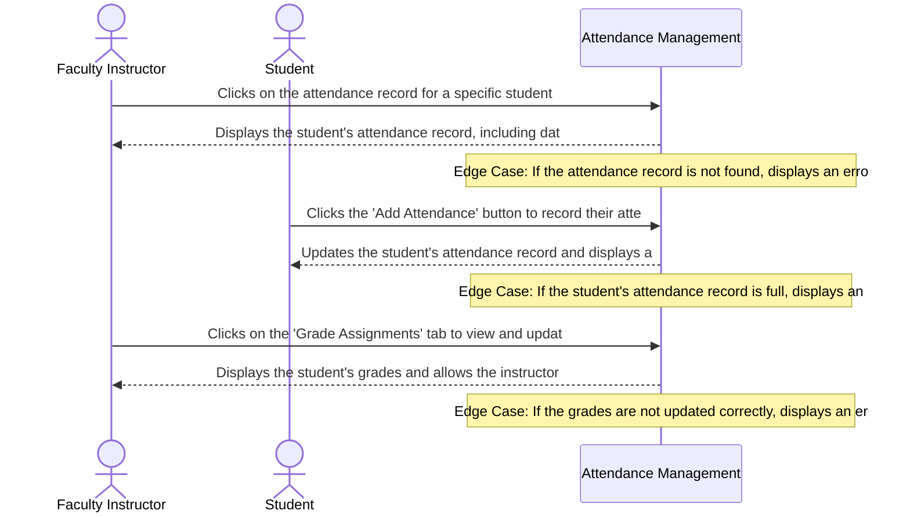

# Product Requirements Document: College Attendance Management System
**Version:** v2.3 | **Status:** DRAFT | **Date:** 2026-11-05 | **Job ID:** faead10b-2fc5-4645-b577-9025c5431a20 | **SHA-256:** `f386b31b21e171da4cb740a829f17ae5b89ae3da5d65a7bcc186a0d371c75652`
**Generated by:** 6aecade658e2f5d31662669f | **Changelog:** Full PRD generation v2.3

---

## 1. Document Information

**Document Title:** Product Requirements Document for College Attendance Management System

**Document ID:** PRD-6AECB40F

**Version:** v2.3

**Target Domain:** Education Management

**Product Category:** Attendance Management

**Job ID:** faead10b-2fc5-4645-b577-9025c5431a20

**Content Hash (SHA-256):** `f386b31b21e171da4cb740a829f17ae5b89ae3da5d65a7bcc186a0d371c75652`

**Status:** Under Active Review

## 2. Executive Summary

The College Attendance Management System is designed to automate attendance tracking, provide real-time attendance percentage display, and enable early warning notifications for students with low attendance. By reducing manual errors and delays, the system aims to improve fairness and consistency in attendance policies, ultimately enhancing the overall student experience in education management.

## 3. Product Overview

### Vision
To deliver an authoritative, high-integrity system solving core operational challenges in Education Management.

### Key Capabilities
- Attendance recording
- Attendance percentage calculation
- Automated notification system

## 4. Problem Statement

Manual attendance tracking processes in education institutions lead to delayed attendance calculations, missed alerts for students with low attendance, and inefficient use of resources. The current system's limitations result in a 75% threshold alert being common, indicating a need for a more efficient and effective attendance management system.

## 5. Product Vision and Objectives

### Core Objectives
1. Automated attendance tracking
2. Real-time attendance percentage display
3. Early warning notifications
4. Automated attendance tracking and notification processes to reduce manual errors and delays
5. Configurable attendance policies and condonation rules to improve fairness and consistency

## 6. Target Users and Stakeholders

**Primary Stakeholders and User Roles:**
- **Faculty Instructors:** Primary actor interacting with College Attendance Management System capabilities.
- **Students:** Primary actor interacting with College Attendance Management System capabilities.

## 7. User Personas

#### Persona 1: Faculty Instructor
- **Responsibilities:** Teaching, grading, and managing student attendance
- **Primary Goals:**
  - Accomplish teaching tasks
  - Manage student attendance
- **Frustrations:**
  - Difficulty in tracking student attendance
  - Inefficient grading process
- **Technical Proficiency:** Intermediate

#### Persona 2: Student
- **Responsibilities:** Attending classes, submitting assignments, and tracking grades
- **Primary Goals:**
  - Attend classes regularly
  - Stay updated on grades
- **Frustrations:**
  - Difficulty in accessing attendance records
  - Inaccurate grade updates
- **Technical Proficiency:** Novice

## 8. Existing Workflow and Pain Points

- Practitioners manually record attendance using paper roll calls, leading to delayed percentage calculations.
- Department heads configure attendance policies, but the current system lacks a user-friendly interface for this process.
- Missed alerts for students with low attendance are common, resulting in missed opportunities for intervention.
- Manual processes lead to errors and delays, causing frustration among practitioners and administrators.
- The current system does not provide real-time attendance percentage display, making it difficult for practitioners to track student attendance.
- There is a lack of automation in attendance tracking and notification processes, leading to manual errors and delays.

## 9. Proposed Solution

The College Attendance Management System will utilize a cloud-based backend to automate attendance tracking, provide real-time attendance percentage display, and enable early warning notifications. The system will be designed to reduce manual errors and delays, improve fairness and consistency in attendance policies, and enhance the overall student experience in education management.

## 10. Product Scope

- Attendance recording and tracking
- Attendance percentage calculation and display
- Automated notification system for students with low attendance
- Configurable attendance policies and condonation rules
- Integration with department head configuration for attendance policies
- Real-time attendance tracking and percentage display

## 11. Out of Scope

**Explicit Non-Goals (Out of Scope for Initial Release):**
- Biometric fingerprint or facial recognition scanning hardware integration
- GPS geolocation or Wi-Fi geofencing for automated student check-in
- Automated optical character recognition (OCR) parsing of medical certificates
- Integration with external university Student Information Systems (SIS) or enterprise ERP platforms
- Student gradebook, assignment submission grading, and academic transcript processing
- Tuition billing, fee penalty enforcement, or financial hold automation

## 12. Functional Requirements

| ID | Title | Description | Priority | Traceable AC |
|---|---|---|---|---|
| **FR-001** | Daily Course Attendance Roll Call Recording | **Actor:** Faculty Instructor. **Trigger:** Class session commences or instructor opens roll call interface. **Preconditions:** Faculty Instructor authenticated and officially assigned to scheduled course section. **Inputs:** Course ID, session date, and student roster attendance statuses [Present / Absent / Excused]. **System Behavior:** The system renders enrolled student class roster, captures present/absent/excused attendance status for each student, validates submission completeness, and persistently commits roll call records to the database with instructor ID and timestamp. **Business Constraints:** Only the designated course instructor can record attendance; duplicate submissions for the same course section and calendar date are rejected. **Alternate & Failure Paths:** If roll call has already been submitted for the session, system rejects submission, preserves existing records, and displays duplicate warning with administrative correction option. **Expected Outcome:** Official attendance roster committed to course ledger with instructor ID and timestamp; submission confirmation displayed. **Relevant Data Changes:** Persists roll call records and individual student session statuses to attendance ledger. **Authorization Requirements:** Authenticated Faculty Instructor assigned to the course section. **Provenance:** `confirmed_user_input` (User raw idea: faculty instructors record daily attendance). | Must Have | AC-001, AC-002 |
| **FR-002** | Real-Time Student Attendance Percentage Calculation | **Actor:** Student / Faculty Instructor. **Trigger:** Attendance roll call submitted or user views course attendance screen. **Preconditions:** Course section exists in academic catalog. **Inputs:** Student ID and Course ID. **System Behavior:** The system calculates real-time attendance percentage: (attended_eligible_sessions / total_eligible_sessions) * 100. If 0 sessions have been conducted, system displays 0 conducted sessions with no percentage without triggering division-by-zero error. **Business Constraints:** Attendance percentage is strictly derived from attended eligible sessions versus total eligible sessions. Denominator treatment for cancelled classes and excused absences is an unresolved open decision. **Alternate & Failure Paths:** If total eligible sessions is 0, percentage is rendered as undefined/uncomputed rather than raising an arithmetic error. **Expected Outcome:** Computed attendance percentage and examination eligibility standing rendered in real time. **Relevant Data Changes:** Updates calculated attendance percentage and eligibility flag in student course summary. **Authorization Requirements:** Enrolled Student (view own records) or assigned Faculty Instructor. **Provenance:** `confirmed_user_input` (User raw idea: students can view their attendance percentage). | Must Have | AC-003, AC-004, AC-005, AC-006 |
| **FR-003** | Automated Below-75% Early Warning Notification Dispatch | **Actor:** System Notification Engine / Student / Faculty Advisor. **Trigger:** Attendance recalculation results in a course attendance percentage strictly below 75.0% (< 75.0%). **Preconditions:** Attendance recalculation completes and percentage < 75.0%. **Inputs:** Student ID, Course ID, calculated percentage, and deficit class count. **System Behavior:** The system generates a low-attendance alert record, calculates the number of consecutive classes required to restore eligibility, and dispatches notification to student email and faculty advisor dashboard. **Business Constraints:** Warning notifications trigger strictly when percentage < 75.0%; alerts are suppressed if percentage >= 75.0%. Exactly 75.0% does NOT trigger a warning. **Alternate & Failure Paths:** If notification dispatch encounters a transport failure, system enqueues alert for retry with exponential backoff and posts an active warning banner on the student portal. **Expected Outcome:** Automated warning notification delivered and logged in audit trail. **Relevant Data Changes:** Notification log record created with timestamp, recipient IDs, and delivery status. **Authorization Requirements:** Internal Notification Service. **Provenance:** `confirmed_user_input` (User raw idea: automated warning notifications sent if attendance falls below 75%). | Must Have | AC-007, AC-008 |
| **FR-004** | Department Head Policy & Administrative Condonation Governance | **Actor:** Department Head. **Trigger:** Policy configuration update or student condonation petition submitted. **Preconditions:** Authenticated session with Department Head administrative role privileges. **Inputs:** Policy parameter values or student condonation petition with medical justification. **System Behavior:** The system provides administrative interface to configure course attendance policy parameters and review formal condonation petitions, updating effective exam eligibility status while preserving raw physical roll call records in the permanent ledger. **Business Constraints:** Condonation adjustments require documented administrative justification and do not alter raw roll call data; permissible condonation percentage limits and proof requirements are unresolved open decisions. **Alternate & Failure Paths:** If non-department-head attempts access, system halts operation with HTTP 403 Forbidden and logs unauthorized access attempt. **Expected Outcome:** Departmental policy parameters updated or approved condonation reflected in student exam eligibility. **Relevant Data Changes:** Administrative override recorded in policy ledger with Department Head ID and audit rationale. **Authorization Requirements:** Authenticated Department Head administrative role. **Provenance:** `confirmed_user_input` (User raw idea: department heads configure attendance policies and condonation rules). | Should Have | AC-009 |

### Detailed Functional Requirement Specifications

#### FR-001: Daily Course Attendance Roll Call Recording
- **Actor:** Faculty Instructor
- **Trigger:** Class session commences or instructor opens roll call interface
- **Preconditions:** Faculty Instructor authenticated and officially assigned to scheduled course section
- **Inputs:** Course ID, session date, and student roster attendance statuses [Present / Absent / Excused]
- **System Behavior:** Renders enrolled student class roster, captures present/absent/excused attendance status for each student, validates submission completeness, and persistently commits roll call records to the database with instructor ID and timestamp
- **Business Constraints:** Only the designated course instructor can record attendance; duplicate submissions for the same course section and calendar date are rejected
- **Alternate & Failure Paths:** If roll call has already been submitted for the session, system rejects submission, preserves existing records, and displays duplicate warning with administrative correction option
- **Expected Outcome:** Official attendance roster committed to course ledger with instructor ID and timestamp; submission confirmation displayed
- **Relevant Data Changes:** Persists roll call records and individual student session statuses to attendance ledger
- **Authorization Requirements:** Authenticated Faculty Instructor assigned to the course section
- **Priority:** Must Have
- **Linked Acceptance Criteria:** AC-001, AC-002
- **Provenance:** `confirmed_user_input` (User raw idea: faculty instructors record daily attendance)

#### FR-002: Real-Time Student Attendance Percentage Calculation
- **Actor:** Student / Faculty Instructor
- **Trigger:** Attendance roll call submitted or user views course attendance screen
- **Preconditions:** Course section exists in academic catalog
- **Inputs:** Student ID and Course ID
- **System Behavior:** Calculates real-time attendance percentage: (attended_eligible_sessions / total_eligible_sessions) * 100. If 0 sessions have been conducted, system displays 0 conducted sessions with no percentage without triggering division-by-zero error
- **Business Constraints:** Attendance percentage is strictly derived from attended eligible sessions versus total eligible sessions. Denominator treatment for cancelled classes and excused absences is an unresolved open decision
- **Alternate & Failure Paths:** If total eligible sessions is 0, percentage is rendered as undefined/uncomputed rather than raising an arithmetic error
- **Expected Outcome:** Computed attendance percentage and examination eligibility standing rendered in real time
- **Relevant Data Changes:** Updates calculated attendance percentage and eligibility flag in student course summary
- **Authorization Requirements:** Enrolled Student (view own records) or assigned Faculty Instructor
- **Priority:** Must Have
- **Linked Acceptance Criteria:** AC-003, AC-004, AC-005, AC-006
- **Provenance:** `confirmed_user_input` (User raw idea: students can view their attendance percentage)

#### FR-003: Automated Below-75% Early Warning Notification Dispatch
- **Actor:** System Notification Engine / Student / Faculty Advisor
- **Trigger:** Attendance recalculation results in a course attendance percentage strictly below 75.0% (< 75.0%)
- **Preconditions:** Attendance recalculation completes and percentage < 75.0%
- **Inputs:** Student ID, Course ID, calculated percentage, and deficit class count
- **System Behavior:** Generates a low-attendance alert record, calculates the number of consecutive classes required to restore eligibility, and dispatches notification to student email and faculty advisor dashboard
- **Business Constraints:** Warning notifications trigger strictly when percentage < 75.0%; alerts are suppressed if percentage >= 75.0%. Exactly 75.0% does NOT trigger a warning
- **Alternate & Failure Paths:** If notification dispatch encounters a transport failure, system enqueues alert for retry with exponential backoff and posts an active warning banner on the student portal
- **Expected Outcome:** Automated warning notification delivered and logged in audit trail
- **Relevant Data Changes:** Notification log record created with timestamp, recipient IDs, and delivery status
- **Authorization Requirements:** Internal Notification Service
- **Priority:** Must Have
- **Linked Acceptance Criteria:** AC-007, AC-008
- **Provenance:** `confirmed_user_input` (User raw idea: automated warning notifications sent if attendance falls below 75%)

#### FR-004: Department Head Policy & Administrative Condonation Governance
- **Actor:** Department Head
- **Trigger:** Policy configuration update or student condonation petition submitted
- **Preconditions:** Authenticated session with Department Head administrative role privileges
- **Inputs:** Policy parameter values or student condonation petition with medical justification
- **System Behavior:** Provides administrative interface to configure course attendance policy parameters and review formal condonation petitions, updating effective exam eligibility status while preserving raw physical roll call records in the permanent ledger
- **Business Constraints:** Condonation adjustments require documented administrative justification and do not alter raw roll call data; permissible condonation percentage limits and proof requirements are unresolved open decisions
- **Alternate & Failure Paths:** If non-department-head attempts access, system halts operation with HTTP 403 Forbidden and logs unauthorized access attempt
- **Expected Outcome:** Departmental policy parameters updated or approved condonation reflected in student exam eligibility
- **Relevant Data Changes:** Administrative override recorded in policy ledger with Department Head ID and audit rationale
- **Authorization Requirements:** Authenticated Department Head administrative role
- **Priority:** Should Have
- **Linked Acceptance Criteria:** AC-009
- **Provenance:** `confirmed_user_input` (User raw idea: department heads configure attendance policies and condonation rules)

## 13. Non-Functional Requirements

| ID | Title | Description | Classification | Priority |
|---|---|---|---|---|
| **NFR-001** | Education Management Operational Latency | The system shall maintain 95th percentile response times under 2000ms for Attendance Management transactions under baseline user concurrency. [Open Architectural Decision: Target bound pending formal load benchmark] | Open decision | Must Have |
| **NFR-002** | Education Management Data Protection & Security | All Attendance Management session records and domain entities must be encrypted in transit using TLS 1.3 and encrypted at rest using AES-256. [Open Architectural Decision: Specific regulatory frameworks pending institutional review] | Open decision | Must Have |
| **NFR-003** | Attendance Management Availability & Fault Tolerance | The system shall target 99.5% operational availability during scheduled operational hours with automated error recovery. [Proposed Target: Operational baseline to be confirmed during initial release] | Proposed target | Must Have |

## 14. User Stories

| Story ID | As a... | I want to... | So that... | Linked FR |
|---|---|---|---|---|
| **US-001** | Faculty Instructor | daily course attendance roll call recording | instructors officially capture daily course attendance in under two minutes without paper roll call latency | FR-001 |
| **US-002** | Student | real-time student attendance percentage calculation | students maintain real-time visibility into their course attendance percentage and examination eligibility standing | FR-002 |
| **US-003** | Faculty Instructor | automated below-75% early warning notification dispatch | at-risk students and academic advisors receive timely intervention notices before attendance deficits trigger exam disbarment | FR-003 |
| **US-004** | Student | department head policy & administrative condonation governance | department leadership enforces standardized attendance policies while fairly processing legitimate medical condonation requests | FR-004 |

## 15. User Journeys

### Step-by-Step User Journey Progression
**Stage 1: 1. View Attendance Record**
- **Actor (Faculty Instructor):** Clicks on the attendance record for a specific student
- **System Response:** Displays the student's attendance record, including dates and attendance status
- **Edge Case / Error Handling:** If the attendance record is not found, displays an error message

**Stage 2: 2. Add Attendance**
- **Actor (Student):** Clicks the 'Add Attendance' button to record their attendance for a class
- **System Response:** Updates the student's attendance record and displays a confirmation message
- **Edge Case / Error Handling:** If the student's attendance record is full, displays an error message

**Stage 3: 3. Grade Assignments**
- **Actor (Faculty Instructor):** Clicks on the 'Grade Assignments' tab to view and update grades for a student
- **System Response:** Displays the student's grades and allows the instructor to update them
- **Edge Case / Error Handling:** If the grades are not updated correctly, displays an error message

## 16. Business Rules

| ID | Rule Title | Operational Statement | Provenance | Source Reference | Rationale | Confirmation Required |
|---|---|---|---|---|---|---|
| **BR-001** | Attendance Percentage Calculation | Automatically calculate attendance percentage for each student after daily attendance recording by faculty instructors. | `ai_proposed_assumption` | User Input: Automated attendance tracking and notification processes to reduce manual errors and delays. | To ensure accuracy and reduce delays in attendance percentage calculation. | Yes (Review needed) |
| **BR-002** | Attendance Threshold Warning | Send automated warning notifications to students if their attendance falls below 75%. | `ai_proposed_assumption` | Confirmed Clarification: Missed 75% threshold alerts are common. | To alert students of potential attendance issues and encourage improvement. | Yes (Review needed) |
| **BR-003** | Department Head Configuration | Allow department heads to configure attendance policies and condonation rules. | `ai_proposed_assumption` | User Input: Configurable attendance policies and condonation rules to improve fairness and consistency. | To ensure that attendance policies are tailored to the specific needs of each department. | Yes (Review needed) |
| **BR-004** | User-Friendly Interface | Design a user-friendly interface for faculty instructors and students to record and view attendance. | `ai_proposed_assumption` | Assignment Requirement: System must be user-friendly. | To ensure that the system is accessible and easy to use for all users. | Yes (Review needed) |
| **BR-005** | Integration with Student Information Systems | Integrate the attendance management system with existing student information systems. | `ai_proposed_assumption` | Assignment Requirement: System must integrate with existing student information systems. | To ensure seamless data exchange and minimize manual data entry. | Yes (Review needed) |

## 17. System Workflows

1. **Student Attendance Recording:** Students record their attendance through the web application or mobile app.
2. **Attendance Percentage Calculation:** The system calculates the student's attendance percentage based on the attendance record.
3. **Automated Notification System:** The system sends automated notifications to parents/guardians/staff regarding attendance updates.
4. **Department Head Configuration:** Department heads configure attendance policies and rules.

## 18. Data Requirements

- **Student**
- **Attendance Record**
- **Attendance Percentage**
- **Notification**

## 19. Integration Requirements

- **System**: Department Head Configuration System; **Api**: Attendance Policy API; **Protocol**: REST

## 20. Security and Privacy Requirements

- **Role**: Student; **Access Control**: Read-only; **Data Encryption**: In transit
- **Role**: Department Head; **Access Control**: Read-write; **Data Encryption**: In transit
- **Role**: Parent/Guardian/Staff; **Access Control**: Read-only; **Data Encryption**: In transit
- **System**: Notification System; **Audit Logging**: Enabled; **Domain Specific Privacy Controls**: Enabled

## 21. Acceptance Criteria

| AC ID | Associated Requirement | Acceptance Criteria (Given-When-Then / Rule) |
|---|---|---|
| **AC-001** | FR-001 | Given an authenticated Faculty Instructor assigned to Course CS-101, When the instructor marks enrolled students as Present or Absent and submits the roster, Then attendance records are persistently committed to the ledger with instructor ID and timestamp. |
| **AC-002** | FR-001 | Given that attendance has already been recorded for Course CS-101 on the selected calendar date, When an instructor attempts to submit a second roll call for the same session, Then the system rejects the duplicate insertion, preserves original records, and displays an 'Attendance already recorded for this session' warning. |
| **AC-003** | FR-002 | Given a student who has attended 18 out of 24 conducted eligible class sessions in Course CS-101 (18 / 24 * 100 = 75.0%), When attendance percentage is calculated, Then the system renders exactly 75.0%, marks the student as 'Eligible for Examination', and suppresses any warning notification. |
| **AC-004** | FR-002 | Given a student who has attended 17 out of 24 conducted eligible class sessions in Course CS-101 (17 / 24 * 100 = 70.83%), When attendance percentage is calculated, Then the system renders 70.83%, marks the student as 'At Risk / Below Threshold', and triggers an automated early warning alert. |
| **AC-005** | FR-002 | Given a student who has attended 20 out of 24 conducted eligible class sessions in Course CS-101 (20 / 24 * 100 = 83.33%), When attendance percentage is calculated, Then the system renders 83.33%, marks the student as 'In Good Standing (Eligible)', and sends no alert. |
| **AC-006** | FR-002 | Given a newly scheduled course section with 0 conducted sessions, When a student or instructor views the attendance screen, Then the system displays '0 conducted sessions (No attendance percentage yet)' without causing a division-by-zero error or application crash. |
| **AC-007** | FR-003 | Given an automated warning alert that encounters an email service timeout during dispatch, When the failure occurs, Then the system enqueues the alert for exponential backoff retry and records an active warning banner on the student portal. |
| **AC-008** | FR-003 | Given a student or unassigned faculty member attempting to submit or modify attendance roll call records, When the request is evaluated, Then the system halts the operation with an HTTP 403 Forbidden response and logs an unauthorized privilege escalation attempt. |
| **AC-009** | FR-004 | Given an authenticated Department Head reviewing a formal condonation request with verified medical documentation, When the Department Head approves an administrative waiver, Then the system updates the student's exam eligibility status to 'Condoned - Eligible' while preserving the raw physical attendance records in the permanent audit ledger. |

## 22. Dependencies and Constraints

- **Platform**: Linux; **Hosting**: Cloud Hosting; **Operating System**: Ubuntu
- **Institutional Constraint**: Compliance with FERPA regulations

## 23. Risks and Mitigation

| Risk ID | Category | Risk Description | Root Cause | Likelihood | Impact | Mitigation Strategy | Contingency Plan | Owner |
|---|---|---|---|---|---|---|---|---|
| **RSK-001** | Operational | A critical failure occurs in the attendance recording system, resulting in incomplete or inaccurate attendance records. | Insufficient data validation and sanitization in the attendance recording system, leading to data corruption or loss. | High | Critical | Implement robust data validation and sanitization mechanisms, including input validation and data normalization, to prevent data corruption or loss. | Implement a backup attendance recording system and ensure that all attendance records are manually verified and validated by authorized personnel. | Engineering Team |
| **RSK-002** | Data Privacy | An unauthorized individual gains access to student attendance data, compromising student confidentiality and potentially leading to data breaches. | Inadequate access controls and authentication mechanisms in the attendance notification system, allowing unauthorized users to access sensitive data. | Medium | High | Implement robust access controls and authentication mechanisms, including multi-factor authentication and role-based access control, to prevent unauthorized access to student attendance data. | Implement a data encryption mechanism to protect student attendance data in transit and at rest, and ensure that all access to student attendance data is logged and audited. | Security Team |
| **RSK-003** | Security | The automated notification system fails to send notifications to authorized personnel, resulting in delayed or missed notifications. | Inadequate testing and validation of the automated notification system, leading to a lack of confidence in its reliability and accuracy. | Medium | High | Implement a comprehensive testing and validation program for the automated notification system, including scenario-based testing and user acceptance testing. | Implement a manual notification system as a fallback, and ensure that all authorized personnel are trained to receive and respond to manual notifications. | Quality Assurance Team |
| **RSK-004** | Functional | The attendance percentage calculation algorithm produces incorrect results, leading to inaccurate student attendance records. | Inadequate testing and validation of the attendance percentage calculation algorithm, leading to a lack of confidence in its accuracy. | Low | Medium | Implement a comprehensive testing and validation program for the attendance percentage calculation algorithm, including scenario-based testing and user acceptance testing. | Implement a manual attendance percentage calculation process as a fallback, and ensure that all authorized personnel are trained to perform manual calculations. | Engineering Team |

## 24. Assumptions and Open Questions

### Documented Operational Assumptions
- [Assumed] Faculty instructors will regularly update attendance records
- [Assumed] Department heads will configure attendance policies

### Open Architectural Questions
- Condonation rules and exam eligibility disputes resolution

## 25. Success Metrics

- **Metric**: Student Attendance Percentage; **Target Value**: 90%; **Threshold**: 85%
- **Metric**: Notification Response Time; **Target Value**: less than 1 hour; **Threshold**: less than 2 hours
- **Metric**: System Uptime; **Target Value**: 99.9%; **Threshold**: 95%

## 26. Release Considerations

- **Phase**: Alpha; **Validation**: Internal testing; **Data Migration**: No data migration required; **Operational Handoff**: No operational handoff required
- **Phase**: Beta; **Validation**: External testing; **Data Migration**: Data migration required; **Operational Handoff**: Operational handoff required

## 27. Appendix and Glossary

- **Domain Specific Terms:** FERPA: Family Educational Rights and Privacy Act, Ollama: Not applicable
- **Acronyms:** API: Application Programming Interface, DB: Database
- **Operational Definitions:** Attendance Policy: A set of rules governing student attendance, Notification: A message sent to parents/guardians/staff regarding attendance updates
