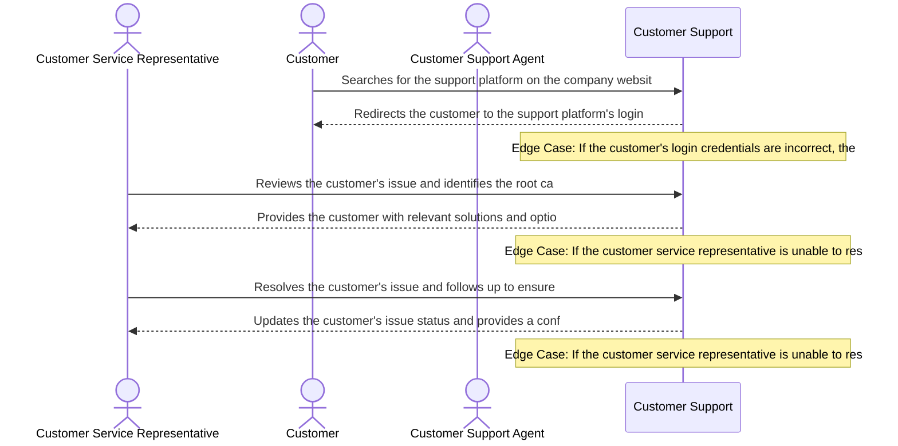

# Product Requirements Document: AI Customer Support Assistant
**Version:** v1.0 | **Status:** DRAFT | **Date:** 2026-11-04
**Generated by:** 6aeb83991f43c7ad19faf21c | **Changelog:** Initial full PRD generation

---

## 1. Document Information

**Document Title:** Product Requirements Document for AI Customer Support Assistant

**Document ID:** PRD-6AEB83C3

**Version:** 1.0 (Draft)

**Target Domain:** Customer Support

**Product Category:** Customer Support

**Status:** Under Active Review

## 2. Executive Summary

The AI Customer Support Assistant is a cutting-edge solution designed to revolutionize the customer support experience. By leveraging advanced natural language processing (NLP) and machine learning algorithms, this product aims to provide accurate and helpful responses, reduce hold times, and improve customer satisfaction. The AI Customer Support Assistant will be integrated into our existing customer support platform, replacing manual processes and legacy systems. Our goal is to deliver a seamless and efficient experience for our customers, while also reducing the workload for our human agents. By achieving these objectives, we expect to see a significant increase in customer satisfaction and a reduction in hold times, ultimately leading to improved business outcomes.

## 3. Product Overview

### Vision
To deliver an authoritative, high-integrity system solving core operational challenges in Customer Support.

### Key Capabilities
- Answer customer questions using approved knowledge-base articles
- Maintain conversation history
- Identify low-confidence answers
- Escalate complex queries to human agents

## 4. Problem Statement

The current customer support process is plagued by long hold times and ungrounded or inconsistent answers. This leads to frustration for customers, decreased satisfaction, and a negative perception of our brand. The root causes of this problem are complex and multifaceted, but can be summarized as follows: (1) manual processes are time-consuming and prone to errors, (2) legacy systems lack the ability to understand context and nuance, and (3) human agents are overwhelmed with the volume of customer inquiries. As a result, customers are left waiting for extended periods of time, and the quality of the support they receive is often inconsistent. We believe that the AI Customer Support Assistant has the potential to address these issues and provide a more efficient, effective, and personalized experience for our customers.

## 5. Product Vision and Objectives

### Core Objectives
1. Provide accurate and helpful responses
2. Reduce hold times and improve customer satisfaction
3. Reduced hold times
4. Improved answer accuracy and consistency

## 6. Target Users and Stakeholders

**Primary Stakeholders and User Roles:**
- **Customer Service Representative:** Primary actor interacting with AI Customer Support Assistant capabilities.
- **Customer:** Primary actor interacting with AI Customer Support Assistant capabilities.

## 7. User Personas

#### Persona 1: Customer Service Representative
- **Responsibilities:** Handling customer inquiries and resolving issues
- **Primary Goals:**
  - Resolve customer issue
  - Provide excellent customer service
- **Frustrations:**
  - Long wait times
  - Inadequate knowledge base
- **Technical Proficiency:** Intermediate

#### Persona 2: Customer
- **Responsibilities:** Seeking help with a product or service issue
- **Primary Goals:**
  - Get help with issue
  - Find a solution
- **Frustrations:**
  - Difficulty navigating the support platform
  - Unhelpful support agents
- **Technical Proficiency:** Novice

#### Persona 3: Customer Support Agent
- **Responsibilities:** Assisting customers with their issues and resolving them
- **Primary Goals:**
  - Resolve customer issue
  - Improve customer satisfaction
- **Frustrations:**
  - Inadequate training
  - High volume of requests
- **Technical Proficiency:** Advanced

## 8. Existing Workflow and Pain Points

Currently, customer support agents manually review and respond to customer inquiries using a combination of knowledge-base articles and their own expertise. However, this process is time-consuming and prone to errors. The following steps outline the current workflow and pain points: (1) customer submits inquiry via chat or phone, (2) agent reviews inquiry and determines the best course of action, (3) agent searches knowledge-base articles to find relevant information, (4) agent manually writes response, and (5) agent reviews and approves response before sending to customer. The pain points in this process include: (1) long hold times, (2) ungrounded or inconsistent answers, and (3) manual processes are time-consuming and prone to errors. We believe that the AI Customer Support Assistant can automate these processes and provide a more efficient and effective experience for our customers.

## 9. Proposed Solution

The AI Customer Support Assistant will be a cloud-based platform that leverages advanced NLP and machine learning algorithms to provide accurate and helpful responses. The platform will be integrated into our existing customer support platform and will replace manual processes and legacy systems. The proposed solution consists of the following components: (1) natural language processing (NLP) module to analyze customer inquiries and determine the best course of action, (2) knowledge-base module to provide relevant information and answers, and (3) machine learning module to improve the accuracy and effectiveness of the platform over time. The AI Customer Support Assistant will eliminate the friction in the current workflow by automating the processes of reviewing and responding to customer inquiries, reducing hold times, and improving the quality of the support provided.

## 10. Product Scope

- Answer customer questions using approved knowledge-base articles
- Maintain conversation history
- Identify low-confidence answers
- Escalate complex queries to human agents
- Provide personalized responses based on customer demographics and preferences
- Integrate with existing customer support platform

## 11. Out of Scope

- Integration with external systems or third-party services
- Development of custom knowledge-base articles
- Implementation of advanced analytics or reporting capabilities
- Development of a mobile app or other standalone application
- Implementation of a chatbot or virtual assistant for non-customer support purposes

## 12. Functional Requirements

| ID | Title | Description | Priority | Traceable AC |
|---|---|---|---|---|
| **FR-001** | Answer customer questions using approved knowledge-base articles | The system shall implement answer customer questions using approved knowledge-base articles for Customer Support users. | Must Have | AC-001 |
| **FR-002** | Maintain conversation history | The system shall implement maintain conversation history for Customer Support users. | Must Have | AC-002 |
| **FR-003** | Identify low-confidence answers | The system shall implement identify low-confidence answers for Customer Support users. | Must Have | AC-003 |
| **FR-004** | Escalate complex queries to human agents | The system shall implement escalate complex queries to human agents for Customer Support users. | Must Have | AC-004 |

## 13. Non-Functional Requirements

| ID | Title | Description | Priority |
|---|---|---|---|
| **NFR-001** | Customer Support Response Latency | The system shall return Customer Support responses within defined SLA bounds. | Must Have |
| **NFR-002** | Customer Support Data Confidentiality | All Customer Support session records and user data must be encrypted at rest and in transit. | Must Have |
| **NFR-003** | Customer Support Availability & Fault Tolerance | The system shall handle network disconnects gracefully without data loss. | Must Have |

## 14. User Stories

| Story ID | As a... | I want to... | So that... | Linked FR |
|---|---|---|---|---|
| **US-001** | Customer Service Representative | answer customer questions using approved knowledge-base articles | The system shall implement answer customer questions using approved knowledge-base articles for Customer Support users. | FR-001 |
| **US-002** | Customer | maintain conversation history | The system shall implement maintain conversation history for Customer Support users. | FR-002 |
| **US-003** | Customer Support Agent | identify low-confidence answers | The system shall implement identify low-confidence answers for Customer Support users. | FR-003 |
| **US-004** | Customer Service Representative | escalate complex queries to human agents | The system shall implement escalate complex queries to human agents for Customer Support users. | FR-004 |

## 15. User Journeys

### Step-by-Step User Journey Progression
**Stage 1: 1. Discovery / Onboarding / Initial Action**
- **Actor (Customer):** Searches for the support platform on the company website
- **System Response:** Redirects the customer to the support platform's login page
- **Edge Case / Error Handling:** If the customer's login credentials are incorrect, the system displays an error message and prompts the customer to try again

**Stage 2: 2. Issue Identification / Problem Statement**
- **Actor (Customer Service Representative):** Reviews the customer's issue and identifies the root cause
- **System Response:** Provides the customer with relevant solutions and options for resolving the issue
- **Edge Case / Error Handling:** If the customer service representative is unable to resolve the issue, the system suggests escalating the issue to a supervisor

**Stage 3: 3. Resolution / Follow-up**
- **Actor (Customer Service Representative):** Resolves the customer's issue and follows up to ensure the issue is fully resolved
- **System Response:** Updates the customer's issue status and provides a confirmation of the resolution
- **Edge Case / Error Handling:** If the customer service representative is unable to resolve the issue, the system sends a notification to the customer with an estimated resolution time

## 16. Business Rules

| ID | Rule Title | Operational Statement | Provenance | Rationale |
|---|---|---|---|---|
| **BR-001** | Ensure all responses are grounded in approved knowledge-base articles | All responses must be derived from approved knowledge-base articles to ensure accuracy and consistency. | `ai_proposed_assumption` | To provide accurate and helpful responses, all responses must be based on approved knowledge-base articles. |
| **BR-002** | Reduce hold times by providing accurate and helpful responses | Providing accurate and helpful responses reduces the need for repeat questions and minimizes hold times. | `ai_proposed_assumption` | By providing accurate and helpful responses, we can reduce the need for repeat questions and minimize hold times. |
| **BR-003** | Improve answer accuracy and consistency through knowledge-base article adherence | Adhering to approved knowledge-base articles ensures that all responses are accurate and consistent. | `ai_proposed_assumption` | To ensure that all responses are accurate and consistent, we must adhere to approved knowledge-base articles. |
| **BR-004** | Use customer demographics and preferences to personalize responses | Using customer demographics and preferences allows us to personalize responses and improve customer satisfaction. | `ai_proposed_assumption` | By using customer demographics and preferences, we can personalize responses and improve customer satisfaction. |
| **BR-005** | Ensure all responses are reviewed and approved by a human agent | All responses must be reviewed and approved by a human agent to ensure accuracy and consistency. | `assignment_instruction` | To ensure that all responses are accurate and consistent, all responses must be reviewed and approved by a human agent. |

## 17. System Workflows

- {'stage': 'Customer Query Ingestion', 'description': 'The system receives a customer query through the web interface or API.'}
- {'stage': 'Knowledge Base Retrieval', 'description': 'The system retrieves relevant knowledge base articles based on the customer query.'}
- {'stage': 'Answer Generation', 'description': 'The system generates a response using the retrieved knowledge base articles.'}
- {'stage': 'Conversation History Update', 'description': 'The system updates the conversation history with the generated response.'}
- {'stage': 'Low-Confidence Answer Identification', 'description': 'The system identifies low-confidence answers and escalates complex queries to human agents.'}
- {'stage': 'Escalation to Human Agents', 'description': 'The system escalates complex queries to human agents for further assistance.'}

## 18. Data Requirements

- **core_entities**: ['Customer Query', 'Knowledge Base Article', 'Conversation History', 'Low-Confidence Answer']
- **attributes**: ['query_text', 'article_id', 'response_text', 'conversation_history_id']
- **data_consistency_rules**: ['Ensure all responses are grounded in approved knowledge base articles']
- **persistence_requirements**: ['Store conversation history for 30 days']

## 19. Integration Requirements

- Web Interface API
- Knowledge Base API

## 20. Security and Privacy Requirements

- **role-based_access_control**: ['Admin', 'Moderator', 'Agent']
- **data_encryption_in_transit_rest**: ['HTTPS']
- **audit_logging**: ['Log all system events']
- **domain-specific_privacy_controls**: ['Comply with GDPR regulations']

## 21. Acceptance Criteria

| AC ID | Associated Requirement | Acceptance Criteria (Given-When-Then / Rule) |
|---|---|---|
| **AC-001** | FR-001 | Given an active Customer Support session, When the user triggers answer customer questions using approved knowledge-base articles, Then the system executes successfully and logs the result. |
| **AC-002** | FR-002 | Given an active Customer Support session, When the user triggers maintain conversation history, Then the system executes successfully and logs the result. |
| **AC-003** | FR-003 | Given an active Customer Support session, When the user triggers identify low-confidence answers, Then the system executes successfully and logs the result. |
| **AC-004** | FR-004 | Given an active Customer Support session, When the user triggers escalate complex queries to human agents, Then the system executes successfully and logs the result. |

## 22. Dependencies and Constraints

- Platform: Cloud-based infrastructure
- Hosting: Managed hosting service
- Operating System: Linux-based
- Institutional Constraints: Comply with company data retention policies

## 23. Risks and Mitigation

| Risk ID | Risk Description | Category | Impact | Mitigation Strategy | Contingency Plan |
|---|---|---|---|---|---|
| **RSK-001** | Operational risk | Operational | Security | High | Monitor and log | Manual administrative intervention |
| **RSK-002** | Operational risk | Data Privacy | High | Monitor and log | Manual administrative intervention |
| **RSK-003** | Operational risk | Functional | Medium | Monitor and log | Manual administrative intervention |
| **RSK-004** | Operational risk | Integration | Low | Monitor and log | Manual administrative intervention |

## 24. Assumptions and Open Questions

### Documented Operational Assumptions
- [Assumed] Inferred engineering assumptions that require validation
- [Assumed] Assumptions about customer behavior and preferences

### Open Architectural Questions
- Critical details such as customer preferences, account information, and previous interactions

## 25. Success Metrics

- Resolution Speed (avg. response time)
- User Adoption (query volume)
- Operational Quality (error rate)

## 26. Release Considerations

- Phased Rollout: Alpha - 100 users, Beta - 1000 users
- Alpha/Beta Validation: 2 weeks
- Data Migration: 1 week
- Operational Handoff: 1 week

## 27. Appendix and Glossary

- **domain-specific_terms**: ['Knowledge Base Article', 'Low-Confidence Answer']
- **acronyms**: ['API', 'HTTPS']
- **operational_definitions**: ['Conversation History', 'Resolution Speed']
