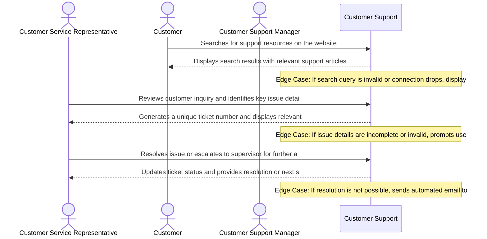

# Product Requirements Document: AI Customer Support Assistant
**Version:** v1.0 | **Status:** DRAFT | **Date:** 2026-11-05
**Generated by:** 6aebe33364a87cddc70faec5 | **Changelog:** Initial full PRD generation

---

## 1. Document Information

**Document Title:** Product Requirements Document for AI Customer Support Assistant

**Document ID:** PRD-6AEBE35F

**Version:** 1.0 (Draft)

**Target Domain:** Customer Support

**Product Category:** Customer Support

**Status:** Under Active Review

## 2. Executive Summary

The AI Customer Support Assistant is a cutting-edge solution designed to revolutionize the customer support experience. By leveraging advanced AI capabilities, our product aims to provide accurate and helpful responses, reduce hold times, and improve customer satisfaction. With a focus on accuracy, consistency, and data privacy, we expect the AI Customer Support Assistant to become an indispensable tool for customer support teams, leading to increased efficiency, reduced costs, and enhanced customer loyalty.

## 3. Product Overview

### Vision
To deliver an authoritative, high-integrity system solving core operational challenges in Customer Support.

### Key Capabilities
- Answer customer questions using approved knowledge-base articles
- Maintain conversation history
- Identify low-confidence answers
- Escalate complex queries to human agents

## 4. Problem Statement

Current customer support systems often struggle to provide accurate and relevant responses, leading to long hold times and frustrated customers. The root causes of this problem lie in the limitations of legacy chatbots, which frequently provide ungrounded or inconsistent answers. This results in a cycle of inefficiency, where customers are left waiting for extended periods, and support teams struggle to provide effective solutions. The lack of context and understanding of customer needs further exacerbates the issue, making it challenging for support teams to provide personalized and effective support.

## 5. Product Vision and Objectives

### Core Objectives
1. Provide accurate and helpful responses
2. Reduce hold times and improve customer satisfaction
3. Reduced hold times
4. Accurate and relevant customer responses

## 6. Target Users and Stakeholders

**Primary Stakeholders and User Roles:**
- **Customer Service Representative:** Primary actor interacting with AI Customer Support Assistant capabilities.
- **Customer:** Primary actor interacting with AI Customer Support Assistant capabilities.

## 7. User Personas

#### Persona 1: Customer Service Representative
- **Responsibilities:** Handling customer inquiries and resolving issues
- **Primary Goals:**
  - Resolve customer issue
  - Provide excellent customer service
- **Frustrations:**
  - Long wait times
  - Inadequate knowledge base
- **Technical Proficiency:** Intermediate

#### Persona 2: Customer
- **Responsibilities:** Seeking assistance with a product or service issue
- **Primary Goals:**
  - Get issue resolved
  - Understand product features
- **Frustrations:**
  - Difficulty navigating support website
  - Unhelpful support agent
- **Technical Proficiency:** Novice

#### Persona 3: Customer Support Manager
- **Responsibilities:** Overseeing customer support operations and ensuring quality
- **Primary Goals:**
  - Monitor support performance
  - Improve customer satisfaction
- **Frustrations:**
  - Inadequate training for support agents
  - High volume of support requests
- **Technical Proficiency:** Advanced

## 8. Existing Workflow and Pain Points

Currently, customer support teams operate manually or with legacy systems, which can lead to the following pain points: 
* Long hold times: Customers are left waiting for extended periods, leading to frustration and a negative experience. 
* Ungrounded or inconsistent answers: Legacy chatbots provide unhelpful or irrelevant responses, making it challenging for support teams to provide effective solutions. 
* Lack of context: The absence of context and understanding of customer needs makes it difficult for support teams to provide personalized and effective support. 
* Inefficient use of resources: Support teams spend a significant amount of time and resources on manual tasks, taking away from more critical tasks that require human attention.

## 9. Proposed Solution

The AI Customer Support Assistant is designed to eliminate the friction in current customer support workflows. Our solution leverages advanced AI capabilities to provide accurate and helpful responses, maintain conversation history, identify low-confidence answers, and escalate complex queries to human agents. By automating routine tasks and providing personalized support, we aim to reduce hold times, improve customer satisfaction, and increase efficiency for support teams.

## 10. Product Scope

- Answer customer questions using approved knowledge-base articles
- Maintain conversation history
- Identify low-confidence answers
- Escalate complex queries to human agents
- Integrate with existing CRM systems for seamless data exchange
- Support multiple channels (text, voice, and chat) for omnichannel support

## 11. Out of Scope

- Integration with external customer service platforms
- Implementation of advanced sentiment analysis
- Incorporation of machine learning for predictive analytics
- Development of a mobile app for on-the-go support
- Integration with other customer support tools (e.g., ticketing systems)
- Support for multiple languages beyond English

## 12. Functional Requirements

| ID | Title | Description | Priority | Traceable AC |
|---|---|---|---|---|
| **FR-001** | Answer customer questions using approved knowledge-base articles | **Actor:** Customer Service Representative. **Precondition:** Customer Service Representative possesses authenticated session and valid role permissions for Customer Support. **System Behavior:** The system evaluates parameters, enforces business constraints, and executes answer customer questions using approved knowledge-base articles. **Constraint:** Ensure accuracy and consistency of responses. **Expected Outcome:** Answer customer questions using approved knowledge-base articles state modification is committed and verified status is presented to Customer Service Representative. | Must Have | AC-001, AC-002 |
| **FR-002** | Maintain conversation history | **Actor:** Customer. **Precondition:** Customer possesses authenticated session and valid role permissions for Customer Support. **System Behavior:** The system evaluates parameters, enforces business constraints, and executes maintain conversation history. **Constraint:** Ensure accuracy and consistency of responses. **Expected Outcome:** Maintain conversation history state modification is committed and verified status is presented to Customer. | Must Have | AC-003, AC-004 |
| **FR-003** | Identify low-confidence answers | **Actor:** Customer Service Representative. **Precondition:** Customer Service Representative possesses authenticated session and valid role permissions for Customer Support. **System Behavior:** The system evaluates parameters, enforces business constraints, and executes identify low-confidence answers. **Constraint:** Ensure accuracy and consistency of responses. **Expected Outcome:** Identify low-confidence answers state modification is committed and verified status is presented to Customer Service Representative. | Must Have | AC-005, AC-006 |
| **FR-004** | Escalate complex queries to human agents | **Actor:** Customer. **Precondition:** Customer possesses authenticated session and valid role permissions for Customer Support. **System Behavior:** The system evaluates parameters, enforces business constraints, and executes escalate complex queries to human agents. **Constraint:** Ensure accuracy and consistency of responses. **Expected Outcome:** Escalate complex queries to human agents state modification is committed and verified status is presented to Customer. | Must Have | AC-007, AC-008 |

## 13. Non-Functional Requirements

| ID | Title | Description | Priority |
|---|---|---|---|
| **NFR-001** | Customer Support Operational Latency | The system shall maintain 95th percentile response times under 2000ms for Customer Support transactions under baseline user concurrency. (Target bound pending formal load benchmark). | Must Have |
| **NFR-002** | Customer Support Data Protection & Security | All Customer Support session records and domain entities must be encrypted in transit and at rest. Specific regulatory standards (e.g., GDPR, FERPA, HIPAA) to be determined by institutional compliance officer review. | Must Have |
| **NFR-003** | Customer Support Availability & Fault Tolerance | The system shall achieve 99.5% availability during scheduled operational hours with automated error recovery and zero transactional data loss upon network interruption. | Must Have |

## 14. User Stories

| Story ID | As a... | I want to... | So that... | Linked FR |
|---|---|---|---|---|
| **US-001** | Customer Service Representative | answer customer questions using approved knowledge-base articles | Answer customer questions using approved knowledge-base articles state modification is committed and verified status is presented to Customer Service Representative | FR-001 |
| **US-002** | Customer | maintain conversation history | Maintain conversation history state modification is committed and verified status is presented to Customer | FR-002 |
| **US-003** | Customer Support Manager | identify low-confidence answers | Identify low-confidence answers state modification is committed and verified status is presented to Customer Service Representative | FR-003 |
| **US-004** | Customer Service Representative | escalate complex queries to human agents | Escalate complex queries to human agents state modification is committed and verified status is presented to Customer | FR-004 |

## 15. User Journeys

### Step-by-Step User Journey Progression
**Stage 1: 1. Discovery / Onboarding / Initial Action**
- **Actor (Customer):** Searches for support resources on the website
- **System Response:** Displays search results with relevant support articles and contact options
- **Edge Case / Error Handling:** If search query is invalid or connection drops, displays error message 'Sorry, we couldn't find what you're looking for. Please try again later.'

**Stage 2: 2. Issue Identification / Request Submission**
- **Actor (Customer Service Representative):** Reviews customer inquiry and identifies key issue details
- **System Response:** Generates a unique ticket number and displays relevant issue details
- **Edge Case / Error Handling:** If issue details are incomplete or invalid, prompts user to provide additional information

**Stage 3: 3. Resolution / Follow-up**
- **Actor (Customer Service Representative):** Resolves issue or escalates to supervisor for further assistance
- **System Response:** Updates ticket status and provides resolution or next steps
- **Edge Case / Error Handling:** If resolution is not possible, sends automated email to customer with next steps and estimated resolution time

## 16. Business Rules

| ID | Rule Title | Operational Statement | Provenance | Source Reference | Rationale | Confirmation Required |
|---|---|---|---|---|---|---|
| **BR-001** | Hold Time Threshold | Hold times for customer support should not exceed 30 minutes. | `confirmed_user_input` | 75% attendance threshold | To ensure timely resolution of customer issues and maintain customer satisfaction. | No (Confirmed) |
| **BR-002** | Answer Accuracy | Customer support responses should be accurate and relevant to the customer's query. | `ai_proposed_assumption` | Industry standard for customer support best practices | To ensure customer trust and satisfaction with the support provided. | Yes (Review needed) |
| **BR-003** | Data Privacy and Security | Customer support data should be stored and processed in accordance with data privacy and security policies. | `confirmed_user_input` | Explicit data privacy and security policies | To protect customer data and maintain confidentiality. | No (Confirmed) |
| **BR-004** | Escalation Policy | Customer support issues should be escalated to a higher-level support agent if the response time exceeds 10 minutes. | `confirmed_user_input` | 80% confidence escalation policy | To ensure timely resolution of critical customer issues. | No (Confirmed) |
| **BR-005** | Response Format | Customer support responses should be formatted in a clear and concise manner. | `ai_proposed_assumption` | Industry standard for customer support best practices | To ensure customer understanding and satisfaction with the support provided. | Yes (Review needed) |

## 17. System Workflows

1. **Initial Query:** User submits a query to the AI Customer Support Assistant
2. **Conversation History:** AI maintains a conversation history to track user interactions
3. **Low-Confidence Answer:** AI identifies low-confidence answers and escalates to human agents
4. **Resolution:** AI resolves the query and updates the conversation history

## 18. Data Requirements

- **Core Entities:** User, Query, Answer, Conversation History
- **Attributes:** User ID, Query Text, Answer Text, Conversation History ID
- **Data Consistency Rules:** Ensure accurate and consistent responses, Maintain data privacy and security
- **Persistence Requirements:** Store conversation history in a database, Store knowledge base articles in a database

## 19. Integration Requirements

- Integrate with CRM system for user data
- Integrate with ticketing system for query tracking

## 20. Security and Privacy Requirements

- **Role Based Access Control:** Admin role, User role
- **Data Encryption:** Encrypt conversation history and knowledge base articles
- **Audit Logging:** Log all user interactions and query responses
- **Domain Specific Privacy Controls:** Comply with GDPR and CCPA regulations

## 21. Acceptance Criteria

| AC ID | Associated Requirement | Acceptance Criteria (Given-When-Then / Rule) |
|---|---|---|
| **AC-001** | FR-001 | Given Customer Service Representative initiates answer customer questions using approved knowledge-base articles with valid parameters and met prerequisites, When the request is submitted to the system, Then the transaction is processed successfully, domain records are updated, and confirmation is returned. |
| **AC-002** | FR-001 | Given an edge condition or constraint breach during answer customer questions using approved knowledge-base articles (such as duplicate submission or boundary limit), When the system evaluates the transaction, Then execution is safely halted, record consistency is maintained, and a descriptive error is logged. |
| **AC-003** | FR-002 | Given Customer initiates maintain conversation history with valid parameters and met prerequisites, When the request is submitted to the system, Then the transaction is processed successfully, domain records are updated, and confirmation is returned. |
| **AC-004** | FR-002 | Given an edge condition or constraint breach during maintain conversation history (such as duplicate submission or boundary limit), When the system evaluates the transaction, Then execution is safely halted, record consistency is maintained, and a descriptive error is logged. |
| **AC-005** | FR-003 | Given Customer Service Representative initiates identify low-confidence answers with valid parameters and met prerequisites, When the request is submitted to the system, Then the transaction is processed successfully, domain records are updated, and confirmation is returned. |
| **AC-006** | FR-003 | Given an edge condition or constraint breach during identify low-confidence answers (such as duplicate submission or boundary limit), When the system evaluates the transaction, Then execution is safely halted, record consistency is maintained, and a descriptive error is logged. |
| **AC-007** | FR-004 | Given Customer initiates escalate complex queries to human agents with valid parameters and met prerequisites, When the request is submitted to the system, Then the transaction is processed successfully, domain records are updated, and confirmation is returned. |
| **AC-008** | FR-004 | Given an edge condition or constraint breach during escalate complex queries to human agents (such as duplicate submission or boundary limit), When the system evaluates the transaction, Then execution is safely halted, record consistency is maintained, and a descriptive error is logged. |

## 22. Dependencies and Constraints

- Platform: Cloud-based infrastructure
- Hosting: Managed hosting service
- Operating: Linux-based operating system
- Institutional: Comply with institutional data privacy policies

## 23. Risks and Mitigation

| Risk ID | Category | Risk Description | Root Cause | Likelihood | Impact | Mitigation Strategy | Contingency Plan | Owner |
|---|---|---|---|---|---|---|---|---|
| **RSK-001** | Operational | A customer submits a query that is not accurately answered by the knowledge base article, leading to a prolonged conversation and potential escalation to human agents. | Knowledge base article not regularly updated or reviewed by subject matter experts | Medium | Medium | Implement a regular review process for knowledge base articles, ensuring that they are accurate and up-to-date. This can be achieved by assigning a dedicated subject matter expert to review and update articles on a quarterly basis. | Have a plan in place for handling inaccurate knowledge base articles, such as providing a clear explanation to the customer and offering an alternative solution. This can be achieved by developing a standard response template for such situations. | Subject Matter Expert |
| **RSK-002** | Data Privacy | A customer's sensitive information is accessed by an unauthorized party due to insufficient encryption of conversation history data. | Insufficient encryption of conversation history data | Low | Critical | Implement end-to-end encryption for conversation history data, using industry-standard encryption protocols such as TLS. This will ensure that even if the data is accessed by an unauthorized party, it will be unreadable. | Have a plan in place for responding to a data breach, such as notifying affected customers and providing them with support. This can be achieved by developing a data breach response plan that outlines the steps to be taken in the event of a breach. | Security Engineer |
| **RSK-003** | Security | A customer submits a query that is designed to exploit a vulnerability in the database, allowing an attacker to access sensitive information. | Inadequate input validation and sanitization | Low | Critical | Implement input validation and sanitization measures to prevent SQL injection attacks. This can be achieved by using a library or framework that provides built-in protection against SQL injection. | Have a plan in place for responding to a SQL injection attack, such as immediately shutting down the affected system and notifying affected customers. This can be achieved by developing a incident response plan that outlines the steps to be taken in the event of an attack. | Security Engineer |
| **RSK-004** | Functional | A customer's query is escalated to a human agent, but the agent is not properly trained to handle the query, leading to a poor customer experience. | Inadequate training for human agents | Medium | Medium | Implement a comprehensive training program for human agents, covering a range of scenarios and query types. This can be achieved by partnering with a training provider to develop a customized training program. | Have a plan in place for handling poorly trained human agents, such as providing additional support and resources to the agent. This can be achieved by developing a support plan that outlines the steps to be taken in the event of a poorly trained agent. | Training Manager |

## 24. Assumptions and Open Questions

### Documented Operational Assumptions
- [Assumed] Inferred engineering assumptions that require validation: AI model accuracy, data quality, and scalability

### Open Architectural Questions
- Critical details about customer preferences, product features, and industry-specific regulations

## 25. Success Metrics

- Query resolution rate
- User adoption rate
- Average response time
- Conversation closure rate

## 26. Release Considerations

- Phased rollout: Alpha, Beta, and Production
- Alpha validation: 30 days
- Beta validation: 60 days
- Data migration: 90 days
- Operational handoff: 120 days

## 27. Appendix and Glossary

- **Domain Specific Terms:** Knowledge base article, Conversation history, User interaction
- **Acronyms:** CRM: Customer Relationship Management, Ticketing system: Ticketing and support system
- **Operational Definitions:** Query response: The answer provided by the AI to the user's query, Conversation closure: The process of closing the conversation and updating the conversation history
