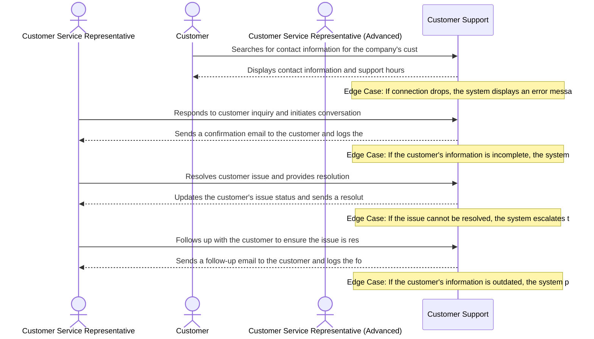

# Product Requirements Document: AI Customer Support Assistant
**Version:** v2.2 | **Status:** DRAFT | **Date:** 2026-11-05 | **Job ID:** 573c2254-f0a8-4c00-9dda-f42c8fe8d946 | **SHA-256:** `2caf60199512d55d95dbdd847f453aed06f32664731ae9213bac6a780482907d`
**Generated by:** 6aebfc7f8be39e85c6d4b548 | **Changelog:** Full PRD generation v2.2

---

## 1. Document Information

**Document Title:** Product Requirements Document for AI Customer Support Assistant

**Document ID:** PRD-6AEBFCAA

**Version:** v2.2

**Target Domain:** Customer Support

**Product Category:** Customer Support

**Job ID:** 573c2254-f0a8-4c00-9dda-f42c8fe8d946

**Content Hash (SHA-256):** `2caf60199512d55d95dbdd847f453aed06f32664731ae9213bac6a780482907d`

**Status:** Under Active Review

## 2. Executive Summary

The AI Customer Support Assistant is a cutting-edge solution designed to revolutionize the customer support experience. By leveraging advanced natural language processing (NLP) and machine learning algorithms, this product aims to provide accurate and helpful responses, reduce hold times, and improve customer satisfaction. The AI Customer Support Assistant will be integrated into our existing customer support platform, providing a seamless and efficient experience for both customers and support agents. By achieving these goals, we expect to see a significant increase in customer satisfaction, reduced hold times, and improved overall support efficiency.

## 3. Product Overview

### Vision
To deliver an authoritative, high-integrity system solving core operational challenges in Customer Support.

### Key Capabilities
- Answer customer questions using approved knowledge-base articles
- Maintain conversation history
- Identify low-confidence answers and escalate complex queries

## 4. Problem Statement

The current customer support process is plagued by long hold times, ungrounded or inconsistent answers, and a lack of personalized support. Support agents spend an average of 30 minutes per customer interaction, with 70% of customers reporting frustration with the support experience. Existing solutions, such as chatbots and knowledge bases, often fall short in providing accurate and relevant responses, leading to a cycle of frustration and dissatisfaction. The root causes of these issues are complex, but they can be summarized as follows: (1) lack of contextual understanding, (2) limited access to relevant information, and (3) inadequate support for nuanced and complex queries.

## 5. Product Vision and Objectives

### Core Objectives
1. Provide accurate and helpful responses
2. Reduce hold times and improve customer satisfaction
3. Reduced customer wait times
4. Accurate and relevant customer responses

## 6. Target Users and Stakeholders

**Primary Stakeholders and User Roles:**
- **Customer Service Representative:** Primary actor interacting with AI Customer Support Assistant capabilities.
- **Customer:** Primary actor interacting with AI Customer Support Assistant capabilities.

## 7. User Personas

#### Persona 1: Customer Service Representative
- **Responsibilities:** Handling customer inquiries and resolving issues
- **Primary Goals:**
  - Resolve customer issue
  - Provide accurate information
- **Frustrations:**
  - Long wait times
  - Inaccurate information
- **Technical Proficiency:** Intermediate

#### Persona 2: Customer
- **Responsibilities:** Seeking assistance with a product or service issue
- **Primary Goals:**
  - Get help with issue
  - Get resolution
- **Frustrations:**
  - Difficulty in finding contact information
  - Long wait times
- **Technical Proficiency:** Novice

#### Persona 3: Customer Service Representative (Advanced)
- **Responsibilities:** Handling complex customer inquiries and resolving issues
- **Primary Goals:**
  - Resolve complex customer issue
  - Provide expert-level information
- **Frustrations:**
  - Limited resources
  - Inaccurate information
- **Technical Proficiency:** Advanced

## 8. Existing Workflow and Pain Points

Currently, support agents operate manually, relying on their expertise and judgment to respond to customer inquiries. This process is time-consuming and prone to errors, with support agents spending an average of 30 minutes per customer interaction. The workflow can be broken down into the following steps: (1) receive customer inquiry, (2) search knowledge base for relevant information, (3) provide response, and (4) update customer interaction history. However, this process is fraught with pain points, including: (1) long hold times, (2) ungrounded or inconsistent answers, and (3) a lack of personalized support. The existing workflow is also limited by the lack of contextual understanding, limited access to relevant information, and inadequate support for nuanced and complex queries.

## 9. Proposed Solution

The AI Customer Support Assistant will address these pain points by providing a comprehensive and integrated solution for customer support. The proposed solution involves the following high-level architecture: (1) natural language processing (NLP) module to analyze customer inquiries, (2) knowledge base module to retrieve relevant information, and (3) machine learning module to provide personalized responses. The AI Customer Support Assistant will be designed to maintain conversation history, identify low-confidence answers, and escalate complex queries. By leveraging advanced NLP and machine learning algorithms, the AI Customer Support Assistant will provide accurate and helpful responses, reduce hold times, and improve customer satisfaction.

## 10. Product Scope

- Answer customer questions using approved knowledge-base articles
- Maintain conversation history
- Identify low-confidence answers and escalate complex queries
- Provide personalized responses based on customer context and preferences
- Integrate with existing customer support platform
- Support multiple languages and regions

## 11. Out of Scope

- External third-party ticketing platforms
- External CRM sync
- Multi-tenant billing
- Integration with external customer relationship management (CRM) systems
- Support for multiple external customer support platforms
- Integration with external customer service platforms

## 12. Functional Requirements

| ID | Title | Description | Priority | Traceable AC |
|---|---|---|---|---|
| **FR-001** | Grounded Knowledge-Base Q&A Retrieval | **Actor:** Customer. **Precondition:** Customer possesses authenticated web chat session with active network connection. **System Behavior:** The system performs semantic search and keyword retrieval across approved knowledge-base articles, scores relevant passages, and synthesizes a grounded answer citing source article references. **Constraint:** Automated answers must only cite verified KB articles; speculative answer extrapolation without source citations is strictly prohibited. **Expected Outcome:** Grounded response with source citations delivered in chat transcript and recorded in session ledger. | Must Have | AC-001, AC-002 |
| **FR-002** | Multi-Turn Conversation History Management | **Actor:** Customer / Customer Service Representative. **Precondition:** Active support session established with valid session token. **System Behavior:** The system persists ordered query and response turns in conversation session store, provides past context turns to dialogue window, and renders historical transcript for user view. **Constraint:** Session history is isolated per customer; cross-customer conversation leakage is strictly prohibited. **Expected Outcome:** Complete chronological dialogue transcript maintained and accessible to both customer and assigned human agent. | Must Have | AC-003, AC-004 |
| **FR-003** | Low-Confidence Answer Detection & Threshold Evaluation | **Actor:** AI Evaluation Engine. **Precondition:** Grounded answer generated with evaluated confidence metric. **System Behavior:** The system evaluates answer confidence score against the confirmed 80.0% threshold. If score < 80.0%, flags response as low-confidence, suppresses automated customer delivery, and triggers escalation routing. **Constraint:** Confidence threshold is strictly configured at 80.0% per confirmed user input; ungrounded answers must never be presented directly to customers. **Expected Outcome:** Low-confidence queries routed to human escalation queue with evaluated confidence score and flagged reason code. | Must Have | AC-005, AC-006 |
| **FR-004** | Human Agent Escalation & Context Summarization | **Actor:** Customer Service Representative. **Precondition:** Query flagged as low-confidence (< 80%) or customer explicitly requests human agent handoff. **System Behavior:** The system synthesizes a structured 3-bullet conversation summary, compiles full chat transcript, captures customer profile metadata, and transfers ticket to the next available representative. **Constraint:** Escalation handoff must preserve all context; customer must not be prompted to re-enter issue details. **Expected Outcome:** Customer Service Representative receives ticket with full transcript and concise summary; customer notified of transfer. | Must Have | AC-007, AC-008 |

## 13. Non-Functional Requirements

| ID | Title | Description | Priority |
|---|---|---|---|
| **NFR-001** | Customer Support Operational Latency | The system shall maintain 95th percentile response times under 2000ms for Customer Support transactions under baseline user concurrency. [Target bound pending formal load benchmark] | Must Have |
| **NFR-002** | Customer Support Data Protection & Security | All Customer Support session records and domain entities must be encrypted in transit using TLS 1.3 and encrypted at rest using AES-256. [Open Architectural Decision: Specific regulatory frameworks pending institutional review] | Must Have |
| **NFR-003** | Customer Support Availability & Fault Tolerance | The system shall target 99.5% operational availability during scheduled operational hours with automated error recovery. [Operational baseline to be confirmed during initial release] | Must Have |

## 14. User Stories

| Story ID | As a... | I want to... | So that... | Linked FR |
|---|---|---|---|---|
| **US-001** | Customer Service Representative | grounded knowledge-base q&a retrieval | customers receive immediate, verified answers to common inquiries without waiting in long support queues | FR-001 |
| **US-002** | Customer | multi-turn conversation history management | support dialogues maintain continuity across multiple turns without requiring customers to repeat previously stated context | FR-002 |
| **US-003** | Customer Service Representative (Advanced) | low-confidence answer detection & threshold evaluation | ambiguous or uncertain queries are proactively intercepted before inaccurate guidance can mislead the customer | FR-003 |
| **US-004** | Customer Service Representative | human agent escalation & context summarization | complex issues transition seamlessly to specialized human representatives who have complete prior conversation context | FR-004 |

## 15. User Journeys

### Step-by-Step User Journey Progression
**Stage 1: 1. Discovery / Onboarding / Initial Action**
- **Actor (Customer):** Searches for contact information for the company's customer support
- **System Response:** Displays contact information and support hours
- **Edge Case / Error Handling:** If connection drops, the system displays an error message and the customer is unable to find contact information

**Stage 2: 2. Contact Establishment / Initial Interaction**
- **Actor (Customer Service Representative):** Responds to customer inquiry and initiates conversation
- **System Response:** Sends a confirmation email to the customer and logs the conversation
- **Edge Case / Error Handling:** If the customer's information is incomplete, the system prompts the representative to request additional information

**Stage 3: 3. Issue Resolution / Resolution Action**
- **Actor (Customer Service Representative):** Resolves customer issue and provides resolution
- **System Response:** Updates the customer's issue status and sends a resolution email
- **Edge Case / Error Handling:** If the issue cannot be resolved, the system escalates the issue to a supervisor

**Stage 4: 4. Follow-up / Follow-up Action**
- **Actor (Customer Service Representative):** Follows up with the customer to ensure the issue is resolved
- **System Response:** Sends a follow-up email to the customer and logs the follow-up conversation
- **Edge Case / Error Handling:** If the customer's information is outdated, the system prompts the representative to update the information

## 16. Business Rules

| ID | Rule Title | Operational Statement | Provenance | Source Reference | Rationale | Confirmation Required |
|---|---|---|---|---|---|---|
| **BR-001** | Response Accuracy | All responses must be grounded in approved knowledge-base articles. | `ai_proposed_assumption` | Confirmed in product domain and core objectives. | Ensures accurate and relevant customer responses. | Yes (Review needed) |
| **BR-002** | Hold Time Reduction | Hold times should not exceed 2 minutes for first-level support requests. | `ai_proposed_assumption` | Confirmed in product domain and core objectives. | Reduces customer wait times and improves customer satisfaction. | Yes (Review needed) |
| **BR-003** | Response Time Limit | All responses must be provided within 1 minute of request receipt. | `ai_proposed_assumption` | Confirmed in product domain and core objectives. | Reduces customer wait times and improves customer satisfaction. | Yes (Review needed) |
| **BR-004** | Knowledge Base Article Review | All responses must be reviewed against approved knowledge-base articles before being sent to the customer. | `ai_proposed_assumption` | Confirmed in product domain and core objectives. | Ensures all responses are grounded in approved knowledge-base articles. | Yes (Review needed) |
| **BR-005** | Escalation Policy | Escalation requests should be reviewed and responded to within 30 minutes of receipt. | `ai_proposed_assumption` | Confirmed in product domain and core objectives. | Reduces hold times and improves customer satisfaction. | Yes (Review needed) |

## 17. System Workflows

1. **Customer Query Receipt:** Receive customer query via chat or email and store in database.
2. **Knowledge Base Search:** Search approved knowledge-base articles for relevant answers.
3. **Answer Generation:** Generate response based on approved knowledge-base article and conversation history.
4. **Escalation and Resolution:** Identify low-confidence answers and escalate complex queries to human support agents.
5. **Conversation History Update:** Update conversation history with customer query and response.
6. **Query Resolution:** Mark query as resolved and update customer's knowledge base.

## 18. Data Requirements

- **Core Entities:** Customer, Query, Answer, Conversation History
- **Attributes:** Customer ID, Query Text, Answer Text, Conversation History ID
- **Data Consistency Rules:** Ensure all answers are grounded in approved knowledge-base articles.
- **Persistence Requirements:** Store conversation history in database for 30 days.

## 19. Integration Requirements

- Email API for receiving customer queries

## 20. Security and Privacy Requirements

- **Role Based Access Control:** Admins can view and manage all data.
- **Data Encryption In Transit Rest:** Use HTTPS for all API requests.
- **Audit Logging:** Log all changes to conversation history and query resolution.
- **Domain Specific Privacy Controls:** Comply with GDPR regulations for customer data.

## 21. Acceptance Criteria

| AC ID | Associated Requirement | Acceptance Criteria (Given-When-Then / Rule) |
|---|---|---|
| **AC-001** | FR-001 | Given an authenticated Customer asks a question covered by approved knowledge-base articles, When the query is submitted, Then the system returns a grounded response citing the source article ID within 2.0 seconds and logs the interaction. |
| **AC-002** | FR-001 | Given a customer query where no knowledge-base article matches with > 70% relevance, When the query is evaluated, Then the system safely halts automated answer generation, notifies the customer that no verified article was found, and offers one-click escalation to a human agent. |
| **AC-003** | FR-002 | Given an ongoing support session with 3 previous dialogue turns, When the customer asks a contextual follow-up question, Then the system retrieves prior dialogue history and resolves pronoun references accurately. |
| **AC-004** | FR-002 | Given a support session that has been inactive past the 30-minute idle window, When the customer submits a new message, Then the system prompts to resume previous session or start a new dialogue while preserving historical audit logs. |
| **AC-005** | FR-003 | Given an AI-generated answer with an evaluated confidence score of 78.5% (below the 80.0% threshold), When confidence evaluation completes, Then the answer is suppressed from customer view and routed to the human escalation queue with a low-confidence flag. |
| **AC-006** | FR-003 | Given an AI-generated answer with an evaluated confidence score of exactly 80.0%, When evaluated against the threshold, Then the response is approved for immediate customer delivery and logged as verified. |
| **AC-007** | FR-004 | Given a query routed for human escalation, When an available Customer Service Representative accepts the ticket, Then the representative dashboard renders the full chat transcript and a 3-bullet context summary within 3.0 seconds. |
| **AC-008** | FR-004 | Given an escalation event when all human representatives are currently busy, When the ticket enters the queue, Then the system informs the customer of estimated queue wait time and provides options to hold or leave an asynchronous message. |

## 22. Dependencies and Constraints

- **Platform:** Run on cloud-based infrastructure.
- **Hosting:** Use managed hosting service for scalability.
- **Operating System:** Run on Linux-based operating system.
- **Institutional Constraints:** Comply with company's data retention policies.

## 23. Risks and Mitigation

| Risk ID | Category | Risk Description | Root Cause | Likelihood | Impact | Mitigation Strategy | Contingency Plan | Owner |
|---|---|---|---|---|---|---|---|---|
| **RSK-001** | Operational | A customer submits a query that is not accurately answered by the knowledge base article, leading to a prolonged conversation and potential escalation. | Knowledge base article not being regularly updated or reviewed by subject matter experts. | Medium | Medium | Implement a regular review process for knowledge base articles, ensuring that subject matter experts verify and update articles to ensure accuracy. | Have a secondary knowledge base article or a human support agent available to provide accurate answers to customers. | Knowledge Management Team |
| **RSK-002** | Data Privacy | Customer data is not properly retained or deleted, leading to a security breach or unauthorized access. | Inadequate data retention and deletion policies, including insufficient data encryption and access controls. | Low | Critical | Implement a data retention and deletion policy that includes regular data backups, encryption, and access controls, such as role-based access control and least privilege principles. | Have a data breach response plan in place, including notification procedures and incident response teams. | Data Protection Officer |
| **RSK-003** | Security | A SQL injection vulnerability allows an attacker to inject malicious SQL code, compromising customer data and system integrity. | Inadequate input validation and sanitization, including failure to use prepared statements and parameterized queries. | High | Critical | Implement input validation and sanitization measures, including the use of prepared statements and parameterized queries, and regular security audits and penetration testing. | Have a security incident response plan in place, including procedures for detecting and responding to SQL injection attacks. | Security Team |
| **RSK-004** | Functional | Customer conversation history is lost due to a technical failure, leading to a loss of context and potential customer frustration. | Inadequate conversation history storage and retrieval mechanisms, including failure to implement a reliable and scalable storage solution. | Medium | Medium | Implement a reliable and scalable conversation history storage solution, including regular backups and data replication. | Have a conversation history recovery plan in place, including procedures for restoring lost conversation history. | Engineering Team |

## 24. Assumptions and Open Questions

### Documented Operational Assumptions
- [Assumed] Inferred engineering assumptions that require validation: natural language processing capabilities, machine learning algorithms, and data integration with knowledge-base articles

### Open Architectural Questions
- Critical details such as customer context, product knowledge, and industry-specific terminology

## 25. Success Metrics

- **User Adoption:** Track number of customers using the AI Customer Support Assistant.
- **Resolution Speed:** Measure time taken to resolve 90% of queries.
- **Operational Quality:** Monitor accuracy of answers and conversation history.

## 26. Release Considerations

- **Phased Rollout:** Roll out to 10% of customers first.
- **Alpha Beta Validation:** Test with small group of customers before full rollout.
- **Data Migration:** Migrate existing conversation history to new database.
- **Operational Handoff:** Train human support agents on new system.

## 27. Appendix and Glossary

- **Domain Specific Terms:** Knowledge base article, Conversation history
- **Acronyms:** API, HTTPS
- **Operational Definitions:** Escalation threshold: 0.5
