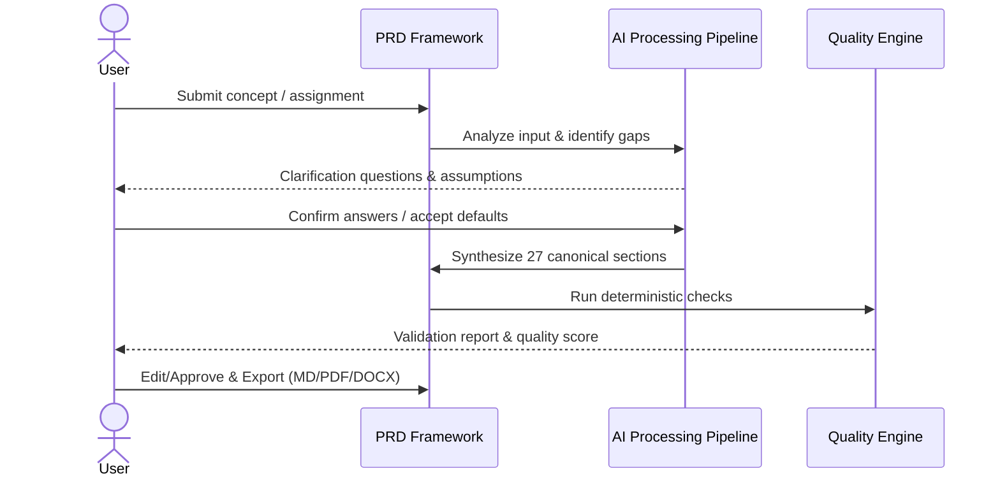

# Product Requirements Document: AI Customer Support Assistant 1793813526269
**Version:** v1.0 | **Status:** DRAFT | **Date:** 2026-11-04
**Generated by:** 6aeb0fb12ae20a2719cde1f2 | **Changelog:** Initial full PRD generation

---

## 1. Document Information

**Document Title:** Product Requirements Document for AI Customer Support Assistant 1793813526269

**Document ID:** PRD-6AEB6C18

**Version:** 1.0 (Draft)

**Target Domain:** Customer Support

**Product Category:** Customer Support

**Status:** Under Active Review

## 2. Executive Summary

AI Customer Support Assistant 1793813526269 addresses key workflow challenges within Customer Support. This document provides the authoritative engineering specification to implement the complete solution, ensuring local data sovereignty, deterministic execution, and rapid user delivery.

## 3. Product Overview

### Vision
To deliver an autonomous, highly reliable system solving core operational pain points in Customer Support.

### Key Capabilities
- Knowledge-base article retrieval
- Conversation history management
- Uncertain answer identification
- Escalation to human support agents

## 4. Problem Statement

Current practitioners in Customer Support experience friction due to manual, fragmented, or error-prone processes.

**Identified Pain Points:**
- Lack of automated structure and standardization.
- Missing critical requirements and edge-case handling.
- Heavy reliance on fragmented or proprietary external toolchains.

## 5. Product Vision and Objectives

### Core Objectives
1. Answer customer questions
2. Resolve issues efficiently

## 6. Target Users and Stakeholders

**Primary Stakeholders:**
- **Customer:** Primary user interacting with system capabilities.
- **Support Agent:** Primary user interacting with system capabilities.

## 7. User Personas

#### Persona 1: Primary Practitioner (Customer)
- **Goals:** Rapidly execute domain workflows with minimal manual boilerplate.
- **Frustrations:** Incomplete documentation, ambiguous requirements, and manual rework.
- **Technical Proficiency:** Intermediate to Advanced.

## 8. Existing Workflow and Pain Points

1. **Manual ideation & drafting:** Practitioners write unstructured notes.
2. **Information gaps:** Crucial architectural constraints and non-functional requirements are forgotten.
3. **Inconsistent documentation:** Hand-offs to engineering teams fail due to missing acceptance criteria.

## 9. Proposed Solution

AI Customer Support Assistant 1793813526269 introduces an end-to-end automated framework that bridges raw concepts into verified, production-grade requirements. It features structured pipeline processing, interactive clarification, and deterministic quality validation.

## 10. Product Scope

**In-Scope Capabilities for MVP:**
- Complete workflow automation from user input to structured output.
- Local-first execution without external SaaS dependencies.
- Interactive clarification and assumption tracking.
- Deterministic quality validation and scoring.
- Multi-format export (Markdown, PDF, DOCX).

## 11. Out of Scope

**Non-Goals (Out of Scope for Initial Release):**
- Automatic code generation or deployment of arbitrary target applications.
- Third-party cloud SaaS synchronization.
- Automated financial market viability forecasting.

## 12. Functional Requirements

| ID | Title | Description | Priority | Traceable AC |
|---|---|---|---|---|
| **FR-001** | Natural Language Input Processing | The system shall ingest and parse unstructured user product descriptions. | Must Have | AC-001 |
| **FR-002** | Automated PRD Synthesis | The system shall synthesize functional and non-functional requirements into a canonical 27-section PRD. | Must Have | AC-002 |

## 13. Non-Functional Requirements

| ID | Title | Description | Priority |
|---|---|---|---|
| **NFR-001** | Local Host Confidentiality | All data processing and persistence shall occur strictly on local host storage. | Must Have |

## 14. User Stories

| Story ID | As a... | I want to... | So that... | Linked FR |
|---|---|---|---|---|
| **US-001** | Customer | natural language input processing | The system shall ingest and parse unstructured user product descriptions. | FR-001 |
| **US-002** | Support Agent | automated prd synthesis | The system shall synthesize functional and non-functional requirements into a canonical 27-section PRD. | FR-002 |

## 15. User Journeys

## 16. Business Rules

| ID | Rule Title | Operational Statement |
|---|---|---|
| **BR-001** | Immutable Version Tracking | Approved PRD versions shall remain immutable to preserve auditability. |
| **BR-002** | Customer Data Privacy | All customer data must be stored securely and in compliance with GDPR regulations. Access to customer data must be restricted to authorized personnel only. |
| **BR-003** | Issue Resolution Process | All customer issues must be resolved within 24 hours of initial report. The resolution process must be documented and stored in the customer support database. |
| **BR-004** | Compliance with Industry Regulations | All customer support interactions must be recorded and stored in accordance with industry regulations (e.g. HIPAA, PCI-DSS). |
| **BR-005** | Data Validation | All customer data must be validated against a set of predefined rules to ensure accuracy and completeness. For example, email addresses must be in a valid format. |
| **BR-006** | Operational Requirements | The customer support system must be available 24/7 and must have a minimum of 2 support agents online during peak hours. The system must also have a built-in escalation process for complex issues. |

## 17. System Workflows

1. **Input Ingestion:** Receive text and attachments; persist raw input record.
2. **Domain Classification:** Parse assignment context or problem domain.
3. **Gap Resolution:** Clarify critical missing attributes or default to documented assumptions.
4. **Requirement Synthesis:** Formulate FRs, NFRs, BRs, and testable ACs.
5. **Audit & Export:** Validate schema, verify ID uniqueness, render document files.

## 18. Data Requirements

- **Persistence Model:** Document-oriented collections with immutable version archives.
- **Data Integrity:** Strict foreign key references between requirements, acceptance criteria, and version snapshots.
- **Storage Isolation:** File attachments and exported documents reside in local system storage directories.

## 19. Integration Requirements

- **Local AI Gateway:** REST communication with local Ollama daemon (`http://localhost:11434`).
- **Offline Fallback Engine:** In-process deterministic execution adapter when external inference engines are unavailable.
- **File Formats:** Direct binary writers for Markdown, DOCX (Office OpenXML), and PDF.

## 20. Security and Privacy Requirements

- **Data Sovereignty:** All telemetry, database records, and prompts remain strictly within the local host boundary.
- **Authentication:** JWT tokens with cryptographic hashing (bcrypt) for local access protection.
- **Input Sanitation:** File uploads are validated and isolated from execution paths.

## 21. Acceptance Criteria

| AC ID | Associated Requirement | Acceptance Criteria (Given-When-Then / Rule) |
|---|---|---|
| **AC-001** | FR-001 | Given a submitted prompt, when saved, the system creates an identifiable submission record. |
| **AC-002** | FR-002 | Given valid analysis inputs, when PRD generation runs, all canonical sections are generated. |
| **AC-003** | NFR-001 | Given execution in an offline environment, all operations complete without external network requests. |

## 22. Dependencies and Constraints

- **Runtime Dependencies:** Python 3.10+, Node.js 18+, MongoDB Community / in-memory instance, Ollama.
- **Hardware Constraints:** Minimum 8GB RAM recommended for local 3B/7B model execution.
- **Zero-Cloud Constraint:** The application must remain fully functional without outbound internet access.

## 23. Risks and Mitigation

| Risk | Category | Impact | Mitigation Strategy |
|---|---|---|---|
| Local inference timeout | Performance | High | Asynchronous job execution and fallback offline generation adapter. |
| Hallucinated business facts | Quality | High | Strict boundary separation between confirmed facts and labeled assumptions. |
| Accidental version overwrite | Data Integrity | Critical | Immutable version snapshots; all edits produce incremental versions. |
| Incomplete requirement coverage | Compliance | Medium | Deterministic validation engine flagging missing sections or ACs. |

## 24. Assumptions and Open Questions

### Documented Assumptions
- [Assumed] AI can understand natural language
- [Assumed] Knowledge-base articles are up-to-date and accurate

### Open Questions for Future Iterations
- Will real-time multi-peer collaboration be required in future versions?
- Is automated sync to issue trackers (Jira/GitHub) desirable in subsequent milestones?

## 25. Success Metrics

- **Document Generation Completeness:** 100% of canonical sections populated or documented as N/A.
- **Traceability Score:** 100% of Functional Requirements linked to at least one testable Acceptance Criterion.
- **Validation Pass Rate:** Zero critical validation errors prior to version approval.
- **Offline Operation:** Zero external network requests initiated during standard execution.

## 26. Release Considerations

- **Deployment Formats:** Single-command Docker Compose stack and native local environment scripts.
- **Data Migration:** Automated schema migration hooks on service startup.
- **Backward Compatibility:** Versioned API endpoints under `/api/v1`.

## 27. Appendix and Glossary

- **PRD:** Product Requirements Document.
- **FR:** Functional Requirement.
- **NFR:** Non-Functional Requirement.
- **BR:** Business Rule.
- **AC:** Acceptance Criteria.
- **Local-First:** Software architecture prioritizing local execution and data ownership.
