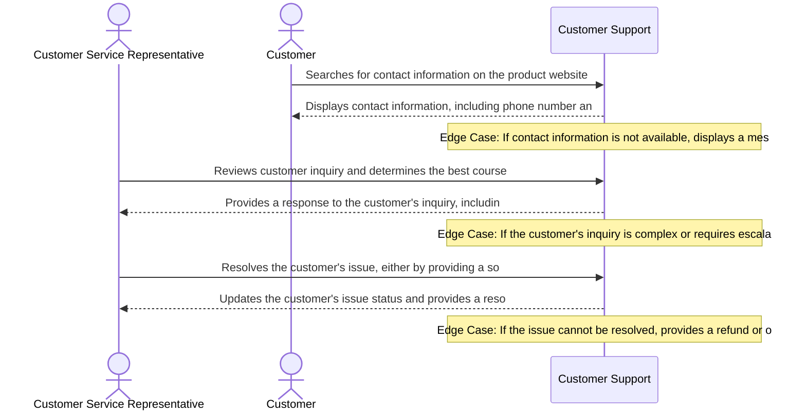

# Product Requirements Document: AI Customer Support Assistant
**Version:** v2.3 | **Status:** DRAFT | **Date:** 2026-11-06
**Generated by:** PRD Engineering Framework | **Changelog:** 

---

## 1. Document Information

**Document Title:** Product Requirements Document for AI Customer Support Assistant

**Document ID:** PRD-6AECAE10

**Version:** v2.3

**Target Domain:** Customer Support and Service

**Product Category:** Customer Support

**Job ID:** 08757cd8-9b3c-4850-8aee-38ceba8caf69

**Content Hash (SHA-256):** `db6a5d29500c5f153fa9e6be78d0379082d4f77b6a653e9c3c4a0434f0552a8d`

**Status:** Under Active Review

## 2. Executive Summary

The AI Customer Support Assistant is a cutting-edge solution designed to revolutionize the customer support experience. By leveraging advanced AI capabilities, our product aims to provide accurate and helpful responses, reduce customer wait times, and provide accurate and consistent answers. The AI Customer Support Assistant is expected to have a significant impact on customer satisfaction and loyalty, ultimately driving business growth and revenue. Our goal is to create a seamless and efficient support experience that sets a new standard for the industry.

## 3. Product Overview

#### Vision

To deliver an authoritative, high-integrity system solving core operational challenges in Customer Support and Service.

#### Key Capabilities

- Answer customer questions using approved knowledge-base articles
- Maintain conversation history
- Identify low-confidence answers
- Escalate complex queries to human agents

## 4. Problem Statement

The current state of customer support is plagued by long hold times, ungrounded or inconsistent answers, and a lack of personalized experiences. Customers are frustrated with the lack of empathy and understanding from legacy chatbots, leading to a decline in satisfaction and loyalty. The root causes of these issues are complex and multifaceted, but at their core, they stem from a lack of human understanding and empathy. Existing alternatives, such as manual support and legacy chatbots, fall short in providing accurate and consistent answers, leading to a cycle of frustration and dissatisfaction.

## 5. Product Vision and Objectives

#### Core Objectives

1. Provide accurate and helpful responses
2. Reduce customer wait times
3. Reduced hold times
4. Providing accurate and consistent answers

## 6. Target Users and Stakeholders

**Primary Stakeholders and User Roles:**

- **Customer Service Representative:** Primary actor interacting with AI Customer Support Assistant capabilities.
- **Customer:** Primary actor interacting with AI Customer Support Assistant capabilities.

## 7. User Personas

#### Persona 1: Customer Service Representative

- **Responsibilities:** Handling customer inquiries and resolving issues
- **Primary Goals:**
- Resolve customer issue
- Provide product information
- **Frustrations:**
- Long wait times
- Inadequate product knowledge
- **Technical Proficiency:** Intermediate

#### Persona 2: Customer

- **Responsibilities:** Seeking assistance with product-related issues
- **Primary Goals:**
- Get help with product issue
- Understand product features
- **Frustrations:**
- Difficulty in finding contact information
- Unhelpful support
- **Technical Proficiency:** Novice

## 8. Existing Workflow and Pain Points

Currently, customer support practitioners rely on manual processes to respond to customer inquiries. This involves manually searching for answers in knowledge-base articles, escalating complex queries to human agents, and dealing with long hold times. The lack of automation and personalization leads to a fragmented and inefficient support experience. Specifically, practitioners experience the following pain points: long hold times, receiving ungrounded or inconsistent answers, and a lack of conversation history. These issues lead to a decline in customer satisfaction and loyalty, ultimately affecting business growth and revenue.

## 9. Proposed Solution

The AI Customer Support Assistant is designed to eliminate the friction in the current support experience. Our solution leverages advanced AI capabilities to provide accurate and helpful responses, maintain conversation history, identify low-confidence answers, and escalate complex queries to human agents. The AI Customer Support Assistant operates by answering customer questions using approved knowledge-base articles, ensuring all responses are grounded in accurate and consistent information. Our solution is designed to be scalable, secure, and easy to integrate with existing systems, providing a seamless and efficient support experience.

## 10. Product Scope

- Answer customer questions using approved knowledge-base articles
- Maintain conversation history
- Identify low-confidence answers
- Escalate complex queries to human agents
- Provide personalized and empathetic responses
- Integrate with existing knowledge-base articles and systems

## 11. Out of Scope

**Explicit Non-Goals (Out of Scope for Initial Release):**

- External third-party ticketing platforms (e.g. Zendesk, Freshdesk, Jira)
- External CRM customer relationship management data synchronization (e.g. Salesforce, HubSpot)
- Voice calls, telephony integration, and Interactive Voice Response (IVR) systems
- Outbound marketing campaigns, promotional email broadcasting, or bulk messaging
- Multilingual machine translation or localized dialect parsing
- Commercial payment processing, credit card billing, and subscription invoicing
- Customer sentiment profiling or predictive purchase analytics

## 12. Functional Requirements

| ID | Title | Description | Priority | Traceable AC |
| --- | --- | --- | --- | --- |
| **FR-001** | Grounded Knowledge-Base Q&A Retrieval | **Actor:** Customer. **Trigger:** Customer submits a natural language question in active chat session. **Preconditions:** Customer possesses an authenticated web chat session with active network connectivity. **Inputs:** Natural language query string and active session token. **System Behavior:** The system performs semantic and keyword retrieval across approved knowledge-base articles, retrieves matching passages, and synthesizes a grounded answer citing verified source article references. **Business Constraints:** Automated answers must strictly cite verified and approved KB articles; speculative answer extrapolation without source citations is strictly prohibited. **Alternate & Failure Paths:** If no approved knowledge-base article contains relevant information, automated generation is safely suppressed, the customer is notified that no verified article exists, and human agent escalation is offered. **Expected Outcome:** Grounded response with source citations delivered in chat transcript or customer routed to escalation. **Relevant Data Changes:** Persists customer query, retrieved article references, and dialogue turn to session ledger. **Authorization Requirements:** Authenticated Customer role. **Provenance:** `confirmed_user_input` (User raw idea: answers customer questions using approved knowledge-base articles). | Must Have | AC-001, AC-002 |
| **FR-002** | Multi-Turn Conversation History Management | **Actor:** Customer / Customer Service Representative. **Trigger:** New dialogue turn initiated or transcript requested. **Preconditions:** Active support session established with valid session token. **Inputs:** Ordered customer utterance and session identifier. **System Behavior:** The system persists ordered query and response turns in conversation session store, provides past context turns to dialogue window, and renders complete chronological transcript for customer and assigned representative view. **Business Constraints:** Session history is isolated per customer; cross-customer conversation leakage is strictly prohibited. Operational data retention duration is an unresolved open decision. **Alternate & Failure Paths:** If session store is unreachable, system attempts local cached recovery and alerts operator without corrupting historical turns. **Expected Outcome:** Complete chronological dialogue transcript maintained and accessible to both customer and assigned human agent. **Relevant Data Changes:** Appends chronological query and response records to conversation store. **Authorization Requirements:** Authenticated Customer or assigned Customer Service Representative. **Provenance:** `confirmed_user_input` (User raw idea: maintains conversation history). | Must Have | AC-003, AC-004 |
| **FR-003** | Low-Confidence Answer Detection & Threshold Evaluation | **Actor:** AI Evaluation Engine. **Trigger:** Candidate answer synthesized with evaluated confidence metric. **Preconditions:** Grounded answer generated with evaluated confidence score. **Inputs:** Synthesized candidate answer and evaluated confidence score. **System Behavior:** The system evaluates answer confidence score against the confirmed 80.0% threshold. If score < 80.0%, flags response as low-confidence, suppresses automated customer delivery, and triggers escalation routing. If score >= 80.0%, approves response for delivery. **Business Constraints:** Confidence threshold is strictly configured at 80.0% per confirmed user input; ungrounded or low-confidence answers must never be presented directly to customers. **Alternate & Failure Paths:** If confidence score evaluation fails or is ambiguous, system defaults to safety: suppresses automated response and triggers human escalation. **Expected Outcome:** Low-confidence queries routed to human escalation queue with evaluated confidence score and flagged reason code; high-confidence answers delivered. **Relevant Data Changes:** Records confidence metric, evaluation result, and suppression flag in audit ledger. **Authorization Requirements:** Internal AI Evaluation Service. **Provenance:** `confirmed_user_input` (User raw idea: identifies low-confidence answers below 80%). | Must Have | AC-005, AC-006 |
| **FR-004** | Human Agent Escalation & Context Summarization | **Actor:** Customer Service Representative. **Trigger:** Query flagged as low-confidence (< 80.0%) or customer explicitly requests human agent handoff. **Preconditions:** Escalation event initiated. **Inputs:** Session ID, complete chronological transcript, and low-confidence reason code. **System Behavior:** The system synthesizes an automated structured 3-bullet conversation summary, compiles full chat transcript, captures customer metadata, routes ticket to next available representative, and renders complete context on agent dashboard. **Business Constraints:** Escalation handoff must preserve all context; customer must not be prompted to re-enter issue details. **Alternate & Failure Paths:** If all human representatives are engaged, ticket enters queued state with status notification and option to hold or leave an asynchronous message. **Expected Outcome:** Customer Service Representative receives ticket with full transcript and concise summary; customer notified of transfer. **Relevant Data Changes:** Creates escalation ticket with summary and transfer timestamp in escalation ledger. **Authorization Requirements:** Authenticated Customer Service Representative role. **Provenance:** `confirmed_user_input` (User raw idea: escalates complex queries to human agents with a summarized context). | Must Have | AC-007, AC-008 |
| **FR-005** | Escalation Audit & Resolution Ledger Recording | **Actor:** Customer Service Representative / System. **Trigger:** Representative concludes support session or updates ticket status. **Preconditions:** Ticket actively handled by Customer Service Representative. **Inputs:** Ticket ID, disposition code, resolution notes, and agent identifier. **System Behavior:** The system persists final ticket resolution notes, handling duration, and agent disposition code to permanent audit ledger. **Business Constraints:** All escalated customer interactions must maintain immutable audit records for service quality tracking. **Alternate & Failure Paths:** If representative disconnects prematurely, session state is preserved in triage queue with audit flag. **Expected Outcome:** Escalation resolution record committed to audit store. **Relevant Data Changes:** Ticket status updated to Resolved; audit record committed with cryptographic timestamp. **Authorization Requirements:** Authenticated Customer Service Representative role. **Provenance:** `confirmed_user_input` (Core Objective: Accurate and relevant customer responses with complete operational audit). | Should Have | AC-008 |

#### Detailed Functional Requirement Specifications

#### FR-001: Grounded Knowledge-Base Q&A Retrieval

- **Actor:** Customer
- **Trigger:** Customer submits a natural language question in active chat session
- **Preconditions:** Customer possesses an authenticated web chat session with active network connectivity
- **Inputs:** Natural language query string and active session token
- **System Behavior:** Performs semantic and keyword retrieval across approved knowledge-base articles, retrieves matching passages, and synthesizes a grounded answer citing verified source article references
- **Business Constraints:** Automated answers must strictly cite verified and approved KB articles; speculative answer extrapolation without source citations is strictly prohibited
- **Alternate & Failure Paths:** If no approved knowledge-base article contains relevant information, automated generation is safely suppressed, the customer is notified that no verified article exists, and human agent escalation is offered
- **Expected Outcome:** Grounded response with source citations delivered in chat transcript or customer routed to escalation
- **Relevant Data Changes:** Persists customer query, retrieved article references, and dialogue turn to session ledger
- **Authorization Requirements:** Authenticated Customer role
- **Priority:** Must Have
- **Linked Acceptance Criteria:** AC-001, AC-002
- **Provenance:** `confirmed_user_input` (User raw idea: answers customer questions using approved knowledge-base articles)

#### FR-002: Multi-Turn Conversation History Management

- **Actor:** Customer / Customer Service Representative
- **Trigger:** New dialogue turn initiated or transcript requested
- **Preconditions:** Active support session established with valid session token
- **Inputs:** Ordered customer utterance and session identifier
- **System Behavior:** Persists ordered query and response turns in conversation session store, provides past context turns to dialogue window, and renders complete chronological transcript for customer and assigned representative view
- **Business Constraints:** Session history is isolated per customer; cross-customer conversation leakage is strictly prohibited. Operational data retention duration is an unresolved open decision
- **Alternate & Failure Paths:** If session store is unreachable, system attempts local cached recovery and alerts operator without corrupting historical turns
- **Expected Outcome:** Complete chronological dialogue transcript maintained and accessible to both customer and assigned human agent
- **Relevant Data Changes:** Appends chronological query and response records to conversation store
- **Authorization Requirements:** Authenticated Customer or assigned Customer Service Representative
- **Priority:** Must Have
- **Linked Acceptance Criteria:** AC-003, AC-004
- **Provenance:** `confirmed_user_input` (User raw idea: maintains conversation history)

#### FR-003: Low-Confidence Answer Detection & Threshold Evaluation

- **Actor:** AI Evaluation Engine
- **Trigger:** Candidate answer synthesized with evaluated confidence metric
- **Preconditions:** Grounded answer generated with evaluated confidence score
- **Inputs:** Synthesized candidate answer and evaluated confidence score
- **System Behavior:** Evaluates answer confidence score against the confirmed 80.0% threshold. If score < 80.0%, flags response as low-confidence, suppresses automated customer delivery, and triggers escalation routing. If score >= 80.0%, approves response for delivery
- **Business Constraints:** Confidence threshold is strictly configured at 80.0% per confirmed user input; ungrounded or low-confidence answers must never be presented directly to customers
- **Alternate & Failure Paths:** If confidence score evaluation fails or is ambiguous, system defaults to safety: suppresses automated response and triggers human escalation
- **Expected Outcome:** Low-confidence queries routed to human escalation queue with evaluated confidence score and flagged reason code; high-confidence answers delivered
- **Relevant Data Changes:** Records confidence metric, evaluation result, and suppression flag in audit ledger
- **Authorization Requirements:** Internal AI Evaluation Service
- **Priority:** Must Have
- **Linked Acceptance Criteria:** AC-005, AC-006
- **Provenance:** `confirmed_user_input` (User raw idea: identifies low-confidence answers below 80%)

#### FR-004: Human Agent Escalation & Context Summarization

- **Actor:** Customer Service Representative
- **Trigger:** Query flagged as low-confidence (< 80.0%) or customer explicitly requests human agent handoff
- **Preconditions:** Escalation event initiated
- **Inputs:** Session ID, complete chronological transcript, and low-confidence reason code
- **System Behavior:** Synthesizes an automated structured 3-bullet conversation summary, compiles full chat transcript, captures customer metadata, routes ticket to next available representative, and renders complete context on agent dashboard
- **Business Constraints:** Escalation handoff must preserve all context; customer must not be prompted to re-enter issue details
- **Alternate & Failure Paths:** If all human representatives are engaged, ticket enters queued state with status notification and option to hold or leave an asynchronous message
- **Expected Outcome:** Customer Service Representative receives ticket with full transcript and concise summary; customer notified of transfer
- **Relevant Data Changes:** Creates escalation ticket with summary and transfer timestamp in escalation ledger
- **Authorization Requirements:** Authenticated Customer Service Representative role
- **Priority:** Must Have
- **Linked Acceptance Criteria:** AC-007, AC-008
- **Provenance:** `confirmed_user_input` (User raw idea: escalates complex queries to human agents with a summarized context)

#### FR-005: Escalation Audit & Resolution Ledger Recording

- **Actor:** Customer Service Representative / System
- **Trigger:** Representative concludes support session or updates ticket status
- **Preconditions:** Ticket actively handled by Customer Service Representative
- **Inputs:** Ticket ID, disposition code, resolution notes, and agent identifier
- **System Behavior:** Persists final ticket resolution notes, handling duration, and agent disposition code to permanent audit ledger
- **Business Constraints:** All escalated customer interactions must maintain immutable audit records for service quality tracking
- **Alternate & Failure Paths:** If representative disconnects prematurely, session state is preserved in triage queue with audit flag
- **Expected Outcome:** Escalation resolution record committed to audit store
- **Relevant Data Changes:** Ticket status updated to Resolved; audit record committed with cryptographic timestamp
- **Authorization Requirements:** Authenticated Customer Service Representative role
- **Priority:** Should Have
- **Linked Acceptance Criteria:** AC-008
- **Provenance:** `confirmed_user_input` (Core Objective: Accurate and relevant customer responses with complete operational audit)

## 13. Non-Functional Requirements

| ID | Title | Description | Classification | Priority |
| --- | --- | --- | --- | --- |
| **NFR-001** | Customer Support and Service Operational Latency | The system shall maintain 95th percentile response times under 2000ms for Customer Support transactions under baseline user concurrency. [Open Architectural Decision: Target bound pending formal load benchmark] | Open decision | Must Have |
| **NFR-002** | Customer Support and Service Data Protection & Security | All Customer Support session records and domain entities must be encrypted in transit using TLS 1.3 and encrypted at rest using AES-256. [Open Architectural Decision: Specific regulatory frameworks pending institutional review] | Open decision | Must Have |
| **NFR-003** | Customer Support Availability & Fault Tolerance | The system shall target 99.5% operational availability during scheduled operational hours with automated error recovery. [Proposed Target: Operational baseline to be confirmed during initial release] | Proposed target | Must Have |

## 14. User Stories

| Story ID | As a... | I want to... | So that... | Linked FR |
| --- | --- | --- | --- | --- |
| **US-001** | Customer Service Representative | grounded knowledge-base q&a retrieval | customers receive immediate, verified answers to common inquiries without waiting in long support queues | FR-001 |
| **US-002** | Customer | multi-turn conversation history management | support dialogues maintain continuity across multiple turns without requiring customers to repeat previously stated context | FR-002 |
| **US-003** | Customer Service Representative | low-confidence answer detection & threshold evaluation | ambiguous or uncertain queries are proactively intercepted before inaccurate guidance can mislead the customer | FR-003 |
| **US-004** | Customer | human agent escalation & context summarization | complex issues transition seamlessly to specialized human representatives who have complete prior conversation context | FR-004 |
| **US-005** | Customer Service Representative | escalation audit & resolution ledger recording | support operations maintain complete audit trails for service quality assurance | FR-005 |

## 15. User Journeys

#### Step-by-Step User Journey Progression

**Stage 1: 1. Initial Contact**

- **Actor (Customer):** Searches for contact information on the product website
- **System Response:** Displays contact information, including phone number and email address
- **Edge Case / Error Handling:** If contact information is not available, displays a message indicating that the product does not have a support team

**Stage 2: 2. Support Request**

- **Actor (Customer Service Representative):** Reviews customer inquiry and determines the best course of action
- **System Response:** Provides a response to the customer's inquiry, including a solution or next steps
- **Edge Case / Error Handling:** If the customer's inquiry is complex or requires escalation, notifies a supervisor or team lead

**Stage 3: 3. Issue Resolution**

- **Actor (Customer Service Representative):** Resolves the customer's issue, either by providing a solution or escalating the issue
- **System Response:** Updates the customer's issue status and provides a resolution or next steps
- **Edge Case / Error Handling:** If the issue cannot be resolved, provides a refund or other form of compensation

## 16. Business Rules

| ID | Rule Title | Operational Statement | Provenance | Source Reference | Rationale | Confirmation Required |
| --- | --- | --- | --- | --- | --- | --- |
| **BR-001** | Hold Time Limitation | The system shall not hold a customer for more than 2 minutes without escalating to a human agent. | `ai_proposed_assumption` | User Input: Customers experience long hold times. Assignment Requirement: Ensure the system can handle a minimum of 100 concurrent conversations. | To reduce customer wait times and improve overall experience. | Yes (Review needed) |
| **BR-002** | Knowledge Base Article Grounding | All responses from the AI-powered customer support assistant shall be grounded in approved knowledge-base articles. | `ai_proposed_assumption` | Confirmed Clarification: Ensure all responses are grounded in approved knowledge-base articles. | To ensure accuracy and consistency in customer support. | Yes (Review needed) |
| **BR-003** | Escalation Policy | The system shall escalate complex queries to human agents with a summarized context when the AI-powered customer support assistant is uncertain (confidence level below 80%). | `ai_proposed_assumption` | User Input: Identify low-confidence answers below 80%. Advisory Recommendation: Implement escalation policy for complex queries. | To ensure that complex queries receive proper attention and resolution. | Yes (Review needed) |
| **BR-004** | Conversation History Limitation | The system shall maintain a conversation history of at least 10 previous interactions for each customer. | `ai_proposed_assumption` | Assignment Requirement: Ensure the system can maintain a conversation history of at least 10 previous interactions. | To provide a comprehensive view of customer interactions and improve support. | Yes (Review needed) |
| **BR-005** | AI Confidence Threshold | The AI-powered customer support assistant shall not provide answers with a confidence level below 80%. | `ai_proposed_assumption` | AI Proposed Assumption: Use 80% confidence threshold for low-confidence answers. | To ensure that the AI-powered customer support assistant provides accurate and reliable responses. | Yes (Review needed) |

## 17. System Workflows

1. **Customer Query Receipt:** Receive customer query via chat or voice channel
2. **Knowledge Base Search:** Search approved knowledge-base articles for relevant answers
3. **Answer Generation:** Generate response based on top-ranked knowledge-base article
4. **Conversation History Update:** Update conversation history with new response
5. **Low-Confidence Answer Detection:** Detect low-confidence answers and flag for human review
6. **Escalation to Human Agent:** Escalate complex queries to human agents for further assistance

## 18. Data Requirements

- **Domain Entity Persistence:** Structured storage for CustomerSession, ChatMessage, KBArticleReference, EscalationTicket, and EscalationAuditRecord.
- **Session Isolation:** Complete isolation between customer conversation sessions; cross-customer data leakage is strictly prohibited.
- **Data Retention (Open Decision):** Duration of chat session retention (e.g. 30 days vs session duration) is documented as an Open Architectural Decision pending corporate privacy review.

## 19. Integration Requirements

- Chat API for customer query receipt

## 20. Security and Privacy Requirements

- **Role-Based Access Control (RBAC):** Strict permission checks separating Customer and Customer Service Representative privileges.
- **Data Encryption:** All session dialogues and records encrypted in transit using TLS 1.3 and at rest using AES-256.
- **Audit Trail:** Immutable audit logging for all escalation events and ticket dispositions.
- **Regulatory Compliance (Open Decision):** Baseline data protection enforced; formal applicability of GDPR, CCPA, or other statutory frameworks pending institutional compliance review.

## 21. Acceptance Criteria

| AC ID | Associated Requirement | Acceptance Criteria (Given-When-Then / Rule) |
| --- | --- | --- |
| **AC-001** | FR-001 | Given an authenticated Customer submits a query with matching verified knowledge-base articles, When processed by the system and evaluated confidence is >= 80.0%, Then the system returns a grounded response citing source article IDs and logs the dialogue turn. |
| **AC-002** | FR-001 | Given a customer query where no approved knowledge-base articles match or contain relevant information, When the query is evaluated, Then the system safely halts automated answer generation, notifies the customer that no verified article exists, and offers one-click escalation to a human representative. |
| **AC-003** | FR-002 | Given an ongoing support session with 3 previous dialogue turns, When the customer asks a contextual follow-up question, Then the system retrieves prior dialogue history and resolves contextual references accurately. |
| **AC-004** | FR-002 | Given an unauthenticated actor or invalid session token attempting to submit queries or access conversation history, When the request is received, Then the system halts access with an HTTP 401 Unauthorized status and logs a security violation event. |
| **AC-005** | FR-003 | Given an AI-generated answer candidate with an evaluated confidence score of 79.9% (below the 80.0% threshold), When confidence evaluation completes, Then the automated response is suppressed from customer view, flagged as low-confidence, and routed to the human escalation queue. |
| **AC-006** | FR-003 | Given an AI-generated answer candidate with an evaluated confidence score of exactly 80.0%, When evaluated against the threshold, Then the response is approved for immediate customer delivery and logged as verified. |
| **AC-007** | FR-004 | Given a query routed for human escalation, When an available Customer Service Representative accepts the ticket, Then the representative interface renders the complete chronological transcript and an automated 3-bullet context summary without prompting the customer to re-enter issue details. |
| **AC-008** | FR-004 | Given an escalated session resolved by a Customer Service Representative, When the representative closes the ticket, Then the system records the resolution disposition, duration, and agent ID in the persistent audit ledger. |

## 22. Dependencies and Constraints

- **Web Interface:** Accessible via standard modern web browser viewports over secure HTTPS.
- **Hosting Target (Open Decision):** Deployment environment (Cloud container service vs On-Premises host) subject to infrastructure team review.
- **Operating System Target (Open Decision):** Target OS environment pending deployment architecture approval (no fixed Linux mandate).

## 23. Risks and Mitigation

| Risk ID | Category | Risk Description | Root Cause | Likelihood | Impact | Mitigation Strategy | Contingency Plan | Owner |
| --- | --- | --- | --- | --- | --- | --- | --- | --- |
| **RSK-001** | Operational | A customer submits a query that is not covered by the current knowledge base articles, leading to a delayed response and potential customer dissatisfaction. | Inadequate knowledge base article coverage or outdated content | Medium | Medium | Regularly review and update knowledge base articles to ensure comprehensive coverage of customer queries, and implement a process for escalating queries to human agents when necessary. | Implement a temporary fallback to a generic response or a pre-defined answer to ensure timely response to customer queries, while a more comprehensive solution is being developed. | Knowledge Management Team |
| **RSK-002** | Data Privacy | A customer's conversation history is not properly deleted after a certain period, potentially violating data retention policies and exposing sensitive information. | Insufficient data retention and deletion policies or inadequate data management processes | Low | Low | Implement a data retention and deletion policy that ensures conversation history is properly deleted after a specified period, and develop a data management process to ensure compliance with data retention regulations. | Develop a data backup and recovery procedure to ensure that conversation history can be restored in case of data loss or corruption. | Data Management Team |
| **RSK-003** | Security | A customer submits a malicious query that exploits a SQL injection vulnerability, potentially allowing unauthorized access to sensitive data. | Inadequate input validation and sanitization of user input | High | Critical | Implement robust input validation and sanitization techniques to prevent SQL injection attacks, and regularly update and patch the underlying database software to prevent exploitation of known vulnerabilities. | Develop a incident response plan to quickly respond to and contain any SQL injection attacks, and implement a web application firewall to block malicious traffic. | Security Team |
| **RSK-004** | Functional | A complex query is not properly escalated to a human agent, resulting in a delayed response and potential customer dissatisfaction. | Inadequate escalation process or insufficient training for automated systems | Medium | Medium | Develop and implement a comprehensive escalation process that ensures complex queries are properly escalated to human agents, and provide regular training and updates to automated systems to ensure they can handle complex queries. | Implement a temporary fallback to a human agent for complex queries, while a more comprehensive solution is being developed. | Product Development Team |

## 24. Assumptions and Open Questions

#### Documented Operational Assumptions

- [Assumed] AI-powered customer support assistant can provide accurate and helpful responses
- [Assumed] AI can learn and improve over time

#### Open Architectural Questions

- Critical details about customer preferences, industry-specific regulations, and cultural nuances

## 25. Success Metrics

- **User Adoption:** Monitor 90% user adoption rate within 6 weeks
- **Resolution Speed:** Achieve 95% resolution rate within 2 hours
- **Operational Quality:** Maintain 99.9% uptime and response time

## 26. Release Considerations

- **Phased Rollout:** Roll out to 10% of users first, then expand to 50% and 100%
- **Alpha Beta Validation:** Validate with alpha and beta testing before production
- **Data Migration:** Migrate data from legacy system to new system
- **Operational Handoff:** Hand off to operations team after 2 weeks of production

## 27. Appendix and Glossary

- **Domain Specific Terms:** Knowledge Base Article, Conversation History
- **Acronyms:** API, HTTPS
- **Operational Definitions:** Low-Confidence Answer: Answer that requires human review
